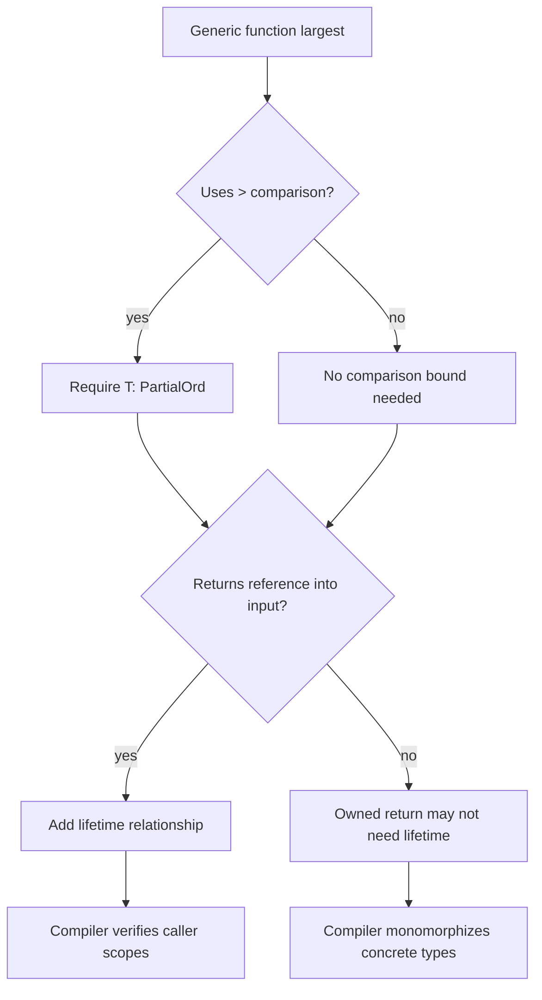

# Generics, Traits, and Lifetimes

Generics remove duplication across concrete types, traits state the behavior those types must provide, and lifetimes relate the validity of borrowed values. These mechanisms let libraries stay reusable without giving up static checks or forcing runtime dispatch.

## Generalize only the operations the function uses

A concrete largest-element function already reveals the required algorithm:

```rust
fn largest_i32(list: &[i32]) -> &i32 {
    let mut largest = &list[0];
    for item in list {
        if item > largest {
            largest = item;
        }
    }
    largest
}
```

Replacing `i32` with an unconstrained `T` fails at `>` because arbitrary types need not support ordering. The smallest sufficient bound is `PartialOrd`:

```rust
fn largest<T: PartialOrd>(list: &[T]) -> &T {
    let mut largest = &list[0];
    for item in list {
        if item > largest {
            largest = item;
        }
    }
    largest
}
```

The function works for integers and characters:

```rust
let numbers = vec![34, 50, 25, 100, 65];
assert_eq!(largest(&numbers), &100);

let chars = vec!['y', 'm', 'a', 'q'];
assert_eq!(largest(&chars), &'y');
```

It returns a borrowed item, so it neither moves values from the slice nor requires `T: Clone`. It does assume a nonempty slice; an API accepting empty input should return an `Option<&T>` or define another explicit policy.



Rust normally monomorphizes generic code: it generates code for the concrete types actually used, avoiding runtime type dispatch by default. The useful sequence is to write concrete code, observe real duplication, then introduce only the type parameters and bounds demanded by its operations.

## Traits turn capabilities into contracts

A trait names shared behavior:

```rust
trait Summary {
    fn summarize(&self) -> String;
}
```

An implementation supplies that behavior for a type:

```rust
struct Article {
    headline: String,
    author: String,
}

impl Summary for Article {
    fn summarize(&self) -> String {
        format!("{}, by {}", self.headline, self.author)
    }
}
```

Function bounds then state exactly what callers must provide. These two signatures express the same simple constraint:

```rust
fn notify(item: &impl Summary) { }
fn notify_generic<T: Summary>(item: &T) { }
```

With several parameters, a `where` clause is often easier to scan:

```rust
use std::fmt::Display;

fn print_pair<T, U>(label: T, item: U)
where
    T: Display,
    U: Summary,
{
    println!("{label}: {}", item.summarize());
}
```

Traits may also provide default methods in terms of a smaller required core. That lets implementations supply the essential behavior while callers receive a richer interface, but the defaults become part of the contract that later API changes must respect.

The orphan rule prevents conflicting global implementations: an `impl` is allowed only when either the trait or the target type is local to the current crate. A crate cannot implement someone else's trait for someone else's type merely because the combination would be convenient.

## Lifetimes describe a relationship, not a duration extension

A lifetime annotation never keeps a value alive. It states how the validity of references is related so the borrow checker can reject a possible dangling reference.

```rust
fn longest<'a>(x: &'a str, y: &'a str) -> &'a str {
    if x.len() > y.len() {
        x
    } else {
        y
    }
}
```

The result may be either `x` or `y`, so it can be used only within the lifetime supported by both inputs—the shorter overlapping validity at the call site. The inputs do not need identical lexical scopes.

```rust
let s1 = String::from("abcd");
let s2 = "xyz";
let result = longest(s1.as_str(), s2);
println!("{result}");
```

Both inputs remain valid at the use of `result`. The following shape is rejected:

```rust
let result;
{
    let s2 = String::from("xyz");
    result = longest("abcd", s2.as_str());
}
println!("{result}");
```

If `longest` chose `s2`, `result` would refer to a dropped `String`. Binding the output to the shared lifetime lets the compiler reject that possible path.

## When lifetime syntax disappears

References always have lifetimes, but common relationships are inferred through elision rules. Each input reference begins with its own inferred parameter; if there is exactly one input reference, its lifetime is assigned to output references; and methods commonly tie output references to `&self` or `&mut self`.

Explicit syntax is needed only when those rules cannot determine the intended relationship. Owned values such as `String` need no lifetime annotation unless they contain references themselves.

## Static generics or runtime trait objects

Generic bounds are a good default when each call uses a concrete type known to the compiler. Trait objects are useful when one collection or interface must hold values of different concrete types behind shared behavior. Choosing a trait object solely to avoid writing a generic bound adds indirection without adding useful heterogeneity; forcing generics onto a genuinely mixed runtime collection does the opposite.

Everyday enums use the same abstraction system. `Option<T>` and `Result<T, E>` are ordinary generic enums, and domain code can define its own when those standard shapes do not capture the required states.

| Feature | What it expresses | Example | Checked by |
|---|---|---|---|
| Generic type | one algorithm over several types | `Vec<T>` | Type checker |
| Trait | shared behavior | `Display`, `Iterator` | Trait solver |
| Trait bound | required capability | `T: Clone` | Type checker |
| Lifetime | validity relationship between references | `&'a str` | Borrow checker |
| `where` clause | readable complex bounds | `where T: Display + Clone` | Type checker |
| Monomorphization | concrete code for static generic uses | instantiations for `i32` and `String` | Compiler backend |

## A trait-bound example in full

```rust
use std::fmt::Display;

trait Summary {
    fn summarize(&self) -> String;
}

struct NewsArticle {
    headline: String,
    author: String,
}

impl Summary for NewsArticle {
    fn summarize(&self) -> String {
        format!("{}, by {}", self.headline, self.author)
    }
}

fn print_pair<T, U>(label: T, item: U)
where
    T: Display,
    U: Summary,
{
    println!("{label}: {}", item.summarize());
}

fn main() {
    let article = NewsArticle {
        headline: String::from("Rust reaches stable build"),
        author: String::from("The team"),
    };

    print_pair("headline", article);
}
```

The signature lists only the capabilities the body uses: printable `label` and summarizable `item`. Borrowing should be preferred over adding `Clone` merely to work around an ownership error, and a missing operation belongs in the bound rather than as an unexplained compiler fight.

## Worked example: largest without assuming nonempty input

The first `largest` function indexes element zero, so an empty slice panics. Returning `Option<&T>` states the missing case and still avoids cloning:

```rust
fn largest<T: PartialOrd>(items: &[T]) -> Option<&T> {
    let mut iter = items.iter();
    let mut largest = iter.next()?;
    for item in iter {
        if item > largest { largest = item; }
    }
    Some(largest)
}

assert_eq!(largest(&[4, 9, 2]), Some(&9));
assert_eq!(largest::<i32>(&[]), None);
```

For `[4, 9, 2]`, `iter.next()` yields a reference to `4`. The loop compares `9` with `4` and updates `largest` to the reference to `9`. It then compares `2` with `9` and leaves the binding unchanged. `Some(largest)` returns a reference into the original slice. For an empty slice, `next()` returns `None`; the `?` returns `None` before the loop.

Written explicitly, the signature is `fn largest<'a, T: PartialOrd>(items: &'a [T]) -> Option<&'a T>`. Elision removes syntax, not the relationship. No `Copy` or `Clone` bound appears because the implementation never creates an owned `T`.

`PartialOrd` admits types with incomplete ordering. Floating-point values are the important example: comparisons involving `NaN` are false, so this algorithm may keep a value a caller does not expect. Requiring `Ord` gives a total order but excludes primitive floating-point types. The semantic promise determines the bound.

## Associated types and generic trait parameters

Traits can describe relationships among types as well as methods. `Iterator` uses an associated type:

```rust
trait Iterator {
    type Item;
    fn next(&mut self) -> Option<Self::Item>;
}
```

An implementation chooses one `Item`. A function can relate its argument to the yielded value:

```rust
fn total<I>(values: I) -> i64
where
    I: IntoIterator<Item = i32>,
{
    values.into_iter().map(i64::from).sum()
}

assert_eq!(total([10, 20, 30]), 60);
```

`IntoIterator<Item = i32>` says more than “can be iterated”: every element must be an `i32`. The array becomes an iterator, `map` widens each value to `i64`, and `sum` consumes it. A generic trait parameter serves a different purpose. A type may implement `From<T>` for several source types because `T` is part of the trait identity. Associated types fit when one implementation should make one canonical choice.

## Static dispatch and `dyn Trait`

`fn render<T: Draw>(value: &T)` uses static dispatch. The compiler knows the concrete `T` at each call, checks its implementation, and normally monomorphizes the function. Different concrete values cannot occupy one `Vec<T>` unless an enum or another unifying type represents them.

`Box<dyn Draw>` uses a trait object. It permits a heterogeneous collection:

```rust
trait Draw { fn draw(&self) -> String; }

struct Button { label: String }
struct Spacer { width: usize }

impl Draw for Button {
    fn draw(&self) -> String { format!("[{}]", self.label) }
}
impl Draw for Spacer {
    fn draw(&self) -> String { " ".repeat(self.width) }
}

let row: Vec<Box<dyn Draw>> = vec![
    Box::new(Button { label: String::from("Save") }),
    Box::new(Spacer { width: 2 }),
];
```

The vector owns two concrete types behind one interface. Calling `draw` selects an implementation at runtime through indirection. Dyn compatibility restricts which traits can form trait objects: methods returning `Self` or having their own unconstrained type parameters generally cannot be called through `dyn Trait`. Static generics remain simpler when runtime heterogeneity is unnecessary.

## Worked example: a struct that borrows text

Lifetime parameters also appear on structs containing references. A parser can return a view into its input rather than allocate copies:

```rust
#[derive(Debug, PartialEq)]
struct Header<'a> {
    name: &'a str,
    value: &'a str,
}

fn parse_header<'a>(line: &'a str) -> Option<Header<'a>> {
    let (name, value) = line.split_once(':')?;
    Some(Header { name: name.trim(), value: value.trim() })
}

let line = String::from("Content-Type: text/plain");
let header = parse_header(&line).unwrap();
assert_eq!(header.name, "Content-Type");
assert_eq!(header.value, "text/plain");
```

`split_once` finds the colon and returns two slices of `line`. `trim` may shorten them but they still point into the same allocation. The returned `Header<'a>` cannot outlive `line` because both fields carry its lifetime. Dropping `line` while using `header` later is rejected. The annotation records the dependency; it does not extend the allocation.

Methods on `Header<'a>` often need no extra syntax. In `fn name(&self) -> &str`, method elision ties the output to the borrow of `self`. Returning `&'a str` instead states that the result may remain valid for the lifetime of the underlying input, beyond the shorter method-call borrow.

## Reading bounds as API promises

Compiler suggestions can make code compile while weakening its design. Adding `T: Clone` because a value moved may duplicate expensive data and conceal that borrowing was intended. Adding `'static` does not mean “valid for this function”; for a reference it requires a referent that can live for the entire program. `T: 'a` means that references stored inside `T` outlive `'a`.

Use the weakest contract that matches the promised semantics, but do not choose a weak bound when the algorithm assumes more. A sorting API that depends on a total order should say `Ord`; one accepting a caller-supplied comparator can support other ordering rules. The body, edge cases, and signature should agree.

Blanket implementations also affect what can be added later. An implementation such as `impl<T: Display> Summary for T` covers every present and future `Display` type, preventing a more specific `Summary` implementation for those types in the same coherence domain. Broad impls are powerful, but they consume design space.

## Default methods, supertraits, and conditional implementations

A trait may supply behavior in terms of a smaller required method. The required part is the contract implementors must write; the default part is shared policy they may override.

```rust
trait Named {
    fn name(&self) -> &str;

    fn greeting(&self) -> String {
        format!("Hello, {}", self.name())
    }
}
```

An implementor that defines `name` receives `greeting` automatically. The default can call other methods on the same trait, but it cannot access fields because the trait does not know the implementing type's representation. Changing a widely used default later can alter behavior even without breaking compilation, so a default method is part of the API contract.

A supertrait states that one capability depends on another. `trait Outline: Display` means every `Outline` implementor must also implement `Display`, allowing outline methods to format `self`. This differs from repeating `T: Outline + Display` at each call site: the relationship belongs to the trait definition and applies everywhere.

Implementations can themselves be conditional:

```rust
struct Pair<T> { left: T, right: T }

impl<T> Pair<T> {
    fn new(left: T, right: T) -> Self { Self { left, right } }
}

impl<T: PartialOrd> Pair<T> {
    fn larger(&self) -> &T {
        if self.left >= self.right { &self.left } else { &self.right }
    }
}
```

Every `Pair<T>` has `new`; only pairs whose elements support comparison have `larger`. Placing the bound on the smaller `impl` block avoids burdening construction and unrelated methods. The same idea appears in blanket implementations, where a trait implementation becomes available for every type satisfying stated bounds.

## Lifetime annotations describe possible outputs

The borrow checker checks the signature without inspecting each caller's intent. A function returning one of two input references needs a relationship broad enough for either branch. If it always returns the first input, tying the result only to that input is more accurate:

```rust
fn first<'a, 'b>(x: &'a str, _y: &'b str) -> &'a str { x }
```

Now the second argument may be short-lived because the output cannot refer to it. Conversely, no lifetime annotation can make `fn bad() -> &str` return a reference to a local `String`; the owner is dropped on return. Return an owned `String`, move ownership into a longer-lived structure, or borrow from an input.

The special `'static` lifetime is common on string literals because their bytes are stored in the program image. An owned type such as `String` also satisfies many `'static` bounds when it contains no borrowed data; that bound says the value could be kept indefinitely, not that the value itself is allocated forever.

When a lifetime error seems opaque, first write down which owner supplies each reference and which returned value may point to which input. The needed annotation usually follows from that map.

<div className="see-also">

See also: [Ownership, references, and slices](/cs/programming/rust/ownership-references-slices) · [Structs, methods, and enums](/cs/programming/rust/structs-methods-enums) · [Error handling](/cs/programming/rust/error-handling) · [Closures and iterators](/cs/programming/rust/closures-and-iterators) · [Smart pointers](/cs/programming/rust/smart-pointers) · [Object-oriented and advanced features](/cs/programming/rust/object-oriented-and-advanced-features)

</div>
