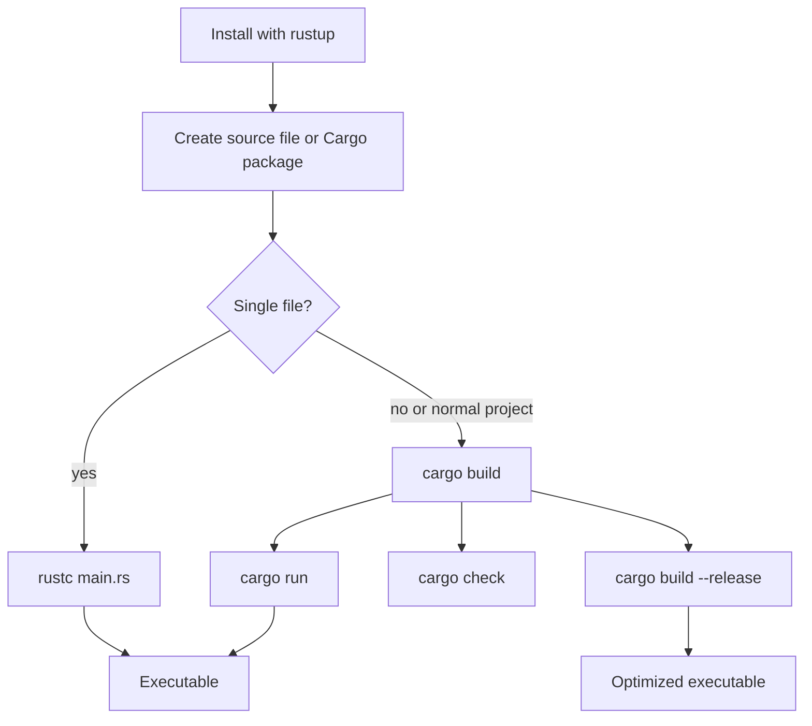

# Getting Started, Toolchain, and Cargo

The compiler `rustc` turns Rust source into machine code; Cargo supplies the repeatable project workflow around it. Learning the raw one-file loop first clarifies what Cargo later automates: target selection, dependency resolution, profiles, package metadata, and artifact placement.

## What `rustup` installs

`rustup` is the recommended Rust installer and toolchain manager. A normal installation includes `rustc`, Cargo, the standard library, and local documentation. The book targets the stable toolchain so examples continue to compile on later stable releases even when diagnostics evolve.

Useful checks after installation are:

```powershell
rustc --version
cargo --version
```

If either command is not recognized in a fresh shell, the installation or `PATH` setup is incomplete. `rustup doc` opens the installed Rust documentation, which is often the fastest reference for standard-library signatures, trait bounds, return types, and examples.

## The one-file compile-and-run loop

A binary crate needs a `main` entry point:

```rust
fn main() {
    println!("Hello, world!");
}
```

`fn` introduces the function, the empty parentheses mean no parameters, and the braces contain its body. `println!` is a macro rather than an ordinary function; the exclamation mark belongs to the macro invocation syntax.

On Windows, compile and run it directly with:

```powershell
rustc main.rs
.\main.exe
```

The expected output is:

```text
Hello, world!
```

Unix-like shells usually run the generated binary as `./main`. Direct `rustc` use is useful for tiny experiments, but it does not manage dependencies, profiles, package metadata, or a multi-file layout.

## From a source file to a Cargo package

Create the conventional project structure with:

```powershell
cargo new hello_cargo
cd hello_cargo
```

Cargo produces:

```text
hello_cargo/
  Cargo.toml
  src/
    main.rs
```

`Cargo.toml` is the manifest containing the package name, version, Rust edition, and dependencies. `src/main.rs` is the default root of a binary crate; `src/lib.rs` is the default root of a library crate.

A crate is Rust's smallest compilation unit. A binary crate produces an executable, while a library crate exposes code for other crates. A package is the Cargo-managed bundle described by one manifest and may contain one or more crate targets.

When dependencies are present, Cargo resolves compatible versions and stores the selected graph in `Cargo.lock`. `cargo new` now defaults to tracking that file. Committing it is especially important for applications that need reproducible builds, and it can also stabilize library CI and MSRV checks.

## The edit loop Cargo provides

`cargo build` reads the manifest, invokes `rustc`, and writes a debug artifact under `target/debug`. `cargo run` builds only when necessary and then starts the program. `cargo check` performs type, name, trait, and borrow analysis without final code generation, so it is usually the quickest command during editing.



| Command | Main purpose | Output or effect | Typical moment |
|---|---|---|---|
| `rustc main.rs` | Compile one file directly | `main` or `main.exe` | Tiny experiments |
| `cargo new app` | Create a package | Manifest plus `src/main.rs` | Starting a project |
| `cargo build` | Compile debug binary | `target/debug/...` | Normal local build |
| `cargo run` | Build then execute | Program output | Quick iteration |
| `cargo check` | Type-check without final binary | Diagnostics only | Frequent edit loop |
| `cargo build --release` | Optimized build | `target/release/...` | Benchmarking or shipping |

Cargo owns the `target` directory; its contents are generated artifacts, not source to edit. `cargo build` stops after building, while `cargo run` adds execution.

## Debug and release are different intentions

The default development profile favors fast compilation and includes debug information. The release profile, selected with `cargo build --release`, enables optimization and writes under `target/release`.

```powershell
cargo build
cargo run
cargo check
cargo build --release
```

Benchmarking `target/debug` does not characterize optimized Rust performance. The slower release compilation is paid when runtime performance matters; the development profile remains better for ordinary edit-check cycles.

## A first program with command-line input

```rust
use std::env;

fn greeting(name: &str) -> String {
    format!("Hello, {name}!")
}

fn main() {
    let name = env::args()
        .nth(1)
        .unwrap_or_else(|| String::from("world"));

    println!("{}", greeting(&name));
}
```

Run it with:

```powershell
cargo run -- Ada
```

The `--` separates Cargo's options from the program's arguments. Without a supplied name the program prints `Hello, world!`; with `Ada` it prints `Hello, Ada!`. The example introduces a standard-library module, a helper function, an owned `String`, a borrowed `&str`, and formatting macros inside the normal Cargo loop.

## Treat diagnostics as part of the workflow

Rust reports type mismatches, unused results, missing imports, and invalid borrows before producing an executable. Read the diagnostic literally: it usually names the relevant type, trait, lifetime, or candidate method. `cargo check` gives a stable, quick way to reproduce that feedback.

For unfamiliar APIs, `cargo doc --open` builds documentation for the current package and its dependencies. Inspecting a method's signature and return type is more reliable than memorizing every standard-library operation.

## Toolchains, targets, and components

A Rust toolchain is a matched set of compiler, standard library, and tools for a release channel. `rustup show` reports the installed toolchains and active default. Stable is the normal choice for learning and production work. Beta previews the next stable release, while nightly carries experiments that may require feature gates and may change.

The active toolchain can come from a global default, a directory override, or a `rust-toolchain.toml` file checked into a project. Pinning a channel in a project file helps contributors use the same compiler family without asking them to change every other project. An exact version gives stronger repeatability but also requires deliberate updates for security fixes and language improvements.

Compilation targets describe the platform for generated code. The host target matches the machine running the compiler. Cross-compiling starts by installing another standard library with `rustup target add`, but that alone may not supply a suitable linker or system libraries. Rust can compile source for the target only when the rest of the native toolchain is available.

Optional components include `rustfmt` for formatting and Clippy for additional lints. Their common Cargo front ends are:

```powershell
cargo fmt --check
cargo clippy --all-targets
cargo test
```

Formatting settles layout mechanically. Clippy reports suspicious or non-idiomatic constructs, and tests exercise behavior. A lint is still a diagnostic with context, not a command to accept every suggested rewrite blindly.

## Worked example: reading a manifest before building

A small package manifest might be:

```toml
[package]
name = "greeter"
version = "0.1.0"
edition = "2024"

[dependencies]
```

The package name identifies the Cargo package and normally determines the default binary name. The version follows semantic-version notation used by the ecosystem. The edition selects a coherent set of language compatibility rules; it does not select a compiler release or fragment the package ecosystem. Crates from different editions can depend on one another.

With `src/main.rs` present, `cargo check` proceeds in a definite order. Cargo reads the manifest, selects the default binary target, resolves the dependency graph, and invokes `rustc` with the edition and target metadata. With no dependencies, resolution is nearly empty. Rust then parses the crate root, resolves names, checks types and borrows, and writes intermediate metadata under `target`. It omits the final linking work that `cargo build` performs.

Add a library root at `src/lib.rs` and the same package now has a library target as well as its binary. Code in `main.rs` can import the library by the crate name, written with underscores if the package name contains hyphens. Keeping reusable behavior in the library makes it directly testable; the binary can remain responsible for arguments, output, and exit status.

Additional conventional targets include files under `src/bin/` for more binaries, examples under `examples/`, integration tests under `tests/`, and benchmarks under `benches/`. Cargo discovers these according to target conventions or explicit manifest entries. A package is therefore a build container, while each target becomes a crate compiled from its own root.

## Worked example: trace an edit through Cargo's cache

Take the greeting program and run:

```powershell
cargo check
cargo run -- Ada
cargo run -- Grace
```

The first command checks the crate and records build fingerprints. The first `cargo run` sees that the sources and relevant settings have not changed, reuses valid intermediate work, performs any remaining code generation and linking, then launches the binary with `Ada`. The `--` is consumed by Cargo as a separator; only `Ada` reaches `env::args` as the second process argument. `nth(1)` returns it, `greeting` borrows its text, and the program prints `Hello, Ada!`.

The second run changes only a runtime argument. Source, features, compiler flags, and dependency inputs are unchanged, so Cargo does not need to rebuild the executable. It launches the same artifact with `Grace`. Editing `src/main.rs`, changing a dependency feature, switching profiles, or selecting another target invalidates the relevant cached work.

Incremental reuse is an optimization, not a source of truth. If generated artifacts appear inconsistent after unusual toolchain or environment changes, `cargo clean` removes the package's `target` directory so the next build starts fresh. Cleaning should be diagnostic rather than habitual; it discards useful cached work and rarely fixes a source error.

## Dependency resolution and the lockfile

Dependency declarations express acceptable versions and optional features. Cargo resolves one concrete graph and records it in `Cargo.lock`. Subsequent builds use those selected versions while they remain compatible with the manifest. `cargo update` asks Cargo to reconsider versions within the declared constraints; it is different from editing a manifest to permit a new incompatible range.

Applications normally commit the lockfile because deployment should build the versions that were tested. Library packages also generate lockfiles locally, but published library consumers resolve the library inside their own larger graph. Keeping a library lockfile in version control can still make its own CI and examples repeatable. The key distinction is that a lockfile records a resolution; it does not override a downstream package's dependency policy when the library is consumed.

Cargo downloads registry sources into a shared cache and keeps build artifacts in `target`. Deleting `target` does not remove downloaded source archives. Conversely, copying an executable out of `target` does not copy dynamic system dependencies it may rely on.

## Profiles change compilation policy

The development and release profiles are named configurations, not different languages. Development builds favor compile speed and useful debugging. Release builds enable stronger optimization by default and usually disable overflow checks for ordinary integer arithmetic, while debug builds normally check overflow and panic when it occurs. Code must not depend on either overflow behavior; use checked, wrapping, saturating, or overflowing arithmetic when the policy matters.

Profile settings can be customized in `Cargo.toml`, but changing them without a measured need makes builds harder to compare. Benchmark only optimized artifacts, keep the workload and inputs fixed, and record the toolchain and target. A faster debug build or a single noisy timing says little about shipped performance.

## A short diagnostic routine

When a new project does not build, first establish which layer failed. If `cargo --version` is unavailable, repair installation or shell `PATH`. If Cargo cannot parse `Cargo.toml`, fix the named manifest line. Dependency-resolution errors concern versions, features, registries, or network access. Compiler errors concern the selected crate's Rust source. Linker errors occur after Rust compilation and often point to a missing native toolchain or library.

Run the narrowest command that reproduces the problem. `cargo check` is enough for most language errors; `cargo test` is needed for test-only code; `cargo build --release` is needed for profile-specific behavior. Copying the first meaningful diagnostic, including its source span and notes, preserves more information than reporting only that Cargo failed.

<div className="see-also">

See also: [Guessing game first project](/cs/programming/rust/guessing-game-first-project) · [Common programming concepts](/cs/programming/rust/common-programming-concepts) · [Packages, crates, and modules](/cs/programming/rust/packages-crates-modules) · [Cargo and crates.io workflow](/cs/programming/rust/cargo-crates-io-workflow) · [Automated tests](/cs/programming/rust/automated-tests)

</div>
