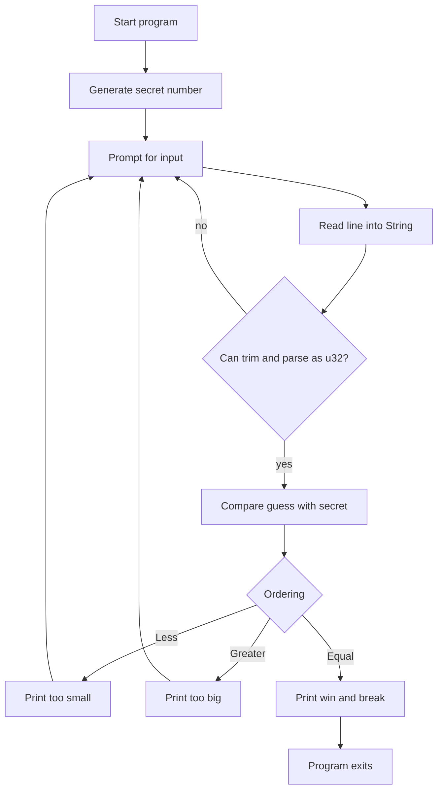

# Guessing Game First Project

The guessing game earns its place as a first project by concentrating several Rust habits in one short loop: mutable input buffers, references, external crates, fallible operations, pattern matching, shadowing, and compiler-guided refinement. The game itself is incidental; the value lies in watching these features cooperate before studying each one separately.

## The whole control loop first

The program chooses an integer from 1 through 100, reads guesses until one parses successfully, compares each number with the secret, and exits on equality.



| Concept met early | Concrete use in the game | Later home chapter |
|---|---|---|
| Mutable binding | `let mut guess = String::new()` | Variables and mutability |
| Reference | `&mut guess` | Ownership and borrowing |
| External crate | `rand` in `Cargo.toml` | Cargo and crates.io |
| Enum | `Result`, `Ordering` | Enums and pattern matching |
| Pattern matching | `match guess.cmp(...)` | Patterns and matching |
| Loop control | `loop`, `continue`, `break` | Control flow |

The first version need not introduce every recovery path at once. Compile after each change, read the diagnostic, and refine the program while the source is still small.

## Adding the random-number dependency

The book's version uses the external `rand` crate. Add the matching release to `Cargo.toml`:

```toml
[dependencies]
rand = "0.10.1"
```

Cargo may compile several transitive crates because `rand` has dependencies of its own. It records the exact selected graph in `Cargo.lock`, so later builds of the checkout reuse those versions.

The current book imports `rand`'s prelude so the random-range extension trait is in scope:

```rust
use rand::prelude::*;

let secret_number = rand::rng().random_range(1..=100);
```

Without the prelude import, `random_range` is unavailable even though the generator value exists.

## Reading into a caller-owned buffer

Terminal input arrives as text of unknown length, so the program allocates an empty growable string:

```rust
let mut guess = String::new();
```

`read_line` appends into that buffer and therefore receives a mutable reference:

```rust
io::stdin()
    .read_line(&mut guess)
    .expect("Failed to read line");
```

After the user types `42`, the string usually contains `"42\n"` on Unix-like systems or `"42\r\n"` on Windows. `trim()` returns the borrowed slice `"42"`; it does not rewrite the original `String`.

`read_line` returns `Result` because input may fail. The early version uses `expect` to stop with context. That still acknowledges failure instead of silently discarding the result.

## Turning text into a checked number

Parsing requires a target type. Shadowing lets the name `guess` follow the value from raw text to the integer the game actually compares:

```rust
let guess: u32 = guess.trim().parse().expect("Please type a number!");
```

The annotation tells `parse` to produce `u32`. This `let` creates a new binding; it does not mutate the earlier `String` into another type. For an input of `42`, the new binding contains the integer `42`.

The final version treats malformed guesses as routine input rather than a reason to terminate:

```rust
let guess: u32 = match guess.trim().parse() {
    Ok(num) => num,
    Err(_) => continue,
};
```

On `Ok(num)`, the `match` expression yields the number for the assignment. On an input such as `hello`, `parse::<u32>()` returns `Err`; the wildcard deliberately ignores the detailed parse error and `continue` starts the next loop iteration. No comparison runs and no artificial numeric value is invented.

## Comparing with `Ordering`

`cmp` compares compatible values and returns one of the `Ordering` variants:

```rust
match guess.cmp(&secret_number) {
    Ordering::Less => println!("Too small!"),
    Ordering::Greater => println!("Too big!"),
    Ordering::Equal => {
        println!("You win!");
        break;
    }
}
```

`break` is part of the equality arm because a correct guess terminates the surrounding `loop`. Omitting it would print the win message and prompt again.

An attempted comparison between the original `String` and the numeric secret produces a useful type error. Rust will not guess a text-to-number conversion; the explicit parse establishes what invalid input means and which integer type is expected.

## The complete game

```rust
use rand::prelude::*;
use std::cmp::Ordering;
use std::io;

fn main() {
    println!("Guess the number!");

    let secret_number = rand::rng().random_range(1..=100);

    loop {
        println!("Please input your guess.");

        let mut guess = String::new();

        io::stdin()
            .read_line(&mut guess)
            .expect("Failed to read line");

        let guess: u32 = match guess.trim().parse() {
            Ok(num) => num,
            Err(_) => continue,
        };

        println!("You guessed: {guess}");

        match guess.cmp(&secret_number) {
            Ordering::Less => println!("Too small!"),
            Ordering::Greater => println!("Too big!"),
            Ordering::Equal => {
                println!("You win!");
                break;
            }
        }
    }
}
```

The program intentionally recovers from invalid numeric input but still treats a failed terminal read as fatal. That is a policy choice made at each `Result`, not a universal rule for all failures.

## Compiler messages worth keeping

The unused-`Result` warning from `read_line` means the returned value carries failure information. The mismatched-type error on a raw string comparison identifies the absent conversion. A missing `rand` prelude import points to the trait providing `random_range`. These messages describe type and API boundaries rather than cosmetic style.

Remove any debug print of `secret_number` once the loop works. Keep `&mut guess` on `read_line`, handle parse failure according to the desired user experience, and remember that the numeric `guess` is a shadowing binding rather than an in-place conversion.

## Trace two loop iterations by hand

Take a fixed secret of `73` while reasoning about the control flow. Suppose the first terminal line is `hello` followed by Enter.

1. `String::new()` creates an empty, owned buffer for this iteration.
2. `read_line(&mut guess)` appends the bytes for `hello` and the platform line ending. Its successful `Ok` value contains the number of bytes read, which this program does not need.
3. `guess.trim()` returns the slice `"hello"`. The original allocation still contains the line ending.
4. Type inference knows the target is `u32`, so `parse` attempts an unsigned decimal integer and returns `Err`.
5. The error arm executes `continue`. Control jumps to the top of `loop`; the print and comparison below the match do not run.
6. The old input `String` goes out of scope at the end of that iteration and its allocation is released.

Now enter `80`.

1. A fresh buffer receives `"80\n"`, and `trim` exposes `"80"`.
2. Parsing returns `Ok(80)`. The match expression itself therefore has the value `80`, which initializes the new numeric `guess` binding.
3. `guess.cmp(&secret_number)` compares `80` with `73`. It returns `Ordering::Greater`.
4. The corresponding arm prints `Too big!`. It does not break, so execution reaches the end of the loop body and begins another iteration.

If the next line is `73`, parsing succeeds and `cmp` yields `Equal`. The equality arm prints the win message and `break` transfers control to the first statement after the loop. There is none, so `main` returns and the process exits successfully.

The secret range `1..=100` includes both endpoints. Writing `1..100` would use an end-exclusive range and never generate `100`. The generator chooses one value before the loop; moving generation into the loop would change the target after every guess.

## Separate game rules from terminal I/O

The complete first version puts everything in `main`, which is useful while learning the syntax. The comparison rule becomes easier to test when expressed as a function that has no terminal or random-number dependency:

```rust
use std::cmp::Ordering;

#[derive(Debug, PartialEq)]
enum Hint {
    TooSmall,
    TooBig,
    Correct,
}

fn classify(guess: u32, secret: u32) -> Hint {
    match guess.cmp(&secret) {
        Ordering::Less => Hint::TooSmall,
        Ordering::Greater => Hint::TooBig,
        Ordering::Equal => Hint::Correct,
    }
}

assert_eq!(classify(40, 73), Hint::TooSmall);
assert_eq!(classify(80, 73), Hint::TooBig);
assert_eq!(classify(73, 73), Hint::Correct);
```

For `classify(40, 73)`, `cmp` returns `Less`, the first arm produces `Hint::TooSmall`, and that enum value becomes the function result. There are no side effects and no hidden global secret. The three assertions cover each possible `Ordering` variant, and the compiler checks that the match remains exhaustive.

The I/O loop can map each `Hint` to user-facing text. That division prevents tests from needing to fake standard input and keeps wording changes out of the game rule. It also exposes an important boundary: parsing determines whether text is a number, while `classify` determines how a valid number relates to the secret.

## Validate the range as its own invariant

Parsing `500` as `u32` succeeds even though it lies outside the advertised game. The simplest loop can print a message and continue:

```rust
let guess: u32 = match guess.trim().parse() {
    Ok(number @ 1..=100) => number,
    Ok(_) => {
        println!("Enter a number from 1 through 100.");
        continue;
    }
    Err(_) => {
        println!("Enter a whole number.");
        continue;
    }
};
```

The first pattern both checks the inclusive range and binds the accepted number. The second arm distinguishes a valid integer outside the rules from text that cannot be parsed. For input `101`, parsing returns `Ok(101)`, the range pattern fails, and `Ok(_)` prints the range message. For `-2`, parsing as `u32` fails because unsigned integers cannot represent a negative value, so the final arm runs.

A larger program could introduce a `Guess` type whose constructor enforces the range. Private fields would prevent later code from constructing an invalid value directly. For this short project, the local check is enough; the type becomes valuable when validated guesses cross function or module boundaries.

## What Cargo contributes to the exercise

The dependency line `rand = "0.10.1"` is a compatible-version requirement, not a demand for only one exact patch. Cargo resolves a compatible version, downloads its transitive dependencies, and records the selected graph in `Cargo.lock`. The code imports the extension trait through `rand::prelude::*`; methods supplied by traits are available only when the trait is in scope.

After dependencies compile once, editing `src/main.rs` normally rebuilds only the local crate. `cargo check` is enough while resolving type errors. `cargo run` is needed when exercising terminal behavior. Random output makes exact end-to-end tests awkward, another reason to keep deterministic rules such as `classify` separate.

Randomness here is for a game, not a security decision. The code relies on the crate's thread-local generator and range method according to their documented contract. Security tokens, cryptographic keys, or unbiased sampling under specialized constraints require an API selected for that purpose rather than copying the tutorial pattern without review.

## Small changes that alter behavior

- Reusing one `String` outside the loop requires `guess.clear()` before each `read_line`; otherwise new input is appended to old input.
- Replacing `continue` with a numeric fallback silently turns malformed text into a real guess and gives the user misleading feedback.
- Matching `Ordering::Equal` without `break` reports a win but keeps the game alive.
- Generating the secret inside the loop produces a moving target.
- Omitting `trim` leaves line-ending whitespace for the integer parser, which then rejects otherwise valid input.
- Printing the secret is useful for the earliest manual check but invalidates the finished game.

## End-of-input is different from an empty guess

`read_line` returns `Ok(0)` when it reaches end-of-file before reading bytes. An interactive terminal can produce this when the user signals EOF; redirected input reaches it when the file is exhausted. The tutorial ignores the byte count, so EOF produces an empty string, parsing fails, and the loop immediately tries again. With redirected input that can become a busy infinite loop.

A more complete reader checks the count:

```rust
let bytes = io::stdin()
    .read_line(&mut guess)
    .expect("Failed to read line");

if bytes == 0 {
    println!("Input closed.");
    break;
}
```

An actual blank line has at least a line-ending byte and therefore differs from EOF, even though both become empty after `trim`. The byte count preserves that distinction.

Prompts are often written with `print!` instead of `println!` so the cursor remains on the same line. Standard output may be buffered, however, and a prompt without a newline can remain unseen while the program waits for input. Calling `io::stdout().flush()` after `print!` forces it out and returns another `Result` that must be handled. The line-oriented `println!` version avoids that extra concern in a first project.

For a long-running input loop, locking standard input once can avoid repeated locking overhead. That refinement changes little here; random generation, terminal latency, and human response dominate. The clear ownership story is more valuable: the loop owns each buffer, `read_line` borrows it mutably, and parsing borrows a trimmed view only until the numeric value is produced.

Each refinement keeps invalid states out of the comparison step and preserves clear feedback.

<div className="see-also">

See also: [Getting started, toolchain, and Cargo](/cs/programming/rust/getting-started-toolchain-cargo) · [Common programming concepts](/cs/programming/rust/common-programming-concepts) · [Ownership, references, and slices](/cs/programming/rust/ownership-references-slices) · [Pattern matching](/cs/programming/rust/pattern-matching) · [Error handling](/cs/programming/rust/error-handling) · [Cargo and crates.io workflow](/cs/programming/rust/cargo-crates-io-workflow)

</div>
