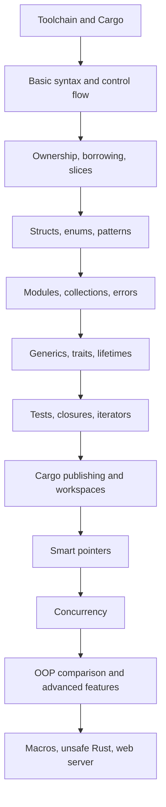

# Rust

Rust is a systems programming language built around memory safety, predictable performance, and integrated tooling. The source is Steve Klabnik and Carol Nichols's *The Rust Programming Language*, with contributions from the Rust community. The PDF assumes Rust 1.65 or later, so the chapter sequence follows that edition and does not add unrelated ecosystem material.

The route begins with the toolchain and a first project, moves through ownership and the type system, then builds toward tests, iterators, Cargo publishing, smart pointers, concurrency, advanced features, unsafe Rust, macros, and a multithreaded web server. Async/await has no detail chapter because this edition does not develop it as a main chapter.

## Safety begins with ownership

Rust source is compiled and checked before execution. The compiler enforces types, ownership, borrowing, and lifetime relationships. In ordinary safe Rust, those checks rule out dangling references, double frees, use-after-free, and data races in safe concurrent code. Logic errors remain possible and still require design, tests, and review.

Every value has an owner, only one owner at a time, and is dropped when that owner leaves scope. Moving a `String` transfers ownership; cloning requests an explicit copy; borrowing through `&str` gives read access without transfer. Lifetimes let the compiler establish that a reference cannot outlive the value it points to.

The same accounting extends into collections and concurrency. A vector owns its elements. A hash map owns inserted keys and values unless it deliberately stores references. Values moved into threads or closures are no longer available through the old binding. Resource management remains local enough to trace from the types and expressions.

Rust's abstractions retain that cost model. Generics are commonly monomorphized, iterators are lazy and often optimize into loops, and traits support static dispatch through bounds or dynamic dispatch through trait objects. High-level composition does not require a garbage collector or runtime reflection system.

Errors also travel through explicit channels. `panic!` reports unrecoverable bugs or broken invariants. `Result<T, E>` represents recoverable failure, and `?` propagates it without obscuring the straight-line path. Tests may use either panics or returned results to report failure.

## The toolchain and units of code

The usual toolchain includes `rustup`, `rustc`, Cargo, the standard library, local documentation, formatting and analysis tools, and access to crates.io. `rustc` is the compiler. Cargo manages packages and dependencies, builds code, runs tests, generates documentation, and publishes crates.

Rust code is organized into packages, crates, modules, and items. A package is a Cargo-managed unit with a manifest; a crate is a compilation unit; a module is a namespace and privacy boundary inside a crate. Cargo is therefore part of the normal programming model rather than a convenience reserved for large projects.

## Twenty chapters, from Cargo to a server

The source has 20 main chapters: Getting Started; Programming a Guessing Game; Common Programming Concepts; Understanding Ownership; Structs; Enums and Pattern Matching; Packages, Crates, and Modules; Common Collections; Error Handling; Generics, Traits, and Lifetimes; Automated Tests; the `minigrep` I/O project; Closures and Iterators; Cargo and crates.io; Smart Pointers; Fearless Concurrency; Object-Oriented Programming Features; Patterns and Matching; Advanced Features; and the Multithreaded Web Server.

Their conceptual dependency runs as follows:



| Source chapter area | Notes page |
|---|---|
| Chapter 1: install, hello world, Cargo | [Getting Started, Toolchain, and Cargo](/cs/programming/rust/getting-started-toolchain-cargo) |
| Chapter 2: guessing game | [Guessing Game First Project](/cs/programming/rust/guessing-game-first-project) |
| Chapter 3: variables, types, functions, control flow | [Common Programming Concepts](/cs/programming/rust/common-programming-concepts) |
| Chapter 4: ownership, references, slices | [Ownership, References, and Slices](/cs/programming/rust/ownership-references-slices) |
| Chapters 5-6 and 18: structs, enums, patterns | [Structs, Methods, and Enums](/cs/programming/rust/structs-methods-enums), [Pattern Matching](/cs/programming/rust/pattern-matching) |
| Chapters 7-9: modules, collections, errors | [Packages, Crates, and Modules](/cs/programming/rust/packages-crates-modules), [Common Collections](/cs/programming/rust/common-collections), [Error Handling](/cs/programming/rust/error-handling) |
| Chapters 10-14: abstraction, tests, projects, Cargo | [Generics, Traits, and Lifetimes](/cs/programming/rust/generics-traits-lifetimes), [Automated Tests](/cs/programming/rust/automated-tests), [I/O Project with Minigrep](/cs/programming/rust/io-project-minigrep), [Closures and Iterators](/cs/programming/rust/closures-and-iterators), [Cargo and Crates.io Workflow](/cs/programming/rust/cargo-crates-io-workflow) |
| Chapters 15-20: pointers, concurrency, advanced topics, server | [Smart Pointers](/cs/programming/rust/smart-pointers), [Concurrency and Shared State](/cs/programming/rust/concurrency-and-shared-state), [Object-Oriented and Advanced Features](/cs/programming/rust/object-oriented-and-advanced-features), [Macros and Unsafe Rust](/cs/programming/rust/macros-and-unsafe-rust), [Multithreaded Web Server](/cs/programming/rust/multithreaded-web-server) |

The order is structural. Collections and error APIs rely on moves, borrows, and explicit failure, so syntax and ownership come first. Iterators, smart pointers, and concurrency use trait bounds and reference validity, so traits and lifetimes precede them. By the final project, values can move into closures, jobs can cross thread boundaries, and cleanup can be expressed through ownership.

The three project chapters reinforce rather than interrupt that progression. The guessing game previews variables, references, `Result`, `match`, and Cargo dependencies. `minigrep` separates `main`, configuration, I/O, search logic, and tests. The web server combines TCP, HTTP, closures, threads, channels, mutexes, and graceful shutdown.

## An early route for experienced programmers

A programmer who knows another language but not ownership can take a short first pass:

1. Start with [Getting Started, Toolchain, and Cargo](/cs/programming/rust/getting-started-toolchain-cargo) to distinguish `rustc`, Cargo, debug and release builds, and `cargo check`.
2. Read [Guessing Game First Project](/cs/programming/rust/guessing-game-first-project) for `let mut`, `String`, `&mut`, `Result`, `match`, dependencies, and loop control in one working program.
3. Use [Common Programming Concepts](/cs/programming/rust/common-programming-concepts) to recalibrate familiar variables, functions, arrays, and loops against Rust's type rules.
4. Move immediately to [Ownership, References, and Slices](/cs/programming/rust/ownership-references-slices). Ownership explains most of the unfamiliar compiler diagnostics that follow.
5. Continue with [Structs, Methods, and Enums](/cs/programming/rust/structs-methods-enums) and [Pattern Matching](/cs/programming/rust/pattern-matching) to design types whose variants express valid states.

```text
toolchain -> guessing game -> common concepts -> ownership -> structs/enums -> patterns
```

This route supplies enough syntax to read examples before asking the reader to reason closely about moves, borrows, and lifetimes.

## Tracing a moved-value error

Suppose a CLI tool passes a value to a function and then tries to use the old binding. A “moved value” diagnostic means ownership transferred.

Start with [Ownership, References, and Slices](/cs/programming/rust/ownership-references-slices) for moves, clones, borrowing, and slices. If command-line parsing is involved, [I/O Project with Minigrep](/cs/programming/rust/io-project-minigrep) shows a `Config` that owns arguments while search functions borrow file contents. If a closure or iterator took the value, [Closures and Iterators](/cs/programming/rust/closures-and-iterators) distinguishes `iter`, `iter_mut`, and `into_iter` and explains closure capture.

The intended relationship determines the repair:

- Pass a reference when the callee only needs to read or temporarily mutate the same value.
- Clone when both sides genuinely need independent owned values and the copy cost is acceptable.
- Let the callee consume the value when the old binding has no further role.

The compiler message becomes easier to interpret by asking who owns the value now, who only needs access, and who must mutate or consume it.

## Boundaries and recurring mistakes

- Translating another language line by line tends to fight ownership. Data flow and ownership boundaries need to be designed together.
- Cargo remains the normal route for builds, tests, dependencies, and documentation after the first chapter.
- `Result` is a recoverable-failure contract, not ceremonial boilerplate.
- Reaching for `clone` on every move error hides ownership design and may introduce unnecessary allocation. Borrow when shared access expresses the relationship.
- Rust's object-oriented discussion concerns traits, composition, encapsulation, and trait objects; it does not introduce class inheritance.
- Unsafe Rust requires explicit local invariants and a safe interface around them. It should not be a routine response to borrow-checker friction.
- Async/await belongs outside this source-backed sequence unless a later source is added.

<div className="see-also">

See also: [Getting Started, Toolchain, and Cargo](/cs/programming/rust/getting-started-toolchain-cargo) · [Ownership, References, and Slices](/cs/programming/rust/ownership-references-slices) · [Generics, Traits, and Lifetimes](/cs/programming/rust/generics-traits-lifetimes) · [Concurrency and Shared State](/cs/programming/rust/concurrency-and-shared-state) · [Multithreaded Web Server](/cs/programming/rust/multithreaded-web-server)

</div>
