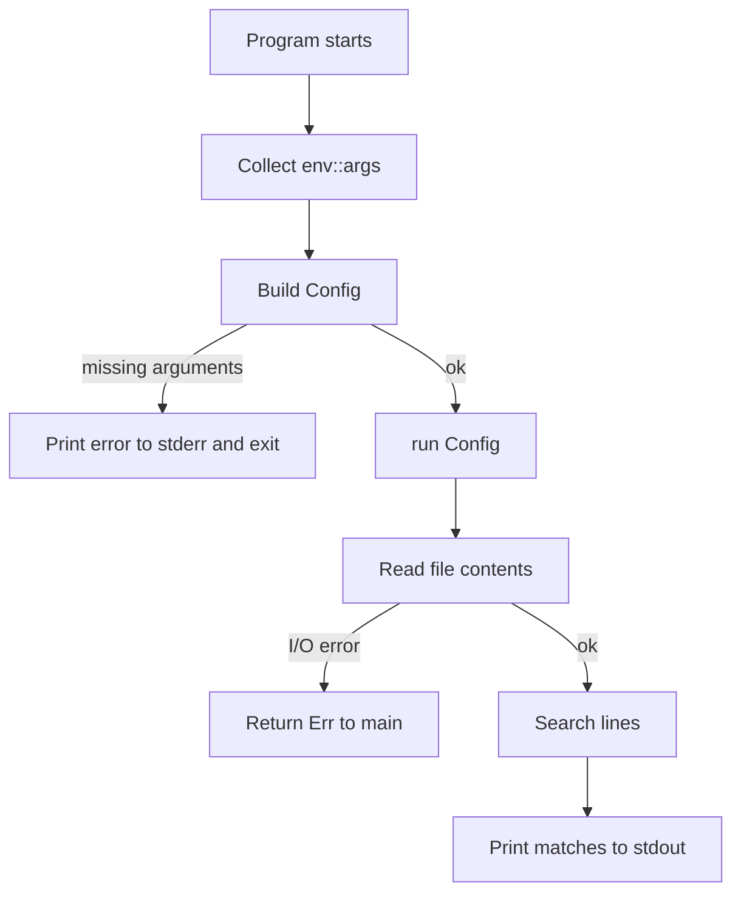

# I/O Project with Minigrep

`minigrep` is a small command-line search program whose architecture matters more than its feature set. Raw process input, configuration validation, file I/O, text search, output, and exit policy each belong at a different boundary. Separating them turns the search logic into an ordinary testable function.

## Keep the process boundary thin

The binary in `src/main.rs` should collect arguments, build a configuration, call the library, report failure on standard error, and choose a nonzero exit status. It should not contain the search algorithm or terminate from inside reusable library code.



| Responsibility | Good location | Reason |
|---|---|---|
| Collect raw args | `main.rs` | Process boundary |
| Parse config | `lib.rs` or small config module | Testable validation |
| Read file | `run` or I/O layer | Fallible side effect |
| Search text | `lib.rs` pure function | Easy unit tests |
| Print matches | `run` or main path | User-facing side effect |
| Print errors | `main.rs` with `eprintln!` | Keep diagnostics on stderr |

Standard output remains the stream of matching lines, which allows redirection and shell pipelines. Diagnostics go through `eprintln!` so they do not corrupt that data stream. Only `main` should call `process::exit`; a library function should return information to its caller.

## Parse arguments before touching the file

`std::env::args()` yields owned `String` values. The first is normally the executable path, followed by the query and file path. Direct indexing is fragile:

```rust
let query = args[1].clone();
let file_path = args[2].clone();
```

Missing input becomes an unrelated bounds panic. Consuming the iterator lets absence become a deliberate configuration error:

```rust
let mut args = args.into_iter();
let _program = args.next();
let query = args.next().ok_or("Didn't get a query string")?;
let file_path = args.next().ok_or("Didn't get a file path")?;
```

For `minigrep frog poem.txt`, the three values are the executable name, `frog`, and `poem.txt`. If only the executable name is present, the second `next` returns `None`; `ok_or` converts it to `Err`, and `?` returns before any file operation begins.

```rust
pub struct Config {
    pub query: String,
    pub file_path: String,
    pub ignore_case: bool,
}

impl Config {
    pub fn build(args: impl IntoIterator<Item = String>) -> Result<Config, &'static str> {
        let mut args = args.into_iter();
        let _program = args.next();
        let query = args.next().ok_or("Didn't get a query string")?;
        let file_path = args.next().ok_or("Didn't get a file path")?;
        let ignore_case = std::env::var("IGNORE_CASE").is_ok();

        Ok(Config {
            query,
            file_path,
            ignore_case,
        })
    }
}
```

The environment variable supplies process-level configuration for case sensitivity. Reading it once during configuration keeps the pure search functions independent of global state.

## Make the search a borrowed transformation

The case-sensitive core needs neither files nor arguments:

```rust
pub fn search<'a>(query: &str, contents: &'a str) -> Vec<&'a str> {
    contents
        .lines()
        .filter(|line| line.contains(query))
        .collect()
}
```

`contents.lines()` yields borrowed lines, `filter` retains those containing the query, and `collect` builds a vector of slices. The explicit lifetime ties the returned `&str` values to `contents`; the result cannot outlive the source text. The query does not appear in the output, so its lifetime need not be tied to the result.

This signature makes unit tests small: a string literal can supply the contents, and the expected vector can contain string slices. No temporary file, environment variable, or argument list is required for core search behavior.

## Case folding without changing the returned text

For the sample:

```text
Rust:
safe, fast, productive.
Pick three.
Trust me.
```

lowercase comparison against `rust` proceeds as follows:

| Original line | Lowercased for comparison | Contains `rust`? |
|---|---|---|
| `Rust:` | `rust:` | yes |
| `safe, fast, productive.` | `safe, fast, productive.` | no |
| `Pick three.` | `pick three.` | no |
| `Trust me.` | `trust me.` | yes |

The implementation compares transformed text but returns slices of the original lines:

```rust
pub fn search_case_insensitive<'a>(query: &str, contents: &'a str) -> Vec<&'a str> {
    let query = query.to_lowercase();
    contents
        .lines()
        .filter(|line| line.to_lowercase().contains(&query))
        .collect()
}
```

The output therefore preserves `Rust:` and `Trust me.` exactly. Unicode lowercasing is more involved than a complete locale-aware, grapheme-aware search policy; this routine is adequate for the tutorial's simple substring behavior, not every internationalized search product.

## Keep fallible I/O in `run`

`run` owns the side effect of reading the file and propagates failures instead of panicking:

```rust
use std::error::Error;
use std::fs;

pub fn run(config: Config) -> Result<(), Box<dyn Error>> {
    let contents = fs::read_to_string(config.file_path)?;
    let results = if config.ignore_case {
        search_case_insensitive(&config.query, &contents)
    } else {
        search(&config.query, &contents)
    };

    for line in results {
        println!("{line}");
    }

    Ok(())
}
```

The boxed error keeps the small application signature compact. `main` still owns user-facing reporting:

```rust
use std::{env, process};
use minigrep::{run, Config};

fn main() {
    let config = Config::build(env::args()).unwrap_or_else(|error| {
        eprintln!("Problem parsing arguments: {error}");
        process::exit(2);
    });

    if let Err(error) = run(config) {
        eprintln!("Application error: {error}");
        process::exit(1);
    }
}
```

The library returns errors; the executable decides wording and status. Borrowed search results avoid unnecessary `String` allocation, while file contents remain alive for the duration of printing.

## Refactor in compiler-sized steps

The project grows in a useful order: collect arguments, read the file, extract configuration, improve errors, move logic to `lib.rs`, test search, then add the case-insensitive branch. Each step leaves ownership, visibility, and error types small enough for compiler diagnostics to identify the next mismatch.

Keeping every operation in `main`, unwrapping file reads, or mixing environment access into the pure search function makes tests and policy changes harder. Narrow parse, execute, and report layers leave clear places for later features without requiring those features now.

## Worked example: follow one invocation across the boundary

Consider:

```powershell
minigrep duct poem.txt
```

Assume `poem.txt` contains:

```text
Rust:
safe, fast, productive.
Pick three.
Duct tape is productive.
```

With case-sensitive search and no `IGNORE_CASE` variable, execution proceeds in distinct stages.

1. `env::args()` yields the executable path, `duct`, and `poem.txt` as owned strings.
2. `Config::build` discards the first item, moves `duct` into `query`, and moves `poem.txt` into `file_path`. No cloning is required because the iterator already owns the values.
3. The environment lookup is absent, so `ignore_case` becomes `false`.
4. `run` moves the path into `fs::read_to_string`. The function opens the file, reads it as UTF-8 text, and returns one owned `String` named `contents`.
5. The false branch calls `search(&config.query, &contents)`. Both arguments are borrowed; the configuration and file text remain owned by `run`.
6. `lines` yields four slices. `contains("duct")` is false for `Rust:`, true for `safe, fast, productive.`, false for `Pick three.`, and true for `Duct tape is productive.` only if the capital `D` matches. It does not, so case-sensitive output contains only `safe, fast, productive.`.
7. The returned vector stores a slice into `contents`. Printing finishes before `contents` is dropped, satisfying the lifetime in `search`.
8. `run` returns `Ok(())`, and `main` reaches a successful process exit.

If opening the file fails, step four returns `Err`. The `?` in `run` converts it to the boxed error and returns immediately; search and printing never occur. `main` prints the diagnostic to standard error and exits with status `1`. A missing query fails earlier in `Config::build` and uses status `2`, so configuration failure remains distinguishable from execution failure.

## Worked example: tests specify matching semantics

The pure functions can be tested without touching process state:

```rust
#[cfg(test)]
mod tests {
    use super::*;

    #[test]
    fn case_sensitive_substring() {
        let text = "Rust:\nsafe, fast, productive.\nTrust me.";
        assert_eq!(search("duct", text), vec!["safe, fast, productive."]);
    }

    #[test]
    fn case_insensitive_preserves_original_lines() {
        let text = "Rust:\nsafe, fast, productive.\nTrust me.";
        assert_eq!(
            search_case_insensitive("rUsT", text),
            vec!["Rust:", "Trust me."]
        );
    }

    #[test]
    fn no_match_is_an_empty_vector() {
        assert!(search("missing", "one\ntwo").is_empty());
    }
}
```

In the first test, only the second line contains the exact lowercase sequence `duct`. The second test lowers the query once, lowers each candidate for comparison, and returns slices of the unchanged source. The expected capitalization therefore checks both matching and output preservation. The third test records that no match is normal output rather than an error.

An empty query is contained in every string according to `str::contains`, so `search("", contents)` returns every line. That behavior may be acceptable, or `Config::build` may reject an empty query. The choice belongs in the configuration contract and deserves a test. Whitespace-only queries are not empty unless the program explicitly trims them; silently trimming would prevent intentional searches for spaces.

## Lines, encodings, and filenames have edges

`str::lines` removes line terminators from yielded slices. It handles both line feed and carriage-return-plus-line-feed endings, so output through `println!` uses the current platform's normal line writing rather than copying the original terminator bytes. A final terminator does not produce an extra empty line. If byte-for-byte preservation matters, a text-line search is the wrong abstraction.

`fs::read_to_string` rejects files that are not valid UTF-8. That is an honest constraint for a Rust string search. A byte-oriented tool would read `Vec<u8>` and search byte slices, while a tool supporting other encodings would need an explicit decoding policy. Replacing the failure with lossy decoding changes observable text and should be a deliberate feature.

`env::args` also requires command-line arguments to be valid Unicode and may panic when the operating system supplies non-Unicode values. `env::args_os` yields `OsString` and preserves native paths. A more robust interface could parse the query as Unicode while keeping the file path as `PathBuf`; converting a path to `String` merely to open it loses that benefit.

Environment-variable presence currently enables case-insensitive matching regardless of its value. `IGNORE_CASE=0` still counts as present. If values such as `true` and `false` are required, parse them explicitly and return a configuration error for unknown text. Reading the variable inside `search` would make identical function arguments produce different results and would make parallel tests contend over global process state.

## Whole-file search versus streaming search

Reading the entire file keeps the tutorial compact and allows returned slices to borrow one stable allocation. Its memory use grows with the input size. A streaming version uses `BufRead::lines` and prints or processes each match as it arrives:

```rust
use std::io::{self, BufRead};

fn search_reader(
    reader: impl BufRead,
    query: &str,
    mut output: impl std::io::Write,
) -> io::Result<()> {
    for line in reader.lines() {
        let line = line?;
        if line.contains(query) {
            writeln!(output, "{line}")?;
        }
    }
    Ok(())
}
```

Each loop iteration owns a new `String`, so it cannot collect borrowed lines that outlive the iteration. It writes immediately instead. For a three-line fixture, the first `lines` call reads and decodes line one, the predicate decides whether to write it, then the temporary string is dropped before line two. I/O errors from reading or writing propagate through `?`.

The generic reader and writer make the streaming path testable with in-memory cursors and byte vectors. They also complicate an introductory example. The whole-file design is appropriate until input size or latency provides a reason to stream.

## Output is an interface, not decoration

Matching lines on standard output can be redirected to a file or piped to another command. Progress text and errors on that stream would corrupt the result. Standard error remains visible to a terminal by default and can be redirected separately.

Writing to a closed pipe can fail. `println!` does not expose a convenient `Result` at each call site and may panic on output failure. A production filter may lock standard output and use `writeln!` so broken-pipe policy is explicit. The tutorial concentrates on file-read errors, but output is fallible as well.

Exit statuses should be stable enough for scripts. The example uses one code for configuration and another for execution. The exact numbers are application policy; consistency matters more than a large taxonomy. Reusable code returns typed information and leaves process termination to the binary.

## Why the borrowed result has only one named lifetime

The search signature names the lifetime of `contents` but not the query:

```rust
pub fn search<'a>(query: &str, contents: &'a str) -> Vec<&'a str>
```

Every returned slice comes from `contents.lines()`. None can point into `query`, so tying the result to both inputs would be needlessly restrictive. A caller may create a short-lived query, complete the search, drop the query, and continue using the matches as long as the contents remain alive.

The iterator chain is lazy until `collect`. `lines` describes how to produce slices, and `filter` describes which to retain. `collect` repeatedly asks for the next retained item and owns the resulting vector, but it does not own the text behind each slice. Dropping `contents` before the vector's last use is rejected.

Returning `Vec<String>` would remove the lifetime parameter by allocating a copy of every matching line. That may be appropriate if matches must outlive the input buffer or cross an ownership boundary. For immediate printing, copies add work without solving a real constraint. Returning the iterator itself can avoid the vector allocation, though its concrete type or `impl Iterator` signature adds another concept. The vector of slices keeps the ownership relationship explicit and the tests direct.

<div className="see-also">

See also: [Error handling](/cs/programming/rust/error-handling) · [Closures and iterators](/cs/programming/rust/closures-and-iterators) · [Automated tests](/cs/programming/rust/automated-tests) · [Cargo and crates.io workflow](/cs/programming/rust/cargo-crates-io-workflow) · [Generics, traits, and lifetimes](/cs/programming/rust/generics-traits-lifetimes)

</div>
