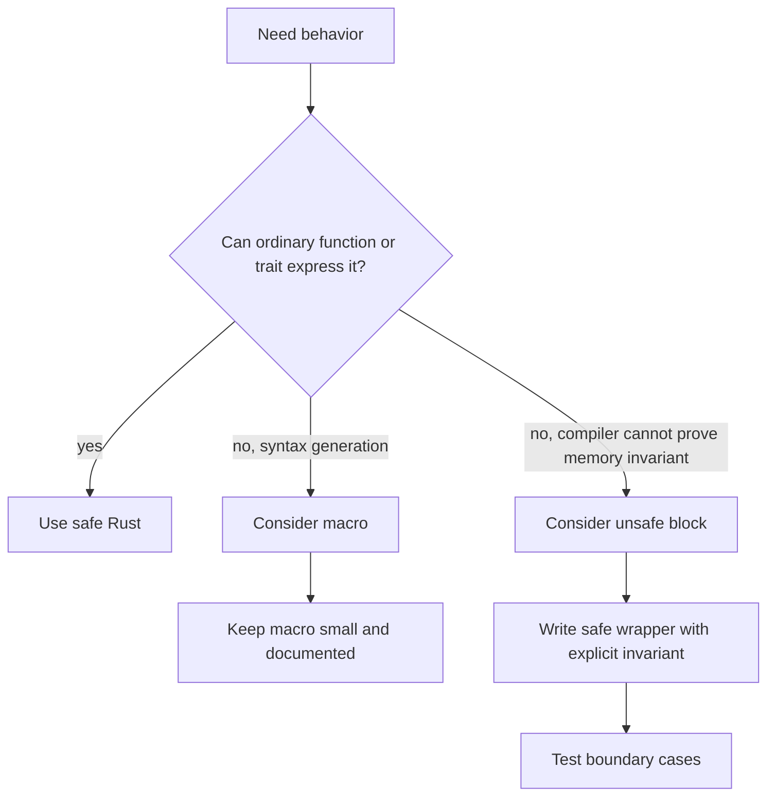

# Macros and Unsafe Rust

Macros and `unsafe` solve different problems at Rust's ordinary boundaries. A macro transforms token syntax into code. An `unsafe` operation asserts a memory or concurrency invariant the compiler cannot verify. Both tools increase the amount a human reviewer must establish, so their scope should stay small.

## First identify which boundary is blocked

An ordinary function or trait is easier to type-check, read, and debug. Reach for a macro when the required abstraction operates on syntax or declares items; reach for `unsafe` only when a valid low-level operation lies beyond the safe language's proof rules.



| Tool | What it enables | Main risk | Restrained use |
|---|---|---|---|
| `unsafe` block | Raw pointer dereference, unsafe calls | Undefined behavior if invariants are wrong | Minimize and document invariants |
| Unsafe function | Caller-checked preconditions | Easy to call incorrectly | Prefer a safe wrapper when possible |
| `macro_rules!` | Pattern-based code generation | Harder diagnostics and readability | Use when functions cannot express the shape |
| Derive macro | Generated trait implementations | Hidden generated code | Document generated behavior |
| Attribute macro | Transformation of an annotated item | Surprising expansion | Use clear attribute names and scope |

Macro expansion occurs before much ordinary type checking, which accounts for its different error messages. Unsafe code is still type-checked; only a fixed set of extra operations becomes available.

## The five capabilities opened by `unsafe`

Within an `unsafe` block or item, Rust permits:

1. Dereferencing a raw pointer.
2. Calling an unsafe function or method.
3. Accessing or modifying a mutable static variable.
4. Implementing an unsafe trait.
5. Accessing fields of a union.

The borrow checker and all other language rules continue to operate around those capabilities. `unsafe` does not disable checking for an entire function or module.

Raw pointers use `*const T` and `*mut T`. Creating one is safe; dereferencing it is unsafe because the pointer may be null, dangling, misaligned, uninitialized, or aliased in a way that violates Rust's reference rules. An unsafe function shifts unverifiable preconditions to its caller. An `unsafe impl` makes a comparable promise for a trait whose consumers may rely on those invariants, as with manual `Send` or `Sync` implementations.

## Deriving `split_at_mut` from a disjointness invariant

The desired API takes one mutable slice and safely returns two:

```rust
fn split_at_mut_i32(values: &mut [i32], mid: usize) -> (&mut [i32], &mut [i32])
```

The direct construction is rejected because both returned slices appear to mutably borrow `values` at once:

```rust
let len = values.len();
(&mut values[..mid], &mut values[mid..])
```

A human can establish a stronger fact: when `mid <= len`, the ranges `0..mid` and `mid..len` do not overlap. The implementation converts that argument into one checked precondition and a small raw-pointer block:

```rust
fn split_at_mut_i32(values: &mut [i32], mid: usize) -> (&mut [i32], &mut [i32]) {
    let len = values.len();
    let ptr = values.as_mut_ptr();

    assert!(mid <= len);

    // SAFETY: mid is in bounds, and the two ranges are adjacent and disjoint.
    unsafe {
        (
            std::slice::from_raw_parts_mut(ptr, mid),
            std::slice::from_raw_parts_mut(ptr.add(mid), len - mid),
        )
    }
}
```

The first slice covers exactly `0..mid`; the second begins at `ptr.add(mid)` and covers the remaining `len - mid` elements. The original slice guarantees a valid, aligned allocation, and the assertion keeps pointer arithmetic within that allocation. Because callers cannot bypass the range check, the public function remains safe.

```rust
fn main() {
    let mut values = [1, 2, 3, 4, 5, 6];
    let (left, right) = split_at_mut_i32(&mut values, 3);

    left[0] = 10;
    right[0] = 40;

    println!("{values:?}");
}
```

An unsafe block should sit beside a `SAFETY` comment that states the specific validity, alignment, aliasing, initialization, or lifetime argument. General reassurance elsewhere in the module is harder to audit.

## A declarative macro operates on token patterns

`macro_rules!` matches syntax and emits Rust code. A small vector-building macro can accept a variable number of expressions, a call shape an ordinary Rust function cannot provide:

```rust
macro_rules! my_vec {
    ( $( $x:expr ),* ) => {
        {
            let mut temp_vec = Vec::new();
            $(
                temp_vec.push($x);
            )*
            temp_vec
        }
    };
}

let v = my_vec![1, 2, 3];
```

`$x:expr` matches an expression, and `$( ... ),*` accepts zero or more comma-separated matches. The conceptual expansion is:

```rust
{
    let mut temp_vec = Vec::new();
    temp_vec.push(1);
    temp_vec.push(2);
    temp_vec.push(3);
    temp_vec
}
```

The result is `[1, 2, 3]`. Because a macro controls expansion, it must also avoid surprising evaluation order, repeated evaluation of side-effecting inputs, or confusing introduced names. Use a generic function or trait when it can express the same interface cleanly.

## Procedural macros transform token streams

Rust has three main procedural macro forms:

- Custom derive macros generate implementations for `#[derive(...)]`.
- Attribute-like macros transform an item carrying an attribute.
- Function-like procedural macros accept tokens with function-call-like syntax.

All three operate on token streams rather than already type-checked runtime values. Their generated public shape, accepted syntax, and failure messages are part of the API and need documentation.

## What tests cannot establish

Boundary tests are necessary for both macro expansion and unsafe wrappers, but tests cannot prove the absence of undefined behavior. The decisive evidence for unsafe code is the invariant argument: every valid caller must satisfy the conditions needed by the unsafe operations. Safe wrappers should make invalid use impossible; otherwise the remaining preconditions belong on an explicitly unsafe API.

Macro-heavy modules need a similar review of expansion boundaries. Generate the repetitive syntax while keeping evaluation and control flow understandable from the call site.

## Worked example: audit every premise of `split_at_mut`

For `values = [1, 2, 3, 4, 5, 6]` and `mid = 3`, the allocation contains six initialized, aligned `i32` elements. `as_mut_ptr` points to element zero. The assertion establishes `3 <= 6` before any pointer arithmetic occurs.

The first `from_raw_parts_mut(ptr, 3)` describes elements with indices `0`, `1`, and `2`. `ptr.add(3)` points to element three, and the second length is `6 - 3 = 3`, so the second slice describes indices `3`, `4`, and `5`. The index sets are disjoint. Both slice lifetimes are inferred from the original `&mut [i32]`, so neither can outlive the source borrow. The function returns no other route to the original slice while those borrows are active.

Boundary cases matter. With `mid = 0`, the left slice has length zero and the right covers all six elements. With `mid = 6`, the left covers all elements and the right is empty at the one-past-the-end pointer, which is permitted for a zero-length slice when its pointer meets the API's requirements. With `mid = 7`, the assertion panics before `ptr.add(7)` or subtraction. Moving the assertion below the unsafe operations would be too late.

The standard library already supplies `[T]::split_at_mut`; the hand-written version is for studying the proof obligation. Production code should call the existing safe method. Reimplementing a sound primitive adds audit work without new behavior.

## Unsafe functions put part of the proof on the caller

Sometimes preconditions cannot be encoded in a safe signature. Marking the function `unsafe` announces that callers must establish them:

```rust
/// Reads one initialized element from `ptr`.
///
/// # Safety
/// `ptr` must be non-null, aligned for `T`, valid for reads, and point to a
/// properly initialized `T`. No concurrent mutation may violate the read.
unsafe fn read_copy<T: Copy>(ptr: *const T) -> T {
    // SAFETY: the caller promises the requirements documented above.
    unsafe { *ptr }
}
```

The `unsafe fn` declaration does not make every operation in its body implicitly justified. Keeping an explicit inner block identifies the exact dereference and forces the implementation to acknowledge it. The caller must use its own unsafe block and explain how the pointer satisfies the contract.

Prefer safe inputs that carry their own evidence. A function taking `&T` already receives a non-null, aligned, initialized value with a borrow lifetime. Changing it to `*const T` throws away compiler-checked facts and creates no benefit unless raw-pointer interoperability is required. Similarly, indices and slice lengths often express a boundary more safely than pointer pairs.

Foreign-function interfaces are a common source of legitimate raw pointers. The Rust wrapper must check nullability, lengths, ownership transfer, and the foreign API's lifetime rules before constructing references or slices. A C function returning a pointer does not by itself say who frees the allocation or how long it remains valid. Those facts belong in the wrapper's contract.

## Worked example: expand a macro call and count evaluation

Consider a macro that returns the smaller expression:

```rust
macro_rules! min_once {
    ($left:expr, $right:expr) => {{
        let left_value = $left;
        let right_value = $right;
        if left_value < right_value { left_value } else { right_value }
    }};
}
```

For `min_once!(next(), limit())`, expansion creates one call to `next` and one call to `limit`, in that order. Their results are stored before comparison. A naive expansion that inserted `$left` into both the condition and the result could call `next()` twice, changing behavior when it consumes input or increments a counter.

The doubled braces create an expression block and a nested scope. Introduced temporary names do not leak to the caller. Macro hygiene also prevents many accidental identifier captures, but it does not make the call's runtime semantics obvious. Documentation should say whether arguments may be evaluated, how often, and in what broad order when callers could observe it.

The repetition in `my_vec!` can accept a trailing comma with a slightly broader pattern:

```rust
macro_rules! my_vec {
    ( $( $x:expr ),* $(,)? ) => {{
        let mut result = Vec::new();
        $( result.push($x); )*
        result
    }};
}
```

`$(,)?` matches zero or one final comma. For `my_vec![a(), b(),]`, the first repetition captures two expressions. Expansion emits two `push` statements; `a()` runs before `b()`. For `my_vec![]`, the repetition matches zero times and returns an empty vector whose element type must be inferred from context.

## Choosing among a function, a declarative macro, and a derive

A function accepts values after Rust has parsed and typed the call. It supports ordinary generics, can be passed as a value, and produces direct diagnostics. Use it when the number and shape of arguments are fixed.

A declarative macro accepts Rust syntax fragments and can vary the number of arguments, introduce statements, or generate item declarations. Its patterns should stay narrow enough that invalid calls fail near the macro invocation. A catch-all token pattern followed by a complex private parser often produces poor diagnostics.

A custom derive is suitable when a trait implementation follows from a type declaration. It can inspect fields and variants and emit an `impl`, but it lives in a procedural-macro crate and adds compilation and maintenance cost. Handwritten implementations are clearer when only one or two types need special behavior.

Generated code is checked after expansion, so a macro cannot bypass type rules or make unsafe operations safe. If an expansion contains unsafe code, the macro author still owes the invariant proof, and the call-site syntax must not let safe callers violate it.

## Unsafe code review follows the data, not the keyword count

A tiny unsafe block can depend on a large amount of safe setup. Review starts where the raw pointer or invariant originates and follows every mutation that could invalidate it. Relevant questions include whether an allocation can move, whether a length was measured in bytes or elements, whether arithmetic can overflow, and whether aliases remain live during mutation.

The usual hazards have precise meanings. A dangling pointer refers to storage whose lifetime ended. An unaligned pointer does not meet the target type's alignment. Reading uninitialized bytes as a type may be invalid even when the address lies in an allocation. Creating two mutable references to overlapping data violates exclusivity. A data race is undefined behavior even if a test usually prints the expected result.

`Send` and `Sync` are unsafe traits because other safe code relies on their correctness. Manually implementing them based only on the fields one happens to see can become unsound when representation changes. Auto-trait behavior should be left to the compiler unless a type has a reviewed synchronization or ownership argument that the compiler cannot derive.

Tests should cover empty inputs, bounds, alias-sensitive operations, panics before unsafe entry, and representative macro expansions. Tools that interpret Rust's memory model can catch some invalid executions, but passing them does not prove that every caller and platform satisfies the contract. The safety comment remains a proof sketch that must survive refactoring.

<div className="see-also">

See also: [Object-oriented and advanced features](/cs/programming/rust/object-oriented-and-advanced-features) · [Ownership, references, and slices](/cs/programming/rust/ownership-references-slices) · [Concurrency and shared state](/cs/programming/rust/concurrency-and-shared-state) · [Cargo and crates.io workflow](/cs/programming/rust/cargo-crates-io-workflow) · [Multithreaded web server](/cs/programming/rust/multithreaded-web-server)

</div>
