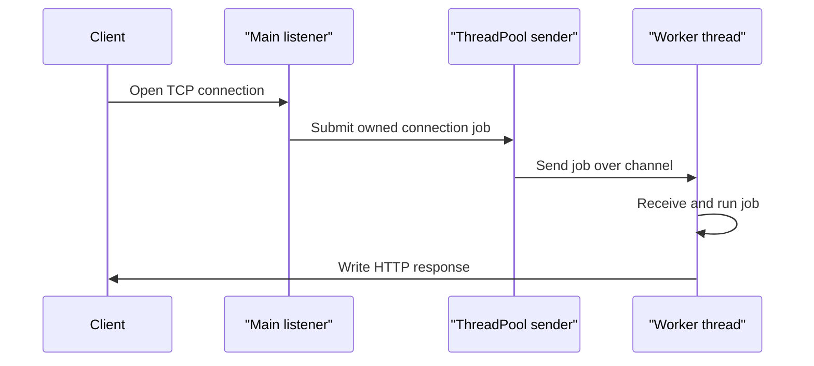

# Multithreaded Web Server

The Rust book ends with a deliberately small web server: bind a TCP listener, accept streams, parse enough HTTP to distinguish a few paths, write responses, then add a thread pool so one slow request does not stall every other connection. The project pulls together ownership, error handling, traits, closures, channels, mutexes, and cleanup.

The design is blocking rather than async. It is useful as a completely inspectable account of how connections become work, but it is not a production HTTP stack.

## From a TCP stream to an HTTP response

`TcpListener` binds to an address, and `incoming` produces connection attempts. Each successful item is a `TcpStream` that the server can read from and write to.

At the request/response level, HTTP is text framed in a fixed order: a status or request line, headers, a blank line, and an optional body. The project only examines the request prefix. A home-page request receives `200 OK`; every other path receives `404 NOT FOUND`.

```rust
let mut buffer = [0; 1024];
stream.read(&mut buffer)?;

let get = b"GET / HTTP/1.1\r\n";
let (status_line, contents) = if buffer.starts_with(get) {
    ("HTTP/1.1 200 OK", "<h1>Hello!</h1>")
} else {
    ("HTTP/1.1 404 NOT FOUND", "<h1>Not Found</h1>")
};

let length = contents.len();
let response = format!(
    "{status_line}\r\nContent-Length: {length}\r\n\r\n{contents}"
);
stream.write_all(response.as_bytes())?;
```

The blank line before the body is part of HTTP framing. The following single-threaded program contains the complete socket and response path:

```rust
use std::io::{Read, Write};
use std::net::{TcpListener, TcpStream};

fn handle_connection(mut stream: TcpStream) -> std::io::Result<()> {
    let mut buffer = [0; 1024];
    stream.read(&mut buffer)?;

    let get_home = b"GET / HTTP/1.1\r\n";
    let (status_line, body) = if buffer.starts_with(get_home) {
        ("HTTP/1.1 200 OK", "<h1>Hello from Rust</h1>")
    } else {
        ("HTTP/1.1 404 NOT FOUND", "<h1>Not Found</h1>")
    };

    let response = format!(
        "{status_line}\r\nContent-Length: {}\r\n\r\n{body}",
        body.len()
    );

    stream.write_all(response.as_bytes())
}

fn main() -> std::io::Result<()> {
    let listener = TcpListener::bind("127.0.0.1:7878")?;

    for stream in listener.incoming().take(2) {
        match stream {
            Ok(stream) => handle_connection(stream)?,
            Err(error) => eprintln!("connection failed: {error}"),
        }
    }

    Ok(())
}
```

The thread-pool version keeps `handle_connection` and submits each accepted stream as a job instead of calling the function in the listener loop.

## Feeding connections to fixed workers

Spawning a new thread for every connection is simple but unbounded. A thread pool creates a fixed set of workers and reuses them, limiting concurrent work and thread-creation overhead.

A job is a boxed closure:

```rust
type Job = Box<dyn FnOnce() + Send + 'static>;
```

`FnOnce` permits the closure to consume captured values and records that it runs once. `Send` permits transfer to a worker thread. `'static` rules out borrowed stack data that might disappear before execution.

Main owns the sending side of a channel. Workers share its single receiver through `Arc<Mutex<Receiver<Job>>>`: `Arc` supplies shared ownership, while `Mutex` serializes access because `Receiver` is not `Sync`.



| Component | Rust type | Role |
|---|---|---|
| Listener | `TcpListener` | Accept connections |
| Stream | `TcpStream` | Read request and write response |
| Job | `Box<dyn FnOnce() + Send + 'static>` | Own executable work |
| Sender | `mpsc::Sender<Job>` | Submit work to workers |
| Shared receiver | `Arc<Mutex<mpsc::Receiver<Job>>>` | Let workers receive from one queue |
| Worker handle | `JoinHandle<()>` | Join thread during shutdown |

The ownership path is explicit:

```rust
for stream in listener.incoming() {
    let stream = stream.unwrap();
    pool.execute(move || {
        if let Err(error) = handle_connection(stream) {
            eprintln!("request failed: {error}");
        }
    });
}
```

`execute` boxes the closure and sends it:

```rust
let job = Box::new(f);
self.sender.as_ref().unwrap().send(job).unwrap();
```

A worker receives one job, releases the receiver lock at the end of the statement, and calls the closure:

```rust
let job = receiver.lock().unwrap().recv().unwrap();
job();
```

The stream moves into the closure, the closure moves through the channel, and one worker consumes it. If a job sleeps, only that worker is occupied; the remaining workers can continue, up to the fixed pool size.

## Shutdown is part of the pool design

Workers normally block in `recv`. Dropping the pool therefore needs a protocol rather than a hope that background threads finish in time. The pool drops its sender, which disconnects the channel; workers observe the receive error and leave their loops. The pool then takes each `JoinHandle` and calls `join`.

This is the final ownership exercise in the project. The sender owns the ability to keep the queue open, and the pool owns the handles needed to wait for termination. Cleanup is expressed through `Drop` and ownership instead of timing.

One subtlety is lock scope. A worker must hold the receiver mutex while waiting for and receiving a job, but it should not hold that mutex while the job itself runs. Otherwise one long request would prevent every other worker from receiving queued work.

## Where the teaching server stops

The parser recognizes byte prefixes, response bodies are fixed strings or files, and only a few routes exist. Real HTTP handling also needs correct parsing, methods and headers, request-size limits, timeouts, TLS, backpressure, and more complete error handling. The example is enough to expose TCP and HTTP framing, not enough to deploy.

The same boundary applies to concurrency. This edition's final project does not build an async server, so futures, executors, tasks, pinning, and async I/O are outside its model. The blocking pool remains valuable precisely because the accept loop, ownership transfers, queue, workers, and shutdown path all fit in a small program.

Common mistakes cluster around those boundaries:

- treating the prefix check as a complete HTTP parser;
- omitting the blank line between headers and body;
- spawning an unlimited number of threads in a long-running server;
- sending closures without the `Send` and `'static` bounds required by workers;
- running a job while still holding the receiver mutex;
- dropping the pool without closing the sender and joining workers;
- describing this blocking design as async/await.

## TCP does not preserve request-shaped messages

A TCP stream is an ordered byte stream. One `read` may return fewer bytes than the client sent, even when more bytes will arrive later. It may also read bytes belonging to more than the first conceptual message. The 1024-byte prefix example works as a teaching simplification, not as a general parser.

The return value from `read` must be respected:

```rust
let mut buffer = [0_u8; 1024];
let bytes_read = stream.read(&mut buffer)?;
let request = &buffer[..bytes_read];
```

If `bytes_read` is zero, the peer closed its writing side before a request was read. Inspecting the entire zero-initialized array hides how much data arrived. Repeated reads need a maximum request size and a framing rule, such as finding the byte sequence that terminates headers. Without a limit, a client can make the server retain memory indefinitely while never completing a request.

The response's `Content-Length` is a byte count, so `body.len()` is correct for a UTF-8 string. It is not a character count. The response should also include a connection policy appropriate to the protocol behavior. This tiny server writes one response and lets the stream close; it does not implement persistent requests.

## Worked example: two clients with one slow route

Assume a pool of two workers. Client A requests `/sleep`, whose handler pauses for five seconds. Client B requests `/` immediately afterward.

1. The listener accepts A and moves its `TcpStream` into a closure. `execute` boxes the closure and sends it to the queue.
2. Worker 0 locks the receiver, calls `recv`, obtains A's job, and ends the receive statement. Its mutex guard is dropped before `job()` begins.
3. Worker 0 runs the slow handler. Its thread sleeps, but it holds neither the channel receiver lock nor client B's stream.
4. The listener accepts B and submits another owned closure.
5. Worker 1 acquires the receiver mutex, receives B's job, releases the lock, and runs the home handler. B gets a response without waiting for A's sleep.
6. Worker 0 eventually wakes, writes A's response, and returns to `recv`.

With only one worker, B waits in the queue until A finishes. With a lock guard accidentally held across `job()`, worker 1 cannot receive B even though it exists, reproducing serial behavior. The pool limits concurrent handlers to its worker count; it does not make an individual blocking handler faster.

The receiver mutex does introduce a brief serialized handoff because only one worker can call `recv` at a time. Once a job has been removed, work proceeds concurrently. The critical section should contain only waiting and dequeueing, never user work.

## Building the worker loop around disconnection

A worker can treat channel closure as its normal stop signal:

```rust
use std::sync::{mpsc, Arc, Mutex};
use std::thread;

fn worker_loop(receiver: Arc<Mutex<mpsc::Receiver<Job>>>) {
    loop {
        let message = receiver.lock().unwrap().recv();
        match message {
            Ok(job) => job(),
            Err(_) => break,
        }
    }
}
```

The temporary mutex guard lives through `recv` and is then dropped before the match body runs. When every sender is dropped, `recv` returns `Err`; the worker breaks rather than panicking. Existing queued jobs are received before disconnection is observed, so closing the sender permits already submitted work to drain.

Mutex poisoning adds another policy question. `lock().unwrap()` panics if a thread panicked while holding that mutex. In this design, jobs run after the guard is released, so an ordinary job panic does not poison the receiver mutex. A panic during receive bookkeeping would. A teaching implementation can unwrap; a reusable pool should decide whether to recover the protected value or shut down.

Job panics also terminate their worker thread unless caught. The pool then has fewer workers, and `join` later reports the panic. Catching panics can preserve capacity but requires careful unwind-safety and reporting. The small project leaves the failure visible rather than pretending it has worker supervision.

## Worked example: shutdown ownership in exact order

Suppose the pool owns four workers and one `Sender<Job>`. Each worker is blocked in `recv`, and the queue is empty.

1. `ThreadPool::drop` takes the sender out of an `Option` and drops it. Taking is needed because fields normally remain alive until after the `drop` method body.
2. With no sender clones elsewhere, the channel becomes disconnected. Each blocked receive wakes and returns `Err` as it gets access to the receiver.
3. Every worker breaks its loop and its thread function returns.
4. The pool iterates over workers, takes each `JoinHandle` from its `Option`, and calls `join`.
5. `join` waits until that worker has actually stopped and reports whether it panicked. After all joins, dropping the pool cannot leave its own worker threads running.

If the sender stayed in the struct throughout the join loop, workers would keep waiting for a message because the channel was still open, and `join` would wait forever. If another sender clone survived outside the pool, the same problem would occur. Keeping the sender private and avoiding unnecessary clones makes the shutdown proof local.

An explicit message enum is an alternative:

```rust
enum Message {
    Run(Job),
    Stop,
}
```

The pool can send one `Stop` per worker. That supports policies such as immediate shutdown versus draining queued work, but it adds protocol states. Channel disconnection is enough for the book's drain-and-stop behavior.

## Bounded work is more than bounded threads

A fixed worker count limits active handlers, but an unbounded channel can still accumulate jobs faster than workers finish them. Each queued closure owns a TCP stream and captured state, so memory and open descriptors can grow under sustained load. A bounded queue makes overload observable: submission must block, fail, or reject work according to policy.

That policy is called backpressure. Blocking the accept loop slows admission but may leave connections waiting in the operating system's listen queue. Rejecting immediately can produce a controlled overload response when enough protocol has been read. Neither choice is universally correct, but an unbounded queue does not provide a complete resource limit.

Timeouts matter for the same reason. A client that connects and sends nothing can occupy a blocking worker indefinitely unless read timeouts or another cancellation mechanism exist. The thread pool protects against one slow request blocking every request; a pool-sized set of slow clients can still occupy all workers.

## What a production HTTP layer would own

Correct HTTP includes request-line validation, header syntax, body framing, method semantics, connection reuse, and limits against malicious input. TLS adds certificate and handshake policy. Logging must avoid leaking sensitive headers. File responses need path normalization and content-type decisions. These concerns are mature library territory.

The teaching server remains useful because its omissions are visible. The listener owns admission, the channel owns queued transfer, each closure owns one stream, and the pool owns worker lifetime. A production runtime changes the mechanisms, but it still needs explicit answers for resource limits, cancellation, request boundaries, and shutdown.

<div className="see-also">

See also: [Concurrency and shared state](/cs/programming/rust/concurrency-and-shared-state) · [Closures and iterators](/cs/programming/rust/closures-and-iterators) · [Error handling](/cs/programming/rust/error-handling) · [Smart pointers](/cs/programming/rust/smart-pointers) · [Macros and unsafe Rust](/cs/programming/rust/macros-and-unsafe-rust)

</div>
