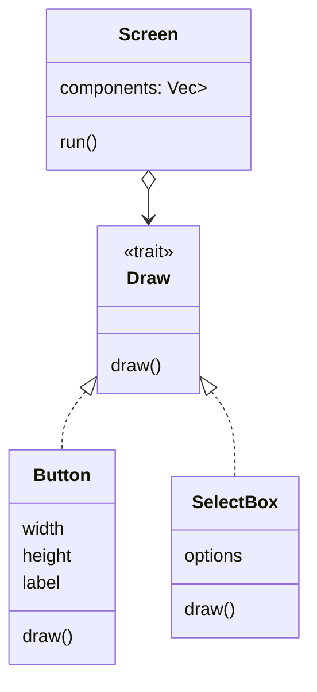

# Object-Oriented and Advanced Features

Rust supports encapsulation, polymorphism, and state-dependent behavior without adopting class inheritance. Private fields and modules protect invariants; traits define shared behavior; composition supplies reuse. The advanced trait and type features extend the same approach by letting APIs state more of their relationships explicitly.

## Encapsulation and two forms of dispatch

A public struct may keep its fields private and expose only constructors and methods. This is Rust's ordinary form of encapsulation: callers depend on the interface, while the module retains control of the representation.

Traits provide polymorphism in two distinct forms. Generic bounds use static dispatch: the compiler knows the concrete type and monomorphizes the code. Trait objects such as `Box<dyn Draw>` use dynamic dispatch: a pointer to the value is paired with a vtable that selects the implementation at runtime.



| Feature | Dispatch | Main benefit | Cost or constraint |
|---|---|---|---|
| Generic trait bound | static | Fast, monomorphized calls | One concrete type per instantiation |
| Trait object | dynamic | Heterogeneous collections | Dyn compatibility and a vtable call |
| Associated type | static | Cleaner trait signatures | One concrete associated type per implementation |
| Newtype | static | A local, distinct wrapper | Desired methods must be forwarded |
| Supertrait | either | Express a trait dependency | Implementors need every required trait |

A heterogeneous UI illustrates the dynamic case:

```rust
trait Draw {
    fn draw(&self);
}

struct Screen {
    components: Vec<Box<dyn Draw>>,
}

impl Screen {
    fn run(&self) {
        for component in &self.components {
            component.draw();
        }
    }
}
```

`Button`, `SelectBox`, and other types can implement `Draw` and share one vector. The box gives the dynamically sized trait object a known pointer size, and each call uses the object's vtable. The trait must be dyn-compatible: generic methods and methods that return `Self` without a `Self: Sized` restriction are common obstacles.

No component subclasses a base class. Composition, trait implementations, default methods, and generic bounds cover the reuse patterns that inheritance often serves elsewhere.

## Encoding a post's state

The book's classic state-pattern version stores `state: Option<Box<dyn State>>` inside one `Post` type and delegates behavior to state objects. It demonstrates encapsulation and trait objects, but calls that are invalid for the current state may still exist and merely do nothing.

A type-state version can instead define `DraftPost`, `PendingReviewPost`, and `Post`. A transition method consumes one state and returns the next. `DraftPost::request_review`, for example, can return `PendingReviewPost`; only the published `Post` exposes `content`. Invalid transitions then fail to compile because the relevant method is absent.

The two versions make different tradeoffs. Trait objects allow the state to vary behind one stable outer type. Separate state types give the compiler a stronger account of valid transitions, at the cost of changing the value's type as it moves through the workflow.

## Associated types, supertraits, and newtypes

An associated type is a placeholder declared inside a trait and selected once by each implementation. `Iterator::Item` is the standard example. A generic type parameter, by contrast, can permit multiple implementations of the same trait for different parameter choices.

A default generic type parameter supplies a type when the caller or implementation does not specify one. `Add<Rhs = Self>` uses this technique so ordinary addition defaults the right-hand side to the left-hand type while still allowing mixed-type implementations. Implementing operator traits such as `Add` is Rust's form of operator overloading; implementations remain subject to the usual trait coherence rules.

A supertrait records a dependency between behaviors. If `OutlinePrint: Display`, every `OutlinePrint` implementor must also implement `Display`, and the default method may rely on `to_string`:

```rust
use std::fmt::{self, Display};

trait OutlinePrint: Display {
    fn outline_print(&self) {
        let output = self.to_string();
        let len = output.len();
        println!("{}", "*".repeat(len + 4));
        println!("*{}*", " ".repeat(len + 2));
        println!("* {output} *");
        println!("*{}*", " ".repeat(len + 2));
        println!("{}", "*".repeat(len + 4));
    }
}

struct Point {
    x: i32,
    y: i32,
}

impl Display for Point {
    fn fmt(&self, f: &mut fmt::Formatter<'_>) -> fmt::Result {
        write!(f, "({}, {})", self.x, self.y)
    }
}

impl OutlinePrint for Point {}

fn main() {
    let point = Point { x: 3, y: 4 };
    point.outline_print();
}
```

The newtype pattern wraps an existing type in a tuple struct. The wrapper has a distinct local type even when its runtime representation is unchanged. It can enforce domain meaning, prevent accidental mixing, or make an external trait implementable for an external wrapped type under Rust's coherence rules. The wrapper does not automatically inherit the inner type's methods or trait implementations.

A type alias, such as `type Kilometers = i32`, only introduces another name for the same type. It can shorten a long signature but cannot prevent kilometers from being mixed with other `i32` values. A newtype creates that separation; an alias does not.

## Resolving names when methods collide

An inherent method and several trait methods may share a name:

```rust
trait Pilot {
    fn fly(&self);
}

trait Wizard {
    fn fly(&self);
}

struct Human;

impl Pilot for Human {
    fn fly(&self) {
        println!("This is your captain speaking.");
    }
}

impl Wizard for Human {
    fn fly(&self) {
        println!("Up!");
    }
}

impl Human {
    fn fly(&self) {
        println!("waving arms");
    }
}
```

`person.fly()` chooses the inherent method. Trait-qualified calls select the others:

```rust
let person = Human;
person.fly();
Pilot::fly(&person);
Wizard::fly(&person);
```

Associated functions without a `self` receiver may need fully qualified syntax that also names the implementing type:

```rust
<Dog as Animal>::baby_name()
```

Function pointers complete this part of the type system. A function item can be passed where `fn` is expected, while closures may implement `Fn`, `FnMut`, or `FnOnce` depending on how they capture and use their environment. Generic closure bounds accept more callables; a bare function pointer is appropriate when captured state must be excluded.

## Choosing only the machinery the API needs

Trait objects are useful when concrete types must coexist at runtime. When all values have one concrete type per call, a generic bound is usually simpler and avoids dynamic dispatch. Private fields matter only if the public methods preserve the intended invariant, and `pub` fields can quietly undo that boundary.

Other recurring problems are mechanical but significant:

- a trait used behind `dyn` must satisfy the language's dyn-compatibility rules;
- associated types are chosen by the implementor, unlike freely supplied generic arguments;
- colliding method names need trait qualification or fully qualified syntax;
- a newtype must forward the operations its public API promises;
- advanced syntax that communicates no invariant or capability is usually ornament.

## Worked example: compare runtime state with type state

A compact runtime-state model stores an enum inside one stable type:

```rust
enum Status {
    Draft,
    Review,
    Published,
}

struct Article {
    text: String,
    status: Status,
}

impl Article {
    fn request_review(&mut self) {
        if matches!(self.status, Status::Draft) {
            self.status = Status::Review;
        }
    }

    fn approve(&mut self) {
        if matches!(self.status, Status::Review) {
            self.status = Status::Published;
        }
    }

    fn content(&self) -> &str {
        if matches!(self.status, Status::Published) { &self.text } else { "" }
    }
}
```

Starting in `Draft`, `request_review` changes the field to `Review`. `approve` then changes it to `Published`, and `content` exposes the text. Calling `approve` on a draft compiles but leaves the state unchanged. The method set stays the same at every stage; validity is checked at runtime.

Type state moves that rule into method availability:

```rust
struct Draft { text: String }
struct Review { text: String }
struct Published { text: String }

impl Draft {
    fn new() -> Self { Self { text: String::new() } }
    fn add_text(&mut self, text: &str) { self.text.push_str(text); }
    fn request_review(self) -> Review { Review { text: self.text } }
}

impl Review {
    fn reject(self) -> Draft { Draft { text: self.text } }
    fn approve(self) -> Published { Published { text: self.text } }
}

impl Published {
    fn content(&self) -> &str { &self.text }
}
```

`Draft::new` creates the only state with `add_text`. `request_review` consumes the draft, moves its string into `Review`, and makes the old binding unusable. Review can move back to draft or forward to publication. Only `Published` has `content`, so exposing a draft is a compile error rather than an empty result.

The stronger model is not automatically better. A collection containing articles in arbitrary states is easy with the enum or trait-object representation and awkward with three unrelated concrete types. Persistence and network decoding also begin with runtime data that must be validated. Type state fits workflows whose transitions occur within typed code and whose changing types do not burden storage or callers.

## Worked example: a newtype protects units and controls formatting

Aliases do not separate values:

```rust
type Meters = u32;
let distance: Meters = 5;
let seconds: u32 = 3;
let mistaken = distance + seconds;
```

The addition compiles because both names mean `u32`. Tuple newtypes create distinct types:

```rust
use std::fmt;

struct Meters(u32);
struct Seconds(u32);

impl Meters {
    fn checked_add(self, other: Meters) -> Option<Meters> {
        self.0.checked_add(other.0).map(Meters)
    }
}

impl fmt::Display for Meters {
    fn fmt(&self, f: &mut fmt::Formatter<'_>) -> fmt::Result {
        write!(f, "{} m", self.0)
    }
}

let total = Meters(120).checked_add(Meters(30)).unwrap();
assert_eq!(total.to_string(), "150 m");
```

The first `Meters` is consumed by `checked_add`; the inner integers use checked arithmetic; `map(Meters)` wraps a successful sum. Passing `Seconds(30)` fails at compile time. Because `Meters` is local, it may implement the external `Display` trait even though its inner `u32` and `Display` are external. This satisfies the orphan rule through the local wrapper.

Newtypes can also restrict construction by keeping the tuple field private and exposing a validating constructor. `Deref` can forward a broad set of inner behavior, but it may erase the conceptual boundary. Explicit methods are often preferable for units, identifiers, and validated strings.

## Why some traits cannot become trait objects

A trait object erases the concrete implementor, so a call through `dyn Trait` must be describable by a common vtable entry. A method such as `fn clone_value(&self) -> Self` cannot produce an unknown-sized concrete `Self` for a caller that knows only the trait object. A method with its own generic parameter would require an open-ended family of monomorphized vtable entries.

Methods unavailable through a trait object can be restricted with `where Self: Sized`. They remain callable on concrete implementors while the rest of the trait stays usable through `dyn`. Associated types must be specified when constructing the object when callers need to know them, as in `dyn Iterator<Item = String>`.

Dynamic dispatch has two separate costs: the value usually needs pointer indirection, and the call cannot be selected statically at the call site. The more important design cost is erased concrete behavior. A `Screen` should ask only for `Draw`; code that repeatedly downcasts components probably chose too narrow a trait or the wrong representation.

## Sized types, slices, and the never type

Most generic parameters have an implicit `Sized` bound because stack variables and by-value arguments need a compile-time size. Slices and trait objects are dynamically sized types. They appear behind pointers such as `&[T]`, `&str`, and `Box<dyn Draw>`, where the pointer carries enough metadata to use the value. A bound written `T: ?Sized` relaxes the implicit requirement and lets a generic abstraction accept both sized and dynamically sized referents.

The never type `!` represents computation that does not return normally. `panic!`, `process::exit`, and an endless loop have this character. It can coerce into other types, which explains why a match arm containing `continue` can coexist with an arm yielding a number: the continuing arm never produces a conflicting value.

These features solve concrete typing problems. `?Sized` belongs on APIs that genuinely accept unsized referents, and `!` usually emerges from control flow rather than being chosen for decoration.

## Method lookup and forwarding need deliberate boundaries

Rust considers inherent methods before trait methods in ordinary method-call syntax, then uses receiver types and traits in scope to resolve candidates. Fully qualified syntax removes ambiguity and is also useful in generic code when the intended implementation should be unmistakable.

Composition does not forward methods automatically. A newtype or containing struct must expose the subset that fits its own contract. That apparent inconvenience protects representation changes: callers cannot accidentally become dependent on every method of an inner collection. Forwarding dozens of methods is evidence that the wrapper may be adding little, unless it also enforces an invariant at construction and mutation points.

## Operator traits should preserve domain expectations

Implementing `Add`, `Index`, or another operator trait gives familiar syntax to a local type. It does not grant permission to assign surprising meaning to the symbol. Addition should normally behave like a stable domain notion of combination and should document overflow or failure policy. If an operation can fail for ordinary inputs, a named method returning `Result` or `Option` often communicates better than an operator that panics.

The default parameter in `Add<Rhs = Self>` permits both common and mixed-type cases. A duration type might add another duration and produce a duration. A point plus a displacement might use a different right-hand type while still producing a point. The associated `Output` type states the result independently of either input.

Indexing is especially strict because `Index::index` returns a reference and has no error channel. Missing keys therefore usually panic. Collection APIs commonly pair indexing with a `get` method returning `Option`; callers choose whether absence is a bug or an expected state. Operator syntax should not erase that policy distinction.

Advanced trait features work best when the resulting call reads like the domain and the implementation maintains the same invariants as an ordinary named method.

<div className="see-also">

See also: [Generics, traits, and lifetimes](/cs/programming/rust/generics-traits-lifetimes) · [Packages, crates, and modules](/cs/programming/rust/packages-crates-modules) · [Smart pointers](/cs/programming/rust/smart-pointers) · [Macros and unsafe Rust](/cs/programming/rust/macros-and-unsafe-rust) · [Multithreaded web server](/cs/programming/rust/multithreaded-web-server)

</div>
