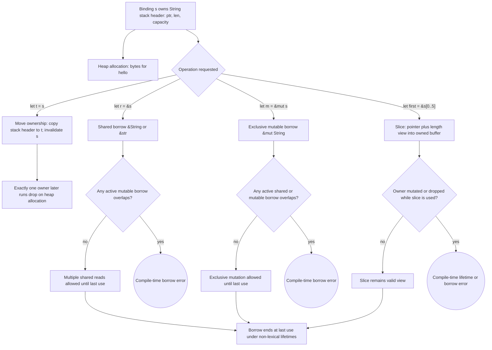

# Ownership, References, and Slices

Rust obtains memory safety for ordinary values without garbage collection or manual deallocation. The compiler tracks who owns each value, when code is borrowing it, and how long derived references remain valid. These checks rule out use-after-free, double-free, iterator invalidation, and data races before the program runs.

Collections, smart pointers, and concurrency all build on the same model. `String` is a useful starting point because its fixed-size header and heap-backed contents expose the difference between moving a value and copying its data.

## One owner is responsible for cleanup

The ownership rules are compact:

1. Every value has an owner.
2. There is only one owner at a time.
3. The value is dropped when its owner leaves scope.

Fixed-size values such as `i32`, `bool`, and many small structs can live entirely on the stack. A `String` has a pointer, length, and capacity in its stack value, while the text buffer lives on the heap.

Assignment moves a heap-owning value:

```rust
let s1 = String::from("hello");
let s2 = s1;
```

Rust copies the three-word header into `s2`, not the heap buffer. Leaving both bindings valid would let both attempt to free the same allocation, so `s1` becomes unusable. The program gets a compile-time move error if it later tries to print `s1`.

`clone` requests an independent owned value and states the potentially allocating operation explicitly:

```rust
let a = String::from("hello");
let b = a.clone();
println!("{a} {b}");
```

`Copy` types behave differently. Integers, booleans, characters, and tuples made entirely of `Copy` elements can be duplicated bit for bit while leaving the source usable. A type that implements `Drop`, including `String`, cannot implement `Copy`.

The ownership and borrowing paths fit into one picture:



## Borrowing separates access from ownership

A reference views a value without taking responsibility for dropping it. `&T` is shared and immutable; `&mut T` is exclusive and permits mutation.

At any point, code may have either any number of shared references or one mutable reference to a value, with no overlap between the modes. Exclusivity lets the compiler assume that no other active reference observes stale or partially updated state while a `&mut T` is in use.

Borrow lifetimes usually end at their final use rather than at the closing brace of the lexical block. Code may use an immutable reference and then take a mutable reference to the owner later in the same block when the compiler can prove that the accesses do not overlap. These non-lexical lifetimes refine where a borrow ends; they do not weaken the aliasing rule.

Function signatures state the ownership policy:

| Parameter form | Takes ownership? | Allows mutation? | Caller can keep using the original? |
|---|---:|---:|---:|
| `String` | yes | yes, if the binding is `mut` | no, unless returned |
| `&String` | no | no | yes |
| `&str` | no | no | yes |
| `&mut String` | no | yes | yes, after the borrow ends |
| `String::clone()` | creates a new owner | the copies mutate separately | yes |

A parameter of type `String` receives ownership. Returning that value can transfer it back, but a borrow is cleaner when the function only inspects the contents. String APIs generally prefer `&str` over `&String` because both borrowed `String` values and string literals can satisfy the broader type.

## Slices keep a view tied to its source

A slice is a pointer-and-length view into a contiguous region. String slices have type `&str`; array and vector slices have type `&[T]`.

Suppose a first-word function returns the byte index `5` for `"hello world"`. If the caller then clears the string, the number remains `5` even though it no longer describes the data:

```rust
let mut s = String::from("hello world");
let word_end = 5;
s.clear();
```

Returning a slice couples the result to the source:

```rust
let mut s = String::from("hello world");
let word = first_word(&s);
s.clear();
println!("{word}");
```

The compiler rejects this sequence because `clear` needs a mutable borrow while `word` is a shared borrow that will be used later. The stale-view bug cannot reach runtime.

```rust
fn first_word(s: &str) -> &str {
    for (index, byte) in s.bytes().enumerate() {
        if byte == b' ' {
            return &s[..index];
        }
    }

    s
}

fn describe_message(message: &str) -> String {
    let first = first_word(message);
    format!("first word: {first}, total bytes: {}", message.len())
}

fn main() {
    let message = String::from("ownership matters");
    let report = describe_message(&message);

    println!("{report}");
    println!("original still usable: {message}");
}
```

`first_word` returns storage borrowed from its input rather than allocating a new string. Its byte scan is valid for the ASCII space delimiter, and every returned boundary comes from a byte position that is also a UTF-8 boundary. Arbitrary string slicing still requires care: Rust string indices are byte offsets, not character positions, and both ends must lie on UTF-8 boundaries.

## Reading borrow-checker failures

Move and borrow errors usually identify a mismatch between the ownership policy in the types and the policy the code needs. Common cases include:

- expecting assignment of `String`, `Vec<T>`, or `HashMap<K, V>` to perform a deep copy;
- cloning only to silence a move error when a borrow would express the real relationship;
- accepting `&String` where `&str` would admit more callers;
- mutating an owner while a shared reference is still used later;
- creating two overlapping `&mut` references;
- returning a reference to a local value that is dropped at the end of the function;
- treating string byte offsets as character positions.

The fix follows from deciding who should own the value, who only needs to observe it, and whether mutation truly requires exclusive access.

## Worked example: follow ownership through function calls

Consider a function that consumes a string and another that only measures it:

```rust
fn add_period(mut text: String) -> String {
    text.push('.');
    text
}

fn byte_len(text: &str) -> usize {
    text.len()
}

let title = String::from("Ownership");
let n = byte_len(&title);
let sentence = add_period(title);

assert_eq!(n, 9);
assert_eq!(sentence, "Ownership.");
```

`title` first owns the `String` header and its heap allocation. `&title` creates a temporary shared `&String`, which coerces to `&str` for `byte_len`. `len` reads the byte count and returns `9`; the borrow ends after the call, while `title` keeps ownership.

The call `add_period(title)` then moves the header into the parameter `text`. The function has exclusive ownership and may mutate the allocation because the binding is `mut`. Returning `text` moves the same header into `sentence`; the buffer need not be copied. Using `title` afterward is rejected because ownership did not move back to that name. When `sentence` leaves scope, its `String` destructor releases the buffer exactly once.

Changing `add_period` to accept `&mut String` would let the caller retain the same binding. Neither signature is universally preferable. Consuming and returning fits transformations that hand ownership onward; a mutable borrow fits an in-place operation where the caller remains the owner.

## Mutable access is exclusive, but it can be divided

Two direct mutable borrows of one value are rejected because they could alias:

```rust
let mut value = 10;
let first = &mut value;
// let second = &mut value; // rejected while `first` is still used
*first += 1;
```

Disjoint fields can often be borrowed separately because the compiler can see that they do not overlap:

```rust
struct Pair { left: i32, right: i32 }

let mut pair = Pair { left: 1, right: 2 };
let left = &mut pair.left;
let right = &mut pair.right;
*left += 10;
*right += 20;
assert_eq!((pair.left, pair.right), (11, 22));
```

Index expressions are harder because arbitrary indices might be equal. The slice method `split_at_mut` proves disjointness once and returns two independent mutable slices:

```rust
let mut values = [1, 2, 3, 4];
let (left, right) = values.split_at_mut(2);
left[0] = 10;
right[0] = 30;
assert_eq!(values, [10, 2, 30, 4]);
```

The split index `2` partitions the valid index ranges into `0..2` and `2..4`. Mutation through the two borrows is allowed because their elements cannot overlap. Asking for an index beyond the length panics rather than constructing invalid references.

Reborrowing temporarily lends access from an existing mutable reference. A call such as `inspect(&*buffer)` can create a short shared view while the `&mut` remains conceptually owned by its caller; mutation resumes after the shared reborrow's last use. The compiler tracks the nested access so the modes do not overlap unsafely.

## Partial moves and destructuring

Patterns can move one field while copying or borrowing another:

```rust
struct Record {
    name: String,
    count: u32,
}

let record = Record { name: String::from("alpha"), count: 3 };
let Record { name, count } = record;
```

`name` moves the `String`; `count` is copied because `u32` implements `Copy`. The whole `record` is no longer usable, but the new bindings are. A destructuring pattern using `ref name` borrows the name instead, allowing later use of the record once the borrow ends, subject to what was moved.

Types implementing `Drop` cannot generally have fields moved out directly because their destructor expects a complete value. Helper methods such as `Option::take`, `mem::replace`, and `mem::take` leave a valid replacement while transferring the old field. These operations encode the requirement that destruction still sees a valid object.

Drop order is deterministic. Local variables are dropped in reverse order of declaration; struct fields are dropped in declaration order after the type's own `drop` method runs. Most code should rely only on ownership rather than intricate order, but resources with dependencies may need fields or explicit guards arranged carefully.

## Worked example: byte boundaries in UTF-8 strings

Rust strings are valid UTF-8, so indexing by a single integer is not supported. The text `"éclair"` begins with `é`, which occupies two UTF-8 bytes:

```rust
let word = "éclair";
assert_eq!(word.len(), 7);
assert_eq!(&word[0..2], "é");
// &word[0..1] would panic: byte 1 is inside `é`.
```

`len` reports seven bytes: two for `é` and one for each of the remaining five ASCII letters. The range `0..2` ends on a character boundary and yields a valid `&str`. The range `0..1` is in bounds as bytes but would split a code point, so slicing panics.

For character-oriented processing, `chars()` decodes Unicode scalar values. For grapheme clusters as users perceive them, standard `char` iteration may still be too fine because one visible symbol can contain several scalar values. The required unit—bytes, scalar values, or grapheme clusters—must be chosen from the problem.

The `first_word` implementation scans bytes only for ASCII space. ASCII bytes cannot occur inside a multibyte UTF-8 encoding, so the found index is a valid string boundary. If the delimiter policy included broader Unicode whitespace, `char_indices` would provide decoded characters together with safe byte positions.

## Lifetimes follow use, not braces alone

Non-lexical lifetimes let a borrow end at its last use:

```rust
let mut message = String::from("hello");
let view = &message;
println!("{view}");
message.push_str(" world");
```

The shared borrow is last used by `println!`, so the later mutable access is accepted even though `view` was declared in the same block. Moving the print below `push_str` would make the uses overlap and the mutation would be rejected, since reallocation could invalidate the slice.

Lifetime annotations on functions do not change when values are dropped. They relate input and output references so callers can be checked. A function cannot return a reference to a local `String` because the owner is destroyed on return; no annotation can lengthen that allocation. Return the owned string or borrow data supplied by the caller.

When the compiler rejects a borrow, list the last use of every reference and the operation needing exclusive access. Often the solution is to shorten a reference's scope, return an owned value, split disjoint data with a safe API, or change a parameter from ownership to borrowing. Cloning is correct only when a genuinely independent owner is required.

## Capacity explains why mutation can invalidate references

`String` and `Vec<T>` keep a length and a capacity. Appending within existing capacity can reuse the allocation; appending beyond it may allocate a larger buffer, move existing elements, and free the old buffer. A reference into the old allocation would then dangle.

The borrow checker does not try to predict whether one particular append will reallocate. A mutable operation such as `push` requires exclusive access while any derived slice that will be used later is active. That conservative rule covers both the reuse and reallocation paths.

Reserving capacity does not permit aliasing around the rule. Even when a programmer knows the address will remain stable, mutation through an owner while a shared reference is active could violate the shared reference's immutability guarantee. Safe APIs reason from types and borrows, not from an incidental allocation plan.

Moving a `String` is different from moving its buffer. The small header changes stack location, but the heap allocation normally stays where it is; references into the buffer can remain meaningful only if the ownership and borrow rules also allow the move. Rust rejects moving an owner while it is borrowed because the general type may contain data whose address or destruction behavior makes such a move unsafe.

<div className="see-also">

See also: [Common programming concepts](/cs/programming/rust/common-programming-concepts) · [Structs, methods, and enums](/cs/programming/rust/structs-methods-enums) · [Common collections](/cs/programming/rust/common-collections) · [Generics, traits, and lifetimes](/cs/programming/rust/generics-traits-lifetimes) · [Smart pointers](/cs/programming/rust/smart-pointers) · [Concurrency and shared state](/cs/programming/rust/concurrency-and-shared-state)

</div>
