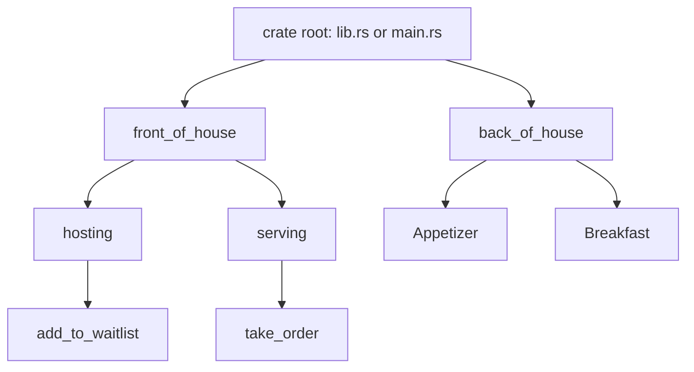

# Packages, Crates, and Modules

Once a Rust project grows beyond one file, its design includes placement and visibility: where an item belongs, which code may use it, and which path names it. Cargo packages and compiler crates set the outer compilation boundaries; modules, paths, and `use` organize names inside a crate.

## From a Cargo package to the module tree

A package is a Cargo unit described by `Cargo.toml`. It contains one or more crates, with at most one library crate and any number of binary crates.

A crate is a compilation unit. The compiler begins at its crate root: normally `src/main.rs` for a binary target and `src/lib.rs` for a library target. From there, module declarations form a tree of functions, structs, enums, traits, constants, implementations, and nested modules.



A path locates an item in that tree:

| Form | Example | Starting point or effect |
|---|---|---|
| Absolute path | `crate::front_of_house::hosting::add_to_waitlist` | Crate root |
| Relative path | `front_of_house::hosting::add_to_waitlist` | Current module |
| Parent path | `super::serve_order()` | Parent module |
| Private item | `fn cook_order()` | Current module and its descendants |
| Public item | `pub fn eat_at_restaurant()` | Callers that can reach its public path |
| Re-export | `pub use front_of_house::hosting;` | A new public path in the API |

`self` can make the current-module starting point explicit. Absolute and relative forms are both useful; the clearer choice depends on how stable and nearby the referenced item is.

## Privacy defines the public API

Items are private to their parent module by default. Descendant modules can access items from their ancestors, but an ancestor cannot enter a child's private namespace. Every segment on an external path must have sufficient visibility.

Consider a restaurant crate:

```rust
mod front_of_house {
    pub mod hosting {
        pub fn add_to_waitlist() {}
    }

    mod serving {
        fn take_order() {}
    }
}

pub fn eat_at_restaurant() {
    crate::front_of_house::hosting::add_to_waitlist();
}
```

The crate root can access its private child `front_of_house`. Inside that module, `hosting` and `add_to_waitlist` are public, so the crate-level function can reach the operation. Outside callers use `eat_at_restaurant`; they cannot reach the private `serving::take_order` implementation.

Visibility is granular. Making a struct public does not expose its fields:

```rust
mod back_of_house {
    pub struct Breakfast {
        pub toast: String,
        seasonal_fruit: String,
    }

    impl Breakfast {
        pub fn summer(toast: &str) -> Breakfast {
            Breakfast {
                toast: String::from(toast),
                seasonal_fruit: String::from("peaches"),
            }
        }
    }
}
```

Callers may construct a breakfast through `Breakfast::summer` and replace the public `toast` field. They cannot assign to `seasonal_fruit`, so the constructor retains control of that invariant. Public enum variants follow a different rule: when an enum is public, its variants are public too.

## Files store modules; declarations create them

The module tree is a language structure, not a directory scan. A declaration such as `mod garden;` tells Rust that the module exists and directs it to the corresponding source file.

A `garden` module can be stored in `src/garden.rs` or the older `src/garden/mod.rs` form. A child named `vegetables`, declared inside `garden`, can live in `src/garden/vegetables.rs` or `src/garden/vegetables/mod.rs`. Current projects usually prefer the non-`mod.rs` form when possible.

Missing-module errors therefore involve two questions: whether the module was declared at the right point in the tree, and whether Rust can find the file for that declaration. Moving a file without updating the relevant `mod` statements breaks the tree even if the new directory layout looks plausible.

## Imports and re-exports shape the names callers see

`use` brings a path into the current scope; it does not change the imported item's visibility. Idiomatic imports often bring a function's parent module into scope, preserving useful context at the call site, while structs, enums, and other named types are commonly imported directly:

```rust
use std::fmt;
use std::collections::HashMap;
```

`as` resolves collisions between final names. Keeping one or both module-qualified is another clear option.

`pub use` both imports and re-exports. It can present a short stable API even when the private implementation tree is deeper:

```rust
pub use crate::front_of_house::hosting;
```

That convenience is also a compatibility commitment. Downstream code may name the re-exported path, so reorganizing private files is cheap while changing public paths can break users.

## A controlled inventory type

The following module exposes the operations callers need while retaining control of the `category` field:

```rust
mod inventory {
    #[derive(Debug)]
    pub enum Category {
        Book,
        Tool,
        Food,
    }

    #[derive(Debug)]
    pub struct Item {
        pub name: String,
        category: Category,
    }

    impl Item {
        pub fn new(name: &str, category: Category) -> Item {
            Item {
                name: String::from(name),
                category,
            }
        }

        pub fn category(&self) -> &Category {
            &self.category
        }
    }
}

use inventory::{Category, Item};

fn main() {
    let item = Item::new("Rust book", Category::Book);
    println!("{} is a {:?}", item.name, item.category());
}
```

The public constructor can validate future representation changes, and the accessor exposes a borrow rather than allowing arbitrary replacement. Internal file splits may follow maintenance needs; the public names should follow the concepts callers need.

## Diagnosing path and visibility errors

Several near-misses recur in larger trees:

- a module is `pub`, but the item inside it remains private;
- a struct is `pub`, but code assumes its fields are public too;
- a re-export leaks an implementation detail that later becomes hard to move;
- package and crate are treated as synonyms even though one package may build several crates;
- a file moves without the corresponding `mod` declaration changing;
- two imports introduce the same final name without `as` or module qualification;
- every nearby reference uses a long `crate::...` path even where a short relative path would read more clearly.

The useful debugging sequence is to identify the target in the module tree, trace every path segment from the current module, then check visibility and file placement.

## Worked example: split one library into files

Suppose a package exposes gardening types and also builds a small command-line program. Its source tree is:

```text
garden_app/
  Cargo.toml
  src/
    lib.rs
    garden.rs
    garden/
      vegetables.rs
    main.rs
```

The declarations, rather than the directories alone, create the module tree. `src/lib.rs` contains:

```rust
pub mod garden;
pub use garden::vegetables::Asparagus;
```

`src/garden.rs` contains:

```rust
pub mod vegetables;

pub fn season() -> &'static str {
    "summer"
}
```

`src/garden/vegetables.rs` contains:

```rust
#[derive(Debug)]
pub struct Asparagus {
    pub length_cm: u32,
}
```

Compilation starts at `lib.rs`. The declaration `pub mod garden;` loads `garden.rs` and creates the child module `garden`. Its `pub mod vegetables;` loads `garden/vegetables.rs` as a child. The re-export in `lib.rs` gives external callers the shorter path `garden_app::Asparagus` while the defining path remains `garden_app::garden::vegetables::Asparagus`.

The binary root `main.rs` is a separate crate in the same package:

```rust
use garden_app::{garden, Asparagus};

fn main() {
    let plant = Asparagus { length_cm: 24 };
    println!("{plant:?} grows in {}", garden::season());
}
```

The binary accesses the library as an external crate by its crate name. It cannot use the library's private items merely because both targets share a package. That separation catches accidental reliance on internals and keeps the reusable API honest.

If `pub mod garden` became plain `mod garden`, the root could still re-export `Asparagus`, but the binary could no longer name `garden::season` through the public path. Visibility is checked along the entire path. A public leaf hidden behind a private ancestor is unreachable unless another public re-export exposes it.

## `pub(crate)`, `pub(super)`, and restricted visibility

Visibility need not be only private or globally public. `pub(crate)` exposes an item throughout the current crate but not to downstream crates. It is useful for helpers shared across internal modules. `pub(super)` exposes an item to the parent module. Restricted forms such as `pub(in crate::path)` can name an ancestor scope.

Narrow visibility records architectural intent. A parser helper used by two sibling modules may be crate-visible without becoming a compatibility promise to users. Making everything `pub` to silence an access error grows the external API and allows callers to depend on representation details.

Privacy is relative to the module tree. A parent can define policy through public methods while children use private ancestors' items according to Rust's descendant access rules. When an access error appears, identify the item and the caller's module; file proximity does not decide permission.

## Imports affect names, not ownership or loading

`use` creates a shorter name in the current scope. It does not copy the item, execute a module, or make a private definition public. Child modules have their own scopes and do not automatically inherit a parent's `use` declarations. They can refer through `super`, import directly, or sometimes use names re-exported by an ancestor.

Grouped imports reduce repetition when they remain readable:

```rust
use std::{cmp::Ordering, collections::HashMap, io::{self, Write}};
```

`self` in the nested group imports the `io` module alongside `io::Write`. A glob import brings every public name from a path into scope. It is common in test modules or preludes with deliberate conventions, but broad globs in application code can hide where names originate and can introduce conflicts when an upstream crate adds exports.

Two types named `Result` or `Error` can coexist through aliases:

```rust
use std::fmt::Result as FmtResult;
use std::io::Result as IoResult;
```

Alternatively, importing the parent modules and writing `fmt::Result` and `io::Result` keeps context at each use. The better form is the one that reduces ambiguity in that module.

## Worked example: protect a constructor invariant

Consider a percentage that must remain between zero and one hundred:

```rust
pub mod metrics {
    #[derive(Debug, Clone, Copy, PartialEq, Eq)]
    pub struct Percent(u8);

    impl Percent {
        pub fn new(value: u8) -> Option<Self> {
            (value <= 100).then_some(Self(value))
        }

        pub fn get(self) -> u8 {
            self.0
        }
    }
}
```

The struct is public, but its tuple field is private. External code can name `Percent` and store it, yet `Percent(200)` fails outside the defining module. `new(85)` checks the range and returns `Some(Percent(85))`; `new(200)` returns `None`. Once constructed, `get` can safely return the inner value because the module controls every creation path.

Making the field public would erase the invariant. Making only the module public would not be enough if the struct remained private. Every segment and the final item participate in reachability, while field privacy separately controls construction and mutation.

An enum differs because its variants define how values are constructed and matched. Public enum variants are public with the enum. When callers should not exhaustively match future states, a public struct with private representation and methods may offer more evolution room; alternatively, a non-exhaustive design can signal that variants or fields may grow.

## Public paths become compatibility commitments

Files can move freely when public paths remain stable through re-exports. A crate might define a type deep under an internal module and expose it at the root. Downstream code then depends on the root path, not the file layout. This lets maintainers reorganize implementation without forcing import changes.

Re-exporting the same item from several public paths can be convenient during a migration, but it also leaves multiple documented names. A deliberate facade module often gives a library a smaller surface than exposing every internal module. API documentation, examples, and compiler diagnostics then point callers toward concepts rather than storage decisions.

Cycles in the conceptual design do not require circular file declarations. Modules form one tree rooted at the crate. Sibling modules can refer to each other through crate-relative paths when visibility permits, even though neither contains the other in the filesystem. If two modules need extensive access to each other's internals, their responsibilities may be too entangled.

## Packages with several targets

One package may have a library, the default binary, additional binaries under `src/bin`, examples, integration tests, and benchmarks. Each target is a crate with its own root and compilation context. Integration tests under `tests` are separate crates that can use only the library's public API. Unit tests inside a source module can access that module's private items through a child test module.

A workspace groups several packages under shared dependency resolution and a common target directory. Workspace membership does not merge their module trees or privacy boundaries. Each package still declares dependencies on the others it uses. Choose another package when a component needs an independent version, dependency set, or compilation boundary; choose another module for ordinary organization within one crate.

<div className="see-also">

See also: [Getting started, toolchain, and Cargo](/cs/programming/rust/getting-started-toolchain-cargo) · [Structs, methods, and enums](/cs/programming/rust/structs-methods-enums) · [Common collections](/cs/programming/rust/common-collections) · [Cargo and crates.io workflow](/cs/programming/rust/cargo-crates-io-workflow) · [Object-oriented and advanced features](/cs/programming/rust/object-oriented-and-advanced-features)

</div>
