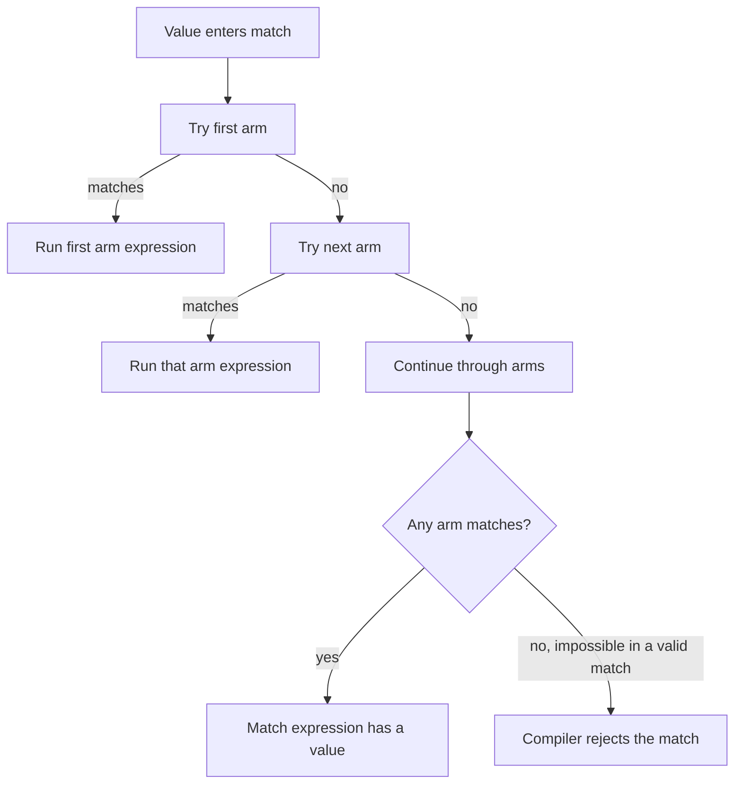

# Pattern Matching

Patterns describe the shape of a value and bind the pieces a branch needs. They appear in `match`, `if let`, `while let`, `let` bindings, `for` loops, function parameters, and closures. Because enum definitions enumerate the possible variants, the compiler can check that a full `match` accounts for every case.

## A match is ordered and exhaustive

`match` evaluates arms from top to bottom and runs the first matching expression. A broad pattern before a narrow one can therefore make the later arm unreachable.



Common pattern forms compose with one another:

| Form | Example | Meaning |
|---|---|---|
| Literal | `0` | Match exactly zero |
| Range | `1..=5` | Match an inclusive range |
| Variable | `x` | Match anything and bind it |
| Wildcard | `_` | Match anything and bind nothing |
| Tuple | `(x, y)` | Destructure two elements |
| Struct | `Point` \{ `x, y: 0` \} | Destructure named fields |
| Enum | `Some(value)` | Match a specific variant |
| Guard | `Some(x) if x > 0` | Add a condition |
| Binding | `id @ 3..=7` | Test and bind the same value |

Exhaustiveness follows from the type. If a `match` over `Option<T>` omits `None` and has no catchall arm, an input exists for which the expression would produce no value, so Rust rejects it.

Nested patterns handle nested enums without manual unwrapping:

```rust
let value = Some(Ok(12));

let message = match value {
    Some(Ok(n)) => format!("number: {n}"),
    Some(Err(e)) => format!("error: {e}"),
    None => String::from("missing"),
};
```

For `Some(Ok(12))`, the first arm binds `n` to `12` and produces `"number: 12"`. An error value takes the second arm, and absence takes the third.

## Refutable patterns belong where failure is allowed

An irrefutable pattern always matches, as in `let x = 5;` or a function parameter name. A refutable pattern can fail: `Some(x)` does not match `None`.

`let` and function parameters require irrefutable patterns because those positions have no branch for failure. `match`, `if let`, and `while let` are designed for refutable patterns.

`if let` is concise when only one shape matters:

```rust
if let Some(port) = configured_port {
    println!("listening on {port}");
}
```

`while let` repeats while the pattern continues to match and is often used to consume a stack:

```rust
while let Some(value) = stack.pop() {
    println!("{value}");
}
```

When every variant carries meaning, a full `match` retains the exhaustiveness check. As an enum grows, the compiler then identifies every match site that needs a decision about the new variant.

## Destructuring also controls ownership

Patterns do more than test structure: they can move, copy, or borrow fields. Matching an owned enum by value may move a `String` or `Vec<T>` into a binding. Matching `&message` instead generally binds references through match ergonomics and leaves the owner intact. Explicit `ref` and `ref mut` bindings are still available when the borrowing mode needs to be stated inside a pattern.

`_` and an underscore-prefixed name differ here. The wildcard `_` does not bind. A name such as `_unused` does bind and can still move its value; the prefix only suppresses the unused-variable warning.

The following function borrows each command, so describing the array does not consume it:

```rust
#[derive(Debug)]
enum Command {
    Quit,
    Move { x: i32, y: i32 },
    Echo(String),
    ChangeColor(u8, u8, u8),
}

fn describe(command: &Command) -> String {
    match command {
        Command::Quit => String::from("stop the program"),
        Command::Move { x, y } if *x == 0 && *y == 0 => {
            String::from("move to the origin")
        }
        Command::Move { x, y } => format!("move to ({x}, {y})"),
        Command::Echo(text) => format!("echo {text:?}"),
        Command::ChangeColor(r, g, b) => {
            format!("set color to rgb({r}, {g}, {b})")
        }
    }
}

fn main() {
    let commands = [
        Command::Move { x: 0, y: 0 },
        Command::Echo(String::from("hello")),
        Command::ChangeColor(255, 128, 0),
        Command::Quit,
    ];

    for command in &commands {
        println!("{}", describe(command));
    }
}
```

The origin-specific arm precedes the general `Move` arm. Reversing them would leave the guarded arm unreachable.

## Guards and bindings refine structural cases

A match guard is an `if` condition attached to an arm. It handles a relationship that structural syntax alone cannot state. Guards do not contribute to exhaustiveness like unguarded patterns because their condition may be false.

For example, a point classifier can combine field patterns with a diagonal guard:

```rust
struct Point {
    x: i32,
    y: i32,
}

let p = Point { x: -3, y: 3 };

let label = match p {
    Point { x: 0, y: 0 } => "origin",
    Point { x, y: 0 } => "x axis",
    Point { x: 0, y } => "y axis",
    Point { x, y } if x.abs() == y.abs() => "diagonal",
    Point { .. } => "general",
};
```

The first three arms fail for `(-3, 3)`; the fourth binds both fields and passes its guard, producing `"diagonal"`. The final `Point` \{ `..` \} arm covers values such as `(2, 5)`.

The `@` operator combines a test with a binding:

```rust
id @ 3..=7
```

This pattern accepts the inclusive range and retains the matched number under the name `id`.

## When a pattern says more or less than intended

Most mistakes come from arm coverage, order, or ownership:

- omitting an enum variant from an exhaustive `match`;
- placing `_` or another catchall before specific arms;
- using `if let` where every variant should be handled explicitly;
- moving a non-`Copy` field when the original value is needed later;
- assuming `_name` behaves like the non-binding wildcard `_`;
- relying on a guarded arm to cover all values of its underlying pattern;
- using byte indices to inspect string data instead of string methods and valid slices.

The best pattern form follows the data shape and the number of cases whose behavior matters.

## Worked example: parse a small command language

Patterns become more useful when parsing has already produced structured data. Suppose commands are represented as token slices:

```rust
#[derive(Debug, PartialEq)]
enum Action<'a> {
    Quit,
    Show(&'a str),
    Move { x: i32, y: i32 },
}

fn parse(tokens: &[&str]) -> Result<Action<'_>, &'static str> {
    match tokens {
        ["quit"] => Ok(Action::Quit),
        ["show", name] => Ok(Action::Show(name)),
        ["move", x, y] => {
            let x = x.parse().map_err(|_| "invalid x coordinate")?;
            let y = y.parse().map_err(|_| "invalid y coordinate")?;
            Ok(Action::Move { x, y })
        }
        ["move", ..] => Err("move requires exactly two coordinates"),
        [] => Err("empty command"),
        _ => Err("unknown command"),
    }
}
```

For `&["show", "status"]`, the second slice pattern matches exactly two elements, checks the first literal, and binds `name` to the second. The result borrows `status` from the token slice. For `&["move", "3", "-2"]`, the third arm binds both text coordinates, parses them in order, and returns `Move` with integers.

For `&["move", "3"]`, the exact three-element arm fails. The next pattern checks a first element of `move` and allows any remaining length through `..`, so it returns the specific arity error. An unknown first word reaches `_`. Ordering matters: placing `_` first would make every later arm unreachable, while placing the broad `move` arm before the exact form would prevent valid moves from being parsed.

The parser uses patterns for structure and ordinary expressions for fallible numeric conversion. Trying to force parsing into a pattern would mix concerns the language treats separately.

## Binding modes: move, copy, and borrow

Matching a value by value follows ordinary ownership. `Copy` fields are copied; non-`Copy` fields are moved unless the pattern borrows them. Consider:

```rust
struct User {
    name: String,
    active: bool,
}

let user = User { name: String::from("Ada"), active: true };
let User { name, active } = user;
```

`name` receives the owned `String`, while `active` receives a copied boolean. The original `user` cannot be used as a complete value afterward. Matching `&user` instead produces borrowed bindings through match ergonomics:

```rust
let user = User { name: String::from("Ada"), active: true };
let User { name, active } = &user;
assert_eq!(name, "Ada");
assert!(*active);
println!("{}", user.name);
```

The pattern shape still names `User` even though the scrutinee is `&User`; Rust adjusts the default binding mode to references. Explicit `ref` and `ref mut` remain useful in mixed patterns where one field is moved and another borrowed, but borrowing the scrutinee is often clearer.

`@` retains a whole value while destructuring or testing it. It can name a complete `Message::Move` value while a nested field pattern requires its `x` field to be zero. The binding must obey the same ownership rules as the nested fields.

## Worked example: guards do not replace structural coverage

Classify a temperature command with ranges and a guard:

```rust
fn advice(reading: Option<i32>, limit: i32) -> &'static str {
    match reading {
        None => "sensor unavailable",
        Some(value @ ..=-1) => {
            let _recorded = value;
            "freezing"
        }
        Some(value) if value > limit => "above configured limit",
        Some(0..=25) => "normal",
        Some(_) => "warm",
    }
}

assert_eq!(advice(None, 30), "sensor unavailable");
assert_eq!(advice(Some(-4), 30), "freezing");
assert_eq!(advice(Some(35), 30), "above configured limit");
assert_eq!(advice(Some(20), 15), "above configured limit");
```

For `Some(20)` with limit `15`, the negative range fails, then the guard passes, so the result is “above configured limit” even though `20` also lies in `0..=25`. First match wins. With limit `30`, the guard fails and matching continues to the normal range.

The guarded `Some(value)` arm does not cover every `Some`; its condition can be false. The final `Some(_)` remains necessary for exhaustiveness after the finite normal range. Guards can refer to outer variables such as `limit`, but a pattern binding with the same name would shadow that outer variable. Naming both values distinctly avoids a subtle comparison against the wrong binding.

## `if let`, `let else`, and full `match`

`if let` fits a single interesting pattern plus an optional fallback. `let else` fits an early-exit check that leaves successful bindings in the surrounding scope:

```rust
fn print_port(value: Option<&str>) {
    let Some(text) = value else {
        eprintln!("missing port");
        return;
    };

    let Ok(port) = text.parse::<u16>() else {
        eprintln!("invalid port");
        return;
    };

    println!("port: {port}");
}
```

If `value` is `None`, the first `else` block must diverge through `return`, `break`, `continue`, or panic. On success, `text` is available afterward. Parsing then performs a second refutable check and leaves `port` in scope. A nested pair of `if let` expressions could express the same logic but would indent the successful path.

A full `match` is preferable when several variants carry policy. Its exhaustiveness check becomes useful during enum evolution: adding a variant points to each decision site lacking a case. A wildcard deliberately opts out of that compiler assistance for future variants, so it should represent a genuinely uniform fallback.

## Rest patterns and ignored values

`..` ignores the remaining fields or elements without naming them. In a `Point` struct pattern, it can leave every field except `x` unnamed. In a tuple, `(first, .., last)` can select endpoints when the tuple length is known. A slice pattern such as `[head, tail @ ..]` binds the first element and the remaining subslice.

The bare wildcard `_` neither binds nor moves a value. `_name` creates a real binding whose name merely suppresses the unused warning, so it may move ownership. This distinction matters with `String`:

```rust
let value = Some(String::from("text"));
if let Some(_) = value { /* `value` is not moved by `_` */ }
println!("{value:?}");
```

Replacing `_` with `_text` would bind and move the string out of the option, preventing the later print. Use `_` when the value must be ignored without ownership, and an underscore-prefixed name when it is intentionally bound for future or conditional use.

## Exhaustiveness is a maintenance tool

For finite types such as enums and booleans, the compiler can prove full coverage directly. Integer and character types are large but ranges and catchalls can cover them. Guards are deliberately excluded from coverage reasoning because the compiler does not generally prove arbitrary boolean expressions.

Unreachable-pattern warnings often reveal an ordering mistake or a redundant case. They should not be silenced reflexively. If one arm subsumes another, either the broad behavior is intended and the narrow arm should disappear, or the narrow arm must move earlier.

Patterns should express data shape, leaving computation in arm bodies and guards. Deeply nested patterns can be precise, but once error reporting or conversion needs several stages, naming an intermediate value generally produces better diagnostics and clearer ownership.

## Or-patterns combine cases with one binding contract

The `|` operator lets several patterns share one arm:

```rust
let label = match status {
    200 | 201 | 204 => "success",
    400..=499 => "client error",
    500..=599 => "server error",
    _ => "other",
};
```

For `201`, the first alternative matches and produces `success`. For `503`, the first two arms fail and the server range succeeds. Inclusive ranges work for numeric and character types whose ordering is known to the compiler.

Every alternative in an or-pattern must introduce compatible bindings. An arm such as `Some(x) | None` cannot use `x`, because the `None` alternative has no value to bind. Restructure the arms or bind only information present in every alternative. This rule prevents an arm body from receiving a conditionally initialized name.

Parentheses can clarify where an or-pattern applies inside a larger pattern. `Some(1 | 2)` matches two inner values, while top-level alternatives can repeat a larger shape. Prefer the form that exposes the shared structure without becoming a puzzle.

Ranges describe ordered sets but cannot express every numeric relation. “Two fields are equal,” “one field exceeds a runtime limit,” and “a number is even” require guards or arm-body logic. A guard runs only after its structural pattern has bound values. That order avoids computing a condition for shapes that could never use it.

Pattern matching does not automatically validate external data. Parsing bytes into an enum or struct remains a fallible step, and the resulting structured value may still need semantic checks. Once those checks produce a faithful type, exhaustive matches make later decisions much harder to forget.

The compiler checks that contract continuously.

<div className="see-also">

See also: [Structs, methods, and enums](/cs/programming/rust/structs-methods-enums) · [Error handling](/cs/programming/rust/error-handling) · [Common collections](/cs/programming/rust/common-collections) · [Generics, traits, and lifetimes](/cs/programming/rust/generics-traits-lifetimes) · [Macros and unsafe Rust](/cs/programming/rust/macros-and-unsafe-rust)

</div>
