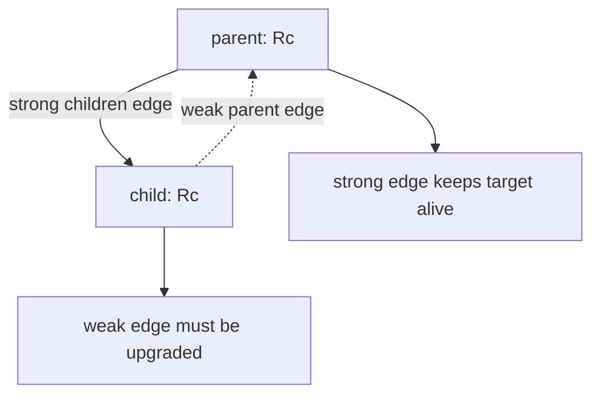

# Smart Pointers

Rust references borrow a value whose owner lives elsewhere. Smart pointers are values that usually own storage themselves and add some policy around access: heap allocation, reference counting, runtime borrow checks, or a non-owning link into shared storage. The policy matters more than the pointer-shaped syntax. Choosing one means choosing an ownership graph and deciding when its invariants are checked.

## Start from the ownership edge

Most data needs no smart pointer. A local value, a field owned directly by its struct, or a temporary `&T` keeps the lifetime and mutation story easy to read. Indirection earns its place when the representation needs something that direct ownership cannot express.

| Type | What the edge means | Borrow checks | Thread-safe? | Typical reason to use it |
|---|---|---|---:|---|
| `Box<T>` | exactly one owner, value stored on the heap | compile time | if `T` is | recursive layout, trait object, stable indirection |
| `Rc<T>` | one of several strong owners | compile time | no | shared immutable data in one thread |
| `RefCell<T>` | one owner with mutable access checked dynamically | runtime | no | interior mutability in one thread |
| `Rc<RefCell<T>>` | shared ownership of dynamically borrowed data | runtime for the inner value | no | a genuinely shared mutable node |
| `Weak<T>` | observer that does not keep an `Rc` allocation alive | after `upgrade` | no | parent/back links and caches |

`Arc<T>`, `Mutex<T>`, and `RwLock<T>` are the corresponding building blocks once threads enter the design. Replacing every `Rc` with `Arc` is not a harmless style change: atomic count updates cost more, and `Arc<T>` still does not make mutation of `T` safe by itself.

## Why recursive types need `Box`

The compiler must know the size and alignment of every local variable. A directly recursive definition has no finite size:

```rust
enum List {
    Cons(i32, List),
    Nil,
}
```

If `S` denotes `size_of::<List>()`, a `Cons` would need space for an `i32`, a discriminant, padding, and another complete `List`. In rough terms the layout equation is $S \ge c + S$ for some positive $c$, which has no finite solution. A box changes the recursive field to a fixed-size pointer:

```rust
#[derive(Debug)]
enum List {
    Cons(i32, Box<List>),
    Nil,
}

let list = List::Cons(
    1,
    Box::new(List::Cons(
        2,
        Box::new(List::Cons(3, Box::new(List::Nil))),
    )),
);
```

Now each `Cons` contains a discriminant, an integer, and one box handle. The handle has a known size even though the allocation it points to contains another node. Ownership remains simple: the head owns its successor, and dropping the head eventually drops every box in the chain.

### Worked example: traversing without consuming

Pattern matching must respect that ownership. A length function only needs to inspect a list, so it borrows the node:

```rust
fn len(list: &List) -> usize {
    match list {
        List::Nil => 0,
        List::Cons(_, tail) => 1 + len(tail),
    }
}

assert_eq!(len(&list), 3);
println!("{list:?}"); // still owned here
```

The steps for `1 -> 2 -> 3 -> Nil` are explicit: `len` sees the first `Cons` and computes `1 + len(tail)`; the next two calls do the same; `Nil` returns `0`; the stack unwinds as $1 + (1 + (1 + 0)) = 3$. In the `Cons` arm, `tail` is a borrowed box because the matched expression was borrowed. Deref coercion turns `&Box<List>` into `&List` for the recursive call. Had the function accepted `List` by value, matching would move each tail and consume the chain.

Heap allocation alone is rarely a speed optimization. A `Box<T>` adds allocation and pointer chasing, while moving the box copies only its small handle. It helps when stable indirection or a smaller outer value is valuable, not merely because `T` is large.

## `Deref` and `Drop`: the two pointer-like traits

`Box<T>`, `Rc<T>`, and several library types implement `Deref`. For a smart pointer `p`, `*p` is conceptually translated through `Deref::deref(&p)`, producing a reference to the target. Method lookup and function calls may apply repeated deref coercions. For example, `String` dereferences to `str`, so `&String` can be passed to a function expecting `&str`.

```rust
fn first_byte(text: &str) -> Option<u8> {
    text.as_bytes().first().copied()
}

let text = Box::new(String::from("rust"));
assert_eq!(first_byte(&text), Some(b'r'));
```

The coercion chain is `&Box<String>` to `&String`, then `&String` to `&str`. Rust inserts these borrow-preserving conversions at suitable coercion sites. It does not transfer ownership of either the box or the string.

A custom `Deref` should feel like transparent access to the contained value. Allocation, I/O, locking with surprising duration, or unrelated calculation hidden behind `*x` makes ordinary expressions difficult to reason about. Wrapper types that are not pointer-like are usually better served by named methods.

`Drop` runs when an owned value leaves scope. Fields are then dropped automatically as part of the containing value's cleanup. Code cannot call `Drop::drop` directly because Rust would still attempt the automatic drop later. `std::mem::drop(value)` consumes a value and ends its lifetime early:

```rust
use std::fs::File;

let output = File::create("result.txt")?;
// write through `output` ...
drop(output); // close before a later operation needs the completed file
```

Early `drop` is also useful for releasing a borrow guard or lock guard. Cleanup should release resources and restore local invariants; large hidden actions at scope exit make control flow hard to audit.

## Shared ownership with `Rc`

`Rc<T>` stores `T` beside reference-count metadata. `Rc::clone(&x)` increments the strong count and returns another handle to the same allocation. It does not clone `T`. When the final strong handle is dropped, `T` is dropped. Weak handles may keep the allocation's bookkeeping around for longer, but they do not keep `T` alive.

### Worked example: sharing an immutable tail

Two lists can share a suffix without copying it:

```rust
use std::rc::Rc;

#[derive(Debug)]
enum SharedList {
    Cons(i32, Rc<SharedList>),
    Nil,
}

let tail = Rc::new(SharedList::Cons(
    10,
    Rc::new(SharedList::Cons(20, Rc::new(SharedList::Nil))),
));
assert_eq!(Rc::strong_count(&tail), 1);

let left = SharedList::Cons(1, Rc::clone(&tail));
assert_eq!(Rc::strong_count(&tail), 2);

{
    let right = SharedList::Cons(2, Rc::clone(&tail));
    assert_eq!(Rc::strong_count(&tail), 3);
    println!("{right:?}");
}

assert_eq!(Rc::strong_count(&tail), 2);
println!("{left:?}");
```

After construction, `tail` contributes one strong owner. Building `left` adds another. Building `right` inside the block raises the count to three; leaving the block drops `right` and its handle, returning the count to two. The nodes `10 -> 20` are allocated once. Neither branch can mutate them through `Rc`, which prevents one owner from changing data while another assumes it is stable.

Strong counts are useful when learning or debugging, but application logic should seldom depend on their exact value. Temporary clones and library internals can make count-based decisions brittle. Prefer `Rc::ptr_eq` if the real question is whether two handles point to the same allocation.

## Interior mutability with `RefCell`

The ordinary borrow rule permits either any number of shared references or exactly one mutable reference. `RefCell<T>` keeps that rule but checks it while the program runs. `borrow()` returns a `Ref<T>` guard and increments a shared-borrow count. `borrow_mut()` returns a `RefMut<T>` guard only if no other borrow is active. A violation panics; `try_borrow` and `try_borrow_mut` return an error instead.

```rust
use std::cell::RefCell;

let score = RefCell::new(10);
let read = score.borrow();
assert_eq!(*read, 10);

// let write = score.borrow_mut(); // would panic while `read` is alive
drop(read);
*score.borrow_mut() += 5;
assert_eq!(*score.borrow(), 15);
```

The first guard remains active until its last use or until it is explicitly dropped. Ending the binding's lexical block is sufficient, but relying on non-lexical lifetime shortening can be less obvious around guards. Small scopes or `drop(read)` state the intended boundary.

Interior mutability supports methods that logically preserve the identity of an object while updating hidden state, such as a test spy recording calls or a lazily populated cache. It does not mean that every `&self` method should mutate freely. Callers still benefit from knowing which operations change observable state.

`Rc<RefCell<T>>` composes two independent policies: `Rc` answers who owns the allocation, while `RefCell` answers when the inner value may be borrowed. Suppose three handles refer to one counter:

```rust
use std::cell::RefCell;
use std::rc::Rc;

let value = Rc::new(RefCell::new(5));
let left = Rc::clone(&value);
let right = Rc::clone(&value);

*left.borrow_mut() += 4;  // 5 -> 9; guard ends after the statement
*right.borrow_mut() *= 2; // 9 -> 18
let observed = *value.borrow();
assert_eq!(observed, 18);
```

There are three strong owners, but each mutation obtains the sole active mutable guard. Keeping the first guard in a variable across the second call would panic. If failure is possible because callbacks or recursion may retain a guard, `try_borrow_mut` lets the program handle contention instead of aborting the current thread.

## Breaking cycles with `Weak`

Reference counting cannot discover unreachable cycles. If a parent strongly owns a child and the child strongly owns the parent, dropping the external handle merely leaves two counts holding each other above zero. The program remains memory safe, but both values leak.



The usual tree representation gives ownership to downward edges and uses `Weak<Node>` for the parent link. `Rc::downgrade(&parent)` creates it. Calling `upgrade()` returns `Option<Rc<Node>>`: `Some` temporarily restores strong ownership if the target survives, while `None` reports that it was already dropped. Code must be prepared for the parent to disappear.

Weak pointers also fit caches whose entries should be reusable without extending object lifetime. They are not raw pointers: the reference-count allocation keeps enough metadata for safe `upgrade`, and Rust never returns a dangling `Rc`.

## Boxes as owning trait objects

Another use for `Box` comes from dynamically sized types. A trait such as `Draw` does not determine the concrete size of a value implementing it. `dyn Draw` therefore cannot usually be stored directly as a local value or in a homogeneous vector. `Box<dyn Draw>` has a known outer size and owns a concrete value behind a trait-object pointer.

```rust
trait Draw {
    fn draw(&self) -> String;
}

struct Label(String);
struct Divider(usize);

impl Draw for Label {
    fn draw(&self) -> String {
        self.0.clone()
    }
}

impl Draw for Divider {
    fn draw(&self) -> String {
        "-".repeat(self.0)
    }
}

let items: Vec<Box<dyn Draw>> = vec![
    Box::new(Label(String::from("Status"))),
    Box::new(Divider(6)),
];

assert_eq!(items[0].draw(), "Status");
assert_eq!(items[1].draw(), "------");
```

Each vector element has the same representation even though the owned concrete values differ. Conceptually, the trait-object handle contains a pointer to data and a pointer to a method table for the concrete type. Calling `draw` dispatches through that table. The box is responsible for eventually dropping the concrete value with the correct destructor.

This choice differs from an enum. An enum works well when all concrete alternatives are known and the code benefits from exhaustive matching. A trait object works when callers care about a shared behavior and the set of implementations may grow independently. It adds indirection and dynamic dispatch, so an enum or a generic parameter remains preferable when the alternatives are closed or compile-time specialization matters.

The same sized/unsized distinction explains `Box<str>` and `Box<[T]>`. A bare `str` or slice has no compile-time length, but the owning box carries the information needed to address the allocation. Converting a `String` into `Box<str>` can also express that the text will no longer need spare capacity or string-specific growth.

## Cost and allocation boundaries

The wrappers have different costs, and none should be treated as syntax alone. `Box::new` generally creates one heap allocation. Cloning an `Rc` updates a non-atomic counter; cloning an `Arc` performs atomic operations. `RefCell` checks and updates borrow state on every guarded access. `Weak::upgrade` tests whether a strong owner remains and, on success, increments the strong count.

Allocation placement can affect locality more than the wrapper's handle size. A linked list made of separately boxed nodes scatters traversal across allocations, while a `Vec<T>` keeps elements contiguous and often performs better. Recursive syntax may suggest a boxed list, yet the operations required by the program may point to a vector, arena, or index-based graph instead. The ownership type should match both the lifetime relationships and the access pattern.

## Reading an over-wrapped design

Nested wrappers often signal that the ownership story has not settled. `Rc<RefCell<T>>` is reasonable for a single-threaded graph node shared by independent owners. It is less convincing when a function could instead borrow `&mut T`, return a computed value, or keep one clear owner at a higher level.

Common failure modes have specific causes:

- `Rc<T>` cannot cross thread boundaries because its counters are non-atomic. Use `Arc<T>` when ownership really is shared across threads.
- `Arc<RefCell<T>>` still fails for cross-thread mutation: `RefCell` is not synchronization. A mutex or read-write lock supplies the needed coordination.
- A `RefCell` borrow panic often comes from a guard living longer than expected, especially across callbacks or iterator chains. Narrowing the guard's scope usually reveals the overlap.
- Strong back edges leak cycles. Decide which direction owns and which direction merely observes.
- `Rc::clone` is cheap relative to cloning a large `T`, but it is not free and it changes lifetime. Passing `&Rc<T>` can be clearer when a callee does not need to retain ownership.
- Layers such as `Rc<RefCell<Option<Box<T>>>>` may each be defensible, yet together they hide the state model. A purpose-built type with named operations can enforce more of the valid transitions.

The useful question is not “which pointer fixes this compiler error?” It is “what relationship should this field represent?” Once that relationship has a sentence—sole owner, shared owner, temporary borrower, or non-owning observer—the appropriate Rust type is usually apparent.

<div className="see-also">

See also: [Ownership, references, and slices](/cs/programming/rust/ownership-references-slices) · [Generics, traits, and lifetimes](/cs/programming/rust/generics-traits-lifetimes) · [Common collections](/cs/programming/rust/common-collections) · [Concurrency and shared state](/cs/programming/rust/concurrency-and-shared-state) · [Object-oriented and advanced features](/cs/programming/rust/object-oriented-and-advanced-features)

</div>
