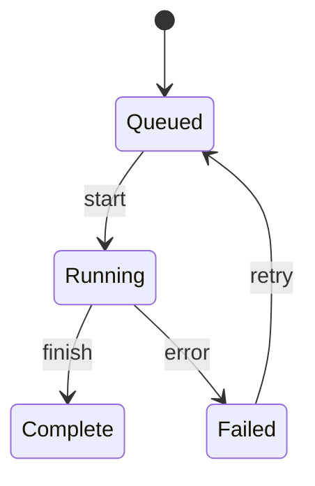

# Structs, Methods, and Enums

Rust's algebraic data types divide modeling into two questions. A struct says that a value contains all of these fields. An enum says that a value is exactly one of these alternatives. Methods then describe which operations preserve, mutate, or consume such values. Good type definitions rule out meaningless states before any validation code runs.

## Product types: all fields exist together

A named-field struct gives related data one identity and labels every component:

```rust
#[derive(Debug)]
struct User {
    active: bool,
    username: String,
    email: String,
    sign_in_count: u64,
}
```

Mathematically, a struct resembles a product. A `User` contains one value from the set of booleans, one username, one email address, and one count. Every valid instance has every field. That differs from a map or stringly typed record, where missing and misspelled keys can survive until runtime.

Construction names the fields, and field-init shorthand avoids repetition when a local binding has the same name:

```rust
fn build_user(username: String, email: String) -> User {
    User {
        active: true,
        username,
        email,
        sign_in_count: 0,
    }
}
```

Field order at construction need not match declaration order. Once created, individual fields can be read with dot syntax. Mutation requires the entire binding to be mutable; Rust does not allow only one ordinary field of an otherwise immutable value to be mutable.

```rust
let mut user = build_user(
    String::from("ada"),
    String::from("ada@example.com"),
);
user.sign_in_count += 1;
```

Keeping fields private to a module lets constructors enforce conditions that raw struct literals could bypass. A type such as `NonEmptyName` can expose `new` returning `Option` or `Result`, while callers outside the module cannot assemble an invalid value directly.

## Update syntax moves what it reuses

Struct update syntax fills unspecified fields from another instance:

```rust
let user2 = User {
    email: String::from("new@example.com"),
    ..user
};
```

This expression is construction, not mutation. `user2` receives a fresh email, while its `active`, `username`, and `sign_in_count` fields come from `user`. Copyable fields such as `bool` and `u64` are copied. The `String` username moves. The source is therefore partially moved and cannot be used as a complete `User` afterward. A field that was not moved may remain individually usable, but code that depends on partial-move details is often harder to maintain than code that finishes with the source value.

If both records must remain intact, clone the owned fields deliberately or design the function to borrow shared data. Deriving `Clone` merely makes copying available; it should not conceal an ownership decision.

Tuple structs are useful when field names add little but type identity matters:

```rust
struct Meters(f64);
struct Seconds(f64);

fn speed(distance: Meters, time: Seconds) -> f64 {
    distance.0 / time.0
}
```

Both wrappers contain one `f64`, yet the compiler rejects swapping them. This “newtype” pattern can separate IDs, units, validated strings, or security-sensitive values at zero conceptual ambiguity. A unit-like struct stores no fields and commonly acts as a marker or a stateless trait implementation:

```rust
struct PlainTextFormatter;
```

| Shape | Meaning | Good fit |
|---|---|---|
| named-field struct | all labeled components occur together | domain records and configuration |
| tuple struct | fixed positional components with distinct type identity | units, wrappers, small coordinates |
| unit-like struct | identity or behavior without stored state | markers and stateless strategies |
| enum | exactly one variant is active | commands, states, recursive syntax trees |

## Method receivers are ownership contracts

An `impl` block attaches functions to a type. Associated functions have no receiver and use `Type::function()` syntax. Methods choose among `&self`, `&mut self`, and `self`; that choice tells the caller what happens to the value.

| Receiver | Permission | Typical use |
|---|---|---|
| `&self` | shared read-only access | queries and formatting |
| `&mut self` | exclusive access without taking ownership | in-place updates |
| `self` | consumes the value | conversion, finalization, state transition |

Rust automatically borrows or dereferences the receiver for ordinary method calls. `rectangle.area()` can call a method taking `&self` without spelling `(&rectangle).area()`. The receiver type still controls what the method body may do.

### Worked example: a rectangle API

```rust
#[derive(Debug, Clone, Copy, PartialEq)]
struct Rectangle {
    width: u32,
    height: u32,
}

impl Rectangle {
    fn new(width: u32, height: u32) -> Self {
        Self { width, height }
    }

    fn square(size: u32) -> Self {
        Self::new(size, size)
    }

    fn area(&self) -> u32 {
        self.width * self.height
    }

    fn can_hold(&self, other: &Self) -> bool {
        self.width >= other.width && self.height >= other.height
    }

    fn rotate(&mut self) {
        std::mem::swap(&mut self.width, &mut self.height);
    }

    fn scaled(self, factor: u32) -> Self {
        Self::new(self.width * factor, self.height * factor)
    }
}
```

Take `outer = Rectangle::new(8, 5)`. First, `area` borrows it and calculates $8 \cdot 5 = 40$; `outer` remains available. Next, `outer.can_hold(&Rectangle::square(5))` checks $8 \ge 5$ and $5 \ge 5$, so it returns `true`. Using `>=` states that equal boundaries fit; a strict containment rule would use `>` instead.

If `outer` is mutable, `outer.rotate()` obtains exclusive access and swaps the dimensions, producing width $5$ and height $8$. Finally, `let doubled = outer.scaled(2)` consumes the receiver and creates dimensions $10$ by $16$. Without the `Copy` derive used here, `outer` would be unavailable after `scaled`. The consuming signature suits a transformation that conceptually turns one value into another; if callers normally need both, `&self` plus a returned value may be friendlier.

`Self` names the type being implemented and reduces repetition. Constructors conventionally use `new`, but `new` has no language-level privilege and need not return `Self` if an API has a reason to return `Result<Self, E>` or another wrapper.

Multiple `impl` blocks are allowed. Splitting them can keep trait bounds or thematic groups readable, though scattering a small type's operations across many blocks provides little benefit.

## Sum types: exactly one variant

An enum represents alternatives. Each variant may carry a different payload shape:

```rust
#[derive(Debug)]
enum Message {
    Quit,
    Move { x: i32, y: i32 },
    Write(String),
    ChangeColor(u8, u8, u8),
}
```

`Quit` carries no data, `Move` has named coordinates, `Write` owns a string, and `ChangeColor` uses three positional components. A value occupies one variant at a time. A design built from a string tag and several optional fields could represent a quit command with stray coordinates or a move command with no `y`; the enum cannot.

Pattern matching both identifies the variant and binds its data:

```rust
fn describe(message: &Message) -> String {
    match message {
        Message::Quit => String::from("quit"),
        Message::Move { x, y } => format!("move to ({x}, {y})"),
        Message::Write(text) => format!("write {text:?}"),
        Message::ChangeColor(r, g, b) => format!("rgb({r}, {g}, {b})"),
    }
}
```

Matching `&Message` borrows payloads rather than moving them. The compiler checks exhaustiveness, so adding a new variant forces each complete match to decide what it means. A wildcard arm suppresses that pressure and is best reserved for cases that genuinely treat the remainder alike.

## Destructuring and ownership in patterns

Patterns can take a struct or enum apart without losing the names established by the type. The binding mode depends on what is being matched. Matching an owned value can move non-`Copy` fields; matching a reference normally creates bindings to borrowed fields through match ergonomics.

```rust
struct Draft {
    title: String,
    words: usize,
}

let draft = Draft {
    title: String::from("Borrowing notes"),
    words: 740,
};

let Draft { title, words } = draft;
println!("{title}: {words}");
// `draft` as a whole is unavailable: `title` moved out.
```

Here `words` is copied because `usize` implements `Copy`, while `title` moves. The destructured variables now own the useful parts. If later code needs the original struct, borrow it instead:

```rust
let draft = Draft {
    title: String::from("Pattern notes"),
    words: 910,
};

let Draft { title, words } = &draft;
assert_eq!(title, "Pattern notes");
assert_eq!(*words, 910);
println!("{}", draft.title);
```

The same rule applies inside a `match`. One arm can borrow a payload using `ref`, but matching a reference to the whole enum is usually cleaner. A mutable reference permits bindings that mutate selected fields:

```rust
fn translate(message: &mut Message, dx: i32, dy: i32) {
    if let Message::Move { x, y } = message {
        *x += dx;
        *y += dy;
    }
}
```

`if let` is suitable because only one variant needs work and every other variant deliberately does nothing. A complete `match` is better when each case has distinct behavior or when a future variant must force a compiler error.

Patterns can also ignore data with `_`, rename fields, test alternatives, and add guards. Guards run after a structural pattern succeeds, so they should refine a case rather than replace a type invariant. If every operation requires a coordinate to be nonnegative, validated coordinate types are stronger than repeating `if x >= 0` guards throughout the program.

The standard `Option<T>` enum applies the same idea to absence:

```rust
enum Option<T> {
    None,
    Some(T),
}
```

Sentinels such as zero, an empty string, or `-1` conflate missing data with ordinary values. `Option` forces the caller to acknowledge both cases. It can still be handled compactly with `if let`, `let else`, `map`, `and_then`, or the `?` operator when the surrounding function also returns an option.

## Worked example: parsing and applying commands

Suppose input consists of `quit`, `move 4 -2`, or `write hello`. Parsing should reject malformed data before execution.

```rust
#[derive(Debug, PartialEq)]
enum Command {
    Quit,
    Move { x: i32, y: i32 },
    Write(String),
}

fn parse_command(input: &str) -> Result<Command, String> {
    let mut words = input.split_whitespace();
    let Some(verb) = words.next() else {
        return Err(String::from("empty command"));
    };

    match verb {
        "quit" if words.next().is_none() => Ok(Command::Quit),
        "move" => {
            let x = words.next().ok_or("missing x")?
                .parse::<i32>().map_err(|_| "invalid x")?;
            let y = words.next().ok_or("missing y")?
                .parse::<i32>().map_err(|_| "invalid y")?;
            if words.next().is_some() {
                return Err(String::from("too many move arguments"));
            }
            Ok(Command::Move { x, y })
        }
        "write" => Ok(Command::Write(words.collect::<Vec<_>>().join(" "))),
        _ => Err(format!("unknown or malformed command: {verb}")),
    }
}
```

For `move 4 -2`, splitting first yields the verb `move`. The next token parses as $x=4$ and the following token as $y=-2$. The final check finds no extra token, so construction returns `Ok(Command::Move { x: 4, y: -2 })`. Execution no longer needs to check whether coordinates exist; the variant guarantees them.

For `move 4 blue`, parsing `4` succeeds and parsing `blue` as `i32` fails. `map_err` converts the library parse error into `"invalid y"`, and `?` returns that error immediately. No half-valid `Command` is produced. For `quit now`, the guard fails because an extra word exists, and the final arm rejects it.

The parser does contain a policy choice: `write` accepts an empty message. If empty text is invalid, the `Write(String)` variant alone does not encode that invariant. A validated `NonEmptyString` newtype or a constructor returning `Result` would move the rule into the payload type.

## Enums can encode legal state transitions

Boolean fields often allow combinations that have no meaning. Consider a download with `started`, `finished`, `failed`, `bytes`, and `error` fields. It could accidentally be both finished and failed, or failed with no error. Variants can keep the data with the state that needs it:

```rust
enum Download {
    Queued { url: String },
    Running { url: String, bytes: u64 },
    Complete { path: String, bytes: u64 },
    Failed { url: String, reason: String },
}

impl Download {
    fn start(self) -> Result<Self, Self> {
        match self {
            Download::Queued { url } => {
                Ok(Download::Running { url, bytes: 0 })
            }
            other => Err(other),
        }
    }
}
```

The consuming receiver is significant. `start` takes the old state and returns either the new state or the unchanged state as an error. There is no instant at which one `Download` is simultaneously queued and running. More elaborate protocols can use separate state types so that illegal operations are absent from the method set entirely, but one enum is often the clearer starting point.



## Layout, derives, and diagnostics

Rust may add padding to structs for alignment, and an enum needs a discriminant plus enough storage for its largest variant. Source field order does not by itself promise a stable foreign-function layout. Code that crosses an ABI boundary must use the appropriate representation attribute and verify all participating field types. Ordinary application code should avoid depending on byte layout.

Derive macros generate common trait implementations when every required field supports them. `Debug` gives developer-oriented formatting, `Clone` duplicates owned values, and `PartialEq` enables equality tests. These traits describe capabilities; deriving all of them automatically can expose semantics the type should not have. A secret token may not belong in debug output, and a resource handle may have no sensible clone.

`dbg!` prints an expression with source location and returns the expression's value. It follows ordinary ownership rules: `dbg!(value)` may move `value`, while `dbg!(&value)` borrows it. Display formatting with `{}` requires `Display`; debug formatting with `{:?}` requires `Debug`.

Several recurring mistakes are really mismatches between the type and the intended ownership:

- A read-only method taking `self` consumes a non-`Copy` receiver and surprises callers. Use `&self` unless consumption expresses the operation.
- Struct update syntax moves non-`Copy` fields from the source. Treat it as construction from old parts, not as record copying.
- Several optional fields tied to a string tag admit contradictory combinations. Variants should carry the fields unique to each case.
- A wildcard match can hide a newly added variant that needed special behavior. Exhaustive arms provide useful maintenance pressure.
- Public fields let every caller bypass constructor validation. Privacy and narrow methods preserve invariants across module boundaries.
- An `Option<Option<T>>` may be correct when two kinds of absence differ, but unnamed nesting is hard to read. A small enum can give the states domain names.

Types do not remove all validation. They determine which mistakes are unrepresentable and which remain runtime checks. Spending a little effort on that boundary simplifies every later match and method.

One useful review technique is to write down every state that the type currently permits, then compare that list with the domain. If several fields must change together, a method can own that transition. If fields are meaningful only under one tag, they belong inside that enum variant. If a value must be validated once and trusted afterward, a private-field newtype gives the validation a durable boundary. The resulting API usually has fewer defensive checks because construction has already done the work.

<div className="see-also">

See also: [Ownership, references, and slices](/cs/programming/rust/ownership-references-slices) · [Pattern matching](/cs/programming/rust/pattern-matching) · [Generics, traits, and lifetimes](/cs/programming/rust/generics-traits-lifetimes) · [Error handling](/cs/programming/rust/error-handling) · [Object-oriented and advanced features](/cs/programming/rust/object-oriented-and-advanced-features)

</div>
