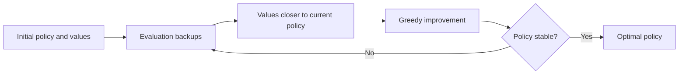

# Dynamic Programming

Dynamic programming solves a finite Markov decision process when its transition and reward model is known. Its full sweeps are rarely affordable in large problems, but the algorithms expose the structure reused throughout reinforcement learning: evaluate a policy, improve it by one-step lookahead, and repeat.

The model assumption is stronger than access to experience. For every state--action pair, DP needs the distribution $p(s',r\mid s,a)$ well enough to sum over all outcomes. Monte Carlo and temporal-difference methods later replace these expected backups with sampled ones. Planning methods keep a model but concentrate computation on a smaller set of states.

## Bellman operators turn equations into algorithms

For a policy $\pi$, define its Bellman expectation operator by

$$
(T_\pi V)(s)=
\sum_a\pi(a\mid s)
\sum_{s',r}p(s',r\mid s,a)
\left[r+\gamma V(s')\right].
$$

The value function $V_\pi$ is the fixed point

$$
V_\pi=T_\pi V_\pi.
$$

Iterative policy evaluation begins with any bounded $V_0$ and repeatedly applies the operator:

$$
V_{k+1}=T_\pi V_k.
$$

For a finite continuing MDP with $\gamma\lt 1$, $T_\pi$ is a contraction in the maximum norm. Let $u$ and $v$ be two value vectors. Rewards cancel when the operator outputs are subtracted, and probabilities form weighted averages:

$$
\begin{aligned}
|(T_\pi u)(s)-(T_\pi v)(s)|
&\leq \gamma
\sum_a\pi(a\mid s)
\sum_{s',r}p(s',r\mid s,a)|u(s')-v(s')|\\
&\leq\gamma\lVert u-v\rVert_\infty.
\end{aligned}
$$

Taking the maximum over $s$ gives

$$
\lVert T_\pi u-T_\pi v\rVert_\infty
\leq\gamma\lVert u-v\rVert_\infty.
$$

Repeated backups therefore erase the influence of initialization geometrically and converge to the unique fixed point.

In matrix form, after averaging transitions and rewards under the policy,

$$
V_\pi=r_\pi+\gamma P_\pi V_\pi,
$$

so exact evaluation can solve

$$
(I-\gamma P_\pi)V_\pi=r_\pi.
$$

Direct linear solution is useful for tiny MDPs and checking implementations. Iteration avoids a dense matrix inverse and exploits sparse transitions, which matters as the state count grows.

## Greedy improvement and its proof

Once $V_\pi$ is known, one-step action values are

$$
q_\pi(s,a)=
\sum_{s',r}p(s',r\mid s,a)
\left[r+\gamma V_\pi(s')\right].
$$

Choose a greedy policy $\pi'$ whose actions maximize this quantity. Then

$$
q_\pi(s,\pi'(s))\geq q_\pi(s,\pi(s))=V_\pi(s).
$$

The policy improvement argument repeatedly expands the left side under $\pi'$:

$$
\begin{aligned}
V_\pi(s)
&\leq \mathbb{E}_{\pi'}[R_{t+1}+\gamma V_\pi(S_{t+1})\mid S_t=s]\\
&\leq \mathbb{E}_{\pi'}[R_{t+1}+\gamma R_{t+2}+\gamma^2V_\pi(S_{t+2})\mid S_t=s]\\
&\leq \cdots\\
&=V_{\pi'}(s).
\end{aligned}
$$

For discounted bounded rewards, the remaining tail vanishes in the limit. Thus the greedy policy is no worse in every state. If it is already greedy with respect to its own value, the Bellman optimality equation holds and the policy is optimal.

Ties require a stable convention. If improvement arbitrarily switches between equal-valued actions, a policy-stability check may never settle even though all tied policies are equally good. Keeping the current action when it belongs to the argmax avoids pointless oscillation.

## Policy iteration, value iteration, and the space between

Policy iteration alternates two operations:

1. evaluate the current policy until $V$ is $V_\pi$ or a close approximation;
2. replace the policy with a greedy one-step lookahead from $V$.

In a finite discounted MDP, exact policy iteration reaches an optimal deterministic policy after finitely many strict improvements because there are finitely many deterministic policies.

Value iteration applies the Bellman optimality operator directly:

$$
(T_*V)(s)=
\max_a\sum_{s',r}p(s',r\mid s,a)
\left[r+\gamma V(s')\right],
$$

with update $V_{k+1}=T_*V_k$. The max operator is nonexpansive, so $T_*$ is also a $\gamma$-contraction. Its unique fixed point is $V_*$. A greedy policy extracted from $V_*$ is optimal.

Value iteration can be read as policy iteration with only one evaluation sweep between improvements. Modified policy iteration performs several evaluation sweeps. The spectrum matters because exact evaluation may waste work on a policy that will soon change, while overly shallow evaluation can require many improvement rounds.



This interaction is generalized policy iteration: evaluation pushes values toward consistency with the policy, while improvement pushes the policy toward greediness with the values. Neither process must finish before the other moves. Actor--critic methods retain the same two-process structure with approximation and sampled updates.

## Synchronous and in-place sweeps

A synchronous sweep computes every $V_{k+1}(s)$ from the old vector $V_k$. An in-place sweep overwrites entries and allows later states in the same sweep to use fresh values. Both converge under standard finite discounted conditions when all states keep being updated, but their intermediate values differ.

Update order can matter greatly. In a deterministic chain leading to a terminal reward, sweeping backward from the terminal state propagates information through the entire chain in one pass. Sweeping forward may move it only one state per pass. Prioritized sweeping formalizes the idea of updating states whose Bellman errors are likely to matter most.

Asynchronous DP can update one state at a time, or uneven subsets, rather than complete sweeps. Convergence requires adequate coverage; a state ignored forever cannot become correct. This flexibility matters more than the word *asynchronous* suggests, because real planning systems rarely spend equal computation everywhere.

## Stopping rules and error bounds

The largest update in a sweep,

$$
\Delta_k=\lVert V_{k+1}-V_k\rVert_\infty,
$$

is easy to monitor. The Bellman residual for a candidate $V$ is

$$
\lVert T_\pi V-V\rVert_\infty
$$

for evaluation, or $\lVert T_*V-V\rVert_\infty$ for control. A contraction gives an error bound:

$$
\lVert V-V_\pi\rVert_\infty
\leq\frac{\lVert T_\pi V-V\rVert_\infty}{1-\gamma}.
$$

To see it, insert and subtract $T_\pi V$:

$$
\begin{aligned}
\lVert V-V_\pi\rVert_∞
&\leq\lVert V-T_\pi V\rVert_∞
+\lVert T_\pi V-T_\pi V_\pi\rVert_∞\\
&\leq\lVert V-T_\pi V\rVert_∞
+\gamma\lVert V-V_\pi\rVert_∞.
\end{aligned}
$$

Rearranging yields the bound. When $\gamma$ is close to one, a seemingly small residual can still permit appreciable value error. A stopping threshold should reflect reward scale and the desired accuracy, not be copied blindly.

In episodic undiscounted problems, convergence relies on termination rather than a discount contraction. Proper policies must reach terminal states under suitable conditions. Treating an undiscounted continuing task like the discounted case can leave Bellman equations without a finite unique solution.

## Worked example: two synchronous evaluation sweeps

There are two nonterminal states. From $A$, the only action gives reward $0$ and moves to $B$. From $B$, it gives reward $1$ and terminates. Let $\gamma=0.9$ and initialize $V_0(A)=V_0(B)=0$.

On the first synchronous sweep,

$$
V_1(A)=0+0.9V_0(B)=0,
$$

and

$$
V_1(B)=1+0.9(0)=1.
$$

The terminal continuation value is zero. The second sweep uses the entire $V_1$ vector:

$$
V_2(A)=0+0.9V_1(B)=0.9,
$$

$$
V_2(B)=1.
$$

These are already exact because the longest reward path has two transitions. An in-place sweep ordered $B,A$ would compute both exact values during its first pass; ordered $A,B$, it matches the first synchronous sweep. The fixed point is unchanged, but information travels at a different speed.

## Worked example: stochastic one-step improvement

At state $s$, action `safe` gives reward $2$ and terminates. Action `risk` gives reward $0$, then moves to $s_1$ with probability $0.75$ and $s_2$ with probability $0.25$. Suppose

$$
V(s_1)=4,\qquad V(s_2)=12,\qquad\gamma=0.5.
$$

For `safe`,

$$
q(s,\mathrm{safe})=2.
$$

For `risk`, first compute expected successor value:

$$
\mathbb{E}[V(S')]
=0.75(4)+0.25(12)
=3+3=6.
$$

Then discount it:

$$
q(s,\mathrm{risk})=0+0.5(6)=3.
$$

The greedy improvement selects `risk` because $3\gt 2$. Replacing the stochastic transition by its most likely outcome would give $0.5(4)=2$ and lose the contribution from the less likely high-value state. DP backups require the full expectation.

## Worked example: value iteration and delayed reward

In state $A$, `exit` yields $1$ and terminates; `wait` yields $0$ and moves deterministically to $B$. In $B$, the only action yields $3$ and terminates. Let $\gamma=0.5$ and $V_0(A)=V_0(B)=0$.

The first optimality sweep gives

$$
V_1(B)=3,
$$

and at $A$,

$$
V_1(A)=\max\{1,0+0.5V_0(B)\}=\max\{1,0\}=1.
$$

On the second synchronous sweep,

$$
V_2(A)=\max\{1,0+0.5(3)\}=1.5.
$$

The greedy action changes from `exit` after the first sweep to `wait` after the second. Delayed reward had not propagated far enough at iteration one.

## A small value-iteration implementation

```python
import numpy as np

# outcomes[s][a] contains (probability, next_state, reward, terminal)
outcomes = {
    0: {
        0: [(1.0, 1, 0.0, False)],
        1: [(1.0, 2, 1.0, True)],
    },
    1: {
        0: [(0.5, 0, 0.0, False), (0.5, 2, 0.0, True)],
        1: [(1.0, 2, 2.0, True)],
    },
}

gamma = 0.9
values = np.zeros(3)  # state 2 is terminal

def action_value(state, action, values):
    return sum(
        probability * (reward + (0.0 if terminal else gamma * values[next_state]))
        for probability, next_state, reward, terminal in outcomes[state][action]
    )

for _ in range(1000):
    new_values = values.copy()  # synchronous update
    for state in outcomes:
        new_values[state] = max(
            action_value(state, action, values) for action in outcomes[state]
        )
    if np.max(np.abs(new_values - values)) < 1e-10:
        values = new_values
        break
    values = new_values

policy = {
    state: max(outcomes[state], key=lambda action: action_value(state, action, values))
    for state in outcomes
}
print(values[:2], policy)
```

Terminal status is attached to each transition because the same state ID conventions vary across environments. Multiplying a terminal successor by $\gamma$ without zeroing its continuation can leak an arbitrary stored value into the backup.

The computational limit is severe: one dense sweep costs roughly the number of state--action--successor triples, and memory must hold the model. Continuous state spaces cannot be enumerated. Approximation changes exact equalities into regression targets, while sampling changes expectations into noisy observations. The Bellman operators remain the reference point for judging those compromises.

## How much work does one backup represent?

For a state with $\vert \mathcal A\vert $ actions and up to $\vert \mathcal S\vert $ successor states per action, a dense optimality backup costs on the order of $\vert \mathcal A\vert \vert \mathcal S\vert $ outcome evaluations. A full sweep multiplies by another $\vert \mathcal S\vert $. Sparse transition graphs can be far cheaper, while a model with many reward outcomes per transition adds another enumeration.

Memory can be the earlier limit. A dense transition tensor grows quadratically in the number of states for each action. Storing only nonzero successor lists is the natural representation for gridworlds, queues, and factored problems. The algorithm does not require a dense array; it requires the ability to compute the expectation.

Exact policy evaluation by a linear solve has cubic worst-case dense cost and can destroy sparsity during factorization. It may still beat thousands of iterative sweeps on a small well-conditioned system. Iteration is easier to interrupt, warm-start, and combine with partial state updates. Modified policy iteration exploits those advantages by carrying approximate values across policy changes.

Discount close to one slows contraction. If $\gamma=0.99$, a worst-case error bound shrinks by only one percent per application of the operator. Good initialization and update ordering then matter more. Policy iteration may need fewer outer improvements because evaluation uses the current policy structure more fully, though each improvement is more expensive.

## Model errors change the problem being solved

When transition probabilities are estimated, DP computes an exact solution to the estimated MDP, not necessarily a good policy in the real environment. Rare catastrophic outcomes are especially easy to underestimate. Repeating Bellman backups does not average model error away; deeper planning can propagate and amplify it.

Validation of a model should include reward-relevant consequences, not only one-step prediction accuracy. Two models with similar average next-state error can induce different policies if one is wrong near a decision boundary. Uncertainty-aware or robust planning treats a set of plausible models rather than one point estimate, at additional computational cost.

A simulator that only generates samples still supports planning. Sample backups approximate the expectation, and repeated simulated experience can be focused on states relevant to the current policy. The distinction between planning and learning is then about the source of experience: simulated transitions from a model versus transitions from the external environment.

## State relevance and prioritized computation

Uniform sweeps devote equal effort to states that may never be reached from the start distribution. Backward reachability can remove irrelevant states in a known graph. Prioritized sweeping maintains a queue ordered by Bellman error and propagates changes to predecessor states. A large value change matters most where it can alter upstream decisions.

Predecessor information is not free. The model may store reverse edges, or compute them at extra cost. Priority thresholds trade queue management against small updates. Starving low-priority states can violate the coverage required for convergence, so implementations often retain occasional broad sweeps.

Real-time dynamic programming goes further by following trajectories from start states and backing up states encountered along them. It can find a good start-state policy without solving every corner of a huge MDP. Its result should be judged on the relevant start distribution, not by demanding uniform value accuracy in unreachable regions.

## Ties and reproducibility in policy extraction

An optimal value function can support several optimal policies. Deterministic `argmax` often returns the first action, making the result depend on array order. That does not change value but can change behavior, fairness, or downstream state visitation. Random tie-breaking or a documented secondary preference gives intentional behavior.

Floating-point near-ties are harder. Two actions whose computed values differ by numerical noise may flip across machines or sweep orders. Comparing within a tolerance and then applying a stable tie rule produces reproducible policies. The tolerance should be small relative to reward scale and the value accuracy guaranteed by the stopping criterion.

Policy stability alone can also stop too early if evaluation is crude. A policy may remain greedy with respect to poor values even though further evaluation would reveal a better action. Modified policy iteration works because its evaluation and improvement errors are controlled over repeated rounds, not because every temporarily stable greedy policy is certified optimal.

Unit tests for a planner should use MDPs with analytically known values, stochastic branches whose probabilities do not happen to be equal, and terminal states containing deliberately nonzero stored values. The last case catches accidental terminal bootstrapping. Running the same problem with forward and reverse in-place sweep orders should converge to the same fixed point even though intermediate sequences differ. Probability rows should be checked to sum to one before planning; otherwise a backup is no longer an expectation.

<div className="see-also">

See also: [Reinforcement learning problem and finite MDPs](/cs/reinforcement-learning/rl-problem-and-mdps) · [Monte Carlo methods](/cs/reinforcement-learning/monte-carlo-methods) · [Temporal-difference learning](/cs/reinforcement-learning/temporal-difference-learning) · [Planning and learning with tabular methods](/cs/reinforcement-learning/planning-and-learning)

</div>
