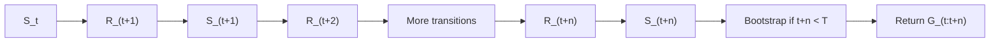

# n-step Bootstrapping

One-step TD learns from the next reward and one estimated successor value. Monte Carlo waits for every reward through termination. An $n$-step method occupies the interval between them: collect $n$ rewards, then bootstrap if the episode is still running.

Backup length changes more than computation. It controls how quickly a newly observed reward moves backward, how much random reward noise enters one target, and how strongly learning depends on current value estimates. Treating $n$ as a design dimension unifies algorithms that otherwise look unrelated.

## The return with a finite horizon

Let an episode terminate at time $T$, so the final reward is $R_T$. Define the endpoint

$$
h=\min(t+n,T).
$$

The $n$-step state-value return is

$$
G_{t:h}
=\sum_{k=t+1}^{h}\gamma^{k-t-1}R_k
+\mathbb 1[t+n<T]\gamma^nV(S_{t+n}).
$$

When $t+n\lt T$, the target contains exactly $n$ rewards followed by a bootstrap. When $t+n\geq T$, it ends at the terminal reward and has no continuation term. The update is

$$
V(S_t)\leftarrow V(S_t)
+\alpha\left(G_{t:h}-V(S_t)\right).
$$

The endpoints recover familiar methods. At $n=1$,

$$
G_{t:t+1}=R_{t+1}+\gamma V(S_{t+1}),
$$

which is TD(0). If $n$ reaches termination, the bootstrap disappears and the target is the Monte Carlo return.

For continuing tasks there is no terminal flush, so the algorithm maintains a rolling window and updates $S_t$ when time $t+n$ has been observed. It incurs an $n$-step delay and stores at least the recent states and rewards.



## An n-step return is a sum of TD errors

For a fixed value function, define the one-step TD error

$$
\delta_k=R_{k+1}+\gamma V(S_{k+1})-V(S_k).
$$

If the $n$-step target does not cross termination, subtracting the current estimate gives

$$
G_{t:t+n}-V(S_t)
=\sum_{k=t}^{t+n-1}\gamma^{k-t}\delta_k.
$$

The identity follows by expansion:

$$
\begin{aligned}
&\delta_t+\gamma\delta_{t+1}+\cdots+\gamma^{n-1}\delta_{t+n-1}\\
&=R_{t+1}-V(S_t)
+\gamma R_{t+2}+\cdots+\gamma^{n-1}R_{t+n}
+\gamma^nV(S_{t+n}).
\end{aligned}
$$

Every intermediate $+\gamma^jV(S_{t+j})$ cancels the following $-\gamma^jV(S_{t+j})$. The identity links the forward view, which waits and forms a return, to backward credit-assignment mechanisms that propagate TD errors to recently visited states.

If values are changed during the interval, the equality needs a convention about which value estimates appear in every term. The clean derivation treats $V$ as fixed while forming the target. Online algorithms introduce corrections or accept small discrepancies.

## Choosing $n$: propagation, bias, and variance

Small $n$ relies heavily on $V(S_{t+n})$. Early in learning that bootstrap may be inaccurate, but the target contains few random rewards and arrives quickly. Larger $n$ weakens dependence on one bootstrap and carries a distant reward backward several states per episode. It also accumulates more environmental randomness and delays the update.

The familiar phrase "bias--variance tradeoff" is only a guide. Bootstrapping does not automatically mean the final estimator is biased; tabular TD can converge to the correct value under standard conditions. The immediate target is biased conditional on an imperfect current $V$, while Monte Carlo targets can be unbiased for $V_\pi$ yet very noisy. Correlation, step size, function approximation, and task structure all affect the observed result.

| Target | Rewards included | Bootstrap | Earliest update | Typical target variability |
|---|---:|---:|---:|---:|
| one-step TD | 1 | yes | one transition later | low |
| $n$-step TD | up to $n$ | yes unless terminated | $n$ transitions later | intermediate |
| Monte Carlo | to termination | no | after termination | often high |

Sparse delayed rewards often favor a longer horizon because one success updates several preceding states at once. Highly stochastic rewards can favor shorter returns. The best $n$ is tied to reward delay, episode length, discount, and approximation; powers of two are a convenient search grid, not a theory.

## n-step SARSA for control

For on-policy action values, the return is

$$
G_{t:h}
=\sum_{k=t+1}^{h}\gamma^{k-t-1}R_k
+\mathbb 1[t+n<T]\gamma^nQ(S_{t+n},A_{t+n}).
$$

Then

$$
Q(S_t,A_t)\leftarrow Q(S_t,A_t)
+\alpha\left(G_{t:h}-Q(S_t,A_t)\right).
$$

If behavior is $\epsilon$-greedy, exploratory actions inside the return are part of the policy being evaluated. A cliff-avoidance policy, for example, values paths partly according to the future exploration risk actually taken. This on-policy character is the same distinction seen in one-step SARSA.

Policy changes during learning, so the trajectory may have been produced by slightly older action probabilities. Tabular control commonly updates continually and accepts this nonstationarity. Large step sizes and abrupt policy changes can make stored multi-step targets stale more quickly.

## Off-policy trajectories and multiplying ratios

Suppose behavior policy $b$ generates data while target policy $\pi$ is evaluated. For state-value prediction, ordinary importance sampling uses

$$
\rho_{t:t+n-1}
=\prod_{k=t}^{\min(t+n-1,T-1)}
\frac{\pi(A_k\mid S_k)}{b(A_k\mid S_k)}.
$$

An ordinary importance-sampled update takes the form

$$
V(S_t)\leftarrow V(S_t)
+\alpha\rho_{t:t+n-1}
\left(G_{t:h}-V(S_t)\right).
$$

The target action probabilities must have support in the behavior policy: whenever $\pi(a\mid s)\gt 0$, the behavior must also satisfy $b(a\mid s)\gt 0$. Otherwise some required ratios are undefined and the data cannot identify the target policy's outcome.

Products are volatile. One zero target probability makes the entire update zero; several ratios greater than one can produce a huge update. Longer horizons magnify the problem. Per-decision importance sampling moves ratios inside the return so each reward is corrected only for actions that precede it, often reducing variance.

For action-value methods, $A_t$ is already the action value being updated, so correction products usually begin with later actions rather than reweighting the conditioned pair $(S_t,A_t)$. Exact index ranges vary with the return definition. Writing the conditioned variables and sampled actions beside the formula is safer than memorizing subscripts.

## Expected branches and tree backup

Tree-backup methods avoid a full product of sampled-action ratios. At a later state they account for unselected actions through their target-policy probabilities and continue recursively down the sampled action. One form of the one-step expected target is

$$
R_{t+1}+\gamma\sum_a\pi(a\mid S_{t+1})Q(S_{t+1},a).
$$

Multi-step tree backup combines this expectation with later sampled rewards. Branches not taken terminate in their current $Q$ estimates; the sampled branch continues deeper. The result can learn off-policy without dividing by behavior probabilities, provided target probabilities are known.

Expectation reduces variance but requires scoring all actions. That is cheap in a small discrete action set and expensive when actions are numerous or continuous. Tree backup does not remove bootstrap error; it replaces some sampling noise with current estimates.

## Worked example: a three-step prediction target

Starting at time $t$, suppose

$$
R_{t+1}=1,\quad R_{t+2}=2,\quad R_{t+3}=3,
$$

the episode continues, $V(S_{t+3})=10$, and $\gamma=0.5$. The return is

$$
G_{t:t+3}
=R_{t+1}+\gamma R_{t+2}+\gamma^2R_{t+3}
+\gamma^3V(S_{t+3}).
$$

Substitution gives

$$
G_{t:t+3}
=1+0.5(2)+0.5^2(3)+0.5^3(10).
$$

The four terms are $1$, $1$, $0.75$, and $1.25$, hence

$$
G_{t:t+3}=4.
$$

If the old estimate is $V(S_t)=2.5$ and $\alpha=0.2$, then

$$
V_{\mathrm{new}}(S_t)
=2.5+0.2(4-2.5)
=2.8.
$$

If the episode had terminated immediately after $R_{t+3}$, the bootstrap term $1.25$ would be removed and the target would be $2.75$.

## Worked example: two-step SARSA

Let

$$
R_{t+1}=-1,\quad R_{t+2}=4,\quad
Q(S_{t+2},A_{t+2})=5,
$$

with $\gamma=0.9$. The episode continues through $t+2$, so

$$
\begin{aligned}
G_{t:t+2}
&=-1+0.9(4)+0.9^2(5)\\
&=-1+3.6+4.05\\
&=6.65.
\end{aligned}
$$

For old value $Q(S_t,A_t)=2$ and $\alpha=0.2$,

$$
\begin{aligned}
Q_{\mathrm{new}}(S_t,A_t)
&=2+0.2(6.65-2)\\
&=2+0.93\\
&=2.93.
\end{aligned}
$$

The first reward is negative, but the later reward and bootstrap more than compensate. Omitting the factor $\gamma^2$ on the bootstrap would incorrectly produce $7.1$.

## Worked example: an importance-sampling product

Consider a two-step state-value return. Behavior probabilities of the sampled actions are $b(A_t\mid S_t)=0.5$ and $b(A_{t+1}\mid S_{t+1})=0.25$. The target probabilities are $0.75$ and $0.5$. Then

$$
\rho_{t:t+1}
=\frac{0.75}{0.5}\frac{0.5}{0.25}
=1.5(2)=3.
$$

If $G_{t:t+2}=4$, $V(S_t)=3$, and $\alpha=0.1$, the corrected update is

$$
V_{\mathrm{new}}(S_t)
=3+0.1(3)(4-3)
=3.3.
$$

Had the target assigned zero probability to either sampled action, the product and the update would be zero. Repeated large products explain why long ordinary importance-sampled returns can be unstable even when every individual ratio is finite.

## Getting episode boundaries and indices right

An offline episode implementation is easier to audit than a fully online circular buffer. It computes all targets after termination while retaining the same return definition:

```python
import numpy as np

rng = np.random.default_rng(2)
n_states = 7  # 0 and 6 are terminal
values = np.zeros(n_states)
alpha, gamma, n = 0.1, 1.0, 3

def generate_episode():
    state = 3
    states = [state]
    rewards = [0.0]  # rewards[k] is R_k; index 0 is unused
    while state not in (0, 6):
        state += int(rng.choice([-1, 1]))
        states.append(state)
        rewards.append(1.0 if state == 6 else 0.0)
    return states, rewards

for _ in range(1000):
    states, rewards = generate_episode()
    terminal_time = len(states) - 1

    for t in range(terminal_time):
        endpoint = min(t + n, terminal_time)
        target = sum(
            gamma ** (k - t - 1) * rewards[k]
            for k in range(t + 1, endpoint + 1)
        )
        if t + n < terminal_time:
            target += gamma ** n * values[states[t + n]]

        state = states[t]
        values[state] += alpha * (target - values[state])

print(np.round(values[1:6], 3))
```

The strict condition `t + n < terminal_time` is deliberate. Equality means $S_{t+n}$ is terminal, so there is no bootstrap. Rewards begin at index one, matching the $R_{t+1}$ convention.

An online version must continue for $n-1$ update opportunities after observing termination so that the remaining short returns are flushed. Many implementations use a logical time that advances beyond $T$ while environment interaction has already stopped. Off-by-one bugs cluster in that phase; tests with episodes shorter than $n$, exactly length $n$, and length $n+1$ catch most of them.

Eligibility traces replace a fixed horizon with a geometric mixture of all horizons. Their forward view weights $n$-step returns, while their backward view maintains a decaying memory of recently visited states. The TD-error identity above is the algebraic bridge between the two views.

## Variable horizons rather than one global n

A fixed $n$ is easy to describe, but a trajectory can suggest different useful horizons at different times. Termination already creates variable short returns near episode ends. Options, repeated actions, and irregular observation intervals can create other natural boundaries. The return definition only requires a stopping time and a clear rule for whether to bootstrap there.

One can randomize the horizon. If continuation stops at each step with probability $1-\lambda$, the resulting mixture gives geometrically decreasing weight to longer returns. That is the forward-view intuition behind the $\lambda$-return. Random horizons can yield an unbiased sample of a mixture without calculating every component, though variance and implementation details need care.

Adaptive horizons based on observed rewards can introduce selection bias. Stopping exactly when a favorable reward appears changes the target distribution. A stopping rule based on state information can be valid when it is part of a formally defined return, but choosing it after inspecting outcomes should not be mistaken for the fixed-$n$ algorithm.

## Discounting across the window

Every reward has an exponent determined by its distance from $t$, while the bootstrap receives $\gamma^n$. Missing one exponent changes the problem. A useful implementation check sets every reward and the bootstrap to one; the target should equal

$$
1+\gamma+\cdots+\gamma^{n}
$$

when the episode continues. With $\gamma=1$, the target becomes the number of reward terms plus the bootstrap value, making indexing errors easier to see.

If time intervals are unequal, a fixed per-transition discount gives different effective discounting per unit of real time. Semi-Markov models use duration-dependent factors such as $\gamma^{\Delta t}$. An $n$-transition return then need not correspond to a fixed temporal horizon.

Rewards may also be defined on states rather than transitions in an environment API. The mathematical convention still labels the reward after action $A_t$ as $R_{t+1}$. An adapter should establish this indexing once; shifting rewards inside every learning algorithm invites inconsistencies.

## Memory and computation in online implementations

A straightforward rolling buffer needs the most recent $n+1$ states, $n+1$ actions for SARSA, and $n$ rewards. Circular storage keeps memory constant in a continuing task. Logical time and buffer indices should have distinct variable names because applying modulo arithmetic to the terminal time is a common source of mistakes.

Targets can be accumulated from scratch in $O(n)$ work per update. A rolling discounted reward sum can reduce work, but removal of the oldest reward and addition of the newest must handle discount powers and terminal shortening exactly. Unless $n$ is large and profiling shows a bottleneck, the transparent loop is safer.

Parallel environments complicate buffers because each episode terminates at a different time. Every environment needs its own window or a batch structure with validity masks. Resetting one environment must flush its pending updates without flushing the others. A single shared `done` flag is insufficient.

Replay buffers create another timing issue. A stored $n$-step transition often records the aggregated reward, final state, effective discount, and terminal flag at collection time. If the behavior policy changes later, the stored target still contains old actions and rewards. Off-policy correction or an algorithm designed for replay is needed; calling the target on-policy because it was on-policy when collected is not enough.

## Tests that catch most return bugs

Deterministic hand-built trajectories are better unit tests than a learning curve. Use rewards with distinct values such as $1,10,100$ so a shifted index is obvious. Test an episode shorter than $n$, equal to $n$, and longer than $n$. Check both $\gamma=1$ and a fractional discount.

Set the bootstrap value to a conspicuous number and verify it appears only when $t+n\lt T$. At termination, poison the stored terminal value with a huge number; a correct implementation ignores it. For SARSA, choose a next action whose value differs sharply from the greedy action to detect an accidental Q-learning target.

For off-policy code, construct a trajectory with one target probability zero. Any ordinary ratio spanning that action should become zero. Then use ratios whose product is easy to calculate and verify the precise endpoint. These tests are small enough to run on every change and more diagnostic than watching noisy training improve.

## Choosing n from evidence

Compare horizons using several random seeds and an equal amount of environment interaction. A longer horizon performs fewer eligible updates early in a run because it waits for more data, so comparing by optimizer steps can favor it unfairly. Wall-clock comparisons should include target construction cost.

Plot performance by episode length or reward delay. If long $n$ helps only on long episodes, it may be solving propagation rather than general optimization. If variance grows sharply across seeds, the average curve alone conceals the cost. Eligibility traces are attractive when no single horizon works consistently, but their $\lambda$ and step size still require tuning.

<div className="see-also">

See also: [Temporal-difference learning](/cs/reinforcement-learning/temporal-difference-learning) · [Monte Carlo methods](/cs/reinforcement-learning/monte-carlo-methods) · [Eligibility traces](/cs/reinforcement-learning/eligibility-traces) · [Planning and learning with tabular methods](/cs/reinforcement-learning/planning-and-learning)

</div>
