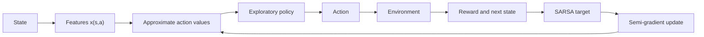

# On-policy Control with Approximation

Tabular SARSA stores one number for every state--action pair. That stops being possible when states contain continuous measurements, images, or combinations too numerous to visit separately. Function approximation replaces the table with a parameterized estimate $\hat q(s,a,w)$ whose parameters are shared across many pairs.

Control adds a feedback loop absent from fixed-policy prediction. The estimates determine which actions are selected; selected actions determine the data; the data then change the estimates. On-policy methods keep the two policies aligned: they learn the value of the same exploratory policy that generates experience.

## Semi-gradient SARSA

Given transition $(S_t,A_t,R_{t+1},S_{t+1})$, select $A_{t+1}$ from the current behavior policy and form

$$
\delta_t=R_{t+1}+\gamma\hat q(S_{t+1},A_{t+1},w_t)
-\hat q(S_t,A_t,w_t).
$$

For a terminal successor, the next action value is zero. The parameter update is

$$
w_{t+1}=w_t
+\alpha\delta_t\nabla_w\hat q(S_t,A_t,w_t).
$$

It is called a **semi-gradient** because the bootstrapped target depends on $w_t$, but that dependence is ignored when differentiating. Treating the target as fixed gives the gradient of squared error for the current estimate:

$$
\frac12\left(G_t-\hat q(S_t,A_t,w)\right)^2.
$$

Differentiating through both sides would not generally produce the desired TD algorithm. In neural-network code, the target branch must be detached from automatic differentiation.

For $\epsilon$-greedy SARSA, $A_{t+1}$ includes exploration. The learned $q_\pi$ therefore values an action under future exploratory behavior, not under a greedy policy that will never make mistakes. In hazardous tasks that distinction can change the preferred route. At deployment, removing exploration changes the policy and means the training values no longer describe behavior exactly, although a near-greedy policy may still perform well.



## Giving actions their own coordinates

For linear approximation,

$$
\hat q(s,a,w)=w^\top x(s,a),
\qquad
\nabla_w\hat q(s,a,w)=x(s,a).
$$

With $m$ state features and $k$ discrete actions, a common design uses $k$ blocks of length $m$. The block for action $a$ contains the state features; every other block is zero. Experience generalizes across similar states for the selected action without forcing different actions to share the same value.

Suppose state features are $\phi(s)=[0.2,1]$ and there are three actions. Then

$$
\begin{aligned}
x(s,0)&=[0.2,1,0,0,0,0],\\
x(s,1)&=[0,0,0.2,1,0,0],\\
x(s,2)&=[0,0,0,0,0.2,1].
\end{aligned}
$$

Omitting action identity would force all three action values to be identical. Sharing can instead be designed deliberately, for example through a neural network with shared hidden layers and separate output heads.

Feature scale controls effective step size. A binary tile vector with eight active components produces an update in eight coordinates. A dense vector with norm $100$ can create a much larger prediction change under the same $\alpha$. Normalization or a step size adjusted by the number of active tilings prevents accidental scale changes.

## Tile coding for continuous states

Tile coding overlays several offset grids on a continuous state space. Each tiling activates one tile, so the feature vector is sparse and binary. Nearby states share many active tiles and therefore similar predictions; crossing a boundary in one tiling changes only one component.

For position and velocity, one grid may divide each dimension into coarse bins. A second grid is shifted by a fraction of a bin, a third by another fraction, and so on. Multiple offsets reduce the sharp discontinuities of a single grid. Resolution encodes the assumed scale of generalization: wide tiles smooth aggressively, while narrow tiles require more experience.

Hashing can map a huge conceptual tile set into a fixed memory. Collisions then force unrelated tiles to share a weight. Moderate collisions often save substantial memory, but severe collisions introduce interference that no optimizer can separate.

Mountain car illustrates the representational need. The useful action depends on position and velocity; the car often must accelerate away from the goal to build momentum. A state feature using position alone is insufficient because the same position calls for different actions under different velocities. Tile coding over both variables supplies local two-dimensional generalization.

## Multi-step targets move information farther

The $n$-step SARSA return is

$$
G_{t:t+n}=R_{t+1}+\gamma R_{t+2}+\cdots
+\gamma^{n-1}R_{t+n}
+\gamma^n\hat q(S_{t+n},A_{t+n},w),
$$

unless termination cuts it short. The semi-gradient update replaces the one-step target by $G_{t:t+n}$:

$$
w\leftarrow w+\alpha
\left(G_{t:t+n}-\hat q(S_t,A_t,w)\right)
\nabla_w\hat q(S_t,A_t,w).
$$

Longer targets can carry a terminal success back through several state--action pairs during one episode. They also contain more stochastic rewards and arrive later. Approximation creates another interaction: changing shared weights while a target waits can make its bootstrap value stale. Step size and $n$ need to be tuned together.

Eligibility traces provide a related backward view that updates recently active features after every TD error. Replacing traces are often natural for binary tile features because repeatedly activating the same component should not let its eligibility grow without bound.

## Worked example: a linear SARSA update

Let

$$
w=(1,0,-1),\qquad
x(S_t,A_t)=(1,2,0),
$$

and let the next selected pair have features

$$
x(S_{t+1},A_{t+1})=(0,1,1).
$$

The current estimate is

$$
\hat q(S_t,A_t)=1(1)+0(2)+(-1)(0)=1.
$$

Using the same weight vector, the next estimate is

$$
\hat q(S_{t+1},A_{t+1})=1(0)+0(1)+(-1)(1)=-1.
$$

For reward $3$ and $\gamma=0.5$, the target is

$$
3+0.5(-1)=2.5,
$$

so

$$
\delta=2.5-1=1.5.
$$

Because the approximator is linear, its gradient is the current feature vector. With $\alpha=0.1$,

$$
\begin{aligned}
w'
&=(1,0,-1)+0.1(1.5)(1,2,0)\\
&=(1,0,-1)+(0.15,0.30,0)\\
&=(1.15,0.30,-1).
\end{aligned}
$$

Only weights attached to active current features change. The next-state features affect the scalar target but are not the gradient direction.

## Worked example: action blocks and generalization

Suppose two actions use state features $\phi(s)=[1,0.5]$ and block encoding. Current weights are

$$
w=[0.2,0.4,-0.1,0.6].
$$

For action 0,

$$
x(s,0)=[1,0.5,0,0],
$$

and

$$
\hat q(s,0)=0.2+0.5(0.4)=0.4.
$$

For action 1,

$$
x(s,1)=[0,0,1,0.5],
$$

giving

$$
\hat q(s,1)=-0.1+0.5(0.6)=0.2.
$$

If a SARSA transition for action 1 has $\delta=1.5$ and $\alpha=0.2$, then

$$
\Delta w=0.2(1.5)[0,0,1,0.5]
=[0,0,0.3,0.15].
$$

Thus

$$
w'=[0.2,0.4,0.2,0.75].
$$

The action-0 estimate at this state remains $0.4$. The action-1 estimate becomes

$$
0.2+0.5(0.75)=0.575.
$$

Other states sharing either active action-1 feature also change, which is the intended generalization.

## Continuing control without artificial episodes

Discounted return prefers rewards according to temporal distance from a chosen time. In an ongoing queue, router, or inventory system, there may be no natural reset and the long-run reward rate may be the actual objective:

$$
r(\pi)=\lim_{h\to\infty}\frac1h
\sum_{t=1}^{h}\mathbb E_\pi[R_t].
$$

Differential values measure reward relative to that rate. Differential SARSA uses

$$
\delta_t=R_{t+1}-\bar R_t
+\hat q(S_{t+1},A_{t+1},w_t)
-\hat q(S_t,A_t,w_t),
$$

then updates

$$
w_{t+1}=w_t+\alpha\delta_t
\nabla_w\hat q(S_t,A_t,w_t),
$$

$$
\bar R_{t+1}=\bar R_t+\beta\delta_t.
$$

Differential action values are relative: adding the same constant to all of them does not change greedy choices. The average reward anchors the TD error. Suitable continuing-task assumptions are needed; if the policy can create separate recurrent classes with different reward rates, a single state-independent average may be problematic.

### Worked differential update

Let $\bar R=1.5$, observed reward $2.0$, current action value $4.0$, and next selected action value $4.8$. Then

$$
\delta=2.0-1.5+4.8-4.0=1.3.
$$

For one scalar feature equal to $1$, $\alpha=0.1$, and $\beta=0.05$,

$$
w'=w+0.1(1.3)=w+0.13,
$$

and

$$
\bar R'=1.5+0.05(1.3)=1.565.
$$

Both rise because the transition was better than predicted relative to the current reward-rate estimate.

## A compact linear implementation

```python
import numpy as np

rng = np.random.default_rng(1)
n_states, n_actions = 6, 2
gamma, epsilon, alpha = 0.95, 0.1, 0.1
weights = np.zeros((n_actions, n_states))

def features(state):
    x = np.zeros(n_states)
    x[state] = 1.0
    return x

def values(state):
    return weights @ features(state)

def choose(state):
    if rng.random() < epsilon:
        return int(rng.integers(n_actions))
    q = values(state)
    return int(rng.choice(np.flatnonzero(q == q.max())))

def step(state, action):
    next_state = min(5, state + 1) if action == 1 else max(0, state - 1)
    terminal = next_state == 5
    reward = 1.0 if terminal else -0.01
    return next_state, reward, terminal

for _ in range(100):
    state = 0
    action = choose(state)
    terminal = False

    while not terminal:
        next_state, reward, terminal = step(state, action)
        next_action = None if terminal else choose(next_state)
        target = reward if terminal else reward + gamma * values(next_state)[next_action]
        error = target - values(state)[action]
        weights[action] += alpha * error * features(state)
        state, action = next_state, next_action
```

One-hot state features make this example tabular in effect; replacing `features` with tile coding turns the same update into genuine generalization. Random tie-breaking prevents the first action from receiving an accidental advantage when all weights are zero.

Approximation cannot recover distinctions absent from the features. If states needing different actions map to the same vector, their updates interfere permanently. Before changing the optimizer, inspect whether the representation includes the variables and resolution required by the dynamics.

On-policy sampling avoids one part of the off-policy instability sometimes called the deadly triad, but nonlinear bootstrapping can still be sensitive to scale, step size, target drift, and correlated experience. Monitor return distributions, value magnitudes, and behavior rather than loss alone; a falling TD loss need not imply an improving control policy.

## Exploration under generalization

In a table, an unvisited action retains its initial estimate at exactly one state. Under approximation, an update from a nearby state can raise or lower that action's estimate everywhere features overlap. Optimistic initialization therefore loses its clean count-based interpretation. Generalization may erase optimism before an action is tried locally, or spread optimism into regions where it is unsafe.

$\epsilon$-greedy remains simple, but random actions in continuous-state control can be costly. State-dependent exploration can use smaller $\epsilon$ in hazardous regions, though learning such a schedule creates another control problem. A softmax policy converts value gaps into probabilities, but its temperature must match the changing scale of $Q$. Values that grow during training can make the same temperature increasingly greedy.

Exploration noise should be evaluated in the environment's action semantics. Uniformly choosing among discrete torque commands differs from perturbing a continuous controller. Temporally correlated noise can produce sustained movement, while independent noise may merely jitter. On-policy value estimates describe whichever exploration process is actually used.

Evaluation episodes should normally disable exploratory randomness and parameter updates, then be reported separately from training return. Training return measures the cost-bearing behavior that supplied data; greedy evaluation measures the intended deployed policy. Reporting only the latter can hide unsafe or expensive learning.

## Interference and catastrophic policy changes

Shared features couple estimates. If one update changes the ordering of actions across a broad state region, the behavior distribution can shift suddenly. The learner then stops visiting data that supported the old estimates and collects a new, correlated stream. Small step sizes, local features, and slowly changing exploration reduce this feedback.

Replay is not automatically compatible with on-policy SARSA. A stored transition includes a next action sampled by an older policy. Reusing it later trains toward that older continuation unless the action is resampled and the target is redefined. Fresh on-policy trajectories avoid the mismatch but use each interaction less often.

Target networks, common in deep value learning, slow the movement of bootstrap targets. They can improve numerical stability, but a target copied from an older on-policy value function is still stale as the behavior changes. Stabilization machinery does not change which policy a target represents.

Feature interference can be measured. After an update, evaluate predictions on a fixed probe set and record unintended changes. Tile coding limits each update to states sharing active tiles; dense neural features may move distant states. A representation that improves training TD error while repeatedly damaging earlier probes is forgetting rather than useful generalization.

## Average reward needs continuing-task discipline

Resetting a continuing system every fixed number of steps changes its state distribution and can make a differential algorithm learn the reset process. If truncation is only for data collection, carry state and average-reward estimates across chunks. If reset is a real intervention, it belongs in the modeled dynamics and reward stream.

The average-reward estimate and differential values can trade constants. A large $\beta$ lets $\bar R$ chase individual rewards, injecting noise into every TD error. A very small $\beta$ leaves a persistent offset that the value function must absorb. The two step sizes should be tuned together, often with the reward-rate update slower than value learning.

Average reward assumes the long-run rate is well defined for the policies considered. In a unichain setting, transient start effects vanish and the rate is state independent. If different actions can trap the system in separate recurrent classes, the eventual rate may depend on start state and early choices. The simple differential formulation then needs more careful assumptions.

Adding a constant $c$ to every reward raises the average reward by $c$ but leaves differential TD errors unchanged once $\bar R$ has adapted. Multiplying rewards rescales errors and effective step sizes. This invariance is useful for checking an implementation: after convergence, a constant reward shift should not change the learned greedy policy.

## What to measure in continuous-control experiments

Mean episodic return can hide failure modes when episode lengths vary. Report success rate, time to goal, action magnitude, and constraint violations when they correspond to the task. For continuing control, use reward rate over a sufficiently long window after burn-in and show variability across windows and seeds.

Feature coverage is worth plotting for tile-coded agents. Regions never visited have values inherited only through overlap and initialization. A smooth-looking value surface there is extrapolation, not evidence. Evaluation from diverse start states separates broad competence from one familiar trajectory.

Policy snapshots can reveal oscillation: successive policies may alternate actions in a region while average return stays flat. Value magnitude alone is less informative because adding constants can leave decisions unchanged. Greedy action maps, visitation densities, and TD-error distributions together give a clearer diagnosis.

Hyperparameter comparisons need equal interaction budgets. An $n$-step method may perform more arithmetic per transition but should not receive extra environment samples. In physical or expensive simulators, interaction is usually the limiting resource; in cheap vectorized simulation, wall-clock and hardware utilization may dominate instead.

<div className="see-also">

See also: [On-policy prediction with approximation](/cs/reinforcement-learning/on-policy-prediction-approximation) · [n-step bootstrapping](/cs/reinforcement-learning/n-step-bootstrapping) · [Eligibility traces](/cs/reinforcement-learning/eligibility-traces) · [Policy gradient methods](/cs/reinforcement-learning/policy-gradient-methods)

</div>
