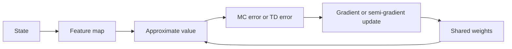

# On-policy Prediction with Approximation

Prediction asks for $V_\pi$ under a fixed policy. A table can represent that function exactly on a small finite state set, but most interesting state spaces are too large or continuous. Approximation replaces one parameter per state with a shared function $\hat v(s,w)$. Experience at one state then changes predictions elsewhere.

Sharing is both the point and the danger. A useful representation lets nearby or behaviorally similar states support one another. A poor representation aliases states with different returns, so improving one prediction damages another. Once tables are abandoned, the feature map and the distribution of visited states become part of the learning problem.

## What error is being minimized?

A common objective is mean squared value error under weighting distribution $\mu$:

$$
\overline{\operatorname{VE}}(w)
=\sum_s\mu(s)\left[V_\pi(s)-\hat v(s,w)\right]^2.
$$

For continuous states, the sum becomes an integral. Under on-policy sampling, $\mu$ is usually related to the fraction of time the policy spends in each state. Frequently visited states matter more; a large error in an unreachable state contributes nothing.

If the exact $V_\pi(S_t)$ were available, stochastic gradient descent would use

$$
w_{t+1}=w_t+\alpha
\left[V_\pi(S_t)-\hat v(S_t,w_t)\right]
\nabla_w\hat v(S_t,w_t).
$$

It is not available. Monte Carlo substitutes the sampled return $G_t$:

$$
w_{t+1}=w_t+\alpha
\left[G_t-\hat v(S_t,w_t)\right]
\nabla_w\hat v(S_t,w_t).
$$

Because $\mathbb E_\pi[G_t\mid S_t=s]=V_\pi(s)$, the expected update is a gradient direction for the value-error objective, subject to the sampling distribution and standard regularity assumptions. The target can have high variance and arrives only after enough future rewards are observed.

The representation may not contain the true value function. Then the best possible weights are a compromise under $\mu$. Changing the policy changes the visited-state weighting and can change that best compromise even if the environment's values at individual states did not change.

## Linear approximation and projection

For feature vector $x(s)\in\mathbb R^d$,

$$
\hat v(s,w)=w^\top x(s),
\qquad
\nabla_w\hat v(s,w)=x(s).
$$

Collecting feature rows into matrix $X$, every representable value vector has the form $Xw$. These vectors form a linear subspace. The least-squares solution is the projection of $V_\pi$ into that subspace under the $\mu$-weighted norm. With diagonal matrix $D$ containing the state weights, the normal equation is

$$
X^\top D Xw=X^\top D V_\pi.
$$

If $X^\top D X$ is invertible,

$$
w=(X^\top D X)^{-1}X^\top D V_\pi.
$$

Collinear features make the weights non-unique even when the predicted values are unique. Regularization or a pseudoinverse selects among equivalent solutions. Interpreting individual coefficients is unreliable under strong collinearity.

Feature scale affects the update. Replacing one coordinate by a version ten times larger changes both its weight convention and the size of stochastic steps. Standardization, bounded features, or coordinate-aware optimization keeps step-size tuning manageable.

## Why TD is a semi-gradient method

TD(0) forms

$$
\delta_t=R_{t+1}+\gamma\hat v(S_{t+1},w_t)
-\hat v(S_t,w_t)
$$

and updates

$$
w_{t+1}=w_t+\alpha\delta_t
\nabla_w\hat v(S_t,w_t).
$$

The target contains $w_t$ through the successor estimate. The update deliberately does not differentiate that target; only the current prediction supplies the gradient. For a linear approximator,

$$
w_{t+1}=w_t+\alpha\delta_t x(S_t).
$$

Minimizing the squared TD error by differentiating both current and next predictions would produce a residual-gradient method, a different algorithm. Semi-gradient TD is valued because on-policy linear TD has strong convergence properties and uses each transition online.

Its solution generally differs from the least-squares projection of $V_\pi$. TD seeks a fixed point of the projected Bellman operator,

$$
Xw=\Pi_D T_\pi(Xw),
$$

where $\Pi_D$ projects back into the representable subspace. The Bellman backup of an approximate value may lie outside that subspace, so the projection is unavoidable. The resulting value can have larger mean squared value error than the best direct fit while still being consistent with bootstrapped dynamics.

On-policy linear TD is a comparatively safe corner of function approximation. Nonlinear models lose the linear convergence theory, and off-policy bootstrapping can diverge even with linear features. These failures arise from the interaction of approximation, bootstrapping, and a sampling distribution different from the target policy.



## Representations encode a generalization assumption

| Representation | Active coordinates | Generalization | Common mismatch |
|---|---:|---|---|
| state aggregation | one group indicator | identical value within a group | boundaries are abrupt |
| coarse coding | several overlapping regions | local, overlapping neighborhoods | receptive fields need design |
| tile coding | one tile per offset tiling | sparse local similarity | resolution fixed in advance |
| radial basis functions | many distance-based activations | smooth local interpolation | centers and widths matter |
| Fourier basis | global cosine features | smooth global structure | poor fit to sharp local changes |
| neural network | learned dense activations | data-adaptive and nonlinear | optimization and stability are harder |

State aggregation is the simplest case: every state in a group shares one parameter. Tile coding overlays offset partitions so a state activates several binary components. Nearby states share most but not necessarily all components, avoiding the single hard boundary of one aggregation.

Radial basis features take a form such as

$$
x_i(s)=\exp\left(-\frac{\lVert s-c_i\rVert^2}{2\sigma_i^2}\right).
$$

Small widths produce local, data-hungry fits; large widths oversmooth. Fourier features use cosines at chosen frequencies and are well suited to globally smooth functions. High frequencies capture detail but create a more sensitive optimization problem.

Neural networks learn their own features, which reduces manual basis design but does not remove representation limits. Architecture, normalization, input variables, and data coverage still determine what can be learned. A network cannot distinguish two states that receive identical observations.

## Worked example: one linear TD update

Let

$$
w=(1,-2),\qquad x(s)=(2,1),\qquad x(s')=(0,3).
$$

The current prediction is

$$
\hat v(s,w)=1(2)+(-2)(1)=0.
$$

The successor prediction is

$$
\hat v(s',w)=1(0)+(-2)(3)=-6.
$$

For reward $4$ and $\gamma=0.5$, the TD target is

$$
4+0.5(-6)=1,
$$

so $\delta=1-0=1$. With $\alpha=0.1$,

$$
\begin{aligned}
w'
&=(1,-2)+0.1(1)(2,1)\\
&=(1.2,-1.9).
\end{aligned}
$$

Check the immediate effect on the current prediction:

$$
\hat v(s,w')=1.2(2)+(-1.9)(1)=0.5.
$$

The target was $1$, but one step moves only halfway because the prediction change is $\alpha\delta\lVert x(s)\rVert^2=0.1(1)(5)=0.5$. Feature norm, not only $\alpha$, controls the effective change.

## Worked example: overlap spreads an update

Suppose

$$
x(A)=(1,1,0),\qquad x(B)=(0,1,1),
$$

with initial $w=(0,0,0)$. A Monte Carlo target from $A$ is $G=10$, and $\alpha=0.2$. The prediction error is $10$, so

$$
w'=0+0.2(10)(1,1,0)=(2,2,0).
$$

The new prediction at $A$ is

$$
\hat v(A,w')=2+2=4.
$$

State $B$ was not visited, but its prediction becomes

$$
\hat v(B,w')=0+2+0=2
$$

because the states share their second feature. Now add state $C$ with $x(C)=(0,0,1)$. Its prediction remains zero. The feature overlap has made a precise claim: evidence at $A$ generalizes partly to $B$ and not at all to $C$.

If $A$ and $B$ truly have opposite values, the shared feature causes interference. More data cannot remove that structural conflict unless the other coordinates provide enough freedom to compensate.

## Worked example: the weighted compromise depends on visitation

Two states share a constant-only model $\hat v(s,w)=w$. Their true values are $V(A)=0$ and $V(B)=10$. If the on-policy distribution is

$$
\mu(A)=0.9,\qquad\mu(B)=0.1,
$$

the value error is

$$
J(w)=0.9(0-w)^2+0.1(10-w)^2.
$$

Differentiate:

$$
\frac{dJ}{dw}=1.8w+0.2(w-10)=2w-2.
$$

Setting the derivative to zero gives $w=1$. If visitation were balanced, the same model would choose $w=5$. Neither solution represents both states; each is the best compromise under a different sampling distribution.

## Terminal transitions and detached targets in code

```python
import torch

torch.manual_seed(0)
gamma = 0.9
model = torch.nn.Linear(1, 1)
optimizer = torch.optim.SGD(model.parameters(), lr=0.05)

# (state, reward, next_state, terminal)
transitions = [
    (0.0, 0.0, 1.0, False),
    (1.0, 0.0, 2.0, False),
    (2.0, 0.0, 3.0, False),
    (3.0, 1.0, 4.0, True),
]

def encode(state):
    return torch.tensor([[state / 4.0]])

for _ in range(200):
    for state, reward, next_state, terminal in transitions:
        prediction = model(encode(state))
        with torch.no_grad():
            target = torch.tensor([[reward]])
            if not terminal:
                target = target + gamma * model(encode(next_state))

        loss = 0.5 * (target - prediction).pow(2).mean()
        optimizer.zero_grad()
        loss.backward()
        optimizer.step()
```

The `no_grad` block implements the semi-gradient. It also prevents a terminal state's arbitrary network output from entering the target. In a batched implementation, terminal masks must have a shape that cannot broadcast across the wrong dimension.

Training loss alone is a weak diagnostic because TD targets move as the network changes. When exact values are available in a small test problem, report value error directly. Otherwise examine held-out Monte Carlo returns, TD-error distributions, prediction scale, and learning curves under multiple seeds.

Step sizes should be tested with the actual feature normalization. For binary tile coding with $m$ active tilings, a rough scale often divides the nominal step size by $m$. Dense features can have state-dependent norms, motivating normalized updates or adaptive optimizers. No optimizer can repair a feature map that omits a return-relevant variable.

## Least-squares views of prediction

Gradient updates process one sample cheaply, but a fixed batch of transitions also defines a linear system. Least-squares Monte Carlo regresses observed returns on features. Least-squares TD instead estimates the projected Bellman fixed point from transition statistics. These methods can use data efficiently but require matrices whose storage and inversion grow quadratically and cubically with feature dimension.

Regularization adds a term such as $\lambda I$ before solving. It improves conditioning and shrinks directions weakly supported by data. The solution then changes with feature scaling, so regularization strength cannot be compared across arbitrary encodings. Incremental solvers and recursive least squares reduce repeated batch cost while retaining more state than a simple SGD update.

The least-squares perspective is useful even when it is not implemented. It distinguishes error caused by limited data from error caused by the representational subspace. If an accurately solved linear system still performs poorly, taking more gradient steps on the same features will not help.

## Aliasing: when the observation cannot support the value

Suppose two latent states produce the same feature vector but have different expected returns. Any deterministic approximator on those features must assign them one value. The learned answer becomes a visitation-weighted average, and TD errors may remain systematically positive in one latent state and negative in the other.

Adding memory or a missing observation can resolve perceptual aliasing. Adding model capacity without new information cannot. A larger neural network maps identical inputs identically. Residual patterns grouped by available history can reveal which omitted variable matters.

Aggregation deliberately introduces a milder version of aliasing. Its quality depends on grouping states whose values and transition consequences are similar under the policy. Grouping only by physical distance can fail when a barrier makes nearby states lead to very different futures.

## Data coverage and extrapolation

On-policy prediction is accurate where the policy goes. A low weighted value error can coexist with arbitrary predictions in rarely visited states. If those values will later support policy improvement, the distribution can shift toward precisely those poorly estimated regions.

Holdout sets drawn from the same trajectory distribution test interpolation under $\mu$. Evaluating from a broader start-state distribution tests extrapolation and may be much harder. Both are legitimate, but they answer different questions. A plot of state visitation beside value error prevents the overall average from hiding empty regions.

Correlated transitions reduce the effective sample size. Consecutive states in a slowly mixing chain may provide nearly redundant features and targets. Multiple independent episodes, spaced samples, or replay shuffling can make optimization behave more like its independent-sample analysis. Replay changes temporal correlations but not the underlying coverage.

Importance weighting can retarget an objective toward a different state distribution, but large weights create variance and require support. No weighting scheme can evaluate a region absent from the data. Model-based simulation or new interaction is needed there.

## Monte Carlo and TD diagnostics disagree for a reason

A Monte Carlo validation return is noisy but independent of the current bootstrap estimate. Comparing $\hat v(S_t)$ with many empirical returns from the same state gives a direct calibration check when resetting to that state is possible. TD error can be small even when absolute values are wrong if neighboring predictions are wrong in a mutually consistent way.

Conversely, a correct value function still has nonzero sample TD errors in a stochastic environment. The conditional mean is zero, not every realization. Squared TD error therefore contains irreducible transition and reward variance. Driving training TD error to zero may overfit sampled transitions.

Bellman residual and value error are related through contraction in a complete tabular representation, but projection complicates the relation. A small projected residual certifies consistency within the feature space, not closeness to an unrepresentable $V_\pi$. Direct return-based checks remain valuable.

## Step-size schedules and nonstationarity

Decreasing step sizes support asymptotic convergence in a stationary tabular or linear setting. They also make the learner unable to track a changed policy or environment. Prediction inside control is inherently nonstationary because policy improvement changes the target value and visitation distribution.

A constant step size maintains adaptability and a steady noise floor. Averaging parameters over time can reduce variance after an initial burn-in while retaining simple updates. Adaptive optimizers rescale coordinates based on gradient history; their defaults come from supervised learning and still require checks under bootstrapped targets.

Learning-rate schedules keyed to optimizer steps behave differently when episode lengths or batch sizes change. Schedules keyed to environment transitions are easier to compare across agents. Whichever clock is used should be recorded with checkpoints so a run can be reproduced.

Initial weights also affect transient learning. Zero initialization encodes zero return. An optimistic constant can encourage downstream control to visit unknown states, while in pure prediction it simply adds error that must be removed. With features lacking a constant component, setting every weight equally does not necessarily produce a constant initial value.

Reproducibility requires saving the feature transformation with the weights. Tile offsets, hash seeds, normalization statistics, Fourier orders, and radial-basis centers define the coordinate system. Reconstructing any of them differently turns a valid weight vector into predictions for another model. Versioning only the numeric parameters is therefore incomplete.

## Related pages

- [Temporal-difference learning](/cs/reinforcement-learning/temporal-difference-learning)
- [On-policy control with approximation](/cs/reinforcement-learning/on-policy-control-approximation)
- [Off-policy approximation](/cs/reinforcement-learning/off-policy-approximation)
- [Eligibility traces](/cs/reinforcement-learning/eligibility-traces)
