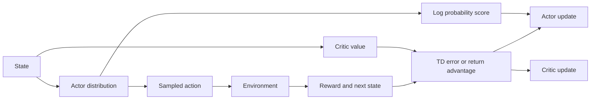

# Policy Gradient Methods

Value-based control asks which action has the largest estimated return and then constructs behavior around that answer. Policy gradient methods instead parameterize the behavior itself and adjust its probabilities to increase expected return. A value function may still be learned, but it serves the policy update rather than defining the policy by an argmax.

Direct policy optimization is natural when actions are continuous, randomized behavior is genuinely useful, or small parameter changes should produce small behavioral changes. Its central difficulty is statistical: a sampled return is a noisy report about every action that preceded it.

## Differentiating an expectation over trajectories

Let $\tau=(S_0,A_0,R_1,\ldots,S_T)$ be a trajectory. With environment dynamics independent of policy parameters,

$$
p_\theta(\tau)=p(S_0)
\prod_{t=0}^{T-1}
\pi_\theta(A_t\mid S_t)
p(S_{t+1},R_{t+1}\mid S_t,A_t).
$$

For trajectory return $G(\tau)$, the objective is

$$
J(\theta)=\mathbb E_{\tau\sim p_\theta}[G(\tau)].
$$

Use the log-derivative identity $\nabla p=p\nabla\log p$:

$$
\begin{aligned}
\nabla J(\theta)
&=\sum_\tau \nabla p_\theta(\tau)G(\tau)\\
&=\sum_\tau p_\theta(\tau)
G(\tau)\nabla\log p_\theta(\tau)\\
&=\mathbb E_\pi\left[
G(\tau)\sum_{t=0}^{T-1}
\nabla\log\pi_\theta(A_t\mid S_t)
\right].
\end{aligned}
$$

The initial-state and transition factors vanish from the log gradient because they do not contain $\theta$. No differentiable environment model is required.

Rewards received before $A_t$ cannot be caused by that action. Replacing the whole-trajectory return by the return-to-go

$$
G_t=R_{t+1}+\gamma R_{t+2}+\gamma^2R_{t+3}+\cdots
$$

removes irrelevant past reward and reduces variance. The sampled REINFORCE direction is then

$$
G_t\nabla_\theta\log\pi_\theta(A_t\mid S_t).
$$

Depending on whether the objective uses discounted state occupancy or a start-state discounted return, derivations place an additional $\gamma^t$ outside $G_t$. The objective and estimator must use one convention consistently; silently mixing them changes how early and late decisions are weighted.

## The policy gradient theorem

The theorem packages the effect of policy changes on future state visitation into an occupancy weighting:

$$
\nabla J(\theta)
\propto
\sum_s\mu_\pi(s)
\sum_a q_\pi(s,a)
\nabla_\theta\pi_\theta(a\mid s).
$$

Using

$$
\nabla\pi_\theta(a\mid s)
=\pi_\theta(a\mid s)
\nabla\log\pi_\theta(a\mid s),
$$

this becomes an expectation of an action value times a score function. A positive signal raises the sampled action's log probability; a negative signal lowers it. The theorem avoids explicitly differentiating the stationary or discounted state distribution, even though that distribution changes with the policy.

An action must have nonzero probability to be sampled and improved through the score estimator. A softmax policy supplies full support in exact arithmetic, but extreme logits can make some actions numerically and statistically unreachable. Exploration control is therefore part of optimization.

## Baselines and advantages

Subtracting a state-dependent baseline preserves the expected gradient:

$$
\mathbb E_{A\sim\pi}
\left[b(s)\nabla\log\pi(A\mid s)\right]
=b(s)\sum_a\pi(a\mid s)\nabla\log\pi(a\mid s).
$$

Since $\pi\nabla\log\pi=\nabla\pi$,

$$
b(s)\sum_a\nabla\pi(a\mid s)
=b(s)\nabla1=0.
$$

Taking $b(s)\approx v_\pi(s)$ turns $q_\pi(s,a)-v_\pi(s)$ into the advantage

$$
A_\pi(s,a)=q_\pi(s,a)-v_\pi(s).
$$

An action can have positive expected return and still deserve a lower probability if it is worse than the state's alternatives. Advantage measures that relative quality. A learned baseline should be detached from the actor loss unless the algorithm deliberately includes a coupled term.

The best variance-reducing baseline is not always exactly $v_\pi(s)$ because score-gradient magnitudes vary by action. The state value is popular because it is learnable, interpretable, and usually effective. An ordinary action-dependent baseline can bias the estimator; valid action-dependent control variates require correction terms.

## Softmax policies for discrete actions

Given preferences $h(s,a,\theta)$,

$$
\pi_\theta(a\mid s)=
\frac{\exp(h(s,a,\theta))}
{\sum_b\exp(h(s,b,\theta))}.
$$

For independent tabular preferences, the score derivative is

$$
\frac{\partial\log\pi(A\mid s)}{\partial h(s,a)}
=\mathbb 1[a=A]-\pi(a\mid s).
$$

The selected preference moves one way and all competing preferences move the other, with changes summing to zero. Adding a constant to every preference changes no probability, so one redundant direction always exists.

Illegal actions should be masked before normalization by assigning them no probability. Multiplying probabilities by a mask after softmax and forgetting to renormalize produces an invalid distribution. If a state has no legal action, it should be terminal or handled explicitly.

## Gaussian policies for continuous actions

A scalar Gaussian policy can use network outputs $\mu_\theta(s)$ and $\log\sigma_\theta(s)$:

$$
\pi_\theta(a\mid s)=\mathcal N(a;\mu_\theta(s),\sigma_\theta(s)^2).
$$

For fixed standard deviation,

$$
\nabla_\mu\log\pi(a\mid s)
=\frac{a-\mu}{\sigma^2}.
$$

An above-baseline return moves the mean toward the sampled action. Learning variance controls exploration, but unconstrained standard deviations can collapse toward zero or grow excessively. Parameterizing $\log\sigma$ guarantees positivity, and bounded log scales keep numerical behavior reasonable.

Clipping an unbounded Gaussian action to an environment limit changes the executed distribution and piles probability mass at the bounds. A squashed Gaussian applies a differentiable transformation such as tanh and must include its change-of-variables correction when log probabilities are used.

## REINFORCE and actor--critic

REINFORCE waits for a Monte Carlo return:

$$
\theta\leftarrow\theta+\alpha
\left(G_t-b(S_t)\right)
\nabla\log\pi_\theta(A_t\mid S_t).
$$

It has no bootstrap bias in its return target but often high variance and delayed updates. A critic replaces the full return with a learned estimate. One-step actor--critic uses

$$
\delta_t=R_{t+1}+\gamma\hat v(S_{t+1},w)-\hat v(S_t,w)
$$

as an advantage estimate, followed by

$$
\theta\leftarrow\theta+\alpha_\theta\delta_t
\nabla\log\pi_\theta(A_t\mid S_t),
$$

$$
w\leftarrow w+\alpha_w\delta_t
\nabla_w\hat v(S_t,w).
$$

The actor can update after every transition and usually sees lower-variance signals. Critic approximation and bootstrapping introduce bias. An overconfident bad critic can steer the actor systematically, so critic loss, explained variance, advantages, entropy, and episodic return all deserve monitoring.

Multi-step returns interpolate between REINFORCE and one-step actor--critic. Generalized advantage estimation uses an exponentially weighted sum of TD errors, adding another bias--variance control through $\lambda$.



## Worked example: a two-action softmax update

Let preferences be $h_1=0$ and $h_2=1$. Then

$$
\pi_1=\frac1{1+e}\approx0.269,
\qquad
\pi_2=\frac e{1+e}\approx0.731.
$$

Action 2 is sampled and has advantage $3$. For the selected action,

$$
\frac{\partial\log\pi_2}{\partial h_2}
=1-\pi_2=0.269.
$$

For action 1,

$$
\frac{\partial\log\pi_2}{\partial h_1}
=-\pi_1=-0.269.
$$

With $\alpha=0.1$, the common multiplier is $0.1(3)=0.3$, giving

$$
\Delta h_2=0.3(0.269)=0.0807,
$$

$$
\Delta h_1=-0.0807.
$$

New preferences are approximately $[-0.0807,1.0807]$. Their difference has increased from $1$ to $1.1614$, so the new action-2 probability is

$$
\pi'_2=\frac{e^{1.1614}}{1+e^{1.1614}}\approx0.762.
$$

Positive advantage raises the sampled action probability from $0.731$ to about $0.762$.

## Worked example: return-to-go versus whole-episode return

Consider a two-decision episode with rewards $R_1=2$ and $R_2=-1$, using $\gamma=0.5$. The trajectory return from time zero is

$$
G_0=R_1+0.5R_2=2-0.5=1.5.
$$

At time one, the return-to-go is

$$
G_1=R_2=-1.
$$

Using $G_0=1.5$ for both decisions would tell the second action it had a positive outcome, even though the reward following it was $-1$ and the earlier reward could not have been caused by it. Reward-to-go assigns score terms

$$
1.5\nabla\log\pi(A_0\mid S_0)
-1\nabla\log\pi(A_1\mid S_1).
$$

The estimator removes a source of variance without discarding any causal contribution of the later action.

## Worked example: a Gaussian mean update

Suppose $A\sim\mathcal N(\mu,\sigma^2)$ with $\mu=1$, $\sigma=2$. The sampled action is $A=3$, its advantage is $4$, and $\alpha=0.1$. The score with respect to the mean is

$$
\frac{A-\mu}{\sigma^2}
=\frac{3-1}{4}=0.5.
$$

The ascent update is

$$
\mu'=1+0.1(4)(0.5)=1.2.
$$

The mean moves toward the successful sampled action. If the advantage were $-4$, the update would move it to $0.8$, away from that action.

## Entropy and premature certainty

An entropy bonus augments the objective with

$$
\mathcal H(\pi(\cdot\mid s))
=-\sum_a\pi(a\mid s)\log\pi(a\mid s).
$$

It discourages a categorical policy from collapsing too early. The coefficient sets a real preference for stochasticity; it is not merely a numerical aid. Too much entropy prevents exploitation, while too little may leave rarely sampled actions without a recovery path. Annealing is common but should be tied to observed learning behavior.

Normalize advantages cautiously. Subtracting a batch mean and dividing by a batch standard deviation often stabilizes optimization, but very small batches give noisy normalization. It also changes step magnitudes across batches. Gradient clipping limits exceptional updates but cannot fix consistently wrong advantages.

## REINFORCE with a running baseline

```python
import torch

torch.manual_seed(2)
n_states, n_actions = 4, 2
policy = torch.nn.Linear(n_states, n_actions, bias=False)
optimizer = torch.optim.Adam(policy.parameters(), lr=0.05)
gamma = 0.9
running_baseline = 0.0

def one_hot(state):
    x = torch.zeros(n_states)
    x[state] = 1.0
    return x

def step(state, action):
    next_state = min(3, state + 1) if action == 1 else max(0, state - 1)
    reward = 1.0 if next_state == 3 else -0.02
    return next_state, reward, next_state == 3

for _ in range(200):
    log_probs, rewards = [], []
    state, terminal = 0, False

    while not terminal and len(rewards) < 20:
        distribution = torch.distributions.Categorical(logits=policy(one_hot(state)))
        action = distribution.sample()
        state, reward, terminal = step(state, int(action))
        log_probs.append(distribution.log_prob(action))
        rewards.append(reward)

    returns, value = [], 0.0
    for reward in reversed(rewards):
        value = reward + gamma * value
        returns.append(value)
    returns.reverse()

    advantages = torch.tensor(returns) - running_baseline
    loss = -torch.stack(log_probs).mul(advantages).sum()
    optimizer.zero_grad()
    loss.backward()
    optimizer.step()

    running_baseline = 0.9 * running_baseline + 0.1 * returns[0]
```

The optimizer minimizes, so the actor objective receives a minus sign. The scalar baseline is updated after the policy step and is not part of the computation graph. A state-value baseline would use information more efficiently in tasks where expected return varies greatly by state.

## Credit assignment over long episodes

Return-to-go removes rewards that precede an action, but every later reward still affects it. In a long episode, one terminal outcome can send nearly the same noisy signal to hundreds of score terms. Discounting shortens the effective horizon; a critic supplies more local estimates; multi-step advantages choose an intermediate span.

Generalized advantage estimation forms a discounted trace of TD errors:

$$
\hat A_t^{\gamma,\lambda}
=\delta_t+(\gamma\lambda)\delta_{t+1}
+(\gamma\lambda)^2\delta_{t+2}+\cdots.
$$

At $\lambda=0$ it uses the one-step TD error. Near $\lambda=1$ it approaches a Monte Carlo-style advantage when the episode ends. Larger $\lambda$ reduces reliance on the critic and usually raises variance. Advantages must stop or bootstrap correctly at true termination and truncation.

Reward normalization and advantage normalization change gradient scale, not the underlying ordering of trajectories. Clipping rewards changes the objective itself. If rare large rewards carry the task's real value, clipping them for stability can train the wrong policy.

## Trust regions and destructive updates

The vanilla gradient is locally improving only for a sufficiently small step under ideal estimates. A large optimizer step can move probability mass away from useful actions in many states at once. Because the new policy then collects different data, recovery may be slow.

Kullback--Leibler divergence between old and new action distributions measures behavioral movement. Trust-region methods constrain an approximate update by a KL budget. Clipped surrogate objectives pursue a similar goal by limiting incentives to change probability ratios far from one. These methods add machinery because policy-space distance is more relevant than raw parameter distance: small weight changes can yield large probability changes in a saturated network.

Monitoring empirical KL, entropy, and the fraction of clipped samples can reveal an update that is too aggressive. A good surrogate loss with collapsing return is not success; it can reflect stale advantages or distribution shift outside the batch.

## On-policy data and reuse limits

REINFORCE and the basic policy-gradient theorem assume trajectories from the current policy. After an update, old actions were sampled from $\pi_{\mathrm{old}}$, not $\pi_{\mathrm{new}}$. Importance ratios

$$
\frac{\pi_{\mathrm{new}}(A_t\mid S_t)}
{\pi_{\mathrm{old}}(A_t\mid S_t)}
$$

can correct action probabilities under support assumptions, but products or extreme ratios raise variance. Modern on-policy methods often reuse a batch for only a small number of epochs and constrain policy movement.

Storing only states, actions, and rewards is insufficient for exact later ratios if the old policy changes. Store old log probabilities or a policy version. Recomputing an "old" probability with current parameters silently produces a ratio of one and removes the correction.

Experience replay is therefore more natural for explicitly off-policy actor--critic algorithms. It can still be used with on-policy objectives when corrections are derived carefully, but replay itself does not make stale data current.

## Continuous actions and density details

Probability density can exceed one; log density is not a log probability mass. Policy-gradient derivations remain valid with densities, but interpreting a positive log density as certainty is wrong. Action units also affect density values, though properly transformed distributions preserve likelihood through a Jacobian correction.

State-dependent variance allows exploration to differ by situation. A shared global variance is simpler and may be too noisy near precision-sensitive states. If variance shrinks quickly, mean parameters receive high-magnitude scores through the $1/\sigma^2$ factor, creating unstable updates. Minimum variance, entropy regularization, or bounded log standard deviations limit collapse.

For multidimensional independent Gaussians, log probabilities sum across action coordinates. Correlated action requirements may call for a full covariance or a transformed latent distribution. A diagonal policy cannot express that correlation directly, though the mean network can still coordinate deterministic components.

Actions passed through tanh approach bounds asymptotically. The log-Jacobian term becomes numerically delicate near saturation. Stable library transforms are preferable to hand-written `log(1 - tanh(x)^2)` without safeguards.

## Separating actor and critic failures

If returns stagnate, first ask whether the critic predicts sampled returns at all. A poor critic gives poor advantages even when the actor and optimizer are correct. If critic predictions are reasonable but policy entropy and probabilities do not respond to advantage signs, inspect detached tensors, log-probability shapes, and loss signs.

Actor and critic losses often share an encoder. A large critic gradient can dominate shared features and harm the policy, or vice versa. Separate learning rates, loss coefficients, gradient norms, and sometimes separate networks make the interaction easier to control.

Advantages should be approximately centered when the baseline is good. Persistent positive advantages indicate an underestimating critic; persistent negative ones indicate overestimation. Centering a batch masks that diagnostic, so log raw statistics before normalization.

Deterministic evaluation can understate the learned stochastic policy's objective. Taking the Gaussian mean or categorical argmax produces a different policy. Report both sampled performance and deterministic performance when deployment uses one but training optimizes the other.

Several random seeds are indispensable because trajectory sampling, initialization, and minibatch order all influence the data distribution. Report the distribution of final returns and learning speed, not only the best checkpoint. A seed that discovers a rewarding region early can dominate an average. Fixed evaluation seeds reduce measurement noise, while separate training seeds preserve an honest view of exploration variability.

## Related pages

- [Multi-armed bandits](/cs/reinforcement-learning/multi-armed-bandits)
- [On-policy control with approximation](/cs/reinforcement-learning/on-policy-control-approximation)
- [n-step bootstrapping](/cs/reinforcement-learning/n-step-bootstrapping)
- [Eligibility traces](/cs/reinforcement-learning/eligibility-traces)
