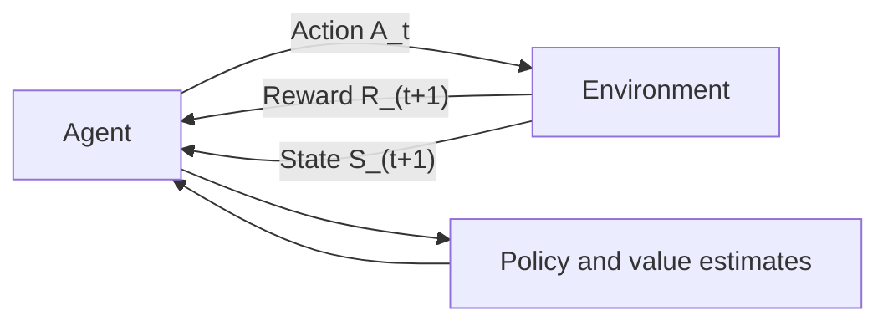

# Reinforcement Learning Problem and Finite MDPs

Reinforcement learning studies decisions whose consequences arrive through interaction. The learner is not given a correct action for each situation. It acts, observes a scalar reward and a new situation, and must improve while its own behavior changes the data it will see next.

A finite Markov decision process is the basic mathematical model for this interaction. It separates the agent's decision rule from the environment's dynamics and turns vague ideas about delayed consequences into conditional probabilities. Most later RL algorithms can be located by asking three questions: is a model available, which policy is being evaluated, and how is the return target estimated?

## Drawing the agent--environment boundary

At time $t$, the agent receives state $S_t$, chooses action $A_t$, then receives reward $R_{t+1}$ and next state $S_{t+1}$. The time indices encode the causal order:

$$
S_t\longrightarrow A_t\longrightarrow (R_{t+1},S_{t+1}).
$$

What belongs inside the agent is a modeling choice. In a robot, the controller is the agent while motors, body, and room may be environment. If low-level motor control is fixed and the learner chooses destinations, those control loops can instead be treated as part of the environment. The boundary should leave actions under the learner's control and states available when decisions are made.

The reward belongs to the environment interface, even when a designer specifies it. It states the objective, not a recommended action. Rewarding a proxy such as raw clicks, speed, or queue throughput can produce behavior that exploits the proxy while missing the intended goal. Constraints and delayed costs need representation in the objective or environment, not an expectation that the agent will infer unstated preferences.



## The finite MDP model

A finite MDP has finite state set $\mathcal S$, finite action sets $\mathcal A(s)$, and one-step dynamics

$$
p(s',r\mid s,a)
=\Pr(S_{t+1}=s',R_{t+1}=r\mid S_t=s,A_t=a).
$$

For every allowed $(s,a)$, these probabilities sum to one over $(s',r)$. Marginal transition probabilities and expected rewards can be recovered:

$$
p(s'\mid s,a)=\sum_r p(s',r\mid s,a),
$$

$$
r(s,a)=\sum_{s',r}r\,p(s',r\mid s,a).
$$

Some texts specify $p(s'\mid s,a)$ and an expected reward separately. The joint kernel is more general because reward can be correlated with the particular next state.

The Markov property is

$$
\Pr(S_{t+1},R_{t+1}\mid S_0,A_0,\ldots,S_t,A_t)
=p(S_{t+1},R_{t+1}\mid S_t,A_t).
$$

It does not claim that the physical world forgets its history. It claims that the chosen state contains enough history to predict the next reward and state distribution relevant to decisions. A single camera frame may omit velocity; the last several frames or a learned memory state may be closer to Markov.

When the agent receives an observation that does not reveal the underlying state, the problem is partially observable. Treating the observation as $S_t$ can still yield a working heuristic, but standard MDP equations no longer describe all conditional dependencies. A belief state or recurrent history representation is one response.

## Policies and the source of randomness

A stochastic policy assigns

$$
\pi(a\mid s)=\Pr(A_t=a\mid S_t=s),
\qquad
\sum_{a\in\mathcal A(s)}\pi(a\mid s)=1.
$$

A deterministic policy is a special case, often written $a=\pi(s)$. Randomness can enter through the policy, the transition kernel, the reward, or all three. A deterministic policy does not imply a deterministic trajectory.

The **behavior policy** generates experience. A **target policy** is the policy being evaluated or improved. They are identical in on-policy learning and different in off-policy learning. Keeping the names separate prevents a common conceptual error: a return observed under one policy does not automatically have the distribution of a different policy.

For finite discounted MDPs, there exists a deterministic stationary optimal policy. Stochastic policies remain useful for exploration, constraints, adversarial settings, and parameterized policy optimization.

## Episodic and continuing time

An episodic task has terminal states and resets to a start distribution. The return from time $t$ is

$$
G_t=R_{t+1}+\gamma R_{t+2}+\cdots
+\gamma^{T-t-1}R_T.
$$

After termination there is no continuation value. One can also represent episodes as transitions into an absorbing state with zero reward forever; both conventions agree when handled consistently.

A continuing task has no terminal boundary. With bounded rewards and $0\leq\gamma\lt 1$,

$$
G_t=\sum_{k=0}^{\infty}\gamma^kR_{t+k+1}
$$

is finite. Discounting can express time preference and guarantees that distant bounded rewards have diminishing total influence. In episodic tasks, $\gamma=1$ may be valid when termination makes returns finite. Average-reward formulations provide another objective for continuing systems where a discounted start-time perspective feels artificial.

The recursive identity

$$
G_t=R_{t+1}+\gamma G_{t+1}
$$

is the source of Bellman equations and temporal-difference targets.

## Values are policy-conditional predictions

The state value and action value under $\pi$ are

$$
V_\pi(s)=\mathbb E_\pi[G_t\mid S_t=s],
$$

$$
Q_\pi(s,a)=\mathbb E_\pi[G_t\mid S_t=s,A_t=a].
$$

$V_\pi$ averages over the policy's first action, so

$$
V_\pi(s)=\sum_a\pi(a\mid s)Q_\pi(s,a).
$$

$Q_\pi(s,a)$ fixes the first action and follows $\pi$ thereafter. It is not the expected immediate reward; it includes all discounted later rewards. Values can be negative, and a larger value merely means better under the chosen reward scale.

Optimal values compare all policies:

$$
V_*(s)=\max_\pi V_\pi(s),
\qquad
Q_*(s,a)=\max_\pi Q_\pi(s,a).
$$

If $Q_*$ is known, choosing any action in $\arg\max_aQ_*(s,a)$ gives an optimal deterministic policy. Approximate values complicate that statement because small errors around near-ties can change the greedy action.

## Deriving the Bellman expectation equations

Start with return decomposition and condition on $S_t=s$:

$$
V_\pi(s)=\mathbb E_\pi[R_{t+1}+\gamma G_{t+1}\mid S_t=s].
$$

Expand over the first action and the environment outcome:

$$
V_\pi(s)=
\sum_a\pi(a\mid s)
\sum_{s',r}p(s',r\mid s,a)
\left[r+\gamma V_\pi(s')\right].
$$

For action values, the first action is already fixed and the next action is averaged under the policy:

$$
Q_\pi(s,a)=
\sum_{s',r}p(s',r\mid s,a)
\left[r+\gamma\sum_{a'}\pi(a'\mid s')Q_\pi(s',a')\right].
$$

These are consistency equations, not learning algorithms by themselves. Dynamic programming applies their expectations using a known model. Monte Carlo estimates returns without bootstrapping. TD methods use sampled transitions and current value estimates.

Replacing policy averaging by maximization gives the optimality equations:

$$
V_*(s)=\max_a
\sum_{s',r}p(s',r\mid s,a)
\left[r+\gamma V_*(s')\right],
$$

$$
Q_*(s,a)=
\sum_{s',r}p(s',r\mid s,a)
\left[r+\gamma\max_{a'}Q_*(s',a')\right].
$$

The max makes the equations nonlinear, but in a finite discounted MDP their solution is unique.

## Worked example: returns at every time

An episode produces $R_1=2$, $R_2=-1$, and $R_3=4$, then terminates. Let $\gamma=0.5$. Work backward from the end:

$$
G_2=R_3=4.
$$

Then

$$
G_1=R_2+\gamma G_2=-1+0.5(4)=1.
$$

Finally,

$$
G_0=R_1+\gamma G_1=2+0.5(1)=2.5.
$$

Expanding checks the indexing:

$$
G_0=2+0.5(-1)+0.5^2(4)=2.5.
$$

The reward $R_1$ belongs to the transition after action $A_0$, not to state $S_1$ by naming convention alone.

## Worked example: solving a continuing two-state process

Under a fixed policy, state $A$ gives reward $1$ and moves to $B$; state $B$ gives reward $2$ and moves to $A$. With $\gamma=0.9$,

$$
V(A)=1+0.9V(B),
$$

$$
V(B)=2+0.9V(A).
$$

Substitute the second into the first:

$$
\begin{aligned}
V(A)
&=1+0.9(2+0.9V(A))\\
&=2.8+0.81V(A).
\end{aligned}
$$

Therefore

$$
0.19V(A)=2.8,
\qquad
V(A)=\frac{2.8}{0.19}\approx14.7368.
$$

Back-substitution gives

$$
V(B)=2+0.9(14.7368)\approx15.2632.
$$

$B$ has the larger value even though the process alternates forever, because starting at $B$ receives the larger reward first.

## Worked example: immediate reward versus long-term value

At state $s$, action `cash` gives reward $5$ and terminates. Action `invest` gives reward $0$ and moves to state $g$, where the only action gives reward $8$ and terminates. With $\gamma=0.8$,

$$
Q(s,\mathrm{cash})=5.
$$

For `invest`,

$$
Q(s,\mathrm{invest})=0+0.8V(g).
$$

Since $V(g)=8$,

$$
Q(s,\mathrm{invest})=0.8(8)=6.4.
$$

The zero-reward first action is optimal. If $\gamma=0.5$, its value would be $4$ and `cash` would win. Discounting can change the optimal policy, not only the numerical scale of values.

## Models, samples, and planning

A distribution model supplies probabilities or expectations for every outcome. A sample model generates a possible $(S',R)$ for a queried $(S,A)$. Both support planning. Model-free algorithms avoid an explicit model but still rely on the environment to produce transition samples.

A learned model introduces model error. Planning deeply with a slightly wrong model can compound that error, so "model-based" does not mean exact. Conversely, a known simulator may be expensive enough that sample efficiency remains important.

```python
import numpy as np

# Markov reward process induced by a fixed policy.
gamma = 0.9
transition = np.array([
    [0.0, 1.0],  # A -> B
    [1.0, 0.0],  # B -> A
])
expected_reward = np.array([1.0, 2.0])

# v = r + gamma P v
values = np.linalg.solve(
    np.eye(2) - gamma * transition,
    expected_reward,
)
residual = values - (expected_reward + gamma * transition @ values)

print(values)
print(residual)
```

The linear solve is a reference calculation for a small fixed-policy process. Large MDPs use iterative methods because storing or factoring a dense transition matrix is prohibitive.

## State and reward design failures

A state representation can fail the Markov test in subtle ways. In a queue, current length may be insufficient if arrival rate changes by time of day. In a game, the board may be insufficient if repetition rules depend on history. Adding relevant history can restore Markov structure, but indiscriminately adding everything enlarges the learning problem.

Reward timing also matters. A terminal success reward can make credit assignment slow but preserves the objective cleanly. Dense shaping speeds learning only when it does not alter which behaviors are optimal, or when the alteration is intended. A system rewarded for intermediate metrics will optimize those metrics, including loopholes.

Finally, termination and truncation are different. Termination means the task-defined future return ends. A time limit imposed by data collection may truncate an otherwise continuing process; bootstrapping from the final observed state can then be appropriate. Treating every time limit as a zero-valued terminal state biases value estimates.

## Occupancy: which states the objective actually weights

A policy and start distribution induce a distribution over visited states. In a discounted task, one useful definition is the discounted occupancy

$$
d_\pi(s)=(1-\gamma)
\sum_{t=0}^{\infty}\gamma^t\Pr_\pi(S_t=s).
$$

The factor $1-\gamma$ normalizes the weights for $\gamma\lt 1$. Expected start-state return can be expressed through these visitation weights and expected rewards. Policy evaluation is therefore never detached from where the policy goes.

Two policies can have identical action choices in frequently visited states and differ only in an unreachable region; their start-state performance is then identical. A uniform average of value error across every enumerated state would overemphasize that region. Conversely, a policy improvement can make a previously rare state common, exposing inaccurate estimates that did not matter under the old occupancy.

Start-state distribution belongs in the task definition. Training only from an easy fixed start may produce high return there and poor behavior elsewhere. Random starts can broaden coverage but also change the objective. Evaluation should use the deployment start distribution or report several clearly named distributions.

## Equivalent reward descriptions and shaping

Adding a constant to every reward in a continuing discounted task shifts all policy values by the same $c/(1-\gamma)$ when episode length is unaffected, leaving action comparisons unchanged. In episodic tasks, policies that terminate at different times receive different numbers of added constants, so their ordering can change.

Potential-based shaping adds

$$
F(s,a,s')=\gamma\Phi(s')-\Phi(s)
$$

to the environment reward. Along a trajectory, discounted shaping terms telescope. Under standard conditions, they change values by a state-dependent offset without changing optimal action choices. Arbitrary intermediate bonuses lack that guarantee and can create reward loops.

Shaping still affects learning speed and transient exploration. A badly scaled potential can dominate the original reward numerically. The unshaped task return should remain an evaluation metric so faster optimization of the shaped signal is not confused with better task performance.

## Time, actions, and state abstraction

The MDP time step should match the decision frequency. If an action persists for five simulator frames, treating every frame as a fresh decision changes both dynamics and discounting. Frame skipping, macro-actions, and options alter the temporal abstraction while leaving the agent--environment interface intact at a coarser scale.

State-dependent action sets must be respected in Bellman maxima and policy normalization. Giving impossible actions a finite low value is brittle because initialization or approximation can make them look attractive. Mask them from the set over which probabilities and maxima are computed.

A state abstraction groups histories that should support the same decisions. Exact abstractions preserve rewards and transition probabilities between groups; approximate abstractions trade a smaller problem for bounded or empirical error. Visual similarity alone is insufficient. Two nearly identical observations can require different actions when hidden inventory, velocity, or time remains relevant.

## What an MDP leaves unspecified

The MDP describes possible consequences and rewards, not how the agent learns. Dynamic programming assumes the kernel is known. Model-free algorithms observe samples. Planning can use a simulator. The same MDP can be attacked by all of them, and their data requirements differ even though the optimal value equations do not.

It also does not prescribe risk attitude beyond expected return. Two policies with equal mean return but very different failure probabilities are equivalent under the basic objective. Risk-sensitive utilities, constraints, or distributional criteria are needed when tail outcomes matter.

Multi-agent environments can violate stationarity from one agent's perspective because other learners change their policies. Folding their current configuration into state may be impossible or insufficient. An MDP remains a useful approximation, but its stationary-kernel assumption should be stated rather than taken for granted.

Reward uncertainty and model uncertainty are distinct from transition randomness. An MDP's stochastic kernel can be known exactly while outcomes remain random. In learning, the kernel is also unknown. Confidence about an estimate is epistemic; randomness remaining under a known model is aleatoric. Exploration is valuable for the former, not the latter by itself.

## Related pages

- [Multi-armed bandits](/cs/reinforcement-learning/multi-armed-bandits)
- [Dynamic programming](/cs/reinforcement-learning/dynamic-programming)
- [Monte Carlo methods](/cs/reinforcement-learning/monte-carlo-methods)
- [Temporal-difference learning](/cs/reinforcement-learning/temporal-difference-learning)
