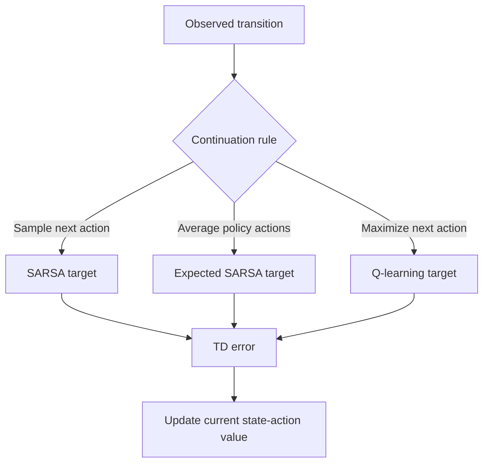

# Temporal-Difference Learning

Temporal-difference learning updates a prediction after one or a few transitions rather than waiting for the final return. It samples experience like Monte Carlo and bootstraps from a current estimate like dynamic programming. That combination supports online learning without a transition model.

The family is broader than one formula. TD(0) predicts state values; SARSA evaluates and improves the behavior policy; Q-learning targets a greedy policy; Expected SARSA averages over next actions; double learning addresses bias created by maximizing noisy estimates. Their update skeleton is nearly identical, but the continuation target changes what each algorithm learns.

## TD prediction from one transition

For fixed policy $\pi$, TD(0) forms the target

$$
R_{t+1}+\gamma V_t(S_{t+1})
$$

and updates

$$
V_{t+1}(S_t)=V_t(S_t)
+\alpha_t\delta_t,
$$

where

$$
\delta_t=R_{t+1}+\gamma V_t(S_{t+1})-V_t(S_t).
$$

Other states retain their old values. At a true terminal transition, continuation value is zero:

$$
\delta_t=R_{t+1}-V_t(S_t).
$$

The TD error measures a local inconsistency. If values exactly satisfy the Bellman equation, its conditional expectation given $S_t$ is zero, although individual errors remain noisy. A zero error on one transition does not prove the value function is correct; reward and successor randomness can cancel by chance.

TD can update in continuing tasks and before an episode ends. Its target contains only one sampled reward, usually reducing variance relative to a complete Monte Carlo return. The price is dependence on the current successor estimate. Early errors propagate through bootstrapping, then can be corrected as states are revisited.

## Why TD and Monte Carlo can prefer different compromises

Monte Carlo moves toward an observed return $G_t$. Conditional on state, that return has expectation $V_\pi(S_t)$, so tabular MC directly averages return samples. TD moves toward a reward plus another learned prediction. In a table, both converge to $V_\pi$ under standard conditions, but their finite-sample behavior differs.

TD exploits the Markov structure. If two episodes pass through the same state, TD treats future outcomes after that state as evidence for the same continuation value, regardless of the earlier path. Monte Carlo assigns each earlier state its own complete sampled outcome. This often lets TD learn efficiently from overlapping trajectories.

Bootstrapping also creates a chain of moving targets. With function approximation or off-policy data, that chain can become unstable. The tabular on-policy convergence result does not transfer automatically to neural networks.

For tabular prediction, common sufficient conditions include repeated visitation and step sizes satisfying

$$
\sum_t\alpha_t(s)=\infty,
\qquad
\sum_t\alpha_t(s)^2<\infty
$$

for each state. A sample-average schedule eventually settles; a small constant step size continues tracking and fluctuating, which can be preferable in a nonstationary environment.

## From prediction to action values

Control algorithms estimate $Q(s,a)$ and couple evaluation to policy improvement. Their targets differ only after the observed transition.

| Method | Continuation estimate at $S_{t+1}$ | Relation between behavior and target |
|---|---|---|
| SARSA | $Q(S_{t+1},A_{t+1})$ | on-policy |
| Expected SARSA | $\sum_a\pi(a\mid S_{t+1})Q(S_{t+1},a)$ | on-policy or off-policy |
| Q-learning | $\max_aQ(S_{t+1},a)$ | greedy target, exploratory behavior allowed |
| Double Q-learning | selected by one table, evaluated by the other | greedy target with reduced max bias |

All use

$$
Q(S_t,A_t)\leftarrow Q(S_t,A_t)
+\alpha\left(\text{target}-Q(S_t,A_t)\right).
$$

### SARSA includes the cost of exploration

SARSA observes the tuple $(S_t,A_t,R_{t+1},S_{t+1},A_{t+1})$ and uses

$$
R_{t+1}+\gamma Q(S_{t+1},A_{t+1}).
$$

The next action is sampled from the same policy being evaluated. If that policy is $\epsilon$-greedy, its value includes the chance of future exploratory actions. Near a cliff or other hazard, a route with a high greedy value may have poor on-policy value because random deviations are costly.

For convergence toward optimal behavior, exploration is commonly reduced while every state--action pair continues to be sampled sufficiently. This *greedy in the limit with infinite exploration* condition captures the tension: keep learning about alternatives, yet let the limiting policy become greedy.

### Q-learning separates behavior from its greedy target

Q-learning uses

$$
R_{t+1}+\gamma\max_aQ(S_{t+1},a).
$$

The behavior may remain $\epsilon$-greedy or follow another exploratory policy. The update evaluates what a greedy action would do next, not what behavior actually selects. Tabular Q-learning converges to $Q_*$ under appropriate visitation and step-size conditions.

Calling it off-policy does not remove coverage requirements. A behavior policy that never tries an action cannot establish its value. Aggressive policy changes, large constant step sizes, or approximation can also violate the clean tabular theory.

### Expected SARSA removes next-action sampling noise

Expected SARSA uses

$$
R_{t+1}+\gamma
\sum_a\pi(a\mid S_{t+1})Q(S_{t+1},a).
$$

For an $\epsilon$-greedy policy with a unique greedy action and $k$ actions, the greedy action has probability $1-\epsilon+\epsilon/k$, while each other action has $\epsilon/k$. Computing the expectation costs a pass over actions but removes randomness from sampling $A_{t+1}$.

Choosing $\pi$ equal to behavior makes it on-policy. Choosing a greedy target distribution while behavior explores makes it off-policy and yields the same continuation value as Q-learning when ties are handled consistently.



## Maximization bias and double learning

Suppose every action has true value zero, but estimates contain independent zero-mean noise. The maximum estimate is usually positive because the maximization selects whichever error happened to be largest:

$$
\mathbb E\left[\max_a\hat q(a)\right]
\geq\max_a\mathbb E[\hat q(a)].
$$

The inequality can be strict. Q-learning uses the same estimates to select and evaluate the maximizing action, so this optimism enters its target.

Double Q-learning maintains $Q^A$ and $Q^B$. On an update to $Q^A$, select with $Q^A$ and evaluate with $Q^B$:

$$
a^*=\arg\max_aQ^A(S_{t+1},a),
$$

$$
R_{t+1}+\gamma Q^B(S_{t+1},a^*).
$$

On other steps, reverse the roles. If the estimation errors are sufficiently independent, the evaluator does not automatically share the selector's positive error. Double learning reduces bias; it does not guarantee pessimism-free or variance-free values.

## Worked example: one TD(0) update

Let $V(s)=4$, reward $R_{t+1}=2$, $V(s')=5$, $\gamma=0.9$, and $\alpha=0.1$. The target is

$$
2+0.9(5)=6.5.
$$

The TD error is

$$
\delta=6.5-4=2.5.
$$

Therefore

$$
V_{\mathrm{new}}(s)=4+0.1(2.5)=4.25.
$$

If $s'$ were terminal, its stored value would be ignored. The target would be $2$, the error $-2$, and the update would decrease $V(s)$ to $3.8$.

## Worked example: SARSA, Expected SARSA, and Q-learning

A transition gives reward $-1$, $\gamma=1$, and the old value is $Q(S_t,A_t)=3$. At the next state,

$$
Q(s',\mathrm{safe})=2,
\qquad
Q(s',\mathrm{risky})=10.
$$

The $\epsilon$-greedy behavior has $\epsilon=0.2$ over two actions and actually samples `safe`. Since `risky` is uniquely greedy,

$$
\pi(\mathrm{risky}\mid s')=0.9,
\qquad
\pi(\mathrm{safe}\mid s')=0.1.
$$

SARSA uses the sampled action:

$$
y_{\mathrm{SARSA}}=-1+2=1.
$$

Expected SARSA uses

$$
\begin{aligned}
y_{\mathrm{Exp}}
&=-1+0.1(2)+0.9(10)\\
&=-1+0.2+9\\
&=8.2.
\end{aligned}
$$

Q-learning uses

$$
y_Q=-1+\max(2,10)=9.
$$

With $\alpha=0.5$, the updated current value is respectively

$$
Q'_{\mathrm{SARSA}}=3+0.5(1-3)=2,
$$

$$
Q'_{\mathrm{Exp}}=3+0.5(8.2-3)=5.6,
$$

$$
Q'_Q=3+0.5(9-3)=6.
$$

One observed transition produces three answers because the algorithms ask about three different continuation policies.

## Worked example: visible maximization bias

Two actions both have true value zero. Suppose one noisy estimate set is

$$
Q^A(a_1)=1.2,\qquad Q^A(a_2)=-0.2.
$$

A single-estimator max reports $1.2$, an overestimate of the true maximum $0$. A second independent table has

$$
Q^B(a_1)=-0.4,\qquad Q^B(a_2)=0.3.
$$

Double Q selects $a_1$ using $Q^A$ but evaluates it with $Q^B$:

$$
Q^B(\arg\max_aQ^A(a))=Q^B(a_1)=-0.4.
$$

This sample is pessimistic, but it does not systematically select the evaluator's largest positive noise. On an update to the other table, $Q^B$ would select $a_2$ and $Q^A$ would evaluate it as $-0.2$.

## Terminal states, time limits, and initialization

A task-defined terminal transition has zero continuation. A time-limit truncation may end data collection while the underlying process could continue. Setting its continuation to zero teaches the agent that the horizon itself destroys future reward. When that is not part of the task, bootstrap from the final observation instead.

Optimistic Q initialization encourages exploration in small deterministic settings because untried actions retain high estimates. It interacts with step size and reward scale, and repeated stochastic disappointment may be needed to erase optimism. It does not replace a continuing exploration policy in nonstationary or poorly covered tasks.

Tie-breaking should be random among maximizing actions. Deterministically choosing the first array index can prevent nominally greedy optimistic initialization from trying every action.

## Tabular SARSA with explicit terminal handling

```python
import numpy as np

rng = np.random.default_rng(3)
n_states, n_actions = 5, 2
q = np.zeros((n_states, n_actions))
alpha, gamma, epsilon = 0.2, 0.9, 0.1

def step(state, action):
    next_state = min(4, state + 1) if action == 1 else max(0, state - 1)
    terminal = next_state == 4
    reward = 1.0 if terminal else -0.01
    return next_state, reward, terminal

def epsilon_greedy(state):
    if rng.random() < epsilon:
        return int(rng.integers(n_actions))
    tied = np.flatnonzero(q[state] == q[state].max())
    return int(rng.choice(tied))

for _ in range(200):
    state = 0
    action = epsilon_greedy(state)
    terminal = False

    while not terminal:
        next_state, reward, terminal = step(state, action)
        if terminal:
            target = reward
            next_action = None
        else:
            next_action = epsilon_greedy(next_state)
            target = reward + gamma * q[next_state, next_action]

        q[state, action] += alpha * (target - q[state, action])
        state, action = next_state, next_action
```

Selecting `next_action` only for nonterminal states avoids querying a policy where no action exists. The code is SARSA because the same sampled `next_action` appears in both the target and the next environment step.

Learning curves should report return under both training behavior and the intended evaluation policy when they differ. Q-learning may learn a good greedy policy while accumulating poor exploratory returns; SARSA may choose a safer policy while exploration remains active. Reporting only the table values obscures that operational difference.

## Reward propagation and initialization

In a deterministic chain with reward only at the end, one-step TD moves information backward roughly one transition at a time. After the terminal transition updates its predecessor, an earlier state can benefit on a later visit. Online update order can accelerate propagation within an episode if the trajectory revisits states, but it cannot use a reward before that reward has been observed.

Optimistic initialization changes the transient direction. A state with value ten and a zero-reward successor also valued ten has TD error $\gamma10-10$, negative when $\gamma\lt 1$. Optimism decays even without a disappointing immediate reward because discounting makes unsupported continuation inconsistent. In episodic undiscounted tasks, terminal observations are what finally remove unsupported optimism.

Initial values encode assumptions about unseen regions. Zero is pessimistic when returns are positive and optimistic when returns are negative. Comparing algorithms with the same numeric initialization can therefore give them different exploration pressure if their reward transformations differ.

## Step size per visit or per clock tick

A tabular sample-average-style schedule uses a separate count for each state or state--action pair. The $n$th visit receives step size $1/n$. A global schedule tied to total environment steps shrinks learning for rare states before they have enough samples. Per-pair schedules better match the convergence conditions but require counts and adapt poorly to drift.

Constant step size gives recent transitions persistent influence. Its stable range depends on reward scale, discount, visitation, and whether updates occur in batches. A value that works for TD(0) may be too large for multi-step returns or function approximation.

When several workers update one table asynchronously, effective step sizes and ordering change. Stale reads can be tolerable in a tabular problem and harmful near policy ties. Reproducible comparisons should distinguish environment parallelism from algorithmic changes.

## Expected backups still use sampled states

Expected SARSA averages over the next action, but it usually observes only one next state and reward. It removes action-selection variance, not transition variance. A full dynamic-programming backup would also average over every possible $(s',r)$ under the model.

This distinction helps compare computational cost. If the action set is small and policy probabilities are already available, Expected SARSA adds little work. In a huge action space, summing all actions may be harder than accepting one sampled action. Sampling several actions offers an intermediate estimator.

The expectation must use a normalized policy after legal-action masking. Ties under $\epsilon$-greedy need a defined distribution: exploration probability plus the greedy share can be divided among all maximizing actions. Assuming one unique greedy action when there are ties changes the target.

## Overestimation is not the only bias

Maximization bias arises from selecting noisy high estimates, but function approximation and data distribution can create underestimation too. Double learning targets one particular mechanism; it does not make estimates unbiased in general. If both tables share data, features, and initialization, their errors are correlated and bias reduction can be smaller than the ideal argument suggests.

Maintaining two tables also halves the update frequency per table when one is chosen at random each step. Learning can initially be slower. Summing or averaging the tables for behavior uses both data streams while preserving cross-evaluation in targets.

Clipped double estimators that take the minimum of two critics deliberately introduce pessimism to counter overestimation. That is a different estimator from tabular Double Q-learning. The names are related, but selection/evaluation separation and minimum-taking should not be conflated.

## Diagnosing a TD agent

Large TD errors can mean surprising rewards, wrong successor values, an abrupt policy change, or a coding bug. Log the target components separately. A huge max continuation with ordinary rewards points toward value explosion; a huge reward points toward environment scaling or terminal handling.

Mean TD error near zero can conceal large positive and negative errors. Track absolute or squared error distributions by state visitation. Persistent signed error in a region suggests insufficient representation or nonstationarity. Declining error alongside declining return may mean the agent has settled into an easily predicted poor policy.

Evaluate greedy actions and their margins. If the top two values differ by less than update noise, behavior can flip often even while values appear stable. Tie-aware metrics and policy-change counts reveal this instability.

Finally, test the target formulas on one deterministic transition before running an environment. Give successor actions conspicuously different values and verify that SARSA, Expected SARSA, and Q-learning produce the intended numbers. Most algorithm swaps require changing one target line; that same similarity makes silent swaps easy.

## Related pages

- [Monte Carlo methods](/cs/reinforcement-learning/monte-carlo-methods)
- [n-step bootstrapping](/cs/reinforcement-learning/n-step-bootstrapping)
- [Eligibility traces](/cs/reinforcement-learning/eligibility-traces)
- [Off-policy approximation](/cs/reinforcement-learning/off-policy-approximation)
