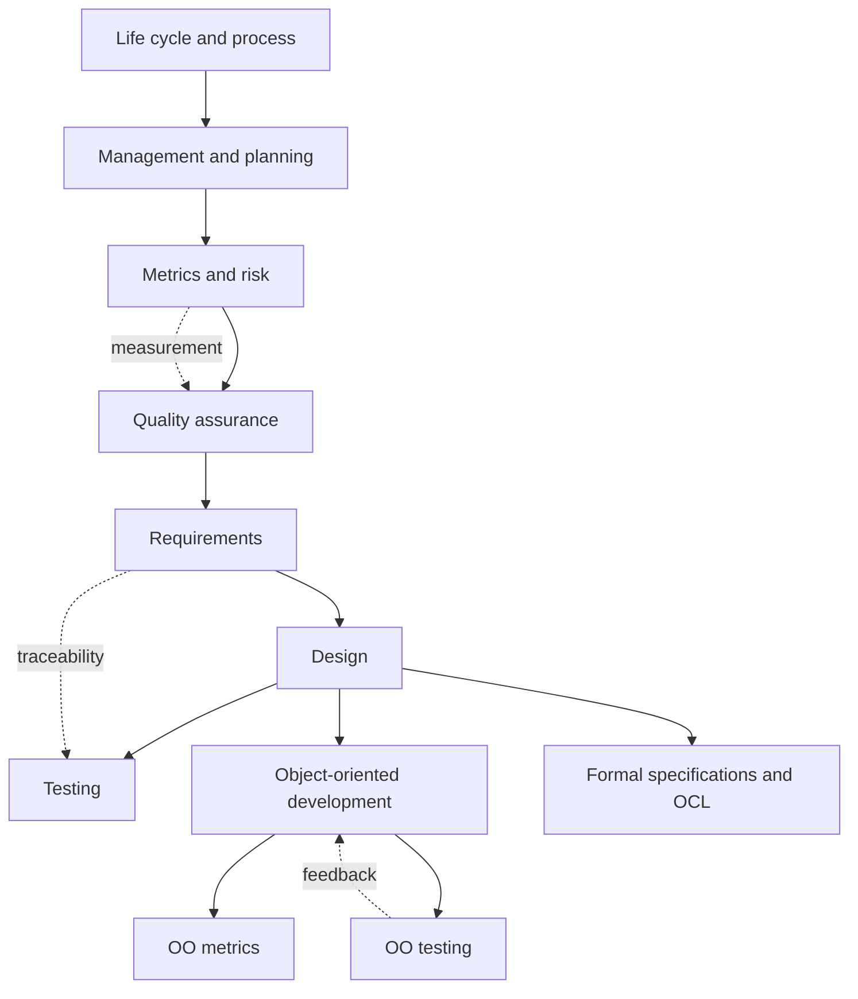

# Software Engineering

These notes follow David A. Gustafson's *Schaum's Outline of Theory and Problems of Software Engineering*. The source combines terminology with techniques, diagrams, calculations, review rules, and worked problems for specifying, designing, measuring, testing, and controlling software projects.

Its sequence runs from life cycles and process models through project management, planning, metrics, risk, quality assurance, requirements, design, testing, object-oriented development, object-oriented metrics and testing, and formal notation with OCL. The same sequence works as a course path, while each chapter can also serve as a reference for a particular artifact or technique.

## Engineering work leaves evidence

**Software engineering** is the disciplined development and evolution of software systems through explicit processes, models, artifacts, measurements, reviews, and validation. Programming is one activity among requirements work, coordination, uncertainty management, design, verification, and maintenance.

A **software process** specifies activities, roles, artifacts, and decisions. It may be descriptive, recording what happened, or prescriptive, stating what should happen. A **software artifact** is any durable work product: a requirements specification, object model, test plan, source file, defect report, schedule, quality plan, or user manual.

A **model** abstracts one part of a system or project for a particular question. The source uses life-cycle diagrams, data-flow diagrams, Petri nets, UML-style object models, use cases, sequence and state diagrams, control-flow graphs, PERT networks, risk decision trees, traceability matrices, and OCL constraints. None is a universal picture; each suppresses details irrelevant to its question.

A **metric** maps a product, process, or project property to a number for a stated purpose. The source covers LOC, cyclomatic complexity, Halstead measures, Henry–Kafura information flow, productivity, earned-value indicators, reliability estimates, review effectiveness, and object-oriented metrics. The interpretation and decision attached to a metric matter as much as the calculation.

A **quality activity** adds evidence about the product or process. Formal inspections, testing, statistical quality assurance, problem reporting, configuration control, and postmortems cover different failure modes and occur at different points in the work.

## From project process to verifiable behavior

The chapters form a chain of artifacts and feedback rather than isolated management and technical topics:

| Position | Page | Source chapter focus |
|---:|---|---|
| 2 | [Software life cycle models](/cs/software-engineering/software-life-cycle-models) | activities, documents, waterfall, prototype, incremental, spiral |
| 3 | [Software process models and diagrams](/cs/software-engineering/software-process-models-and-diagrams) | process models, DFDs, Petri nets, UML-style diagrams, state and lattice models |
| 4 | [Project management and process improvement](/cs/software-engineering/project-management-and-process-improvement) | team approaches, CMM, PSP, earned value, error tracking, postmortems |
| 5 | [Project planning and estimation](/cs/software-engineering/project-planning-and-estimation) | WBS, PERT, critical path, slack, LOC, COCOMO, function points |
| 6 | [Software metrics](/cs/software-engineering/software-metrics) | measurement theory, product metrics, process metrics, GQM |
| 7 | [Risk analysis and management](/cs/software-engineering/risk-analysis-and-management) | risk identification, exposure, decision trees, mitigation, risk plans |
| 8 | [Software quality assurance](/cs/software-engineering/software-quality-assurance) | inspections, checklists, reliability, statistical SQA, SQA plans |
| 9 | [Requirements engineering](/cs/software-engineering/requirements-engineering) | object models, DFDs, behavior models, data dictionaries, IEEE SRS outline |
| 10 | [Software design](/cs/software-engineering/software-design) | data, architecture, interfaces, abstraction, cohesion, coupling, traceability |
| 11 | [Software testing](/cs/software-engineering/software-testing) | functional, structural, data flow, random, operational-profile, and boundary testing |
| 12 | [Object-oriented development](/cs/software-engineering/object-oriented-development) | object discovery, inheritance, reuse, associations, existence dependency, multiplicity |
| 13 | [Object-oriented metrics](/cs/software-engineering/object-oriented-metrics) | CK metrics and MOOD metrics |
| 14 | [Object-oriented testing](/cs/software-engineering/object-oriented-testing) | method-message testing and function pair coverage |
| 15 | [Formal specifications and OCL](/cs/software-engineering/formal-specifications-and-ocl) | formal specs, preconditions, postconditions, invariants, OCL navigation |

Four threads cut across the sequence:

| Learning thread | Pages to read together | Result |
|---|---|---|
| Project control | life cycle, management, planning, metrics, risk | plan, track, and adjust work |
| Requirements to design | process models, requirements, design, formal specs | move from domain behavior to implementable contracts |
| Quality and testing | SQA, testing, OO testing, metrics | find defects and interpret evidence |
| Object-oriented modeling | process diagrams, OO development, OO metrics, OCL | model classes, associations, constraints, and design risk |

## Six claims that organize the subject

### Milestones require inspectable artifacts

A life-cycle phase helps only when its output can be inspected, and a milestone helps only when the team can decide whether it occurred. The same rule applies to requirements reviews, design traceability, test reports, earned-value analysis, and postmortems.

### Each diagram answers one kind of question

A data-flow diagram asks what data a process consumes and produces. A state diagram asks which transitions are legal. A sequence diagram orders messages in a scenario. A PERT network identifies schedule-controlling tasks. A traceability matrix checks whether requirements appear in design and tests.

### Measurement needs a decision

Cyclomatic complexity, LOC, defect density, review yield, CBO, LCOM, and earned value become useful only when tied to a decision. Numbers without decisions are noise; decisions without evidence are guesses.

### Quality begins before test execution

Requirements need validation before design, designs need inspection before implementation, and code needs review and tests. Reliability estimates require representative data; defects require tracking and verification. An SQA plan assigns roles and expected evidence across those activities.

### Object relationships carry complexity

Object-oriented designs can move complexity out of procedure bodies and into class relationships, inheritance, dynamic dispatch, coupling, and call sequences. Short methods do not guarantee a simple design, which motivates separate treatment of OO development, metrics, and testing.

### Formal notation turns ambiguity into reviewable claims

Preconditions, postconditions, invariants, and OCL expressions force behavior to be stated precisely enough to inspect and test. Precision cannot supply missing domain judgment, but it exposes disagreements over the intended rule.

## A two-week route through the techniques

For an exam centered on PERT, earned value, risk exposure, cyclomatic complexity, functional testing, object modeling, and OCL, study in prerequisite order:

1. [Software life cycle models](/cs/software-engineering/software-life-cycle-models) supplies the phase and artifact vocabulary.
2. [Project planning and estimation](/cs/software-engineering/project-planning-and-estimation) covers WBS, PERT, critical path, slack, LOC, COCOMO, and function points.
3. [Project management and process improvement](/cs/software-engineering/project-management-and-process-improvement) places PV, EV, AC, SV, CV, SPI, and CPI against a project baseline.
4. [Risk analysis and management](/cs/software-engineering/risk-analysis-and-management) builds risk exposure and mitigation on schedule, cost, and technical uncertainty.
5. [Software metrics](/cs/software-engineering/software-metrics) precedes [Software testing](/cs/software-engineering/software-testing) for cyclomatic complexity and structural coverage.
6. [Requirements engineering](/cs/software-engineering/requirements-engineering) supplies specifications and scenarios for functional tests.
7. [Software process models and diagrams](/cs/software-engineering/software-process-models-and-diagrams) and [Object-oriented development](/cs/software-engineering/object-oriented-development) establish object models and associations.
8. [Object-oriented metrics](/cs/software-engineering/object-oriented-metrics) and [Object-oriented testing](/cs/software-engineering/object-oriented-testing) extend measurement and coverage to class interactions.
9. [Formal specifications and OCL](/cs/software-engineering/formal-specifications-and-ocl) comes last because its navigation and constraints assume the object model.

OCL depends on object models, functional testing depends on specifications, and earned value depends on a baseline. Those dependencies determine the order more reliably than the apparent difficulty of each formula.

## Following a borrowing feature through the artifacts

Consider a library system that must lend an available copy to a patron and reject the request when no copy is available.

1. **Requirement:** the SRS states that a request for a title creates a loan for the patron and an available copy, or reports unavailability.
2. **Object model:** `Patron`, `Book`, `Copy`, and `Loan` carry the domain state. Associations connect patrons to loans and copies to active loans.
3. **Scenario:** the system searches copies, creates a loan, marks a selected copy unavailable, and returns a due date. The alternate flow reports that none is available.
4. **Design:** an interface such as `borrow_book(patron_id, isbn) -> BorrowResult` reports success or a named failure.
5. **Traceability:** the requirement maps to `CatalogService`, `LoanService`, `CopyRepository`, and `BorrowResult`.
6. **Tests:** cases cover an available copy, no available copy, unknown patron, invalid ISBN, and an attempt to loan the same copy twice.
7. **Metrics:** complexity and coupling in `LoanService` become review targets if the operation accumulates branches or touches too many collaborators.
8. **Quality evidence:** requirements and design reviews, test records, and defect reports document what was checked and what remains open.
9. **Formal constraint:** an invariant allows at most one active loan per copy; a success postcondition increments the patron's checked-out count by one.

Completeness here means that the same behavior can be followed from requirement to model, design, traceability, test, review evidence, and constraint. A missing link leaves a specific gap to investigate.

## Where technique turns into ritual

- Terminology alone is poor preparation for a problem-oriented source. PERT networks, metric calculations, models, test cases, and OCL constraints need to be worked by hand.
- Life cycle, planning, testing, and quality share artifacts, traceability, measurements, and feedback; treating them as silos breaks that chain.
- A memorized metric formula is unsafe without its validity conditions and the decision it supports.
- UML-style diagrams need multiplicities, domain meaning, and legal transitions, not merely familiar shapes.
- Functional tests come from specifications and scenarios. Tests derived only from code reproduce implementation assumptions.
- Precise formal notation can encode the wrong domain rule. Precision improves reviewability, not truth.

See also: [Software life cycle models](/cs/software-engineering/software-life-cycle-models) · [Software process models and diagrams](/cs/software-engineering/software-process-models-and-diagrams) · [Project management and process improvement](/cs/software-engineering/project-management-and-process-improvement) · [Project planning and estimation](/cs/software-engineering/project-planning-and-estimation) · [Software metrics](/cs/software-engineering/software-metrics) · [Risk analysis and management](/cs/software-engineering/risk-analysis-and-management) · [Software quality assurance](/cs/software-engineering/software-quality-assurance) · [Requirements engineering](/cs/software-engineering/requirements-engineering) · [Software design](/cs/software-engineering/software-design) · [Software testing](/cs/software-engineering/software-testing) · [Object-oriented development](/cs/software-engineering/object-oriented-development) · [Object-oriented metrics](/cs/software-engineering/object-oriented-metrics) · [Object-oriented testing](/cs/software-engineering/object-oriented-testing) · [Formal specifications and OCL](/cs/software-engineering/formal-specifications-and-ocl)

