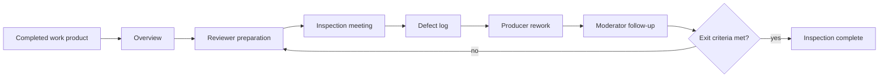

# Software Quality Assurance

Software quality assurance is the planned set of activities that helps a team build confidence in both the product and the process used to create it. Quality has to be planned, measured, reviewed, and followed up.

Quality assurance is broader than testing. Testing executes software to reveal failures; inspections examine work products directly; reliability estimates use failure data; statistical quality assurance uses samples to infer quality; an SQA plan states who will do which quality activities and under what standards. Together, these practices reduce the chance that defects survive until late phases or customer use.

## What assurance covers

**Software quality assurance (SQA)** is the planned and systematic set of activities used to provide confidence that software processes and products satisfy requirements, standards, and stakeholder expectations.

A review is an examination of a work product. Reviews can be informal or formal. A **formal technical review**, or **inspection**, has explicit roles, a completed work product, a defined process, records, and the primary purpose of finding defects.

| Quality activity | Finds or prevents | Typical evidence |
|---|---|---|
| Requirements review | ambiguous or missing requirements | review report, issue list |
| Design inspection | interface, data, and structure defects | inspection log |
| Code inspection | logic, standards, and maintainability defects | defect list and rework record |
| Testing | failures during execution | test report |
| Reliability analysis | failure probability over use | failure data and estimate |
| SQA audit | process compliance gaps | audit report |

## Anatomy of a formal inspection

The common inspection roles are:

| Role | Responsibility |
|---|---|
| Moderator | selects team, conducts inspection, reports results |
| Reader | guides the team through the work product |
| Recorder | records each issue or defect accurately |
| Producer | created the work product, answers questions, performs rework |

The common steps are overview, preparation, inspection meeting, rework, and follow-up. Entry criteria decide whether the inspection can begin; exit criteria decide whether it is complete.

Formal inspections slow review down and assign responsibilities. The producer is present, but the goal is to find defects in an explicit work product rather than judge its author. Preparation time matters; reviewers who first see the work product during the meeting are unlikely to find deep issues.

Inspection effectiveness can be measured by defects found per KLOC and defects found per reviewer-hour. Those measures are imperfect, but they help compare techniques and tune preparation and review time. A technique that finds slightly more defects may still be inefficient if it requires far more reviewer effort.

### Checklists should follow defect history

A **checklist** is a focused list of items or questions reviewers use to find common faults. Checklist items should be updated based on defect history. Items that never find faults should be removed, and recurring escaped faults should become new checklist items.

If a C++ team repeatedly loses time to accidental semicolons after `if` or `while` conditions, the checklist should include that specific issue. An item that is never associated with a found fault after many inspections is a candidate for removal because long checklists dilute attention.

## Reliability follows the operational profile

**Reliability** is the probability of not failing in a specified time or number of executions. If $R(n)$ is reliability over $n$ units, the failure probability is:

$$
F(n) = 1 - R(n)
$$

If one-execution failure probability is $F(1)$, and executions are independent under the same conditions, then:

$$
R(n) = R(1)^n
$$

**Error rate** or failure rate can be estimated from inter-failure time. If a failure occurs every two days, an instantaneous rate estimate is $0.5$ failures per day.

Software reliability differs from hardware reliability. Software does not wear out physically. Failures occur when execution reaches a fault under particular input or state conditions. Reliability therefore depends on the operational profile: the same program may appear reliable under common inputs and fail under rare but important inputs.

### Estimating reliability from observed failures

During representative testing, a system has 10 failures in 200 test cases. Estimate $F(1)$ and $R(1)$ for one test execution, then estimate the probability of 5 independent executions without failure.

Estimate the one-execution failure probability from the sample:

1. Failure probability:

$$
F(1) = \frac{10}{200} = 0.05
$$

2. Reliability for one execution:

$$
R(1) = 1 - F(1) = 1 - 0.05 = 0.95
$$

3. Reliability for 5 independent executions:

$$
\begin{aligned}
R(5) &= R(1)^5 \\
     &= 0.95^5 \\
     &\approx 0.7738
\end{aligned}
$$

The estimated one-execution reliability is 0.95, and the estimated probability of five executions without failure is about 0.774. Reliability decreases as the number of executions increases when $R(1) \lt 1$.

### Sampling has to match real use

**Statistical quality assurance** uses samples, often randomly selected tests, to estimate the quality of the larger product or process. Its estimates depend on representativeness. If random tests are drawn from realistic operation, their failure rate can estimate field behavior. A sample that ignores important usage modes produces a misleading estimate.

## Comparing inspection techniques by effort

Inspection technique A requires 2 hours/KLOC preparation plus 1 hour/KLOC meeting time and finds 12 defects/KLOC. Technique B requires 1 hour/KLOC preparation plus 4 hours/KLOC meeting time and finds 14 defects/KLOC. Compare them by defects found per reviewer-hour.

Compute total review effort and defect discovery rate for each technique.

1. Technique A total effort:

$$
2 + 1 = 3 \text{ hours/KLOC}
$$

2. Technique A rate:

$$
\frac{12}{3} = 4 \text{ defects per hour}
$$

3. Technique B total effort:

$$
1 + 4 = 5 \text{ hours/KLOC}
$$

4. Technique B rate:

$$
\frac{14}{5} = 2.8 \text{ defects per hour}
$$

5. B finds two more defects per KLOC:

$$
14 - 12 = 2
$$

6. B uses two more hours per KLOC:

$$
5 - 3 = 2
$$

Technique A is more efficient by defects found per reviewer-hour: 4 versus 2.8. Technique B finds 14 rather than 12 defects/KLOC in this controlled comparison, but its marginal two defects cost two additional hours/KLOC. Defect criticality and schedule determine which tradeoff is acceptable.

## Writing an SQA plan that can be audited

An **SQA plan** defines purpose, referenced documents, management, documentation, standards, reviews, audits, testing, problem reporting, tools, code control, training, risk, and related quality activities. An IEEE-style plan assigns ownership: it states which documents will be reviewed, which standards apply, who tracks problems, how configuration items are controlled, and how test and defect reports are handled.

The plan needs to be written early enough to influence the project. If the test plan is due during requirements, the SQA plan should say so. If formal inspections occur at the end of each phase, it should name the inspected work products and approval records. Scheduled activities, named owners, and retained evidence replace a vague promise to be careful.

Problem reporting belongs in the plan because defects must be controlled after discovery. A useful report identifies the affected item, describes the observed failure, gives reproduction information when applicable, records severity and priority, assigns responsibility, and captures the final resolution. Weak reporting lets the same fault be found repeatedly, loses deferred fixes, and allows corrections to ship without verification.

Responsibilities can be separate without becoming hostile or bureaucratic. Developers produce and correct work products. Testers run planned and exploratory tests against baselined builds. Configuration management controls versions. The QA group checks whether reviews, inspections, audits, test reporting, and problem tracking occur as planned. Management then receives quality evidence before release pressure obscures unresolved problems.

## Failure modes in the assurance process

- SQA reduced to testing omits reviews, inspections, standards, audits, and problem tracking.
- An inspection meeting cannot compensate for reviewers arriving unprepared.
- The producer answers questions and reworks defects but should not turn the inspection into a design defense.
- Stale checklist items consume attention that should go to recurring defects.
- Reliability estimates from nonrepresentative tests say little about field behavior.
- Failure probability over $n$ executions is not $F(1)^n$. Under the simple independence assumption, it is $F(n) = 1 - R(1)^n$.
- A plan that names activities but omits responsible groups and retained evidence cannot establish whether the work occurred.

See also: [Software testing](/cs/software-engineering/software-testing) · [Software metrics](/cs/software-engineering/software-metrics) · [Risk analysis and management](/cs/software-engineering/risk-analysis-and-management) · [Requirements engineering](/cs/software-engineering/requirements-engineering) · [Software design](/cs/software-engineering/software-design)

