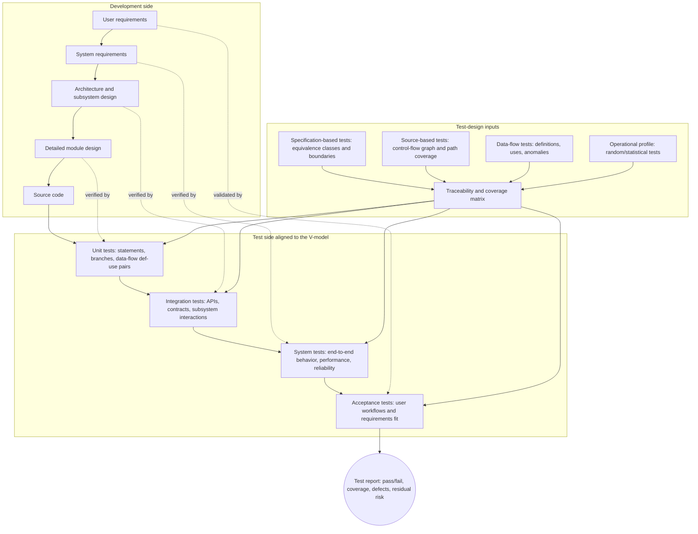

# Software Testing

Software testing executes software with selected inputs to reveal failures and build evidence about behavior. The classic triangle classification problem is a useful running example because its small input space still contains easy-to-miss cases.

Testing is not exhaustive for realistic programs. A function with two 32-bit integer inputs has $2^{64}$ possible input pairs. The engineering problem is selection: choose tests that cover important domains or code structures and expose likely faults. Coverage criteria provide stopping rules and direct attention to parts of the specification or implementation that a developer might unconsciously avoid.

## What a test case must establish

A **test case** consists of input data, execution conditions, and expected output or behavior. Without an expected result, a test run is only an experiment.

A **test coverage criterion** is a rule for selecting tests and deciding when enough tests have been run for a given purpose. Criteria include functional subdomain coverage, every-statement coverage, every-branch coverage, data flow coverage, and boundary coverage.

Criterion A **subsumes** criterion B if every test set satisfying A also satisfies B. Subsumption compares logical strength, not real-world fault-finding quality. A poor test set satisfying a stronger criterion may be worse than a thoughtful test set satisfying a weaker one.

A **test matrix** lists test cases against conditions, outputs, paths, or code elements to show what each test covers.

The main criteria divide the test-selection problem in different ways:

| Criterion | Basis | Strength | Limitation |
|---|---|---|---|
| Functional subdomains | specification | user-visible behavior | can miss implementation paths |
| C0 statement | source code | executes all statements | may miss false branches |
| C1 branch | control decisions | covers both decision outcomes | can still choose weak data |
| Path | control paths | strong path reasoning | often infeasible with loops |
| Data flow | def-use pairs | catches variable-flow faults | analysis can be complex |
| Boundary | subdomain edges | targets common faults | requires boundary knowledge |
| Random | probability model | supports inference | rare cases may be missed |

## Matching tests to development artifacts



Each development artifact has a matching test level, from detailed design and unit tests up to requirements and acceptance tests. Specification subdomains, control-flow coverage, data-flow criteria, and operational profiles feed the traceability matrix and final test report.

## Deriving cases from the specification

Testing requires a specification. Without one, testers cannot decide whether behavior is correct; weak requirements produce weak test oracles.

**Functional testing** derives tests from the specification. It partitions inputs and expected outputs into subdomains such as normal cases, special cases, error cases, and likely user misconceptions. A useful set covers each distinct output, each error message, ordering variants, and special cases. For a triangle classifier, that means equilateral, isosceles, scalene, non-triangle, and bad-input cases, with the largest side in different positions.

### Building a weekly-pay test matrix

A payroll program takes hours worked and hourly wage. A worker may not work more than 80 hours per week, and wage may not exceed USD 50 per hour. Overtime is paid at 1.5 times the wage for hours above 40.

Start with the output and error subdomains:

1. Normal non-overtime case: hours between 0 and 40, wage in range.

2. Overtime case: hours greater than 40 and at most 80, wage in range.

3. Invalid hours: negative hours or more than 80.

4. Invalid wage: negative wage or greater than 50.

5. Boundary values: 0, 40, 80 for hours and 0, 50 for wage.

| Test | Hours | Wage | Expected result |
|---|---:|---:|---|
| T1 | 30 | 20 | USD 600 normal pay |
| T2 | 45 | 20 | USD 950 overtime pay |
| T3 | 81 | 20 | invalid hours |
| T4 | -1 | 20 | invalid hours |
| T5 | 40 | 50 | USD 2000 boundary normal |
| T6 | 80 | 50 | USD 5000 boundary overtime |
| T7 | 10 | 51 | invalid wage |

6. Compute overtime tests:

For T2:

$$
\begin{aligned}
Pay &= 40 \times 20 + (45 - 40) \times 20 \times 1.5 \\
    &= 800 + 5 \times 30 \\
    &= 950
\end{aligned}
$$

For T6:

$$
\begin{aligned}
Pay &= 40 \times 50 + 40 \times 50 \times 1.5 \\
    &= 2000 + 3000 \\
    &= 5000
\end{aligned}
$$

T2 pays USD 950, and T6 pays USD 5000. Computing the expected values independently prevents a plausible-looking but incorrect oracle from entering the matrix.

## What structural coverage does and misses

**Structural testing** derives tests from source code structure. **C0 coverage**, or every-statement coverage, requires every statement to execute at least once. **C1 coverage**, or every-branch coverage, requires both outcomes of every decision.

C1 is stronger than C0 for ordinary control flow because exercising both decision outcomes also executes the statements reached through them. Subsumption remains a formal relationship rather than a quality guarantee: the tester still chooses the input values. A small C1-satisfying set for the triangle program can be less effective than a larger, well-chosen C0 set if it covers the code without checking enough output subdomains.

**Path testing** attempts to execute paths through the control-flow graph. Loops can generate infinitely many paths, so complete path coverage is usually infeasible.

**Multiple-condition coverage** requires primitive conditions inside compound decisions to evaluate both true and false, often across combinations. Short-circuit evaluation can make some combinations infeasible or prevent a later condition from being evaluated.

### Following definitions to their uses

**Data flow testing** focuses on definitions and uses of variables. A **def** assigns a value. A **c-use** uses a value in computation. A **p-use** uses a value in a predicate. A **def-free path** from a definition to a use contains no intervening redefinition.

These criteria catch faults related to definitions, redefinitions, and uses. A variable may be assigned in one branch but used after another branch where it was never defined. Statement coverage can execute both statements in separate runs and still miss the problematic definition-use relationship.

## Attacking the boundaries

**Boundary testing** selects cases on and just off boundaries between subdomains because many faults shift a decision edge. If overtime begins after 40 hours, the set should include 40 and values just below and above it. For multidimensional inputs, choose points on the boundary and nearby points on each relevant side.

### The triangle-inequality edge

For triangle sides $a$, $b$, and $c$, one invalid boundary is $a = b + c$. Assume the invalid side is $a \ge b + c$, and construct two on-boundary tests and one nearby test in the valid domain.

Choose points on the equality boundary and a nearby point in the valid domain.

1. On-boundary tests satisfy $a = b + c$.

2. Choose widely separated examples:

$$
(a,b,c) = (8,1,7)
$$

and

$$
(a,b,c) = (20,9,11)
$$

Both satisfy equality and should be classified as not a triangle if the program uses strict triangle inequality.

3. A just-off-boundary test in the valid domain should have $a \lt  b + c$ by a small amount:

$$
(a,b,c) = (7.9,4,4)
$$

Because $7.9 \lt  8$, it should be valid if other inputs are positive.

On-boundary tests `(8,1,7)` and `(20,9,11)` should be rejected as non-triangles. The nearby case `(7.9,4,4)` should be accepted as an isosceles triangle. Substitution into the strict inequality checks each expected result.

## Random tests need an operational profile

**Random testing** selects cases randomly, ideally from an **operational profile** that describes expected usage categories and their probabilities in real operation. It supports fast, unbiased generation and statistical inference, but unweighted random inputs rarely cover uncommon categories well. Random integers, for example, are unlikely to produce equal triangle sides, so a triangle test suite without a suitable profile may almost never exercise equilateral cases.

## Executable cases for the triangle classifier

```python
def classify_triangle(a, b, c):
    if a <= 0 or b <= 0 or c <= 0:
        return "bad inputs"
    if a >= b + c or b >= a + c or c >= a + b:
        return "not a triangle"
    if a == b == c:
        return "equilateral"
    if a == b or a == c or b == c:
        return "isosceles"
    return "scalene"

tests = [
    (5, 5, 5, "equilateral"),
    (3, 4, 5, "scalene"),
    (8, 1, 7, "not a triangle"),
    (7.9, 4, 4, "isosceles"),
    (0, 0, 0, "bad inputs"),
]

for a, b, c, expected in tests:
    actual = classify_triangle(a, b, c)
    assert actual == expected, (a, b, c, actual, expected)
```

The cases combine output subdomains with the boundary $a = b + c$. The assertion makes a mismatch fail the run instead of leaving it buried in printed status.

## Sources of false confidence

- A run without an expected output supplies no pass-or-fail oracle.
- High statement coverage says which code executed, not whether the observed behavior was correct.
- Functional sets often omit error outputs, special cases, and alternate orderings of symmetric inputs.
- Random testing without an operational profile under-samples rare but important categories.
- When interpreting reliability results, $F(n)$ is not $F(1)^n$; under the simple independence model, $F(n) = 1 - R(1)^n$.
- Multiple-condition tests have to account for short-circuit evaluation.
- A triangle suite that always places the largest side first leaves symmetric orderings unchecked.

<div className="see-also">

See also: [Software quality assurance](/cs/software-engineering/software-quality-assurance) · [Requirements engineering](/cs/software-engineering/requirements-engineering) · [Software metrics](/cs/software-engineering/software-metrics) · [Object-oriented testing](/cs/software-engineering/object-oriented-testing) · [Formal specifications and OCL](/cs/software-engineering/formal-specifications-and-ocl)

</div>
