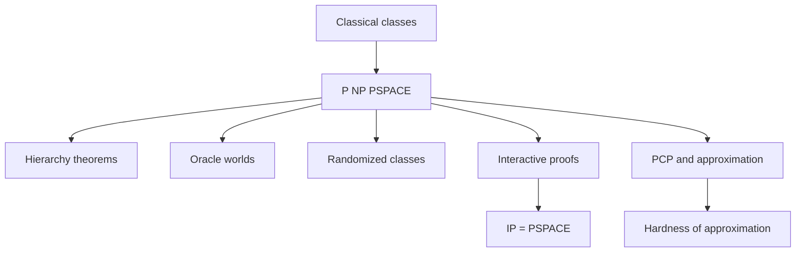

# Advanced Complexity Topics

After P, NP, and PSPACE, complexity theory branches into sharper questions. Hierarchy theorems ask whether giving a machine more time or space genuinely increases its power. Oracles expose limits of broad proof techniques. Randomized computation, interactive proofs, and PCPs connect verification with probability, games, algebra, and approximation.

Complexity is therefore not a single ladder. Time, space, randomness, alternation, parallelism, communication, and approximation define different ways to classify computational difficulty.

## A map beyond the classical classes



| Topic | Main surprise | Typical proof ingredient |
|---|---|---|
| hierarchy theorems | more resource can strictly help | diagonalization with bounds |
| oracles | some techniques cannot settle P vs NP | relativized computation |
| BPP | randomness with small error can be amplified | Chernoff or majority bounds |
| IP | interaction verifies PSPACE | arithmetization |
| PCP | constant-query checking of NP proofs | probabilistic proof encodings |

An **oracle Turing machine** can ask membership questions to a fixed oracle language in one step. **Relativization** studies complexity classes when every machine receives access to the same oracle.

The class **BPP** contains languages decided in randomized polynomial time with bounded error. For every fixed input, the answer is correct with probability at least some constant above $1/2$, conventionally $2/3$. The probability is over the machine's internal random choices, not a distribution over inputs.

An **interactive proof system** lets a polynomial-time randomized verifier exchange messages with a computationally unbounded prover. Completeness supplies a convincing prover strategy for true statements; soundness bounds every prover's chance of convincing the verifier of a false statement. The class IP contains the languages with such protocols.

The **PCP theorem** says, in one standard formulation, that an NP proof can be encoded so that a verifier uses logarithmically many random bits and reads only constantly many proof bits. False claims are rejected with a fixed positive probability regardless of the purported proof.

## Resource hierarchies need clocks

A **hierarchy theorem** states that, under suitable constructibility conditions, a larger resource bound gives strictly more computational power. The time hierarchy theorem, for example, places some decidable problems in a larger time class but outside a smaller one, so deterministic time classes do not all collapse.

The proof is diagonalization with a budget. A universal machine enumerates machines running within the smaller bound and constructs a language that disagrees with the $i$th machine on its own encoded input. A clock stops the simulation soon enough for the diagonal language to remain decidable within the larger bound.

Constructibility is part of the theorem, not a technical ornament. The machine must be able to compute or enforce its resource allowance during simulation. These hierarchy results separate sufficiently different deterministic bounds; they do not settle the finer question $P\stackrel{?}{=}NP$.

## Oracle worlds and the relativization barrier

There are oracles $A$ and $B$ such that

$$
P^A=NP^A
\qquad\text{and}\qquad
P^B\ne NP^B.
$$

An oracle world is a laboratory for proof methods, not evidence about which equality holds without an oracle. If an argument continues to work after the same arbitrary oracle is attached to every machine, then it **relativizes**. Since the displayed statement changes truth value between oracle worlds, a uniformly relativizing argument cannot decide ordinary P versus NP. Results such as $IP=PSPACE$ rely on nonrelativizing ideas, notably arithmetization.

### Tracing the barrier argument

Suppose a relativizing proof claimed $P\ne NP$.

1. Relativization would make the same argument prove $P^O\ne NP^O$ for every oracle $O$.
2. An oracle $A$ exists for which $P^A=NP^A$.
3. The relativized conclusion is false in that world.
4. No purely relativizing proof can therefore establish $P\ne NP$.

The symmetric argument rules out a purely relativizing proof of $P=NP$ by using an oracle $B$ for which $P^B\ne NP^B$. Neither oracle result answers the original question; together they identify a limit of the proof style.

## Amplifying bounded-error computation

BPP separates running time from correctness probability. The algorithm has a polynomial running-time bound, while each fixed input is answered correctly with high probability. Independent repetition followed by majority vote reduces error exponentially without leaving polynomial time.

For an algorithm with error at most $1/3$, three trials are not enough to push the error below $1/8$. The majority is wrong when exactly two or all three runs fail:

$$
\binom{3}{2}\left(\frac13\right)^2\left(\frac23\right)
+\left(\frac13\right)^3
=\frac7{27}\approx0.259.
$$

With eleven trials, the exact wrong-majority probability is

$$
\sum_{k=6}^{11}\binom{11}{k}
\left(\frac13\right)^k
\left(\frac23\right)^{11-k}
=\frac{21627}{177147}\approx0.1221<\frac18.
$$

Chernoff bounds give the general exponential decay without evaluating each binomial tail. It is widely conjectured that BPP equals P, but randomness remains a central resource in algorithm design and complexity theory.

### Simulating majority amplification

```python
import random

def noisy_decider(x):
    correct = (len(x) % 2 == 0)
    if random.random() < 2 / 3:
        return correct
    return not correct

def amplified_decider(x, trials=31):
    votes = sum(1 for _ in range(trials) if noisy_decider(x))
    return votes > trials // 2

for sample in ["1010", "101"]:
    print(sample, amplified_decider(sample))
```

The trials must be independent. Reusing correlated random choices can destroy the binomial-tail guarantee.

## Verification through interaction

An NP verifier checks one static certificate. An interactive verifier conducts a protocol with a prover that may adapt its messages. Random challenges make consistent cheating unlikely: completeness protects an honest prover on true instances, while soundness quantifies over every strategy on false instances.

The theorem

$$
IP=PSPACE
$$

says that every polynomial-space computation has an interactive proof with a polynomial-time verifier. The prover supplies guidance through a long computation, and algebraic consistency tests let the verifier check that guidance without reproducing the computation. Interaction and randomness thus let limited verifiers check statements as hard as any problem in PSPACE.

## Local proof checking and approximation hardness

The PCP theorem replaces full certificate reading with probabilistic spot checks of a specially encoded proof. A constant number of queries can still catch a false proof with constant probability.

That local testability transfers to optimization problems. A reduction can encode the gap between a completely consistent proof and one with many local inconsistencies. If an approximation algorithm crossed the resulting gap for certain problems, it would distinguish the two cases and imply $P=NP$. The encoding and verifier are part of the theorem; an ordinary NP certificate does not automatically support constant-query checking.

## Alternation, circuits, and average-case hardness

An alternating machine has existential states, where at least one successor must accept, and universal states, where every successor must accept. The two state types resemble choices by a prover and an adversary. Polynomial-time alternation captures PSPACE, explaining why quantified Boolean formulas and finite games fit naturally into polynomial space.

Circuit complexity studies **nonuniform** computation. Instead of one machine serving every input length, a circuit family supplies one Boolean circuit for each length. P/poly contains languages with polynomial-size circuit families, possibly using advice that depends only on the input length. Strong lower bounds for explicit functions remain difficult and are tied to derandomization and class separations.

Cryptographic hardness is different from NP-completeness. Security requires problems that resist efficient adversaries on an intended input distribution, not merely worst-case instances. Factoring, discrete logarithms, lattice problems, and one-way functions inhabit this setting; their definitions add probability, interaction, and adversarial success bounds to the language of reductions.

Approximation studies near-optimal solutions when exact optimization is NP-hard. Parallel complexity asks which problems become fast when many processors cooperate. Both directions refine the broad classes by changing the computational resource or the required quality of the answer.

## Keeping hierarchy, oracle, BPP, IP, and PCP claims separate

- Hierarchy theorems separate classes with sufficiently different resource bounds, not deterministic from nondeterministic polynomial time.
- Oracles are proof devices for relativized computation, not subroutines available to ordinary algorithms.
- BPP permits bounded error on every input; it does not permit a fixed set of inputs on which the algorithm is usually wrong.
- IP protocols may use randomness, multiple rounds, and an adaptive prover, unlike static NP certificates.
- PCP verification assumes a particular encoded proof and verifier rather than random access to an unmodified proof.

<div className="see-also">

See also:

- P, NP, and verifiers are introduced in [time complexity, P, and NP](/cs/theory/time-complexity-p-and-np).
- NP-completeness and reductions are in [NP-completeness and classic reductions](/cs/theory/np-completeness-and-classic-reductions).
- PSPACE is developed in [space complexity](/cs/theory/space-complexity).
- Diagonalization starts in [proof methods and countability](/cs/theory/proof-methods-and-countability).

</div>
