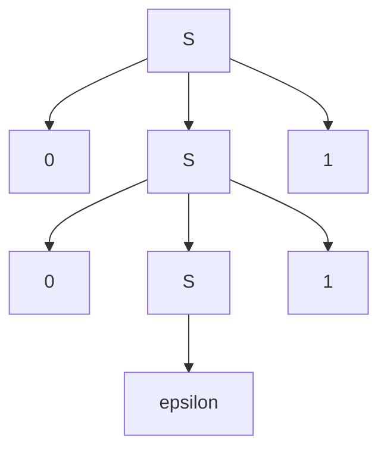

# Context-Free Grammars and Normal Forms

Context-free grammars describe recursive syntax. A nonterminal can expand into smaller instances of the same pattern, so CFGs naturally represent nesting, balanced structure, arithmetic expressions, and programming-language syntax. The viewpoint is generative: a language consists of the terminal strings derivable from a start variable.

The same language may have many grammars, and one grammar may assign several parse trees to a single string. Chomsky normal form trades readable productions for a uniform binary shape that supports proofs and parsing algorithms.

## Grammars as recursive specifications

A **context-free grammar** is a 4-tuple $(V,\Sigma,R,S)$. The set $V$ contains variables or nonterminals, $\Sigma$ contains terminals, $R$ is a finite set of production rules, and $S\in V$ is the start variable. Every rule has one variable on its left side; recursion alone does not make a grammar context-free if that condition fails.

A **derivation** replaces variables according to the productions. If $S\Rightarrow^* w$ for $w\in\Sigma^*$, then the grammar generates $w$. Formally,

$$
L(G)=\{w\in\Sigma^*:S\Rightarrow^*w\}.
$$

Good grammar design begins with the recursive decomposition of the strings. For $0^n1^n$, the outer symbols are linked, suggesting $S\to0S1$. A balanced-parentheses string can contain a pair around a smaller balanced string followed by another balanced string, suggesting $S\to(S)S\mid\epsilon$. For arithmetic, variables such as expression, term, and factor record precedence instead of acting like arbitrary machine states.

## Reading a derivation as a tree

A **parse tree** records derivation structure. Internal nodes are variables, leaves are terminals or $\epsilon$, and the children of a node spell the right-hand side of the production used there. Leftmost and rightmost derivations can expand nodes in different orders while describing the same tree.

For the grammar

$$
S\to0S1\mid\epsilon,
$$

the string `0011` has the derivation

$$
S\Rightarrow0S1\Rightarrow00S11\Rightarrow0011.
$$

Its parse tree exposes the two nested matching pairs:



Every recursive step places a `0` to the left and a `1` to the right of the remaining sentential form. All generated strings therefore have the form $0^n1^n$. Conversely, $n$ recursive expansions followed by $S\to\epsilon$ generate every such string. The grammar cannot generate `0101`, because it never puts a `0` after a generated `1`.

| Grammar feature | Meaning | Role in analysis |
|---|---|---|
| leftmost derivation | always expand the leftmost variable | useful for parser traces |
| parse tree | structure independent of expansion order | reveals ambiguity |
| epsilon rule | a variable may disappear | controlled during normalization |
| unit rule | $A\to B$ | removed during CNF conversion |
| binary rule | $A\to BC$ | core production shape in CNF |

## Ambiguity changes the assigned structure

A grammar is **ambiguous** if one generated string has two distinct parse trees, equivalently two distinct leftmost derivations. Merely finding two derivation orders is insufficient: they may visit the same tree in a different sequence.

Arithmetic grammars show why the distinction matters. If a grammar allows `a+a*a` to group as either `(a+a)*a` or `a+(a*a)`, the parse trees assign different meanings. Introducing variables for expressions, terms, and factors can encode precedence and associativity and remove that ambiguity.

Ambiguity belongs first to a grammar. A language is **inherently ambiguous** only when every CFG generating it is ambiguous. One ambiguous grammar does not establish inherent ambiguity, and replacing it with a longer unambiguous grammar may be possible.

## Proving that a grammar generates exactly the intended language

Language equality needs both inclusions.

- **Soundness of the grammar:** prove that every generated terminal string has the intended property, usually by induction on the parse tree or derivation.
- **Completeness of the grammar:** prove that every intended string can be generated, usually by induction on length, nesting depth, or another size measure.

For $S\to SS\mid(S)\mid\epsilon$, soundness follows because concatenating balanced strings, surrounding one with a matching pair, and producing $\epsilon$ all preserve balance. Completeness uses the structure of a nonempty balanced string: its first opening parenthesis has a matching closing parenthesis, splitting the string into the balanced interior and a balanced remainder. That decomposition supplies the recursive derivation.

The generated language must remain separate from its informal description throughout the proof. “The productions look balanced” is evidence for the design, not a proof of equality.

## Converting a grammar to Chomsky normal form

A grammar is in **Chomsky normal form** when every production has one of the shapes

$$
A\to BC
\qquad\text{or}\qquad
A\to a,
$$

with a controlled special rule $S\to\epsilon$ if the language contains the empty string. Here $A,B,C$ are variables and $a$ is a terminal. Every context-free language has a CNF grammar, subject to that empty-string convention.

A standard conversion proceeds through several preservation steps:

1. Remove symbols that cannot contribute to a terminal derivation from the start variable.
2. Remove epsilon productions, adding the alternatives obtained by omitting nullable variables without introducing unwanted empty strings.
3. Remove unit productions $A\to B$ by transferring the target's non-unit productions to the source.
4. Replace terminals that occur inside long right-hand sides with variables.
5. Break every right-hand side of more than two variables into binary productions.

For example, replace $A\to BCDE$ by

$$
A\to BX_1,
\qquad
X_1\to CX_2,
\qquad
X_2\to DE.
$$

Then

$$
A\Rightarrow BX_1\Rightarrow BCX_2\Rightarrow BCDE,
$$

so terminal order is unchanged. Helper variables must be fresh; reusing a variable with other productions can change the language.

CNF is a technical representation rather than a pleasant notation for humans. Its payoff is a binary parse tree: every nonempty string of length $n$ has a CNF parse tree with exactly $2n-1$ variable-labeled nodes.

## Why CNF leads to the CYK recurrence

The CYK algorithm decides CFG membership after conversion to CNF. A table entry $(i,\ell)$ stores the variables that derive the length-$\ell$ substring starting at position $i$.

If $\ell\gt 1$, any derivation of that substring ends with some rule $A\to BC$ and some split $k$:

$$
B\Rightarrow^* w[i:i+k]
\qquad\text{and}\qquad
C\Rightarrow^* w[i+k:i+\ell].
$$

The algorithm tries all splits and binary productions, building longer spans from shorter ones. Uniform production shapes keep the recurrence small; arbitrary productions would require additional cases. With a conventional implementation, CYK runs in $O(n^3\vert G\vert )$ time for a string of length $n$.

## Small grammar transformations in Python

The first function recognizes the particular language generated by $S\to0S1\mid\epsilon$. The second constructs the binary chain used for a long right-hand side whose symbols are represented by single characters.

```python
def derives_0n1n_by_grammar(w):
    if len(w) % 2:
        return False
    n = len(w) // 2
    return w == "0" * n + "1" * n

def cnf_binary_chain(lhs, rhs):
    if len(rhs) <= 2:
        return [(lhs, rhs)]
    rules = []
    current = lhs
    for i, symbol in enumerate(rhs[:-2], start=1):
        helper = f"X{i}"
        rules.append((current, symbol + helper))
        current = helper
    rules.append((current, rhs[-2:]))
    return rules

print(derives_0n1n_by_grammar("0011"))
print(cnf_binary_chain("A", "BCDE"))
```

This transformation assumes that `X1`, `X2`, and so on are fresh grammar variables. A production representation based on strings also assumes each original symbol occupies one character; a parser implementation should use token sequences instead.

<div className="see-also">

See also:

- Regular-language limitations are proved in [regular expressions and nonregularity](/cs/theory/regular-expressions-and-nonregularity).
- Stack machines for the same languages appear in [pushdown automata and deterministic CFLs](/cs/theory/pushdown-automata-and-deterministic-cfls).
- Non-CFL proofs use the CFL pumping lemma in [non-context-free languages](/cs/theory/non-context-free-languages).
- CFG membership algorithms are part of [Turing machine variants and decidable problems](/cs/theory/turing-machine-variants-and-decidable-problems).

</div>
