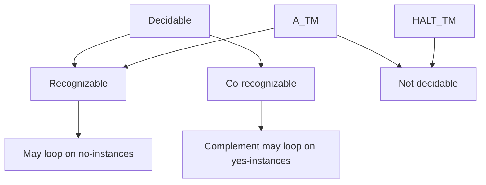

# Decidability and the Halting Problem

Decidability separates algorithmic problems that can always be solved from those for which no universal terminating algorithm exists. Turing machines can encode other machines as data, allowing programs to simulate and inspect programs. Self-reference and diagonalization then impose limits on what any analyzer can decide.

The halting problem is the canonical example: given a machine and an input, determine whether the computation eventually stops. Individual programs may be easy to analyze, but no one algorithm handles every encoded machine-input pair correctly and terminates on all of them.

## Deciders, recognizers, and complements

A language $A$ is **decidable** if a Turing machine halts on every input and accepts exactly the strings in $A$. Such a machine is a **decider**.

A language is **Turing-recognizable** if some machine accepts exactly its members but may loop on nonmembers. It is **co-recognizable** if its complement

$$
\overline A=\Sigma^*\setminus A
$$

is recognizable, relative to a fixed encoding alphabet.



| Language | Recognizable? | Decidable? | Reason |
|---|---|---|---|
| $A_{DFA}$ | yes | yes | finite simulation |
| $E_{DFA}$ | yes | yes | finite reachability |
| $A_{TM}$ | yes | no | simulation recognizes; diagonalization rules out a decider |
| $\overline{A_{TM}}$ | no | no | otherwise $A_{TM}$ would be decidable |
| $HALT_{TM}$ | yes | no | simulation recognizes; $A_{TM}$ reduces to it |

A language is decidable exactly when it is both recognizable and co-recognizable. One direction is immediate: swap the answers of a decider to decide the complement. For the other, run recognizers for $A$ and $\overline A$ in parallel. Every input lies on exactly one side, so one recognizer eventually accepts and determines the answer.

## Acceptance can be recognized by direct simulation

The acceptance problem is

$$
A_{TM}=\{\langle M,w\rangle:M\text{ accepts }w\}.
$$

A recognizer performs the obvious simulation:

1. Check that the input encodes a machine $M$ and string $w$; reject malformed encodings.
2. Simulate $M$ on $w$ step by step.
3. Accept if $M$ accepts and reject if $M$ rejects.
4. If $M$ runs forever, continue the simulation forever.

The machine accepts exactly the members of $A_{TM}$, so it is a recognizer. It fails to be a decider because it inherits nontermination from simulated machines.

Simulation and prediction must remain separate. Every computation can be followed one transition at a time. No finite observation can always predict whether a computation that has not stopped will halt later. Any fixed step cutoff misses machines that halt after the cutoff.

## Diagonalizing against an acceptance decider

Assume for contradiction that a machine $H$ decides whether an encoded machine accepts an encoded input. Construct $D$ to take an encoding $\langle M\rangle$, ask $H$ whether $M$ accepts its own description, and reverse the predicted outcome:

$$
D(\langle M\rangle)=
\begin{cases}
\text{reject}, & H(\langle M,\langle M\rangle\rangle)=\text{accept},\\
\text{accept}, & H(\langle M,\langle M\rangle\rangle)=\text{reject}.
\end{cases}
$$

Now run $D$ on $\langle D\rangle$. If $H$ predicts that $D$ accepts its own description, then $D$ rejects. If $H$ predicts that it does not accept, then $D$ accepts. Both possibilities contradict the claimed correctness of $H$, so $A_{TM}$ is undecidable.

The construction uses only the promised input-output behavior of the proposed decider. It does not depend on its implementation or on computations merely taking a long time.

## Reducing acceptance to halting

The halting problem is

$$
HALT_{TM}=\{\langle M,w\rangle:M\text{ halts on }w\}.
$$

Halting and acceptance differ: a machine that stops and rejects belongs to $HALT_{TM}$ but its pair is absent from $A_{TM}$.

Suppose $H_{halt}$ decided $HALT_{TM}$. A decider for $A_{TM}$ could then work as follows:

1. On $\langle M,w\rangle$, run $H_{halt}$ on the same pair.
2. If $H_{halt}$ reports nontermination, reject.
3. If it reports halting, simulate $M$ on $w$ until it stops.
4. Return the simulated machine's accept or reject answer.

The second simulation terminates because it runs only after a positive halting answer. The resulting machine would decide $A_{TM}$, contradicting the diagonal result. Hence $HALT_{TM}$ is undecidable. It remains recognizable: simulate $M$ and accept as soon as either a halting accept or halting reject state appears.

## Dovetailing complementary recognizers

If recognizers exist for both $A$ and $\overline A$, their simulations can be interleaved rather than run sequentially. A sequential attempt may become trapped in the first recognizer; dovetailing gives each computation progressively more time.

The following code treats `accepts_within` functions as bounded simulators. Each returns true exactly when its recognizer has accepted within the supplied step budget.

```python
from itertools import count

def decide_from_complementary_recognizers(
    accepts_A_within, accepts_not_A_within, x
):
    for budget in count(1):
        if accepts_A_within(x, budget):
            return True
        if accepts_not_A_within(x, budget):
            return False

def accepts_even_within(x, budget):
    return budget >= 1 and len(x) % 2 == 0

def accepts_odd_within(x, budget):
    return budget >= 1 and len(x) % 2 == 1

print(decide_from_complementary_recognizers(
    accepts_even_within, accepts_odd_within, "101"
))
```

Exactly one complementary recognizer eventually accepts, so the unbounded loop terminates under the theorem's assumptions. If someone produced a recognizer for $\overline{A_{TM}}$, combining it with the direct recognizer for $A_{TM}$ would decide $A_{TM}$. Therefore $\overline{A_{TM}}$ is not recognizable.

## What undecidability rules out

Undecidability is a universal impossibility result, not a claim that every instance is opaque. Termination can be proved for many individual programs, and restricted programming languages may have decidable termination. Useful static analyzers deliberately trade completeness, soundness, or generality rather than contradicting the theorem.

Syntax also differs from semantics. Whether a string is a well-formed Turing-machine encoding is a finite syntactic question and is decidable. Whether the encoded machine halts or what language it recognizes is semantic and can be undecidable.

Rice's theorem develops this boundary: every nontrivial property of the language recognized by a Turing machine is undecidable. Many reductions exploit the same pattern by building a machine that has one semantic behavior if $M$ accepts $w$ and another otherwise. Properties of the encoding itself remain outside that conclusion.

## Failed approaches and what they overlook

- A large simulation limit does not decide halting; some terminating machines run longer than the chosen limit.
- Acceptance and halting cannot be interchanged, because halting also includes rejection.
- Recognizability is not closed under complement. Closure would turn every recognizable language into a decidable one by dovetailing.
- Diagonalization is a machine construction over encodings, not an informal paradox.
- Empirical success on many programs does not satisfy a decider's requirement to halt and answer correctly on every valid encoding.

<div className="see-also">

See also:

- Turing-machine configurations are introduced in [Turing machines and the Church-Turing thesis](/cs/theory/turing-machines-and-the-church-turing-thesis).
- Decidable automata and grammar problems are surveyed in [Turing machine variants and decidable problems](/cs/theory/turing-machine-variants-and-decidable-problems).
- Reductions spread undecidability in [reductions and the recursion theorem](/cs/theory/reductions-and-the-recursion-theorem).
- Complexity reductions adapt the same pattern in [NP-completeness and classic reductions](/cs/theory/np-completeness-and-classic-reductions).

</div>
