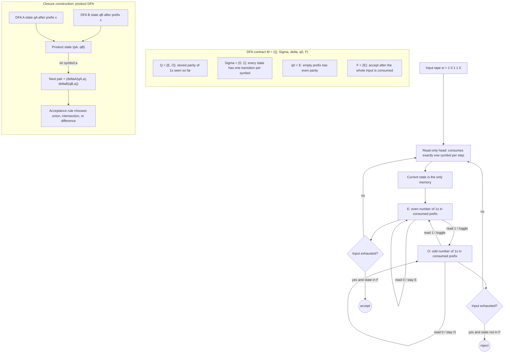

# Finite Automata and DFAs

A deterministic finite automaton reads an input from left to right, stores one state from a finite set, and decides acceptance after the final symbol. With no stack, tape, or unbounded counter, it retains only bounded information: parity, a fixed suffix, a residue modulo $k$, progress toward a substring, or the current stage of a finite protocol.

That restriction gives finite automata both their utility and their clean limits. They model lexical scanners, controllers, protocol states, finite-memory circuits, and regular-language pattern matching. Their constructions also introduce invariants, product states, and finite abstraction in a compact setting.

## A state is the whole memory

A **deterministic finite automaton** is a 5-tuple

$$
M=(Q,\Sigma,\delta,q_0,F),
$$

where $Q$ is a finite set of states, $\Sigma$ is a finite input alphabet, $\delta:Q\times\Sigma\to Q$ is the transition function, $q_0\in Q$ is the start state, and $F\subseteq Q$ is the set of accepting states.

The transition function is total: every state-symbol pair has exactly one next state. A **sink state** often supplies transitions after the desired property has become impossible, though not every DFA needs one.



The parity machine keeps only whether the consumed prefix contains an even or odd number of `1`s. Reading `0` preserves the summary; reading `1` toggles it. Acceptance is checked only when the input is exhausted, even if an accepting state was visited earlier.

| Language pattern | Information stored in a state | Typical state count |
|---|---|---|
| even number of `1`s | parity bit | 2 |
| length divisible by $k$ | residue modulo $k$ | $k$ |
| ends with a fixed word $u$ | longest suffix matching a prefix of $u$ | at most $\lvert u\rvert+1$ |
| contains a fixed substring $u$ | pattern progress plus a found state | at most $\lvert u\rvert+1$ |

## Extending transitions from symbols to strings

On $w=w_1w_2\cdots w_n$, a DFA starts in $q_0$ and applies one transition per symbol. The **extended transition function** packages the full run:

$$
\hat\delta(q,\epsilon)=q,
\qquad
\hat\delta(q,xa)=\delta(\hat\delta(q,x),a).
$$

The recognized language is

$$
L(M)=\{w\in\Sigma^*: \hat\delta(q_0,w)\in F\}.
$$

A language is **regular** when some DFA recognizes it. A state is **reachable** when $\hat\delta(q_0,w)$ equals that state for some input $w$. Unreachable states may be removed without changing the language.

## Designing states from future-relevant information

State names should describe what the machine knows, such as `odd_ones`, `seen_10`, or `matched_01`. The central question is which prefixes must lead to different future behavior.

Prefixes $x$ and $y$ are **distinguishable** for a language if some suffix $z$ makes exactly one of $xz$ and $yz$ belong to the language. A correct DFA must place distinguishable prefixes in different states because no earlier history survives except the current state. This observation becomes the Myhill–Nerode theorem.

Common design patterns follow directly:

- For a modulo language, store the current residue.
- For a suffix language, store the longest suffix seen so far that is also a prefix of the target word.
- For a contains-substring language, store progress toward the pattern and an absorbing found state.
- For combined requirements, store a tuple of the component summaries.

DFAs can count modulo a fixed number because only finitely many residues occur. They cannot recognize $\{0^n1^n:n\ge0\}$: matching an arbitrary number of zeros with later ones requires unbounded information.

## Building the machine for strings ending in `01`

Track the longest useful suffix relative to the pattern `01`:

- `q0`: no nonempty suffix matches a prefix of `01`.
- `q1`: the current input ends in `0`.
- `q2`: the current input ends in `01`; this state is accepting.

| State | on `0` | on `1` | Accepting? |
|---|---|---|---|
| `q0` | `q1` | `q0` | no |
| `q1` | `q1` | `q2` | no |
| `q2` | `q1` | `q0` | yes |

The transition from `q1` on `0` stays at `q1` because the newest `0` can begin a fresh match. From `q2`, a `1` moves to `q0` because the input then ends in `11`.

For `101`, the run is

$$
q0\to q0\to q1\to q2,
$$

so the string is accepted. For `010`, the final transition returns to `q1`, so it is rejected.

### Executing the transition table

```python
def accepts_ending_01(w):
    state = "q0"
    delta = {
        ("q0", "0"): "q1", ("q0", "1"): "q0",
        ("q1", "0"): "q1", ("q1", "1"): "q2",
        ("q2", "0"): "q1", ("q2", "1"): "q0",
    }
    for ch in w:
        state = delta[(state, ch)]
    return state == "q2"

for sample in ["", "01", "101", "010", "1101"]:
    print(sample, accepts_ending_01(sample))
```

An input symbol outside `0` and `1` raises a lookup error here. A reusable DFA implementation should validate its alphabet explicitly.

## Combining regular properties with product states

Regular languages are closed under union, intersection, complement, and difference. Complement keeps the states and transitions of a complete DFA and swaps accepting with nonaccepting states. Binary Boolean operations use product states $(q_A,q_B)$ to simulate both component machines on the same input.

After reading any prefix $x$, the product construction maintains the invariant

$$
\left(
\hat\delta_A(q_{0A},x),
\hat\delta_B(q_{0B},x)
\right).
$$

It holds at $\epsilon$ and one transition preserves it. Acceptance then implements the desired Boolean rule: both components for intersection, at least one for union, or one component but not the other for difference.

Consider $A$, the strings with an even number of `1`s, and $B$, the strings whose length is divisible by $3$. The first DFA has states `E` and `O`; the second has residues `0`, `1`, and `2`. Their intersection DFA has six possible pairs and starts at `(E,0)`.

- On `0`, keep the parity component and increase the length residue modulo $3$.
- On `1`, toggle parity and increase the length residue modulo $3$.
- Accept only `(E,0)`.

The string `101101` has four `1`s and length six, so it finishes in `(E,0)`. The shorter string `101` also finishes there: it has two `1`s and length three. Product state counts multiply because every summary from one machine may need to coexist with every summary from the other.

## Correctness, equivalence, and boundary tests

A state invariant usually proves both directions of correctness at once. Describe exactly what each state means after an arbitrary prefix; prove the description at $\epsilon$ and after one more symbol; then show that the accepting states correspond to the target property.

Two states are equivalent when no continuation distinguishes their acceptance behavior. Equivalent states may be merged during minimization. If a suffix makes one state accept and the other reject, they must remain separate. Finding apparently different states with identical future behavior often reveals either an unnecessary distinction or a transition-table error.

Before writing the proof, boundary strings expose weak state meanings:

- For suffix machines, test $\epsilon$, strings shorter than the suffix, the suffix itself, and near matches.
- For modulo machines, test lengths around a modulus boundary.
- For substring machines, include self-overlapping occurrences.
- For every construction, check the full transition table and whether $\epsilon$ should be accepted.

Tests support the invariant; they do not replace it. The underlying abstraction discards almost all prefix history, and correctness says that everything discarded is irrelevant to every future membership decision.

<div className="see-also">

See also:

- The set and function notation comes from [mathematical preliminaries](/cs/theory/mathematical-preliminaries).
- NFAs and closure constructions extend these ideas in [nondeterminism and closure](/cs/theory/nondeterminism-and-closure).
- Regular expressions are equivalent to automata in [regular expressions and nonregularity](/cs/theory/regular-expressions-and-nonregularity).
- DFA emptiness and equivalence become decidable problems in [Turing machine variants and decidable problems](/cs/theory/turing-machine-variants-and-decidable-problems).

</div>
