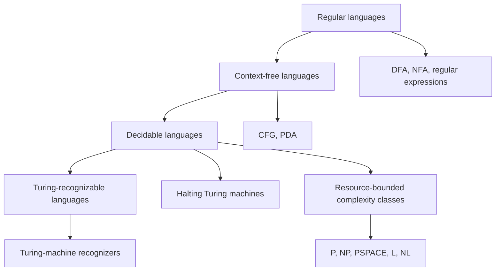

# Theory of Computation

Theory of computation studies computation before choosing a programming language, operating system, or machine architecture. It asks which problems can be solved at all, which are solvable by restricted devices such as finite automata or pushdown automata, and which solvable problems demand unreasonable resources.

The abstractions recur in working systems. Compiler scanners behave like finite automata, parsers are organized around context-free grammars, undecidability limits fully automatic program verification, and complexity theory explains why many optimization problems need reductions, approximations, heuristics, or randomized methods.

The scope follows Michael Sipser's *Introduction to the Theory of Computation*, third edition: mathematical preliminaries, automata and languages, computability, decidability, reducibility, time and space complexity, and selected advanced topics.

## Languages turn problems into mathematical objects

A **model of computation** states exactly what counts as a computation. The principal models are deterministic and nondeterministic finite automata, regular expressions, context-free grammars, pushdown automata, Turing machines, and Turing-machine variants. A useful model is precise enough for proof and spare enough to expose structure.

A **language** is a set of strings over an alphabet. Recognition asks whether a given string belongs to that set. Graphs, formulas, programs, arithmetic expressions, and scheduling instances enter the theory only after an encoding represents them as strings.

A **decision problem** is a yes-or-no problem represented as a language. A language is **decidable** if an algorithm halts on every input and answers membership correctly. It is **recognizable** if an algorithm accepts every member but may run forever on a nonmember. The distinction separates total algorithms from semidecision procedures.

A **complexity class** collects languages decidable within a resource bound, such as polynomial time, polynomial space, logarithmic space, nondeterministic polynomial time, or randomized polynomial time. Reductions compare problems while respecting the relevant resource bound.

## Increasing memory, increasing expressive power

One route through the subject tracks the machine's memory. A DFA has only finite state, so it recognizes exactly those languages whose relevant input history fits into finitely many summaries. A pushdown automaton adds a stack and can maintain nested obligations while seeing only the top. A Turing machine adds a rewritable tape and can carry out general algorithms. Complexity theory retains that general model but limits time, space, nondeterminism, randomness, or interaction.

The arrows in the main chain denote containment. Regular languages are context-free; context-free languages are decidable; decidable languages are recognizable. Each containment is strict. Complexity classes refine parts of the decidable region by charging for resources.

| Theme | Central question | Typical tool |
|---|---|---|
| Automata | What can restricted machines recognize? | constructions and closure proofs |
| Computability | What can any algorithm decide? | diagonalization and reductions |
| Complexity | What can be decided with limited resources? | asymptotic analysis and completeness |

## Equivalences first, then separations

Weak models still express substantial computation. DFAs have no storage beyond finite state, yet they recognize every regular language. NFAs and regular expressions look different but define the same class. The equivalence is constructive: structural induction converts a regular expression to an NFA, subset construction converts an NFA to a DFA, and state elimination converts a finite automaton to a regular expression.

Adding a stack strictly increases expressive power. Context-free grammars and pushdown automata define the same class, the context-free languages. A stack matches nested parentheses and balanced blocks that no finite automaton can handle. One stack cannot coordinate several independent unbounded counts, so languages such as

$$
\{a^n b^n c^n : n \ge 0\}
$$

are not context-free.

Turing machines give a robust account of algorithms. Multitape machines, nondeterministic machines, and enumerators change convenience or efficiency but not the boundary of decidability. That robustness supports the Church–Turing thesis: every effectively calculable procedure can be carried out by a Turing machine.

The negative results draw the outer boundary. The halting problem and Turing-machine acceptance problem are undecidable. Reductions carry those impossibility results into grammar ambiguity, language equivalence, and other semantic program questions. Under resource bounds, the same proof pattern produces NP-completeness and PSPACE-completeness.

The sequence therefore alternates equivalence and separation. DFA, NFA, and regular expressions agree; CFGs and PDAs agree; many Turing-machine variants agree. Regular languages remain strictly weaker than context-free languages, context-free languages strictly weaker than decidable languages, and some recognizable languages are undecidable. Whether polynomial-time computation captures every efficiently verifiable problem remains open.

## Reading order

| Page | Main scope |
|---|---|
| [mathematical preliminaries](/cs/theory/mathematical-preliminaries) | sets, functions, graphs, strings, languages, Boolean logic |
| [proof methods and countability](/cs/theory/proof-methods-and-countability) | construction, contradiction, induction, diagonalization |
| [finite automata and DFAs](/cs/theory/finite-automata-and-dfas) | deterministic finite automata and regular languages |
| [nondeterminism and closure](/cs/theory/nondeterminism-and-closure) | NFAs, subset construction, regular operations |
| [regular expressions and nonregularity](/cs/theory/regular-expressions-and-nonregularity) | regex, GNFA conversion, pumping lemma |
| [context-free grammars and normal forms](/cs/theory/context-free-grammars-and-normal-forms) | CFGs, derivations, parse trees, ambiguity, CNF |
| [pushdown automata and deterministic CFLs](/cs/theory/pushdown-automata-and-deterministic-cfls) | PDAs, CFG equivalence, DPDAs |
| [non-context-free languages](/cs/theory/non-context-free-languages) | pumping lemma for CFLs and separation examples |
| [Turing machines and the Church-Turing thesis](/cs/theory/turing-machines-and-the-church-turing-thesis) | formal TMs, configurations, algorithms |
| [Turing machine variants and decidable problems](/cs/theory/turing-machine-variants-and-decidable-problems) | multitape, nondeterminism, enumerators, language algorithms |
| [decidability and the halting problem](/cs/theory/decidability-and-the-halting-problem) | diagonalization, acceptance, halting, recognizability |
| [reductions and the recursion theorem](/cs/theory/reductions-and-the-recursion-theorem) | mapping reductions, language-theory undecidability, self-reference |
| [time complexity, P, and NP](/cs/theory/time-complexity-p-and-np) | asymptotic time, P, NP, verifiers |
| [NP-completeness and classic reductions](/cs/theory/np-completeness-and-classic-reductions) | Cook–Levin, SAT, CLIQUE, HAMPATH, SUBSETSUM |
| [space complexity](/cs/theory/space-complexity) | PSPACE, Savitch, L, NL, NL-completeness |
| [advanced complexity topics](/cs/theory/advanced-complexity-topics) | hierarchy theorems, oracles, randomized complexity, IP, PCP |

## Classifying languages by the memory they need

Consider

$$
\begin{aligned}
L_1 &= \{w \in \{0,1\}^* : w \text{ ends in } 01\}, \\
L_2 &= \{0^n1^n : n \ge 0\}, \\
L_3 &= \{\langle M,w\rangle : M \text{ accepts } w\}.
\end{aligned}
$$

For $L_1$, a machine need only remember enough recent input to determine whether the current suffix is `01`. Finitely many states suffice, so the language is regular.

For $L_2$, the machine must compare an unbounded block of zeros with a following block of ones. A stack can push one marker per `0` and pop one per `1`, so a PDA recognizes the language. A finite automaton cannot retain the required count; $L_2$ is context-free but not regular.

For $L_3$, the input encodes a machine and its input. A Turing machine can simulate the encoded machine and accept if that simulation accepts. It may run forever otherwise, and no decider can always halt because $A_{TM}$ is undecidable. Thus $L_3$ is recognizable but not decidable.

## Reduction proofs as reusable machinery

Reduction design is the most portable skill in the course. Closure constructions and encodings already contain the idea; computability uses it to transfer undecidability from $A_{TM}$ or $HALT_{TM}$; complexity uses it to transfer NP-hardness or PSPACE-hardness while preserving polynomial-time or log-space bounds.

To prove a new language $B$ undecidable from a known undecidable language $A$:

1. Assume $B$ has a decider $D_B$.
2. Given an instance $x$ of $A$, compute an instance $f(x)$ of $B$.
3. Prove both directions of

$$
x \in A \iff f(x) \in B.
$$

4. Run $D_B$ on $f(x)$ and copy its answer, thereby deciding $A$.
5. The resulting contradiction rules out the assumed decider for $B$.

In notation, $A \le_m B$. The construction must be computable and must preserve membership in both directions. A resource-bounded reduction adds a time or space proof for computing $f$.

## Proof errors that recur

- A DFA is a mathematical model with no unbounded storage, not shorthand for any small program.
- Graphs, machines, and formulas need explicit encodings before claims about languages apply to them.
- A recognizer may loop on nonmembers; a decider must halt on every input.
- Accepted and rejected examples guide a construction but do not prove it correct for every string.
- Reductions transfer more than complexity hardness. Their first major use here is transferring undecidability.

See also: [mathematical preliminaries](/cs/theory/mathematical-preliminaries) · [finite automata and DFAs](/cs/theory/finite-automata-and-dfas) · [decidability and the halting problem](/cs/theory/decidability-and-the-halting-problem) · [NP-completeness and classic reductions](/cs/theory/np-completeness-and-classic-reductions)

