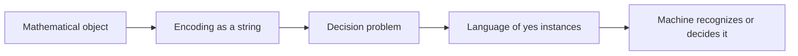

# Mathematical Preliminaries

Theory of computation uses the language of discrete mathematics. Machines are finite descriptions, inputs are strings, behaviors are languages, and proofs manipulate sets, functions, relations, graphs, and logical statements. Most machine definitions are tuples of familiar mathematical objects once their notation is unpacked.

The central shift is to treat syntax as data. Strings are mathematical objects; graphs, formulas, and programs can be encoded as strings; and a decision problem becomes the set of encoded instances whose answer is yes.

## Sets, tuples, functions, and relations

A **set** is an unordered collection of distinct objects. The standard notation is

- $x\in A$ for membership,
- $A\subseteq B$ for inclusion,
- $A\cup B$ and $A\cap B$ for union and intersection,
- $\overline A$ for complement relative to a fixed universe, and
- $\mathcal P(A)$ for the set of all subsets of $A$.

A **sequence** is ordered and may contain repeated elements. A finite sequence is often called a **tuple**, so $(0,1)\ne(1,0)$ and $(0,0,1)\ne(0,1)$. The Cartesian product

$$
A\times B=\{(a,b):a\in A\text{ and }b\in B\}
$$

collects ordered pairs with one coordinate from each set.

A **function** $f:A\to B$ assigns every element of its domain $A$ exactly one element of its codomain $B$. A **relation** from $A$ to $B$ is any subset of $A\times B$; it may be partial or one-to-many. Unless stated otherwise, functions in machine definitions are total and single-valued.

Tuple coordinates carry types and roles. In a DFA transition input $(q,a)$, the first coordinate is a state and the second an alphabet symbol. Swapping them is meaningless even if both are ultimately encoded as strings. Similarly, an encoded triple $\langle G,s,t\rangle$ must be parsed as one graph followed by two vertices.

Finite tuples specify the data defining a computational model. A DFA is $(Q,\Sigma,\delta,q_0,F)$; a CFG is $(V,\Sigma,R,S)$; and a Turing machine includes state sets, alphabets, a transition function, and halting states. A valid construction must supply every component with the required type.

## Strings and languages

An **alphabet** $\Sigma$ is a finite nonempty set of symbols. A **string** is a finite sequence of symbols, $\epsilon$ is the empty string, and $\Sigma^*$ is the set of all finite strings over $\Sigma$, including $\epsilon$. The reverse of $w$ is written $w^R$.

A **language** over $\Sigma$ is any subset of $\Sigma^*$. If $A,B\subseteq\Sigma^*$, their concatenation and Kleene star are

$$
AB=\{xy:x\in A\text{ and }y\in B\},
$$

$$
A^*=\{x_1x_2\cdots x_k:k\ge0\text{ and each }x_i\in A\}.
$$

The case $k=0$ contributes $\epsilon$, so every Kleene star contains the empty string. Closure theorems ask whether a family of languages stays in that family after union, intersection, complement, concatenation, star, or another operation.

For $A=\{0,11\}$ and $B=\{\epsilon,1\}$,

$$
AB=\{0,01,11,111\}.
$$

Pairing elements of $A$ with one another also gives

$$
A^2=AA=\{00,011,110,1111\}.
$$

Here $\epsilon$ acts as the identity for concatenation. It appears in $B$ because it is explicitly an element; this differs from $\emptyset$, the language containing no strings.

### Exploring finite language products

```python
from itertools import product

def concat_language(A, B):
    return {x + y for x, y in product(A, B)}

def star_up_to(A, max_pieces):
    result = {""}
    current = {""}
    for _ in range(max_pieces):
        current = concat_language(current, A)
        result |= current
    return result

A = {"0", "11"}
B = {"", "1"}
print(concat_language(A, B))
print(star_up_to(A, 3))
```

`star_up_to` computes only the strings formed from at most `max_pieces` factors. The full Kleene star is generally infinite and cannot be materialized as a finite Python set.

## From encoded objects to decision languages

A graph consists of vertices and edges; directed edges are ordered pairs, while undirected edges are unordered pairs. Graphs serve both as mathematical structures and as inputs to problems such as reachability, clique, Hamiltonian path, and generalized geography.

An effective encoding writes a graph, automaton, grammar, formula, or Turing machine as a finite string over a fixed alphabet. Angle brackets such as $\langle M,w\rangle$ denote a standard parseable encoding, not an extra alphabet symbol.



| Object | Notation | Role in computation theory |
|---|---|---|
| alphabet | $\Sigma$ | finite set of input symbols |
| string | $w\in\Sigma^*$ | one finite input instance |
| language | $L\subseteq\Sigma^*$ | yes-instances of a decision problem |
| function | $f:A\to B$ | transition rule, reduction, or encoding |
| graph | $G=(V,E)$ | common input type for P, NP, PSPACE, and NL |
| formula | $\phi$ | representation for satisfiability and computations |

For directed reachability, define

$$
\mathrm{PATH}=\{\langle G,s,t\rangle:
G\text{ contains a directed path from }s\text{ to }t\}.
$$

Let $V=\{a,b,c,d\}$ and $E=\{(a,b),(b,c),(a,d)\}$. Since $a\to b\to c$ is a path, $\langle G,a,c\rangle\in\mathrm{PATH}$. No edge leaves $c$, so $\langle G,c,a\rangle\notin\mathrm{PATH}$. A decider may first reject malformed encodings and then reason about the decoded graph.

The distinction between object language and metalanguage matters here. In `0011`, the characters belong to the object under study; the sentence “the string has two zeros” is a statement about that object. Self-reference in computability relies on moving carefully between a machine as a mathematical object and its encoded description as input.

## Logic as syntax and semantics

Boolean formulas use connectives such as $\land$, $\lor$, $\neg$, $\Rightarrow$, and $\Leftrightarrow$. A **truth assignment** maps variables to truth values. A formula is **satisfiable** if at least one assignment makes it true and a **tautology** if every assignment does.

The syntax is a finite string or tree built from variables and connectives. The semantics is its truth value under an assignment. SAT asks whether an existentially successful assignment exists; TQBF evaluates formulas with alternating existential and universal quantifiers.

Boolean formulas can encode local constraints on computations. In the Cook–Levin theorem, variables describe cells of a nondeterministic polynomial-time computation tableau, while clauses enforce legal local transitions. A semantic claim about a computation is thereby turned into satisfiability of a finite formula.

## Operations as machine constructions

Language operations correspond to recurring construction patterns:

- Union accepts if either component accepts.
- Intersection accepts if both components accept.
- Complement swaps accepting and rejecting outcomes for a complete DFA or a decider; the same step is unsafe for a recognizer that may loop.
- Concatenation and star split an input into pieces, often using nondeterminism to choose split points.

Several notation mistakes conceal genuine type errors. A symbol and a one-symbol string are closely related but not identical. $epsilon$ is one string, while $\emptyset$ is a language with no elements. Ordered pairs require parentheses rather than set braces. An encoding must be finite, effective, and unambiguously parseable whenever a proof asks one machine to process another object's description.

<div className="see-also">

See also:

- Proof styles are developed in [proof methods and countability](/cs/theory/proof-methods-and-countability).
- Formal automata begin in [finite automata and DFAs](/cs/theory/finite-automata-and-dfas).
- Encoded machines become central in [decidability and the halting problem](/cs/theory/decidability-and-the-halting-problem).
- Boolean formulas return in [NP-completeness and classic reductions](/cs/theory/np-completeness-and-classic-reductions).

</div>
