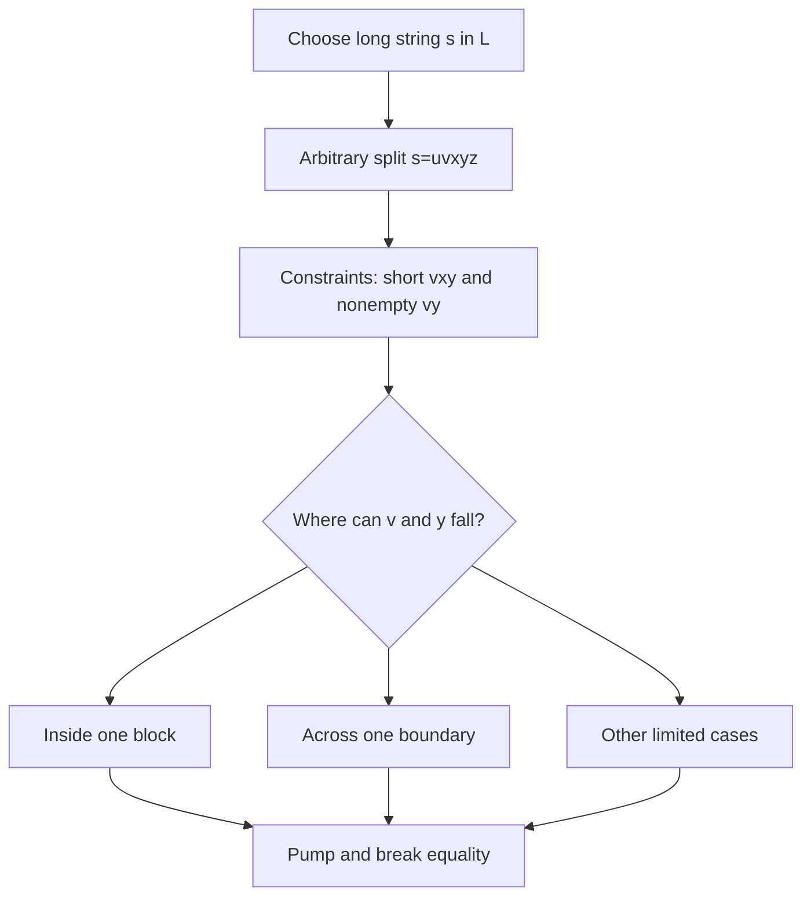

# Non-Context-Free Languages

Context-free languages handle one main unbounded dependency well: matched parentheses, equal blocks such as $0^n1^n$, and recursively nested expressions. Arbitrary coordination among several counts or same-order copying exceeds that pattern. The CFL pumping lemma turns the limited repetition available in parse trees into a proof technique for such boundaries.

| Language | Regular? | Context-free? | Structural reason |
|---|---|---|---|
| $a^*b^*$ | yes | yes | only a fixed block order |
| $\{a^n b^n:n\ge0\}$ | no | yes | one unbounded matching dependency |
| $\{a^n b^n c^n:n\ge0\}$ | no | no | two synchronized equalities |
| palindromes | no | yes | a stack compares symbols in reverse order |
| $\{ww:w\in\{0,1\}^*\}$ | no | no | requires a same-order copy |

The stack explanation guides intuition but does not prove non-context-freeness. Some languages with several counts decompose into unions of context-free cases. A formal argument needs pumping, closure, Ogden's lemma, Parikh's theorem, or another precise result.

## Where the five-part decomposition comes from

The **pumping lemma for context-free languages** says that if $A$ is context-free, then some pumping length $p$ has the following property. Every $s\in A$ with $\vert s\vert \ge p$ can be written

$$
s=uvxyz
$$

so that

$$
|vxy|\le p,
\qquad
|vy|>0,
\qquad
uv^ixy^iz\in A\quad\text{for every }i\ge0.
$$

The two pieces $v$ and $y$ pump together. Either may be empty, but they cannot both be empty.

The lemma follows from repeated variables in a parse tree. Put a grammar in Chomsky normal form and consider a sufficiently long generated string. Its binary parse tree has a long root-to-leaf path, and some variable repeats along that path because the grammar has finitely many variables. The upper occurrence derives a substring containing the lower occurrence. Repeating or deleting the derivation between them adds or removes material on both sides of the lower yield, producing $v$ and $y$.

Choosing the repetition low in the tree bounds the upper yield $vxy$. At least one of $v$ and $y$ must be nonempty, or repeating the derivation would not change the string. Pumping therefore describes local repeatability inside a parse tree, not arbitrary substrings of the word.

## The adversarial order of a pumping proof

The quantifiers determine the proof:

1. Assume the language is context-free and receive its unknown pumping length $p$.
2. Choose a string $s$ in the language with $\vert s\vert \ge p$.
3. Allow an adversary to choose any legal decomposition $uvxyz$.
4. For that arbitrary decomposition, choose an exponent $i$ that makes the pumped string leave the language.



Handling one convenient split proves nothing. The chosen string should constrain the short window so that all legal splits fall into a small number of cases.

## Pumping three synchronized blocks

Let

$$
L=\{a^n b^n c^n:n\ge0\}.
$$

Assume $L$ is context-free, let $p$ be its pumping length, and choose

$$
s=a^p b^p c^p.
$$

For an arbitrary legal split $s=uvxyz$, the window $vxy$ has length at most $p$. It cannot touch both the $a/b$ and $b/c$ boundaries, since those boundaries are separated by the entire block $b^p$. Thus $v$ and $y$ occur inside one block or across one adjacent boundary.

- If the pumped pieces affect one symbol type, pumping changes that count while leaving the other two at $p$.
- If they cross the $a/b$ boundary, pumping changes some $a$s or $b$s but no $c$s.
- If they cross the $b/c$ boundary, pumping changes some $b$s or $c$s but no $a$s.

Because $\vert vy\vert \gt 0$, pumping down with $i=0$ changes at least one count. The three counts can no longer all equal $p$, so $uxz\notin L$. Every legal split contradicts the lemma, and $L$ is not context-free.

The proof works because a window of length $p$ cannot observe all three dependent regions. This “short window cannot see every dependency” pattern recurs in many pumping arguments.

## Filtering a messy language with a regular one

Context-free languages are closed under union, concatenation, star, homomorphism, inverse homomorphism, and intersection with a regular language. They are not closed under arbitrary intersection or complement.

Regular intersection can isolate a controlled sublanguage. Consider

$$
K=\{w\in\{a,b,c\}^*:
\#a(w)=\#b(w)=\#c(w)\}.
$$

Direct pumping is awkward because the symbols may occur in any order. Let $R=a^*b^*c^*$, a regular language. If $K$ were context-free, closure would make $K\cap R$ context-free. But

$$
K\cap R=\{a^n b^n c^n:n\ge0\},
$$

which the preceding argument proves non-context-free. Therefore $K$ is not context-free.

This filtering pattern resembles a reduction: preserve membership in the class while transforming the object into a known impossible case. It is often shorter and less fragile than enumerating every pumping position in the original language.

### Checking the filtered and unfiltered predicates

The two functions below distinguish ordered equal blocks from equal counts in arbitrary order. For example, `abcabc` belongs to $K$ but not to $K\cap a^*b^*c^*$.

```python
def in_anbncn(w):
    i = 0
    while i < len(w) and w[i] == "a":
        i += 1
    j = i
    while j < len(w) and w[j] == "b":
        j += 1
    k = j
    while k < len(w) and w[k] == "c":
        k += 1
    return k == len(w) and i == j - i == k - j

def counts_equal(w):
    return w.count("a") == w.count("b") == w.count("c")

for sample in ["aaabbbccc", "abcabc", "aabbcc", "aaabbccc"]:
    print(sample, in_anbncn(sample), counts_equal(sample))
```

These membership tests do not imply context-freeness; many non-context-free languages are decidable by ordinary algorithms.

## Copying and stronger proof tools

The language

$$
\{ww:w\in\{0,1\}^*\}
$$

requires the second half to repeat the first in the same order. A stack reverses its stored input, which supports palindromes but not direct copying. Pumping proofs for copy languages need carefully chosen repeated blocks or markers so that a local change breaks correspondence between distant positions.

The pumping lemma gives a necessary condition for context-freeness, not a characterization. Failure to find a contradiction does not show that a language is context-free. **Ogden's lemma** lets the proof mark selected positions and is stronger when the ordinary pumping decomposition has too much freedom. **Parikh's theorem** says the symbol-count vectors of every CFL form a semilinear set, ruling out some arithmetic counting patterns that are hard to attack by pumping.

## Choosing a proof that closes every case

- Use ordered blocks when a short pumping window should be unable to reach all dependent regions.
- Use regular intersection when a simple filter exposes a known non-CFL.
- Keep $v$ and $y$ separate in the analysis: either may be empty, although $\vert vy\vert \gt 0$.
- Verify that the selected string belongs to the language and is at least as long as $p$.
- If some legal decompositions survive every pump value you try, change the witness string or use a stronger theorem; do not conclude that the language is context-free.

<div className="see-also">

See also:

- CFGs and CNF are covered in [context-free grammars and normal forms](/cs/theory/context-free-grammars-and-normal-forms).
- PDAs explain the one-stack intuition in [pushdown automata and deterministic CFLs](/cs/theory/pushdown-automata-and-deterministic-cfls).
- Turing machines recognize languages far beyond CFLs in [Turing machines and the Church-Turing thesis](/cs/theory/turing-machines-and-the-church-turing-thesis).
- Reductions later provide another style of impossibility proof in [reductions and the recursion theorem](/cs/theory/reductions-and-the-recursion-theorem).

</div>
