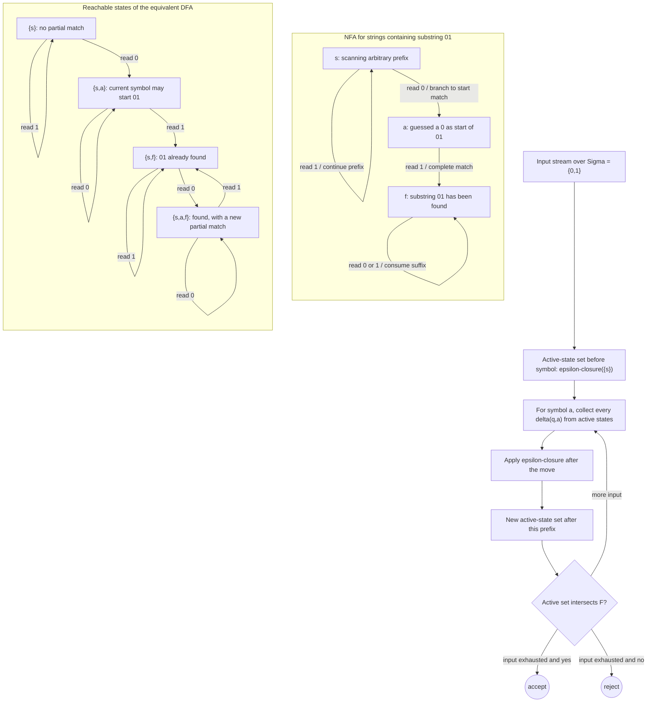

# Nondeterminism and Closure

Nondeterminism lets a finite automaton pursue several possible futures. An NFA may guess where a pattern begins, which alternative to take, or where one factor ends and another begins. It accepts when at least one complete path succeeds.

For finite automata, this branching shortens descriptions without enlarging the class of recognizable languages. Every NFA has an equivalent DFA, although determinization can require exponentially more states.

## Acceptance means that one complete path exists

A **nondeterministic finite automaton** is a 5-tuple $(Q,\Sigma,\delta,q_0,F)$ with transition function

$$
\delta:Q\times(\Sigma\cup\{\epsilon\})\to\mathcal P(Q).
$$

Unlike a DFA transition, an NFA transition returns a set of possible next states. An **epsilon transition** changes state without consuming an input symbol, and any number of such moves may occur before, between, or after symbol-consuming moves.

An NFA accepts $w$ if some path from $q_0$ to a state in $F$ consumes exactly all of $w$ in order. Other paths may get stuck, stop in nonfinal states, or make poor choices. The semantics is existential rather than random: the fraction of successful paths is irrelevant.

To prove acceptance, exhibit one successful path. To prove rejection, account for every possible path and show that none finishes in a final state after consuming the entire input.

## Active-state sets remove the guesswork

The **epsilon closure** of a state set $S$ contains every state reachable from $S$ using only epsilon transitions. During a deterministic simulation, the current configuration is the full set of states reachable after the prefix read so far.



Before reading a symbol, include all epsilon-reachable states. Move from every active state on that symbol, then take epsilon closure again. The second closure matters because the NFA may move spontaneously before the next symbol. Acceptance of $\epsilon$ is already determined by whether the start state's epsilon closure intersects $F$.

The “lucky guess” story is useful shorthand, but the active-state set is the precise model. At every prefix there is one well-defined set of reachable states.

## Determinizing by the subset construction

The **subset construction** makes each active-state set a DFA state. For an NFA $N=(Q,\Sigma,\delta,q_0,F)$:

- the DFA start state is $\epsilon\text{-closure}(\{q_0\})$;
- on symbol $a$, take all $a$-moves from the current subset and then epsilon-close the result;
- a subset is accepting exactly when it intersects $F$.

After any prefix $x$, the construction maintains the invariant that the current DFA subset equals the NFA states reachable along paths labeled $x$, including epsilon moves. This proves language equivalence.

An $n$-state NFA has at most $2^n$ subsets. Only subsets reachable from the start are needed; they can be enumerated by graph search. Representing a subset as an $n$-bit vector makes determinization an effective finite algorithm, after which DFA algorithms for emptiness, equivalence, and minimization apply.

### A two-state determinization

Consider NFA states `s`, `a`, and `b`, with start `s`, final state `b`, loops `s --0--> s` and `s --1--> s`, epsilon transition `s --epsilon--> a`, and transition `a --1--> b`.

The start subset is $\{s,a\}$. On `0`, only `s` moves, and epsilon closure returns $\{s,a\}$. On `1`, `s` reaches `s` and `a` reaches `b`; closing from `s` adds `a`, giving $\{s,a,b\}$. From that subset, `0` returns to $\{s,a\}$ and `1` returns to $\{s,a,b\}$.

Only $\{s,a,b\}$ contains `b`, so it is the lone accepting subset. The resulting DFA accepts exactly the nonempty strings ending in `1`.

## Union, concatenation, and star by epsilon wiring

NFAs make several regular-language closure constructions direct.

| Operation | NFA construction | Choice represented |
|---|---|---|
| union | new start with epsilon edges to both machines | which component accepts |
| concatenation | epsilon edges from first finals to second start | where the input split occurs |
| star | new accepting start and epsilon edges for repeats | how many factors and their boundaries |
| determinization | one DFA state per active subset | all NFA choices simultaneously |

For union, each accepting path chooses one component, and each component path becomes a path in the combined NFA. For concatenation, accepting paths correspond to factorizations $w=xy$ where the first NFA accepts $x$ and the second accepts $y$. For star, paths correspond to finite factorizations into accepted pieces; the new accepting start handles the empty factorization and hence $\epsilon$.

These constructions may take wrong guesses. A concatenation branch can jump to the second machine at a bad split and later fail. That is harmless as long as every successful branch corresponds to a valid factorization and every valid factorization has a successful branch.

## Branching over candidate occurrences of `01`

An NFA for

$$
\{0,1\}^*01\{0,1\}^*
$$

uses state `s` to scan any prefix. On each `0`, one branch stays in `s` while another enters state `a`, treating that symbol as the possible start of `01`. From `a`, a `1` reaches final state `f`; `f` then loops on both symbols to consume the suffix.

On `10010`, the branch using the third symbol as the candidate `0` reaches `f`. On `111000`, every attempt either sees another `0` or reaches end of input before a `1`, so no branch accepts.

### Simulating every active branch

```python
def nfa_contains_01(w):
    states = {"s"}
    for ch in w:
        nxt = set()
        for q in states:
            if q == "s":
                nxt.add("s")
                if ch == "0":
                    nxt.add("a")
            elif q == "a" and ch == "1":
                nxt.add("f")
            elif q == "f":
                nxt.add("f")
        states = nxt
    return "f" in states

for sample in ["", "01", "111000", "10010"]:
    print(sample, nfa_contains_01(sample))
```

This NFA has no epsilon transitions, so the simulator needs no closure step. A general simulator must compute epsilon closure initially and after each symbol move.

## Succinct descriptions and exponential state sets

NFAs postpone commitment. A recognizer for “contains one of these patterns” can branch into independent partial matches, whereas a DFA must remember all viable matches at once. The subset construction stores those simultaneous attempts explicitly and can expose an exponential state blowup even though the recognized language remains regular.

When inspecting an NFA run, follow the active set rather than one favored branch. A path that lacks a transition simply disappears. The entire machine rejects only if all branches disappear, fail to consume the whole input, or finish outside $F$. An accepting subset needs at least one final state, not all states final.

<div className="see-also">

See also:

- DFA basics are in [finite automata and DFAs](/cs/theory/finite-automata-and-dfas).
- Regular-expression constructions use NFAs in [regular expressions and nonregularity](/cs/theory/regular-expressions-and-nonregularity).
- Pushdown automata reuse nondeterministic branching in [pushdown automata and deterministic CFLs](/cs/theory/pushdown-automata-and-deterministic-cfls).
- Nondeterminism becomes a complexity resource in [time complexity, P, and NP](/cs/theory/time-complexity-p-and-np).

</div>
