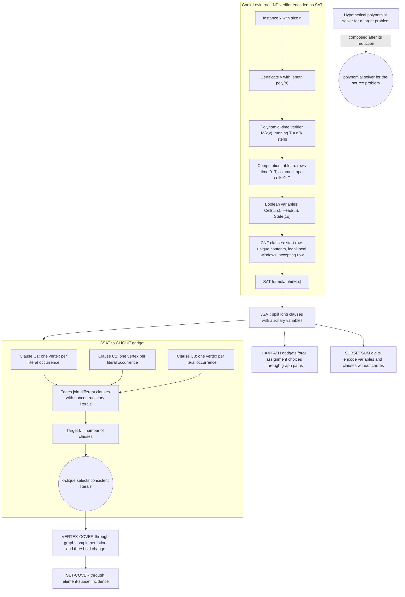

# NP-Completeness and Classic Reductions

NP-completeness identifies problems at least as hard as every problem in NP. It does not prove that they lack polynomial-time algorithms; such a proof would separate P from NP. It does show that one polynomial-time algorithm for any NP-complete problem would put all of NP in P.

The main tool is a polynomial-time transformation that preserves yes and no answers. Starting from SAT, these reductions connect logical formulas to cliques, paths, covers, and arithmetic selection problems.

## Certificates place a problem in NP

A language is in NP when every yes-instance has a polynomial-length certificate verifiable in polynomial time. The certificate depends on the problem, but verification checks a proposed solution rather than discovering one.

| Problem | Certificate | Polynomial check |
|---|---|---|
| SAT | truth assignment | evaluate the formula |
| CLIQUE | $k$ selected vertices | check every selected pair is adjacent |
| VERTEX-COVER | at most $k$ vertices | check every edge has a selected endpoint |
| HAMPATH | ordering of all vertices | check uniqueness and consecutive edges |
| SUBSETSUM | selected indices | add the selected numbers and compare with the target |

A language $B$ is **NP-hard** if every language in NP reduces to it in polynomial time. It is **NP-complete** when it is both NP-hard and in NP. Membership cannot be omitted: problems involving universal reasoning or exponentially large strategy trees may be PSPACE-complete instead.

**SAT** asks whether a Boolean formula has a satisfying assignment. **3SAT** restricts the input to a conjunction of clauses with three literals each, or at most three under another common convention. **CLIQUE** asks whether a graph contains $k$ pairwise adjacent vertices; **HAMPATH** asks for a path visiting every vertex exactly once; and **SUBSETSUM** asks whether some subset of the given integers sums to a target.

The standard proof therefore has two independent parts:

1. Give a polynomial-size certificate and polynomial-time verifier for $B$.
2. Choose a known NP-complete language $A$ and prove $A\le_p B$.

Reductions compose, so the second step transfers hardness from every NP language through $A$ to $B$.

## Reading the reduction arrow in the solver direction

A **polynomial-time mapping reduction** $A\le_p B$ is a polynomial-time computable function $f$ satisfying

$$
w\in A\quad\Longleftrightarrow\quad f(w)\in B.
$$

To prove the target $B$ hard, reduce a problem already known to be hard *to* $B$. A hypothetical solver for $B$ can then be placed after $f$ to solve $A$. Reversing the arrow shows only that $B$ is no harder than $A$.

Both directions of the equivalence need proof. The forward direction builds a target solution from a source solution. The reverse direction decodes an arbitrary target solution and must rule out unintended shortcuts in the construction.

Size is part of correctness. The output graph, formula, or list of numbers must have polynomially many bits. A mathematically accurate transformation that emits exponentially large instances is not a polynomial-time reduction.

## Cook–Levin as a local-consistency construction

The **Cook–Levin theorem** proves that SAT is NP-complete. Given an NP verifier and input $x$, it encodes an accepting polynomial-time computation as a Boolean formula.



The tableau has one row per time step and columns for the tape region reached within the polynomial bound. Boolean variables describe symbols, state, and head position. Clauses enforce the initial configuration, unique cell contents, a legal accepting configuration, and local consistency between neighboring cells in consecutive rows.

Local constraints suffice because one Turing-machine transition affects only a bounded neighborhood. The formula is satisfiable exactly when some certificate makes the verifier accept $x$.

## Building the 3SAT-to-CLIQUE graph

For each literal occurrence in each clause, create one vertex. Join two vertices exactly when they come from different clauses and their literals are not contradictory. If the formula has $m$ clauses, ask for a clique of size $m$.

Consider

$$
(x\lor y\lor z)
\land(\neg x\lor y\lor\neg z)
\land(x\lor\neg y\lor z).
$$

The three vertex groups are

$$
\{x_1,y_1,z_1\},
\qquad
\{\neg x_2,y_2,\neg z_2\},
\qquad
\{x_3,\neg y_3,z_3\}.
$$

No edge is placed within a group, and contradictory pairs such as $x_1$ and $\neg x_2$ are left nonadjacent. Set $k=3$.

If an assignment satisfies the formula, choose one true literal from each clause. The selected literals are mutually consistent, so their vertices form a 3-clique. Conversely, a 3-clique must take one vertex from each clause and cannot contain contradictory literals. Its choices extend to a satisfying assignment. For example, $x=y=z=\text{true}$ satisfies the formula, and $x_1,y_2,z_3$ form a clique.

With at most three vertices per clause, the graph has at most $3m$ vertices and $O(m^2)$ possible inter-clause edges. The construction is polynomial in the formula size.

## Arithmetic choices in SUBSETSUM

**SUBSETSUM** asks whether a subset of the input integers sums to a target. Its NP certificate is a list of selected indices. For numbers `[3, 5, 9, 10, 12]` and target `22`, certificate `[1, 2, 4]` selects $5+9+12=26$ and fails. Certificate `[3, 4]` selects $10+12=22$ and succeeds.

### Verifying an index certificate

```python
def verify_subset_sum(numbers, target, certificate):
    if len(set(certificate)) != len(certificate):
        return False
    if any(i < 0 or i >= len(numbers) for i in certificate):
        return False
    return sum(numbers[i] for i in certificate) == target

nums = [3, 5, 9, 10, 12]
print(verify_subset_sum(nums, 22, [1, 2, 4]))
print(verify_subset_sum(nums, 22, [3, 4]))
```

NP-hardness reductions to SUBSETSUM encode combinatorial choices into digit positions. Separate positions can enforce variable consistency and clause satisfaction, while chosen place values prevent carries from mixing the constraints. Numeric reductions must bound bit length, not merely the count of integers.

## Gadget proofs need an inverse reading

Graph reductions commonly use gadgets whose local choices represent truth assignments or other source decisions. HAMPATH gadgets force a path through one of several routes; cover gadgets force selected vertices or sets to account for specified elements.

The reverse proof is usually where a faulty reduction appears. A target solution may exploit an edge, path, carry, or gadget interaction that was absent from the intended story. A complete proof shows:

- how every source solution selects legal gadget behavior;
- why every target solution has only the intended forms;
- how to decode those forms into a source solution; and
- why the construction and all encoded values remain polynomial in size.

Optimization and decision formulations should also stay separate. NP-completeness is a classification of languages, so CLIQUE asks whether a clique of size at least $k$ exists; the threshold $k$ is part of the input. Search and optimization versions are closely related for many classic problems, but the reduction statement concerns the decision version.

## What the classification does and does not predict

NP-completeness is a worst-case statement. It does not claim that every instance is hard, that small instances resist exact solution, or that heuristics are useless. It rules out a polynomial-time exact algorithm for all instances unless $P=NP$.

That leaves room for strong SAT solvers, approximation, parameterized algorithms, restricted graph families, and domain-specific structure. “NP-complete” means decidable and efficiently verifiable, with worst-case hardness shared across NP; it does not mean unsolvable.

<div className="see-also">

See also:

- P and NP are defined in [time complexity, P, and NP](/cs/theory/time-complexity-p-and-np).
- Mapping reductions for undecidability are in [reductions and the recursion theorem](/cs/theory/reductions-and-the-recursion-theorem).
- PSPACE-completeness extends the idea in [space complexity](/cs/theory/space-complexity).
- Randomization and approximation are surveyed in [advanced complexity topics](/cs/theory/advanced-complexity-topics).

</div>
