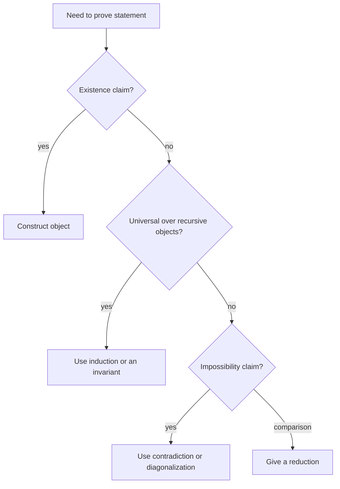

# Proof Methods and Countability

Claims in computation theory usually quantify over all strings, all decompositions, all machines, or all algorithms. A construction must work for every input. A pumping argument must survive every legal split. An undecidability proof must rule out algorithms that have never been written down.

The recurring methods are construction, induction, contradiction, reduction, counting, and diagonalization. Their mechanics are elementary; choosing a statement with the right quantifiers is the harder part.

## Let the quantifiers choose the proof shape

Write the logical obligations before starting the construction.

- A closure theorem begins with all languages $A$ and $B$ in the class.
- A machine-correctness theorem ranges over every input string.
- A pumping proof lets the opponent choose every legal decomposition.
- A mapping reduction must preserve membership for every source input.
- An impossibility theorem must contradict the promised behavior of any proposed decider or recognizer.



| Technique | Typical target | Main checkpoint |
|---|---|---|
| construction | automaton, grammar, reduction | every component is well formed |
| induction | strings, derivations, computation steps | the step follows the recursive structure |
| contradiction | nonregularity, undecidability | the assumed object and its guarantees are precise |
| diagonalization | unlistability, self-reference | candidate $i$ is defeated at test $i$ |

A **direct proof** applies definitions from the hypotheses to the conclusion. A **construction proof** establishes existence by building the required object. A **contradiction proof** assumes the negation of the claim and derives an established impossibility. A **reduction** transforms one problem into another while preserving the relevant answer.

## A construction has a type check and a behavior proof

Building an object creates two obligations.

First, it must satisfy its formal definition. A DFA needs exactly one transition for each state-symbol pair. A CFG production needs one variable on its left. A reduction must output a valid target encoding within the required resource bound.

Second, the constructed object must behave as claimed. Common proof forms are:

- a state invariant after every input prefix;
- both inclusions for equality of generated languages;
- induction on derivations or computation steps; and
- forward and reverse decoding for a reduction.

Closure results are often best handled this way. To prove regular languages closed under union, construct the product DFA and describe precisely what each pair of states means. Contradiction adds little when a direct machine construction already witnesses the claim.

## Strengthening an invariant until induction works

Induction appears in several forms:

- induction on string length for automata and recursive algorithms;
- structural induction following the grammar of regular expressions, formulas, or parse trees;
- induction on derivation length for grammars; and
- induction on computation steps for simulations.

The induction step should match the operation that grows the object: append one symbol, apply one constructor, use one production, or execute one transition.

Consider a DFA with states `even` and `odd`. It begins in `even`, toggles on `1`, and stays put on `0`. Prove the stronger statement: after every $w\in\{0,1\}^*$, the current state records the parity of the number of `1`s in $w$.

For $w=\epsilon$, the count is zero and the start state is `even`. Assuming the claim for $w$, appending `0` changes neither the count nor the state; appending `1` changes both parities. Since these are all one-symbol extensions, the invariant holds for every string. If `even` is the only accepting state, the language is exactly the strings with an even number of `1`s.

A weaker claim such as “the machine accepts some even-parity strings” cannot support the step. Precise state meanings, stack contents, or table-entry interpretations often make an induction go through and leave the desired theorem as a short corollary.

## Contradiction depends on the exact promise

The distinction between a decider and a recognizer is often decisive. A decider halts on both yes- and no-instances; a recognizer may loop on no-instances. An argument that silently uses total halting has assumed a decider, whether or not it says so.

At the end of a contradiction proof, name the fact contradicted. If the assumption that $B$ is decidable yields a decider for $A_{TM}$, the contradiction is with the known undecidability of $A_{TM}$. The constructed machine itself is coherent; it becomes impossible only in combination with the false assumption.

Reductions use the same discipline without necessarily phrasing the proof as contradiction. State which solver is assumed, how an input is transformed, why yes and no answers are preserved, and why the composed algorithm has the claimed halting or resource behavior.

## Finite descriptions form a countable set

A set is **countable** if its elements can be placed in a finite or infinite sequence. The natural numbers and integers are countable. So are all finite strings over a finite alphabet: list them by length, then lexicographically within each length.

Automata, grammars, and Turing machines have finite string descriptions, so each collection of descriptions is countable. Some strings are malformed; discarding them leaves a countable set.

The set of languages over a nonempty alphabet is different. Since $\Sigma^*$ is countably infinite, a language is a subset of a countably infinite set. Cantor's theorem shows that its power set

$$
\mathcal P(\Sigma^*)
$$

is uncountable. There are therefore uncountably many languages but only countably many Turing machines. Most languages have no Turing-machine recognizer.

Countable does not mean finite: there are infinitely many machines, but they can still be enumerated. Nor does the counting comparison identify a natural undecidable language; it proves only that unrecognizable languages exist.

## Diagonal disagreement defeats every proposed list

Diagonalization constructs an object that differs from candidate $i$ on test $i$. Suppose all infinite binary sequences appear in a list $s_1,s_2,s_3,\ldots$. Define

$$
d[i]=1-s_i[i].
$$

The sequence $d$ differs from $s_1$ in position $1$, from $s_2$ in position $2$, and from every $s_i$ in position $i$. It is absent from the supposedly complete list, so infinite binary sequences are uncountable.

### Flipping a finite displayed diagonal

```python
def diagonal_flip(rows, n):
    """Return the first n bits of a sequence differing from row i at bit i."""
    bits = []
    for i in range(n):
        bits.append("1" if rows[i][i] == "0" else "0")
    return "".join(bits)

rows = [
    "001101",
    "101010",
    "111000",
    "010111",
    "000001",
    "110011",
]
print(diagonal_flip(rows, 6))
```

The finite code illustrates the coordinate-wise construction; uncountability uses an infinite list and infinite sequences.

In undecidability proofs, the candidates are encoded machines and the tests are often inputs formed from those descriptions. Self-application is available because a machine's finite code can be passed to another machine as data. The halting and acceptance arguments turn diagonal disagreement into a named language rather than merely a counting existence result.

## Distinctions that prevent short proofs from going wrong

- A few checked examples are not an induction; the step must cover every constructor or extension.
- Uncountably many languages imply the existence of undecidable languages, not undecidability of a particular named language.
- Countability means listability, not finiteness.
- A construction must be both well typed and behaviorally correct.
- A contradiction using a decider's guaranteed termination cannot be reused unchanged for a recognizer.

<div className="see-also">

See also:

- The notation used here relies on [mathematical preliminaries](/cs/theory/mathematical-preliminaries).
- DFA invariants appear in [finite automata and DFAs](/cs/theory/finite-automata-and-dfas).
- Diagonalization becomes concrete in [decidability and the halting problem](/cs/theory/decidability-and-the-halting-problem).
- Reductions are developed in [reductions and the recursion theorem](/cs/theory/reductions-and-the-recursion-theorem).

</div>
