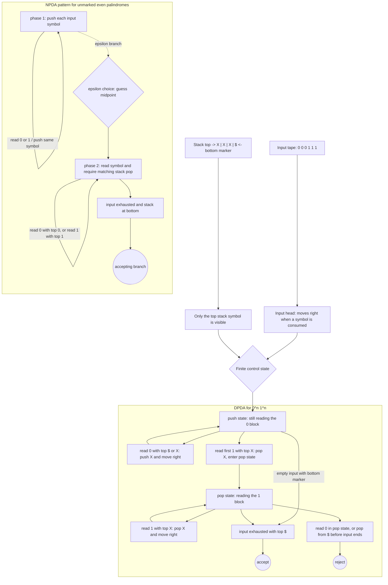

# Pushdown Automata and Deterministic CFLs

A pushdown automaton adds a stack to finite control. The stack supplies unbounded last-in-first-out memory, matching the shape of nested syntax and balanced obligations. A machine can push markers while reading one region and pop them against a later region.

Pushdown automata are the recognizing counterpart of context-free grammars. CFGs expand unfinished variables; PDAs store unfinished work on a stack. Nondeterministic PDAs recognize exactly the context-free languages, while deterministic PDAs recognize a proper subclass important in parsing.

## The stack as a list of unfinished obligations

For $0^n1^n$, each pushed marker means that one future `1` must appear. For balanced parentheses, each marker records an unmatched opening parenthesis. In grammar simulation, the stack holds variables and terminals still to be matched against unread input.

Finite control and stack memory have separate jobs. In a machine for $0^n1^n$, the state records whether the input is still in the zero block or has entered the one block; the stack records how many zeros remain unmatched. The stack alone does not forbid a later zero, and finite control alone cannot store the count.



| Model | Memory and choice | Language family |
|---|---|---|
| DFA | finite state | regular |
| NFA | finite state with branching | regular |
| DPDA | one stack with deterministic moves | deterministic CFLs |
| NPDA | one stack with branching | CFLs |
| Turing machine | read-write tape | recognizable languages, or decidable ones when it always halts |

## Configurations and acceptance conventions

One standard formalization is a 7-tuple

$$
(Q,\Sigma,\Gamma,\delta,q_0,Z_0,F),
$$

where $\Gamma$ is the stack alphabet and $Z_0$ is the initial stack symbol. A transition may consume an input symbol or $\epsilon$, inspect the top stack symbol, replace it by a string of stack symbols, and change control state. Equivalent definitions package the start stack and acceptance conditions differently.

A **configuration** records the current state, unread input, and complete stack contents. Only the top stack symbol is directly accessible in one move. Correctness proofs usually give an invariant connecting these three components.

Under **acceptance by final state**, an accepting computation consumes the entire input and ends in a final state. Under **acceptance by empty stack**, it consumes the input and discharges the stack. For nondeterministic PDAs the conventions recognize the same language class, though a proof must state which one its construction uses. Converting conventions for deterministic machines requires more care because extra epsilon moves can interfere with determinism.

For traces, fix whether the left or right end of a written stack is the top. Saying “push `X`” and “pop `X`” often communicates a worked run more safely than an unexplained transition tuple.

## A deterministic machine for $0^n1^n$

The first `1` visibly announces the transition from pushing to popping, so nondeterministic midpoint guessing is unnecessary.

1. Begin in `push` with bottom marker `$`.
2. For each `0`, push one `X`.
3. On the first `1`, enter `pop` and remove one `X`.
4. For every later `1`, remove another `X`.
5. Accept when the input is exhausted and only `$` remains. If the input is empty, accept directly for $n=0$.
6. Reject a `0` in the pop phase, a pop attempted at `$`, or leftover `X` markers after the input ends.

Thus `0011` pushes twice and pops twice; `001` leaves a marker; `011` tries to pop below the unmatched-zero count; and `0101` returns to `0` after the phase change.

### Simulating the stack discipline

```python
def accepts_0n1n_pda_style(w):
    stack = ["$"]
    i = 0
    while i < len(w) and w[i] == "0":
        stack.append("X")
        i += 1
    while i < len(w) and w[i] == "1":
        if stack[-1] == "$":
            return False
        stack.pop()
        i += 1
    return i == len(w) and stack == ["$"]

for sample in ["", "01", "0011", "001", "0101"]:
    print(sample, accepts_0n1n_pda_style(sample))
```

This code executes the deterministic push/pop strategy directly. A general PDA simulator would also represent control states, epsilon transitions, and—in the nondeterministic case—a set of configurations.

## Translating between grammars and stack machines

The languages recognized by NPDAs are exactly the context-free languages.

From a CFG to a PDA, initialize the stack with the start variable. If a variable is on top, nondeterministically replace it with the right-hand side of one of its productions. If a terminal is on top, consume the same terminal from the input and pop it. Acceptance occurs when the proposed derivation has matched the complete input and no obligations remain.

From a PDA to a CFG, grammar variables describe balanced computations that move between specified states while removing a designated stack symbol without disturbing the stack beneath it. This direction is more technical, but it expresses the same correspondence: recursive derivations and last-in-first-out obligations carry equivalent information.

The translation also explains why a PDA transition may replace one stack symbol with several. Expanding a grammar variable can introduce an entire right-hand side of new obligations.

## Why an unmarked midpoint needs nondeterminism

For the even palindromes

$$
P=\{ww^R:w\in\{0,1\}^*\},
$$

an NPDA pushes input symbols during its first phase, takes an epsilon transition that guesses the midpoint, and then reads and pops matching symbols. It accepts only if the input ends exactly at the bottom marker.

On `0110`, one branch pushes `0`, pushes `1`, switches phases, and matches `1` then `0`. On `0100`, every possible switch point eventually creates a mismatch or unequal lengths.

A DPDA cannot generally determine where an unmarked palindrome's midpoint occurs. By contrast,

$$
\{wcw^R:w\in\{0,1\}^*\}
$$

is deterministic context-free because `c` announces the phase change. Nondeterminism therefore adds genuine recognition power to PDAs, unlike the DFA/NFA case.

Formally, a DPDA permits at most one move from each applicable state, input, and stack-top situation. If an epsilon move is available for a state and stack top, a competing input-consuming move cannot also be available there.

## Deterministic CFLs in parsing

Deterministic context-free languages are closed under complement, after arranging a complete deterministic machine with the appropriate acceptance convention. They do not have the full union closure enjoyed by CFLs. The asymmetry reflects the absence of branching between alternative parses.

LR-style parsers use deterministic stack behavior: finite control and lookahead determine the next shift or reduction without exploring all parse trees. Grammars may need rewriting, precedence declarations, or disambiguation before this single-path behavior is available. The formal DPDA model captures the core choice discipline, while parser generators add tables, error handling, and implementation details.

<div className="see-also">

See also:

- The equivalent grammar viewpoint is in [context-free grammars and normal forms](/cs/theory/context-free-grammars-and-normal-forms).
- Pumping limits for CFLs are in [non-context-free languages](/cs/theory/non-context-free-languages).
- Turing machines extend stack memory to tape memory in [Turing machines and the Church-Turing thesis](/cs/theory/turing-machines-and-the-church-turing-thesis).

</div>
