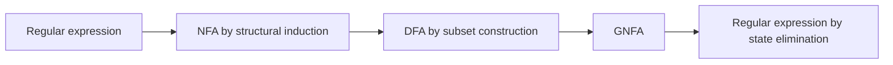

# Regular Expressions and Nonregularity

Regular expressions give an algebraic notation for languages built from union, concatenation, and repetition. Programming libraries add conveniences and, in some cases, features such as backreferences that exceed regular-language power. The mathematical core is smaller and exactly equivalent to finite automata.

The same equivalence gives a boundary question: which languages cannot be described by any regular expression or finite automaton? Pumping and closure arguments formalize the limits of finite memory.

## Reading a regular expression as a syntax tree

Over an alphabet $\Sigma$, the atomic regular expressions are $\emptyset$, $\epsilon$, and each symbol $a\in\Sigma$. If $R$ and $S$ are regular expressions, then so are

$$
(R\cup S),
\qquad
(RS),
\qquad
(R^*).
$$

Their denoted languages are defined recursively: $\emptyset$ contains no strings, $\epsilon$ denotes $\{\epsilon\}$, and a literal $a$ denotes $\{a\}$. The three constructors apply language union, concatenation, and Kleene star.

| Expression | Language | Detail |
|---|---|---|
| `0*` | any number of zeros | includes $\epsilon$ |
| `(0 union 1)*` | all binary strings | algebraically $(0\cup1)^*$ |
| `(0 union 1)*01` | strings ending in `01` | arbitrary prefix, fixed suffix |
| `0*1*` | zeros followed by ones | the counts need not match |
| `emptyset*` | $\{\epsilon\}$ | zero repetitions are allowed |

The expression $(0\cup1)^*01$ is a tree with concatenation at the root, a starred union as one subtree, and literal leaves. Structural induction follows this tree: prove atomic cases, then union, concatenation, and star cases.

Useful identities are semantic equalities between denoted languages:

$$
R\emptyset=\emptyset,
\qquad
R\epsilon=R,
\qquad
R\cup R=R.
$$

Star normally binds more tightly than concatenation, which binds more tightly than union. Parentheses still make construction order unambiguous.

## Encoding two requirements in one expression

To describe binary strings that contain at least one `1` and end in `00`, first express a binary string with a distinguished `1`:

$$
(0\cup1)^*1(0\cup1)^*.
$$

The required suffix contains no `1`, so appending it gives

$$
(0\cup1)^*1(0\cup1)^*00.
$$

The expression accepts `100` and `10100`. It rejects `000` because no occurrence can match the distinguished `1`. Separating the fixed suffix from the existence requirement keeps the construction easy to check.

## Moving between expressions and automata

A language is regular exactly when it is recognized by a DFA, recognized by an NFA, or denoted by a regular expression.

The regex-to-NFA proof follows the expression constructors. Atomic expressions have tiny machines; union adds epsilon branching; concatenation links the first machine's final states to the second start; and star adds an accepting empty path plus repeat loops.

A **generalized NFA** labels edges with regular expressions. To eliminate an intermediate state $r$, update the label between each remaining pair $i,j$ to

$$
R_{ij}\cup R_{ir}(R_{rr})^*R_{rj}.
$$

The first term preserves paths that avoid $r$. The second describes paths that enter $r$, loop there any number of times, and leave for $j$. Repeating the operation until only the start and accept states remain produces one regular expression without changing the accepted path labels.

## Repeated DFA states force pumpable substrings

If a DFA has $p$ states and reads at least $p$ symbols, some state repeats among the states visited during the first $p$ input steps. The substring read between those visits forms a loop: traversing it zero, one, or several times returns to the same state.

The **pumping lemma for regular languages** captures this. If $A$ is regular, then some $p$ satisfies: every $s\in A$ with $\vert s\vert \ge p$ has a split

$$
s=xyz
$$

with

$$
|xy|\le p,
\qquad
|y|>0,
\qquad
xy^iz\in A\quad\text{for every }i\ge0.
$$

This condition is necessary for regularity, not a characterization. Pumping one selected string or one selected decomposition never proves a language regular.

## Trapping the pump inside the zero block

Let

$$
L=\{0^n1^n:n\ge0\}.
$$

Assume $L$ regular and let $p$ be its pumping length. Choose $s=0^p1^p$. For any legal split $s=xyz$, the constraint $\vert xy\vert \le p$ places both $x$ and $y$ entirely inside the initial zero block. Since $\vert y\vert \gt 0$, write $y=0^k$ for some $k\gt 0$.

Pump down with $i=0$:

$$
xz=0^{p-k}1^p.
$$

The result has fewer zeros than ones and is absent from $L$, contradicting the requirement that every exponent remain in the language. Hence $L$ is nonregular.

The quantifier order is adversarial. The proof chooses $s$ after learning $p$, but the split may be any one satisfying the constraints. A useful witness forces every eligible $y$ into a region where adding or removing it breaks the defining property.

## When closure gives a shorter nonregularity proof

Regular languages are closed under union, intersection, complement, concatenation, star, homomorphism, and inverse homomorphism. If a complicated candidate language were regular, applying one of these operations with known regular languages would preserve regularity.

This supports a common contradiction pattern: intersect with a regular filter to isolate a known nonregular sublanguage, or apply a homomorphism that erases irrelevant symbols. The result being nonregular forces the original language to be nonregular as well.

Closure is especially useful when a direct pumping witness has many cases. Pumping remains a necessary-condition argument; failure to find a clean witness does not imply regularity.

## Finite summaries, not surface complexity

Some complicated descriptions still require only finite memory. Binary strings whose numeric value is divisible by $3$ are regular because a DFA stores the current residue modulo $3$. Strings with equal numbers of zeros and ones are not regular because the difference between the counts is unbounded.

The relevant question is which information about a prefix can affect all possible continuations. If finitely many summaries suffice, a DFA may exist. If infinitely many prefixes require distinguishable future behavior, no finite automaton can recognize the language.

Several proof errors follow from ignoring the quantifiers or the formal regex model:

- Backreferences in a programming regex should not be assumed regular.
- $R^*$ always contains $\epsilon$, even when $R$ is empty.
- The pumping witness must belong to the assumed regular language and have length at least $p$.
- Every legal split must fail for some exponent; selecting a convenient split reverses the adversarial roles.
- Short exceptional strings can be bypassed by choosing a witness whose length depends on $p$.

See also:

- NFA constructions for regex operators are in [nondeterminism and closure](/cs/theory/nondeterminism-and-closure).
- DFA memory limitations are introduced in [finite automata and DFAs](/cs/theory/finite-automata-and-dfas).
- Context-free grammars recognize $\{0^n1^n:n\ge0\}$ in [context-free grammars and normal forms](/cs/theory/context-free-grammars-and-normal-forms).
- Pumping for CFLs appears in [non-context-free languages](/cs/theory/non-context-free-languages).

