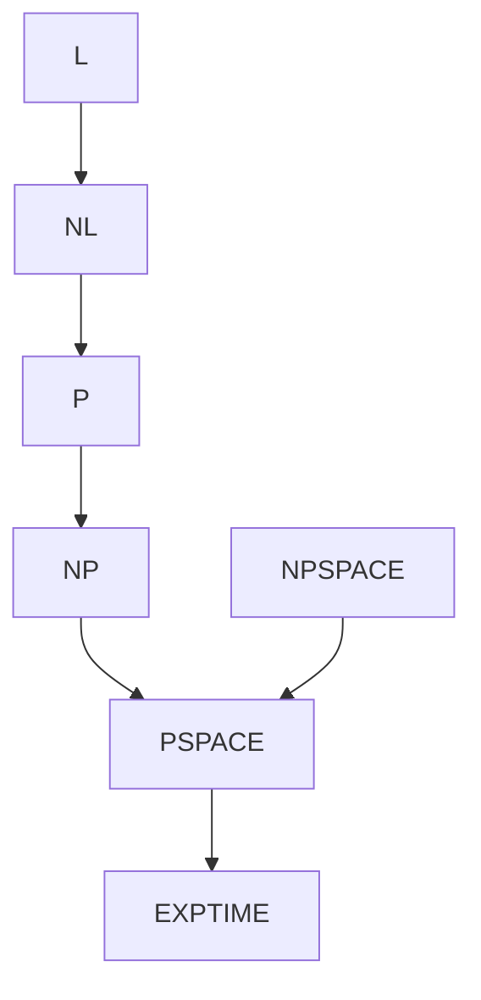

# Space Complexity

Space complexity measures working memory rather than running time. A computation may take many steps while retaining only a small amount of state; it can scan the input again or recompute facts instead of storing them. This tradeoff appears in graph reachability, quantified Boolean formulas, games, and memory-limited computation.

The main classes here are PSPACE, NPSPACE, L, and NL. Savitch's theorem relates deterministic and nondeterministic space: nondeterministic space can be simulated deterministically with only a quadratic increase in space. No comparable theorem is known to collapse P and NP.

## What counts as workspace

For a Turing machine, **space usage** is the number of work-tape cells used as a function of the input length. In the standard multitape model, the input sits on a read-only tape and does not count toward the bound. This convention permits sublinear-space classes.

The class **PSPACE** contains languages decidable in polynomial space. **NPSPACE** is its nondeterministic counterpart: some branch must accept while respecting the polynomial bound. **L** and **NL** impose deterministic and nondeterministic $O(\log n)$ space bounds, respectively.

A polynomial-space computation need not run in polynomial time. It may revisit and overwrite its workspace for exponentially many steps.

## How the main classes fit together

| Class | Resource | Canonical problem |
|---|---|---|
| L | deterministic $O(\log n)$ space | deterministic graph tasks |
| NL | nondeterministic $O(\log n)$ space | directed reachability |
| P | polynomial time | shortest paths, matching |
| NP | nondeterministic polynomial time | SAT |
| PSPACE | polynomial space | TQBF, generalized games |

P and NP lie inside PSPACE because a polynomial-time computation can visit only polynomially many tape cells. PSPACE lies inside EXPTIME because a polynomial-space deterministic machine has at most exponentially many configurations; a longer nonhalting computation must repeat one.

## Configuration graphs turn computation into reachability

A machine using $s(n)$ space has exponentially many possible configurations in $s(n)$. A configuration records the control state, head positions, and current work-tape contents. Legal transitions form a directed **configuration graph**, and nondeterministic acceptance asks whether an accepting configuration is reachable from the start configuration.

This viewpoint supports several results at once. It places polynomial-space deterministic computation in exponential time, reduces an NL machine's acceptance problem to directed reachability, and gives Savitch's deterministic simulation a graph on which to operate. The graph need not be stored explicitly: individual configurations and their outgoing transitions can be reconstructed as needed.

Space bounds therefore tolerate extensive recomputation. A log-space algorithm may rescan its input many times; a polynomial-space search may discard a branch and later reconstruct related information. The saved memory can cost enormous time.

## Savitch's midpoint recursion

For $s(n)\ge \log n$, **Savitch's theorem** states

$$
\mathrm{NSPACE}(s(n))\subseteq \mathrm{DSPACE}(s(n)^2).
$$

Suppose `REACH` must decide whether configuration $c_2$ is reachable from $c_1$ within at most $t$ transitions. It tries each possible midpoint configuration $m$ and recursively checks both halves:

$$
\operatorname{REACH}(c_1,c_2,t)
=
\bigvee_m
\left(
\operatorname{REACH}(c_1,m,\lceil t/2\rceil)
\land
\operatorname{REACH}(m,c_2,\lfloor t/2\rfloor)
\right).
$$

The recursion has depth $O(\log t)$. Each level retains only a constant number of configurations and counters, then reuses the same memory after a recursive call returns. Under the usual bound $t=2^{O(s(n))}$, the depth is $O(s(n))$ and each configuration occupies $O(s(n))$ space, for $O(s(n)^2)$ total space. The running time can be much larger because midpoint configurations are repeatedly enumerated.

For polynomial $s(n)$, squaring the bound still gives a polynomial, hence PSPACE = NPSPACE.

## Directed reachability under a logarithmic budget

A problem is **NL-complete** if it belongs to NL and every language in NL reduces to it by a log-space reduction. Directed reachability, usually called `PATH`, is the standard example.

Given $\langle G,s,t\rangle$ with $n$ vertices, a nondeterministic machine stores the current vertex, initially $s$, and the number of edges guessed so far. It first accepts if the current vertex is $t$. If the counter is already $n-1$, it rejects; otherwise it guesses an outgoing neighbor, updates the current vertex, increments the counter, and repeats. If a path exists, a simple path exists, so some branch guesses it within $n-1$ edge moves. If no path exists, every branch rejects. The vertex name and counter each need $O(\log n)$ bits.

For hardness, take any NL machine and regard its configurations as vertices. The start configuration reaches an accepting configuration exactly when the machine accepts. A log-space transducer can produce or query this graph's local adjacency information using small counters and recomputation rather than materializing the graph.

Log-space reductions are deliberately stricter than polynomial-time reductions. The reduction must not have enough workspace to solve the source problem outright, which matters when defining completeness for small space classes.

The Immerman--Szelepcsényi theorem adds the equality NL = coNL: nondeterministic logarithmic space can decide nonreachability as well as reachability. Its counting proof is more involved, but the result blocks a naive analogy between nondeterministic space and the open P-versus-NP question.

## TQBF as a depth-first game

**TQBF** asks whether a fully quantified Boolean formula is true. Alternating existential and universal quantifiers match alternating moves in a game tree: an existential quantifier asks whether some move works, while a universal quantifier requires every response to work. A depth-first evaluator may traverse an exponential tree, but it stores only the current path, partial assignment, and subformula.

Consider

$$
\exists x\,\forall y\,((x\lor y)\land(\neg x\lor y)).
$$

Trying $x=\text{true}$ reduces the matrix to $y$, which is false when the universal player chooses $y=\text{false}$. Trying $x=\text{false}$ also reduces the matrix to $y$ and fails for the same choice. No existential assignment to $x$ satisfies the universal condition, so the quantified formula is false.

TQBF is PSPACE-complete. The same depth-first pattern applies to many PSPACE-complete games: after completing a branch, the evaluator discards its local assignment and reuses the memory. The board or position description must scale with the input; a fixed finite game has only finitely many positions and does not express the same complexity question.

## Model details that change the argument

- Counting the read-only input as workspace destroys the usual interpretation of sublinear-space classes.
- Polynomial space permits exponential time; the machine can keep overwriting the same cells.
- NPSPACE does not appear to exceed PSPACE: Savitch's theorem proves equality.
- An NL reachability procedure needs a step counter. Without it, a branch may follow a cycle forever.
- A depth-first PSPACE procedure saves memory only if completed branch state is released or overwritten.

See also: [Time complexity, P, and NP](/cs/theory/time-complexity-p-and-np) · [NP-completeness and classic reductions](/cs/theory/np-completeness-and-classic-reductions) · [Advanced complexity topics](/cs/theory/advanced-complexity-topics) · [Turing machines and the Church-Turing thesis](/cs/theory/turing-machines-and-the-church-turing-thesis)

