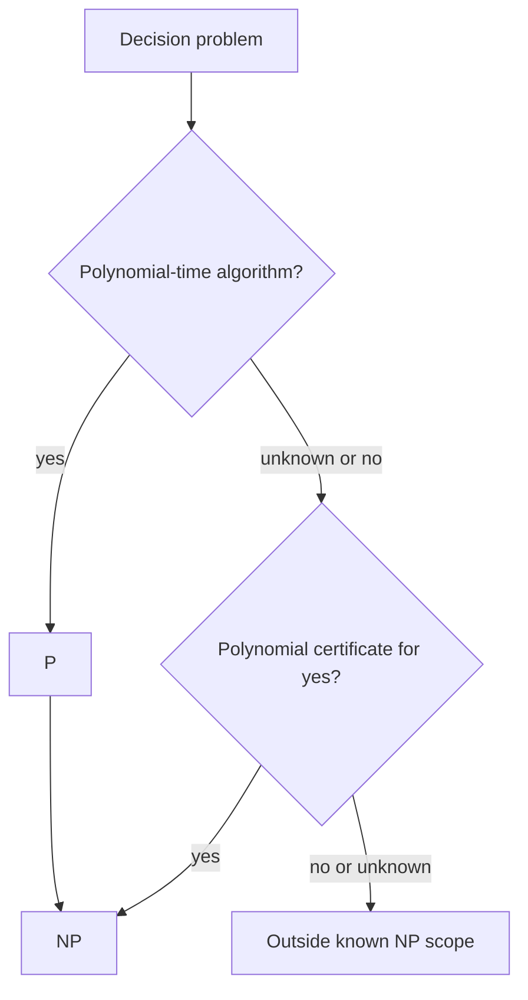

# Time Complexity, P, and NP

Computability asks whether a problem can be solved at all. Complexity asks how the required resources grow with the input. Time complexity counts computation steps as a function of input length, shifting attention from possible algorithms to feasible ones and from individual algorithms to classes of problems.

P contains decision problems solvable in polynomial time. NP contains decision problems whose yes-instances have polynomial-size certificates verifiable in polynomial time; equivalently, they are decidable by nondeterministic polynomial-time Turing machines. The unresolved $P$ versus $NP$ question asks whether efficient verification always implies efficient decision.

## Measuring time against the encoding

For a deterministic Turing machine $M$, the **running time** $t(n)$ is the maximum number of steps $M$ takes on any input of length $n$. Unless stated otherwise, complexity classes use this worst-case measure.

Big-O notation $f(n)=O(g(n))$ means that constants $c$ and $n_0$ exist such that $0\le f(n)\le c g(n)$ for every $n\ge n_0$. Constant factors and lower-order terms do not affect the asymptotic class. For example, when $n\ge1$,

$$
3n^2+20n+7
\le 3n^2+20n^2+7n^2
=30n^2.
$$

Taking $c=30$ and $n_0=1$ proves $3n^2+20n+7=O(n^2)$. Many other choices of constants would work.

The input length is the length of the representation, not the numeric value it encodes. If an integer $N$ is written in binary, the input has about $\log_2 N$ bits. A loop from $1$ through $N$ is exponential in that input length. Analyses of primality, factoring, subset sum, and other arithmetic problems must account for the bit lengths of their numbers.

Representation also affects precise graph bounds. An adjacency matrix occupies $\Theta(n^2)$ entries, while an adjacency list is closer to $\Theta(n+m)$. These encodings are polynomially related for simple graphs, so changing between them does not change membership in P, though it can change a detailed running-time claim.

## P, NP, and the certificate test

The class **P** is the set of languages decidable by deterministic Turing machines in time $n^k$ for some constant $k$.

A language $A$ belongs to **NP** if a polynomial-time verifier $V$ and a polynomial $p$ exist such that

$$
w\in A
\quad\Longleftrightarrow\quad
\exists c,\ |c|\le p(|w|)\text{ and }V(w,c)\text{ accepts}.
$$

The certificate condition is existential and concerns yes-instances. A Hamiltonian path certificate is an ordered vertex list; SAT uses a truth assignment; CLIQUE uses a vertex subset. Each certificate must have polynomial length, and every part of its verification must take polynomial time in the encoded input length.



| Problem | In P? | In NP? | Certificate idea |
|---|---|---|---|
| graph reachability | yes | yes | path, though not needed |
| primality | yes | yes | modern algorithms decide directly |
| SAT | unknown | yes | truth assignment |
| CLIQUE | unknown | yes | vertex subset |
| HAMPATH | unknown | yes | ordered list of vertices |

P is contained in NP: a verifier can ignore its certificate and run the polynomial-time decider. Whether NP is contained in P remains open. Not every decidable problem is known or expected to lie in NP; universal reasoning, game strategies, and exponentially long witnesses often lead to classes such as coNP, PSPACE, or EXPTIME.

## Checking a Hamiltonian path

To show HAMPATH is in NP, consider an input graph $G=(V,E)$ with $n$ vertices and, in the endpoint-specified version, vertices $s$ and $t$. Use an ordered list $(v_1,\ldots,v_n)$ as the certificate. A verifier checks that:

1. $v_1=s$ and $v_n=t$ when endpoints are specified;
2. every vertex of $G$ appears exactly once; and
3. $(v_i,v_{i+1})\in E$ for each $1\le i\lt n$.

The list has polynomial length. Duplicate detection and the $n-1$ edge queries require only polynomial time, so HAMPATH belongs to NP. This proof verifies a proposed path; it does not supply an efficient method for finding one.

## A verifier in code

The verifier pattern is concrete in CLIQUE. Its certificate is a set of $k$ vertices, and verification checks membership, distinctness, and every required edge.

```python
def verify_clique(vertices, edges, certificate, k):
    chosen = list(certificate)
    if len(chosen) != k or len(set(chosen)) != k:
        return False
    if any(v not in vertices for v in chosen):
        return False
    edge_set = {tuple(sorted(e)) for e in edges}
    for i in range(k):
        for j in range(i + 1, k):
            if tuple(sorted((chosen[i], chosen[j]))) not in edge_set:
                return False
    return True

V = {"a", "b", "c", "d"}
E = {("a", "b"), ("a", "c"), ("b", "c"), ("c", "d")}
print(verify_clique(V, E, ["a", "b", "c"], 3))
```

For fixed $k$ vertices the nested loop performs $\binom{k}{2}$ edge checks. With an efficient edge representation, the entire computation is polynomial in the input and certificate lengths.

## Why nondeterminism gives the same class

A nondeterministic polynomial-time machine accepts when some computation branch accepts within a polynomial number of steps. Its choices along an accepting branch can be written as a polynomial-length certificate and replayed by a deterministic verifier.

Conversely, a nondeterministic machine can guess a certificate of the permitted length and run the verifier. Thus the machine and verifier definitions describe the same class rather than two unrelated intuitions about NP.

The equality does not make no-instances equally easy to certify. **coNP** contains complements of NP languages. SAT has assignments as short certificates of satisfiability, but no general short certificate of unsatisfiability is known. Whether NP equals coNP is also open.

## Reductions and the jump from decision to search

Polynomial-time reductions compare problem difficulty. If $A\le_p B$ and $B\in P$, then $A\in P$: compute the reduction in polynomial time, solve the resulting $B$ instance, and translate the yes/no answer. The reduction itself cannot spend exponential time deciding $A$ and then emit a trivial instance, so it preserves the intended notion of efficient solvability.

NP is defined using decision languages because membership gives a clean mathematical target. Search problems are often recoverable with polynomially many decision queries. Given a polynomial-time SAT decider, for example, fix variables one at a time and ask whether the remaining formula is satisfiable. Keep a value whenever the answer remains yes. After polynomially many calls, the fixed values form a satisfying assignment.

Consequently, a decision result about an NP-complete problem often has consequences for finding witnesses, even though search is absent from the formal definition of NP.

## How robust is “polynomial time”?

Reasonable deterministic machine models simulate one another with polynomial overhead. Single-tape and multitape Turing machines may have different exponents, but standard simulations do not introduce exponential gaps. P is therefore treated as a model-robust class of feasible exact computation.

At the level of P and NP, it usually suffices to show that operations on encoded objects can be implemented in polynomial time. Fine-grained bounds require more care: a random-access machine and a single-tape Turing machine can differ enough to alter the stated exponent.

Worst-case analysis requires the bound on every input of length $n$, regardless of how frequently hard inputs occur. This supports composition: a polynomial-time subroutine called polynomially many times still yields a polynomial-time algorithm. Average-case and smoothed analyses answer different questions and require distributions or perturbation models not present in the basic definitions.

If $P=NP$, polynomial-time algorithms would exist for all NP-complete decision problems, with corresponding effects on optimization, search, theorem proving, and cryptography. Their real utility would still depend on exponents and constants. If $P\ne NP$, no NP-complete problem has a polynomial-time algorithm.

## Claims that need a second look

- “Polynomial in $N$” can be exponential when $N$ is binary-encoded; measure against the number of input bits.
- NP supplies certificates for yes-instances. Verifying no-instances belongs to the coNP side of the discussion.
- Membership in NP requires both a polynomial-size certificate and a polynomial-time verifier.
- A worst-case bound says nothing by itself about the frequency of hard instances.
- P/NP membership tolerates polynomial changes of model or encoding, but precise running times do not.

<div className="see-also">

See also: [Turing machine variants and decidable problems](/cs/theory/turing-machine-variants-and-decidable-problems) · [NP-completeness and classic reductions](/cs/theory/np-completeness-and-classic-reductions) · [Space complexity](/cs/theory/space-complexity) · [Advanced complexity topics](/cs/theory/advanced-complexity-topics)

</div>
