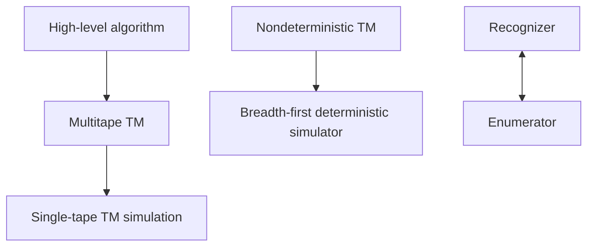

# Turing Machine Variants and Decidable Problems

The basic Turing machine is deliberately sparse. Multitape machines, nondeterministic machines, enumerators, and ordinary high-level algorithms all look more capable or more convenient, but they compute the same languages at the level of decidability and recognizability.

That equivalence permits decidability proofs written as graph searches, parsing algorithms, or simulations. A formal single-tape machine could implement each one. Low-level tape bookkeeping would change efficiency, not the existence of a decider.

## Simulation changes convenience, not computability



A **multitape Turing machine** has several tapes with independent heads. One transition reads the symbols under all heads, writes new symbols, moves each head, and changes state. A single-tape simulator can encode those tapes in delimited regions or tracks, mark every simulated head position, sweep across the encoding to collect the scanned symbols, and sweep again to apply the update.

The simulation is slower, often by a polynomial factor, but it preserves acceptance, rejection, and divergence. Multitape machines are therefore easier to program without deciding any language that a single-tape machine cannot decide.

A **nondeterministic Turing machine** may have several legal moves from one configuration and accepts if at least one branch accepts. Deterministic and nondeterministic machines recognize the same languages and decide the same languages. The simulation strategy, however, must treat all branches fairly.

## Fair exploration of a computation tree

Following one nondeterministic branch until it halts is unsound for recognition. That branch may run forever while a different branch accepts after a few steps. A deterministic simulator instead explores the computation tree breadth-first: all nodes at depth $0$, then depth $1$, and so on. Any accepting branch has finite depth and is eventually reached.

If the nondeterministic machine is a decider, every branch halts. Its computation tree is finitely branching; by König's lemma, a finitely branching tree with no infinite branch is finite. Breadth-first exploration can therefore finish the whole tree and reject when no branch accepts.

Fair scheduling reappears in dovetailing. Whenever several simulations may run without halting, give each one progressively more steps rather than waiting for any single simulation to finish.

## Recognizers and enumerators

An **enumerator** is a Turing-machine-like device with an output printer. It enumerates $L$ if every string in $L$ eventually appears and no string outside $L$ appears. Unless the convention says otherwise, the output may be unordered and may contain repetitions.

A language is Turing-recognizable exactly when some enumerator prints it. Starting with a recognizer $R$ over alphabet $\{0,1\}$, list the binary strings $s_1,s_2,\ldots$ in length-lexicographic order. At stage $t$, simulate $R$ on each of $s_1,\ldots,s_t$ for $t$ steps and print every string whose simulation accepts. If $R(x)$ accepts after $k$ steps, a sufficiently late stage includes $x$ and runs it long enough to observe acceptance. Nonmembers are never printed.

In the reverse direction, a recognizer for input $x$ runs the enumerator until $x$ appears. It accepts at that point; if $x\notin L$, it may wait forever. That one-sided behavior is precisely recognizability.

Requiring an enumeration in a fixed order without repetition is stronger. For an infinite language, an ordered enumerator can often support a membership decision by running until it prints $x$ or passes the position where $x$ would occur. Mere recognizability does not generally provide that structure.

## Finite search decides the standard automata questions

A language is **decidable** if some Turing machine halts on every input and answers membership correctly; older texts also call such languages **recursive**. Encoded automata and grammar questions are themselves languages, such as

$$
A_{DFA}=\{\langle B,w\rangle:B\text{ is a DFA that accepts }w\}
$$

and

$$
E_{DFA}=\{\langle B\rangle:L(B)=\emptyset\}.
$$

| Problem | Input encoding | Decidable idea |
|---|---|---|
| $A_{DFA}$ | $\langle B,w\rangle$ | simulate DFA on $w$ |
| $E_{DFA}$ | $\langle B\rangle$ | reachability to accepting states |
| $EQ_{DFA}$ | $\langle A,B\rangle$ | test emptiness of symmetric difference |
| $A_{CFG}$ | $\langle G,w\rangle$ | CYK or derivation search with bound |
| $E_{CFG}$ | $\langle G\rangle$ | mark variables deriving terminal strings |

DFA membership follows the unique run on $w$. DFA emptiness treats the transition diagram as a finite directed graph and asks whether any accepting state is reachable from the start state. DFA equivalence builds a product automaton for the symmetric difference and applies the same emptiness test. The algorithms halt because they examine only finitely many states or state pairs.

### Walking the DFA state graph

Given DFA $B$, breadth-first search begins at $q_0$. For every transition $\delta(q,a)=r$, regard $r$ as an outgoing neighbor of $q$. Reaching a final state exhibits some word whose transition path ends there, so $L(B)$ is nonempty. Exhausting all reachable states without finding a final state proves $L(B)=\emptyset$.

The following implementation returns `True` exactly when no final state is reachable:

```python
from collections import deque

def dfa_empty(states, alphabet, delta, start, finals):
    seen = {start}
    q = deque([start])
    while q:
        state = q.popleft()
        if state in finals:
            return False
        for symbol in alphabet:
            nxt = delta[(state, symbol)]
            if nxt not in seen:
                seen.add(nxt)
                q.append(nxt)
    return True

states = {"q0", "q1"}
alphabet = {"0", "1"}
delta = {
    ("q0", "0"): "q0",
    ("q0", "1"): "q1",
    ("q1", "0"): "q1",
    ("q1", "1"): "q1",
}
print(dfa_empty(states, alphabet, delta, "q0", {"q1"}))
```

Transition labels do not affect the reachability test itself, but they are not irrelevant: concatenating the labels along a path reconstructs a word accepted by the reached final state.

## Where the finite bounds come from

The high-level procedure in a decidability proof needs an explicit reason to halt. DFA reachability visits at most $\vert Q\vert $ states. Product construction for equivalence visits at most $\vert Q_A\vert \vert Q_B\vert $ pairs. Those finite bounds turn informal searches into deciders.

For context-free grammars, membership can be decided by CYK after conversion to Chomsky normal form. Its table ranges over finitely many substrings and variables. CFG emptiness marks variables known to derive terminal strings; the marked set grows monotonically and can gain a variable at most $\vert V\vert $ times. Both procedures halt.

The decidable boundary depends on the model and the property. CFG equivalence is undecidable even though CFG membership and emptiness are decidable. DFA emptiness and equivalence are decidable, while their general Turing-machine counterparts are undecidable. “A question about a formal language” supplies no verdict on its own.

## Universal simulation stops short of a decider

A universal Turing machine reads $\langle M,w\rangle$ and simulates $M$ on $w$. When $M$ accepts or rejects, the universal machine can report the same result. When $M$ loops, the simulation also loops.

Universal simulation is enough to recognize $A_{TM}$ but not to decide it. The simulator has no general finite bound telling it when an unfinished run will never halt. The same ability to treat machine descriptions as data later supports mapping reductions and self-reference arguments; it does not remove the undecidable behavior of the simulated machine.

## Details that commonly break a proof

- A multitape layout improves convenience and may improve time, but does not enlarge the class of decidable languages.
- Depth-first nondeterministic simulation can disappear into one infinite branch. Breadth-first exploration or dovetailing supplies fairness.
- An ordinary enumerator need not sort its output or suppress duplicates.
- CFG membership and emptiness are decidable; general CFG equivalence is not.
- A high-level search proves decidability only after its finite state space, table, or monotone iteration bound has been identified.

<div className="see-also">

See also: [Turing machines and the Church-Turing thesis](/cs/theory/turing-machines-and-the-church-turing-thesis) · [Decidability and the halting problem](/cs/theory/decidability-and-the-halting-problem) · [Reductions and the recursion theorem](/cs/theory/reductions-and-the-recursion-theorem) · [Time complexity, P, and NP](/cs/theory/time-complexity-p-and-np)

</div>
