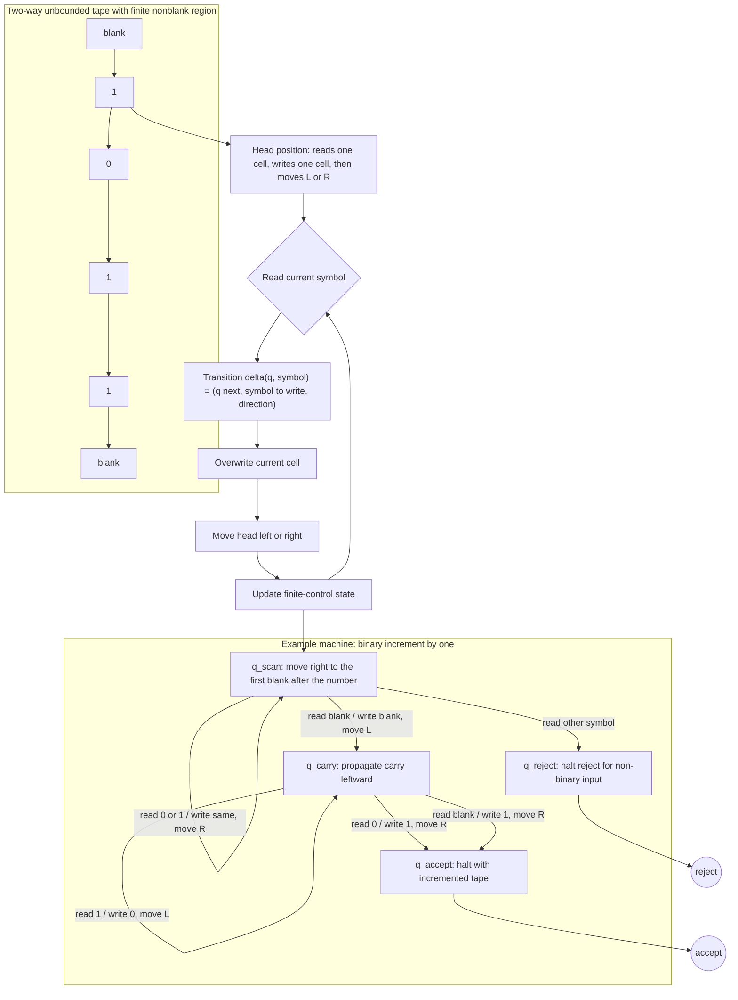

# Turing Machines and the Church-Turing Thesis

A Turing machine adds an unbounded read-write tape to finite control. The tape can be revisited and altered, supplying enough working memory to simulate ordinary algorithms and to compute beyond the limits of finite automata and pushdown automata.

The model is intentionally austere. Its importance comes from expressiveness rather than speed: local read-write-move steps can implement any procedure normally regarded as algorithmic. The Church-Turing thesis connects that formal model to the informal idea of effective calculation.

## The machine at one transition

A deterministic Turing machine can be specified by

$$
(Q,\Sigma,\Gamma,\delta,q_0,q_{accept},q_{reject}).
$$

Here $Q$ is a finite set of states; $\Sigma$ is the input alphabet; $\Gamma$ is the tape alphabet, with $\Sigma\subseteq\Gamma$ and a blank symbol; and $\delta$ maps a nonhalting state and scanned tape symbol to a new state, a symbol to write, and a head direction.

Initially, the finite input occupies consecutive tape cells, all other cells are blank, the head scans the first input symbol, and the control is in $q_0$. A transition reads one cell, overwrites that cell, moves the head left or right, and changes the state. Entering $q_{accept}$ accepts; entering $q_{reject}$ rejects. A run that enters neither state may continue forever.



Only the current state and scanned symbol determine the next local action. The lower subgraph expands binary increment into the scan and carry states needed to transform an input such as `1011` into `1100` on the same tape.

The tape alphabet may include work symbols absent from the input alphabet: marks, delimiters, crossed-off symbols, and separators between encoded fields. They do not enlarge the input language. They let the finite control leave persistent information on the tape.

## Compiling binary increment into local moves

The usual increment algorithm becomes a small collection of tape operations:

1. Scan right to the first blank after the input.
2. Move left to the least significant bit.
3. On `0`, write `1` and accept; the carry is resolved.
4. On `1`, write `0`, move left, and continue carrying.
5. On the blank to the left of the original most significant bit, write `1` and accept.

For `1011`, the two trailing `1`s become `0`s and the next `0` becomes `1`, yielding `1100`. Each carry step moves left, so a finite binary input produces a halting run.

The same algorithm can be exercised without spelling out the transition table:

```python
def binary_increment(bits):
    if not bits or any(bit not in {"0", "1"} for bit in bits):
        raise ValueError("expected a nonempty binary string")

    tape = list(bits)
    i = len(tape) - 1
    while i >= 0 and tape[i] == "1":
        tape[i] = "0"
        i -= 1
    if i >= 0:
        tape[i] = "1"
    else:
        tape.insert(0, "1")
    return "".join(tape)

for sample in ["0", "1", "1011", "111"]:
    print(sample, "->", binary_increment(sample))
```

High-level descriptions like “scan to the next blank” are acceptable after the machine model is established: each macro expands into finitely many ordinary transitions. A useful specification can move among three levels—individual transitions, tape macros such as scan or copy, and algorithms on encoded objects—provided every higher-level step has an effective tape implementation.

## Configurations as proof objects

A **configuration** is the complete instantaneous description of a run: the current state, head position, and all relevant tape contents. It contains exactly the information needed to determine the next step. If two deterministic computations reach the same configuration, their futures are identical.

For a machine that moves right across `0`s and accepts at the first blank, the input `000` gives the trace:

1. State `q`, tape `000_`, head on the first `0`.
2. Read `0`, leave it unchanged, and move to the second `0`.
3. Repeat on the second and third `0`.
4. The head reaches the blank after the input.
5. Reading blank enters `q_accept`.

The computation takes four transitions. Its tape contents never change, but its state and head position do.

A finite accepting run can be encoded as a sequence of configurations in which every adjacent pair obeys the transition function. Computation histories later support reductions and the Cook-Levin tableau construction. Configuration graphs also drive space-complexity arguments: a bounded-space decider cannot run forever without repeating a configuration.

## Recognition leaves the no-case open

A language is **Turing-recognizable** if some machine accepts exactly its members. On a string outside the language, that machine may reject or loop. A language is **decidable** if some machine halts on every input and accepts exactly its members.

| Input case | Recognizer | Decider |
|---|---|---|
| $w\in L$ | eventually accepts | eventually accepts |
| $w\notin L$ | rejects or runs forever | eventually rejects |

Looping is the absence of an answer, not a third answer. Every decider is automatically a recognizer, but a recognizer's unbounded search on no-instances may prevent it from deciding. This asymmetry allows $A_{TM}$ to be recognizable while remaining undecidable.

Halting behavior also affects composition. Deciders for $A$ and $B$ can be run and their answers combined to decide Boolean combinations of the two languages because both runs return. A recognizer does not automatically yield a recognizer for the complement: waiting for it to reject may never finish.

## What the Church-Turing thesis claims

The **Church-Turing thesis** says that every effectively calculable function is computable by a Turing machine. It is not a theorem in the ordinary formal sense because “effectively calculable” is an informal notion rather than a separately defined mathematical class.

Its evidence is robustness. Lambda calculus, general recursive functions, register machines, cellular automata, and reasonable programming languages all yield the same computable functions when supplied with idealized unbounded memory. A Turing machine can also simulate DFAs, use tape as a PDA stack, and implement graph algorithms, arithmetic, parsing, and proof search.

The thesis concerns computability, not equal efficiency. Equivalent models may simulate one another with substantial time or space overhead; complexity theory measures those costs. It also does not replace proofs about a formalized problem. A statement such as “simulate $M$ on $w$” is justified by a constructible universal machine, while decidability, recognizability, and reduction claims still need their own halting and correctness arguments.

## Why the weaker models remain useful

Turing completeness does not make finite automata or pushdown automata obsolete. Restrictions provide stronger conclusions: a DFA deciding a regular language uses constant memory and a single linear scan, while a generic Turing-machine decider establishes only computability. Context-free structure likewise supports specialized parsing algorithms and decidable properties.

Turing machines serve as both a universal model and a boundary-setting tool. The same formalism expresses simulations of ordinary algorithms, diagonal arguments against proposed deciders, and later time- and space-bounded computation.

## Distinctions to keep explicit

- The input is finite. The tape supplies unbounded blank workspace; it is not an infinite input stream.
- A recognizer may loop on nonmembers, whereas a decider must reject them and halt.
- The Church-Turing thesis relates a formal model to an informal concept, so it is supported by converging models rather than proved from a formal definition of effective calculation.
- A configuration includes state, head position, and tape contents; omitting any part loses information needed to determine the next step.
- A bare Turing machine defines what is computable. Time and space bounds are additional restrictions.

<div className="see-also">

See also: [Finite automata and DFAs](/cs/theory/finite-automata-and-dfas) · [Pushdown automata and deterministic CFLs](/cs/theory/pushdown-automata-and-deterministic-cfls) · [Turing machine variants and decidable problems](/cs/theory/turing-machine-variants-and-decidable-problems) · [Decidability and the halting problem](/cs/theory/decidability-and-the-halting-problem) · [Time complexity, P, and NP](/cs/theory/time-complexity-p-and-np)

</div>
