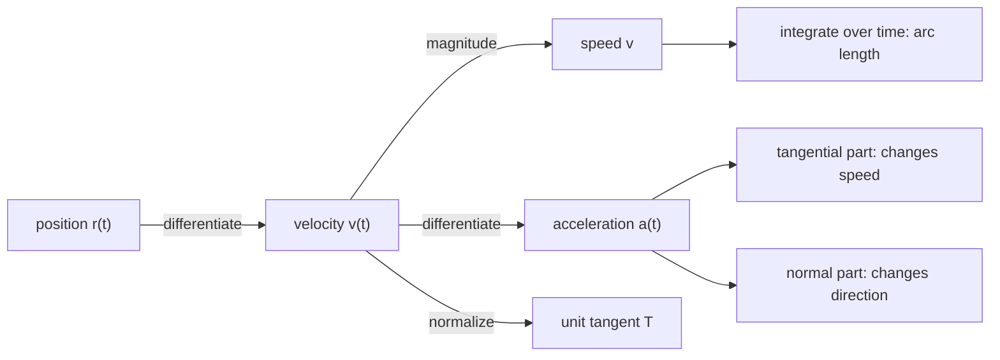

# Vector Functions and Motion

A vector-valued function records a point that depends on a parameter. Read geometrically, its image is a curve. Read kinematically, the parameter is time and the function gives a particle's position. These readings use the same derivatives but answer different questions: the curve has a shape independent of traversal speed, while velocity and acceleration depend on how the curve is parametrized.

## A curve together with a schedule

In three dimensions, write

$$
\mathbf r(t)=\langle x(t),y(t),z(t)\rangle.
$$

Limits, derivatives, and integrals are taken componentwise. Thus

$$
\mathbf r'(t)=\langle x'(t),y'(t),z'(t)\rangle,
\qquad
\int \mathbf r(t)\,dt
=
\left\langle
\int x(t)\,dt,
\int y(t)\,dt,
\int z(t)\,dt
\right\rangle.
$$

This componentwise rule follows from the Euclidean norm. A vector difference tends to zero exactly when each coordinate difference tends to zero. Ordinary one-variable calculus can therefore be applied to each coordinate, while dot and cross products put the components back into geometric form.

The parametrizations

$$
\mathbf r_1(t)=\langle\cos t,\sin t\rangle,
\qquad
\mathbf r_2(t)=\langle\cos 2t,\sin 2t\rangle
$$

have the same unit-circle image. The second completes a revolution in half the time. Replacing $t$ by a monotone function changes the schedule along the curve; it may change velocity and acceleration even when it does not change the traced points.

A curve is regular at $t_0$ when $\mathbf r'(t_0)\ne\mathbf 0$. Regularity ensures that the first derivative supplies a tangent direction. A zero derivative does not automatically mean the geometric image has a corner. For example, $\mathbf r(t)=\langle t^3,t^6\rangle$ has zero velocity at $0$, yet its image lies on the smooth parabola $y=x^2$. The parametrization stalls there. One may need a different parametrization or a limiting tangent argument.

## Position, velocity, speed, and acceleration

For motion,

$$
\mathbf v(t)=\mathbf r'(t),
\qquad
\mathbf a(t)=\mathbf v'(t)=\mathbf r''(t).
$$

Velocity contains direction and rate; speed is the scalar

$$
v(t)=\lVert\mathbf v(t)\rVert.
$$

For a short time increment $\Delta t$, differentiability gives

$$
\mathbf r(t+\Delta t)-\mathbf r(t)
=\mathbf v(t)\Delta t+o(\Delta t).
$$

Thus velocity points along the local displacement. The tangent line at a regular point is

$$
\mathbf L(s)=\mathbf r(t_0)+s\mathbf r'(t_0).
$$

In space, the plane through $\mathbf r(t_0)$ perpendicular to the velocity is the normal plane:

$$
\mathbf r'(t_0)\cdot
\bigl(\mathbf x-\mathbf r(t_0)\bigr)=0.
$$

Dot and cross products obey product rules because both operations are bilinear:

$$
\frac{d}{dt}(\mathbf u\cdot\mathbf v)
=\mathbf u'\cdot\mathbf v+\mathbf u\cdot\mathbf v',
$$

$$
\frac{d}{dt}(\mathbf u\times\mathbf v)
=\mathbf u'\times\mathbf v+\mathbf u\times\mathbf v'.
$$

The first identity explains the relation between speed and acceleration. Since $v^2=\mathbf v\cdot\mathbf v$,

$$
2v\frac{dv}{dt}=2\mathbf v\cdot\mathbf a.
$$

When $v\ne0$,

$$
\frac{dv}{dt}=\frac{\mathbf v\cdot\mathbf a}{\lVert\mathbf v\rVert}.
$$

Positive $\mathbf v\cdot\mathbf a$ means speed is increasing; a negative value means it is decreasing. If speed is constant, velocity and acceleration are perpendicular. The converse holds on an interval for differentiable motion: if $\mathbf v\cdot\mathbf a=0$ throughout the interval, then $v^2$ is constant.

## Arc length removes the timing

Approximating a curve by short chords leads to the arc-length integral

$$
L=\int_a^b\lVert\mathbf r'(t)\rVert\,dt.
$$

Define distance traveled from a fixed starting parameter $a$ by

$$
s(t)=\int_a^t\lVert\mathbf r'(u)\rVert\,du.
$$

The Fundamental Theorem of Calculus gives $ds/dt=\lVert\mathbf r'(t)\rVert$. If the curve is regular, $s$ is strictly increasing locally and can be inverted. Writing the curve in terms of $s$ gives unit speed:

$$
\left\lVert\frac{d\mathbf r}{ds}\right\rVert=1.
$$

Arc length is invariant under an orientation-preserving regular reparametrization. If $t=\phi(u)$ with $\phi'(u)\gt 0$, then the new speed is $\lVert\mathbf r'(\phi(u))\rVert\phi'(u)$; substitution in the integral cancels the changed schedule. If the parameter reverses direction, an absolute value on $\phi'$ preserves the positive length.

The unit tangent is

$$
\mathbf T=\frac{\mathbf v}{\lVert\mathbf v\rVert}
=\frac{d\mathbf r}{ds}.
$$

It records direction without speed. Since $\mathbf T\cdot\mathbf T=1$, differentiation with respect to $s$ gives $\mathbf T\cdot d\mathbf T/ds=0$. A changing unit tangent therefore changes only in a perpendicular direction.

## Curvature and the moving frame

Curvature is the rate at which the unit tangent turns per unit distance:

$$
\kappa=\left\lVert\frac{d\mathbf T}{ds}\right\rVert.
$$

When $\kappa\ne0$, the principal unit normal points in the turning direction,

$$
\mathbf N=\frac{d\mathbf T/ds}{\lVert d\mathbf T/ds\rVert},
$$

and the binormal is $\mathbf B=\mathbf T\times\mathbf N$. The orthonormal frame $\mathbf T,\mathbf N,\mathbf B$ moves along a regular space curve. A straight segment has $\kappa=0$, so it has no preferred principal normal.

To obtain a formula in an arbitrary parameter, note that $d\mathbf T/dt=(d\mathbf T/ds)(ds/dt)=\kappa v\mathbf N$. A standard calculation using the component of acceleration perpendicular to velocity gives

$$
\kappa(t)=
\frac{\lVert\mathbf r'(t)\times\mathbf r''(t)\rVert}
{\lVert\mathbf r'(t)\rVert^3}.
$$

For a plane curve $\mathbf r=\langle x,y\rangle$, regard the vectors as having zero third coordinate:

$$
\kappa(t)=
\frac{|x'(t)y''(t)-y'(t)x''(t)|}
{\bigl((x'(t))^2+(y'(t))^2\bigr)^{3/2}}.
$$

The radius of curvature is $\rho=1/\kappa$ where curvature is nonzero. It is the radius of the circle that best matches the curve to second order at the point.

## Splitting acceleration into two effects

Because $\mathbf v=v\mathbf T$, differentiate with respect to time:

$$
\begin{aligned}
\mathbf a
&=\frac{d}{dt}(v\mathbf T)\\
&=\frac{dv}{dt}\mathbf T
+v\frac{d\mathbf T}{dt}\\
&=\frac{dv}{dt}\mathbf T+\kappa v^2\mathbf N.
\end{aligned}
$$

Hence

$$
\mathbf a=a_T\mathbf T+a_N\mathbf N,
\qquad
a_T=\frac{dv}{dt},
\qquad
a_N=\kappa v^2.
$$

The tangential component changes speed. The normal component changes direction and points toward the local center of curvature. Since the components are perpendicular,

$$
a_N=\sqrt{\lVert\mathbf a\rVert^2-a_T^2}.
$$

Uniform circular motion has $a_T=0$ but $a_N=v^2/R$. Constant speed therefore does not imply zero acceleration. Conversely, straight-line motion may have nonzero tangential acceleration and zero normal acceleration.

## Worked example: a circular helix

Let

$$
\mathbf r(t)=\langle 3\cos t,3\sin t,4t\rangle.
$$

Differentiate once and twice:

$$
\mathbf v(t)=\langle-3\sin t,3\cos t,4\rangle,
$$

$$
\mathbf a(t)=\langle-3\cos t,-3\sin t,0\rangle.
$$

The speed is

$$
v=\sqrt{9\sin^2t+9\cos^2t+16}=5.
$$

It is constant, so $a_T=0$. Directly,

$$
\mathbf v\cdot\mathbf a
=9\sin t\cos t-9\sin t\cos t=0,
$$

which confirms orthogonality. The arc length from $0$ to $b\gt 0$ is

$$
L=\int_0^b5\,dt=5b.
$$

For curvature, compute

$$
\mathbf v\times\mathbf a
=\langle12\sin t,-12\cos t,9\rangle.
$$

Its magnitude is

$$
\sqrt{144\sin^2t+144\cos^2t+81}=15.
$$

Therefore

$$
\kappa=\frac{15}{5^3}=\frac{3}{25}.
$$

The normal acceleration is

$$
a_N=\kappa v^2=\frac{3}{25}\cdot25=3,
$$

which agrees with $\lVert\mathbf a\rVert=3$. The horizontal projection is a circle of radius $3$, but the helix curvature is less than $1/3$ because some motion goes vertically rather than turning around that circle.

## Worked example: projectile motion from initial data

Take feet and seconds, ignore air resistance, and let

$$
\mathbf a(t)=\langle0,-32\rangle,
\qquad
\mathbf v(0)=\langle30,40\rangle,
\qquad
\mathbf r(0)=\langle0,5\rangle.
$$

Integrating acceleration introduces a constant vector:

$$
\mathbf v(t)=\langle C_1,-32t+C_2\rangle.
$$

The initial velocity sets $C_1=30$ and $C_2=40$, so

$$
\mathbf v(t)=\langle30,40-32t\rangle.
$$

Integrate again and apply the initial position:

$$
\mathbf r(t)=\langle30t,5+40t-16t^2\rangle.
$$

At maximum height, the vertical velocity vanishes:

$$
40-32t=0
\quad\Longrightarrow\quad
t=\frac54.
$$

The height then is

$$
y\left(\frac54\right)
=5+40\left(\frac54\right)
-16\left(\frac54\right)^2
=30.
$$

Landing occurs when $y(t)=0$:

$$
5+40t-16t^2=0.
$$

The quadratic formula gives

$$
t=\frac{-40\pm\sqrt{40^2+4(16)(5)}}{-32}
=\frac{5\pm3\sqrt5}{4}.
$$

Only the positive root is physical:

$$
t_{\mathrm{land}}=\frac{5+3\sqrt5}{4}\approx2.927.
$$

The horizontal range is

$$
x(t_{\mathrm{land}})
=30\left(\frac{5+3\sqrt5}{4}\right)
\approx87.8\text{ ft}.
$$

Because the projectile lands below its launch point, its impact speed exceeds its initial speed. Substituting the landing time into $40-32t$ gives the vertical impact component, while the horizontal component remains $30$ in this model.

## Checks that prevent common errors

- Velocity and speed have different types: one is a vector and the other is a nonnegative scalar. An equation that adds them is already suspect.
- In general, $d\lVert\mathbf r\rVert/dt$ is not $\lVert\mathbf r'\rVert$. Differentiating the squared norm gives $d\lVert\mathbf r\rVert/dt=(\mathbf r\cdot\mathbf r')/\lVert\mathbf r\rVert$ when $\mathbf r\ne0$.
- Curvature formulas require nonzero velocity. Substitution at a singular parameter can create division by zero even if the image has a recoverable geometric tangent.
- Parameter time equals arc length only for unit-speed motion. The notation $s$ is conventionally reserved for arc length to keep this distinction apparent.
- Componentwise kinematics still requires one consistent coordinate system and unit system. A sign error in the chosen vertical direction propagates through both velocity and position.
- A particle can revisit the same point with a different velocity. Position alone does not determine its current direction or speed.

## Reparametrization without changing the trace

It helps to separate three objects that are often compressed into one notation: the set of points forming the trace, the direction in which that trace is followed, and the rate of travel. A new parameter can alter the latter two while leaving the first unchanged. If a new parameter increases strictly with the old one, orientation is preserved. If it decreases, orientation reverses. If its derivative vanishes, the new parametrization may cease to be regular even when the geometric curve is smooth.

Consider a circle described once over a standard interval. Replacing the parameter by twice itself traverses the same circle twice as fast and may also traverse it more than once over the same stated interval. Replacing it by its negative reverses the direction. Squaring the parameter on an interval containing zero creates a more subtle problem: points on one side can be retraced, and the chain-rule factor vanishes at zero. Any claim that two parametrizations are equivalent should therefore include the intervals and whether the parameter change is one-to-one.

Orientation matters for velocity, work, and circulation. Arc length and unsigned curvature do not care which way the curve is followed. The unit tangent changes sign under reversal, while the principal normal for an ordinary plane curve usually continues to point toward the same local center of curvature. Signed curvature, used in some treatments of plane curves, does change with orientation. Keeping track of which quantities are signed prevents apparent contradictions between formulas.

Arc-length parametrization is conceptually clean but often inconvenient to obtain in closed form. Computing the integral for distance may be straightforward while solving that relation for the old parameter is impossible using elementary functions. One can still use arc length implicitly: derivatives with respect to distance follow by dividing time derivatives by speed. The geometric conclusions do not require an explicit inverse formula.

## Recovering motion from acceleration and initial data

Acceleration alone does not determine a trajectory. Integrating once introduces a constant velocity vector, and integrating again introduces a constant position vector. Initial velocity and initial position supply these constants. In three dimensions this amounts to six scalar initial values. Forgetting either vector produces a family of motions rather than one motion.

When acceleration depends on time only, componentwise integration is direct. When it depends on position or velocity, the problem becomes a differential equation or system. Central-force motion, drag, and guided motion along a constrained track all require more than the constant-acceleration formula. The geometric vocabulary still applies: velocity remains tangent to the path and acceleration still separates into tangential and normal effects wherever the motion is regular.

Initial conditions also serve as unit checks. Position, velocity, and acceleration have dimensions of length, length per time, and length per time squared. An integration constant added to velocity must have velocity units. A term in position that contains acceleration must be multiplied by time squared. Dimensional disagreement usually exposes a missing factor of time or an incorrectly integrated component.

For constant acceleration, displacement over a time interval can be read as initial-velocity displacement plus the accumulated acceleration contribution. Average velocity equals the mean of initial and final velocities in that special case. Neither shortcut survives arbitrary acceleration without replacing it by an integral. Treating a variable-acceleration problem with constant-acceleration formulas can give the correct units and still be wrong.

## Curvature as a property of the trace

The cross-product curvature formula may look tied to time because it contains first and second time derivatives. Its powers of speed cancel the timing dependence. Under a smooth increasing parameter change, both derivatives acquire chain-rule factors, and the component of the second derivative parallel to velocity disappears in the cross product. What remains scales by exactly the third power needed to cancel the denominator. That cancellation is the algebraic expression of curvature belonging to the trace rather than the schedule.

Curvature also distinguishes a bend from a change in speed. If a car accelerates along a straight road, its acceleration may be large while curvature remains zero. If it rounds a tight bend at steady speed, tangential acceleration is zero but normal acceleration may be large. The product of curvature and speed squared quantifies that second effect, so doubling speed on the same bend multiplies normal acceleration by four.

At an inflection point of a plane curve, curvature may vanish because the direction of bending changes. The principal normal obtained by normalizing the tangent derivative then becomes undefined at the point itself. Normal vectors on the two sides may point in opposite directions. A plot that draws a continuous chosen normal through such a point is using an extra convention, not the principal-normal formula alone.

For a space curve, curvature measures bending but not twisting out of the osculating plane. Torsion supplies that additional quantity. A plane curve has zero torsion wherever the standard frame is defined; a helix has nonzero torsion. Curvature and torsion together determine a regular space curve up to rigid motion under suitable hypotheses, which explains why the moving frame carries more information than a tangent line by itself.

## Measurements and numerical derivatives

Recorded position data arrive at discrete times and usually contain noise. A forward difference estimates velocity from two samples, but its error combines truncation error with amplified measurement noise. A centered difference uses samples on both sides and generally has better truncation accuracy in the interior. Acceleration requires another differentiation and is even more sensitive to noise.

Smoothing, fitting a local polynomial, or using a model-based estimator can be more reliable than repeatedly differencing raw coordinates. The choice changes what small-scale motion is retained, so the sampling interval and smoothing assumptions belong with the reported velocity or curvature. A beautifully smooth curvature plot can be an artifact of aggressive filtering.

Discrete arc length is less fragile: sum the distances between successive samples. This polygonal length approaches the smooth curve length as sampling becomes finer under suitable regularity. It tends to underestimate a curved segment because a chord is shorter than the arc. Uneven sampling is acceptable if actual time gaps and spatial distances are used rather than assuming a constant step.

Numerical checks can preserve geometric structure. Estimated speed should be nonnegative, a computed unit tangent should have norm near one, and constant-speed data should give a small velocity–acceleration dot product relative to their magnitudes. Such residual checks are more informative than comparing rounded coordinate formulas term by term.

## Where the same parametrization reappears

Line integrals use a curve as a schedule for sampling a field. Along $C$, a vector field becomes $\mathbf F(\mathbf r(t))$, while differential displacement is $d\mathbf r=\mathbf r'(t)\,dt$. Work is therefore written

$$
\int_C\mathbf F\cdot d\mathbf r
=\int_a^b\mathbf F(\mathbf r(t))\cdot\mathbf r'(t)\,dt.
$$

The tangent, normal, and curvature also feed into mechanics, road and track design, and numerical path following. Their separation of geometry from timing is the central organizing idea: $\kappa$ belongs to the path, while $a_T$ and $a_N$ describe how a particular motion uses that path.

See also: [Vectors and geometry of space](/math/calculus/vectors-and-geometry-of-space) · [Parametric, polar, and conic curves](/math/calculus/parametric-polar-conics) · [Partial derivatives and the gradient](/math/calculus/partial-derivatives-and-gradient) · [Vector calculus](/math/calculus/vector-calculus)

