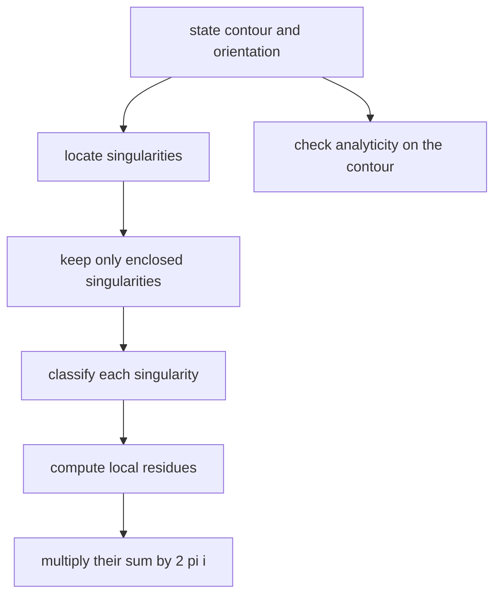

# Complex Integration and Residues

Complex integration begins as ordinary integration along a parametrized curve. Analyticity then makes the result unexpectedly rigid: on suitable domains, contour integrals depend only on endpoints, boundary values determine interior derivatives, and a closed integral can be reduced to one coefficient near each enclosed singularity. The topology of the domain and the contour's orientation remain part of every theorem.

## Integrating along an oriented contour

Let a smooth curve $C$ be parametrized by $z(t)$ for $a\le t\le b$. Define

$$
\int_C f(z)\,dz
=\int_a^b f(z(t))z'(t)\,dt.
$$

A piecewise smooth contour is handled one segment at a time. Reversing orientation replaces $z(t)$ by a reversed parametrization and changes the sign:

$$
\int_{-C}f(z)\,dz=-\int_Cf(z)\,dz.
$$

An orientation-preserving reparametrization does not change the integral. The factor $z'(t)$ adjusts both direction and traversal rate, much as $d\mathbf r$ does in a line integral.

For a direct example, integrate $\bar z$ counterclockwise around the circle $\vert z\vert =R$. Parametrize $z(t)=Re^{it}$, $0\le t\le2\pi$. Then $\bar z=Re^{-it}$ and $dz=iRe^{it}\,dt$, so

$$
\begin{aligned}
\oint_{|z|=R}\bar z\,dz
&=\int_0^{2\pi}Re^{-it}iRe^{it}\,dt\\
&=iR^2\int_0^{2\pi}dt\\
&=2\pi iR^2.
\end{aligned}
$$

The nonzero result does not conflict with Cauchy's theorem: $\bar z$ is not analytic.

## When closed integrals vanish

If $f$ has an antiderivative $F$ on a domain, then along any contour from $z_a$ to $z_b$,

$$
\int_Cf(z)\,dz=F(z_b)-F(z_a).
$$

Every closed-contour integral is then zero. Cauchy's integral theorem gives a broad route to the same conclusion: if $f$ is analytic on a simply connected domain, every closed contour in that domain has integral zero.

The domain condition cannot be dropped. The function $1/z$ is analytic on $\mathbb C\setminus\{0\}$, but the punctured plane fails simple connectedness, and

$$
\oint_{|z|=1}\frac{dz}{z}=2\pi i.
$$

The unit circle cannot be contracted to a point without crossing the missing origin. More generally, deformation of contours is allowed only while remaining in a region where the integrand is analytic. Two contours with the same endpoints have equal integrals when one can be deformed to the other without crossing a singularity, with the endpoints fixed.

For a simple closed contour, positive orientation conventionally means counterclockwise: the interior remains to the left while traversing the path. Clockwise orientation introduces a minus sign in Cauchy and residue formulas.

## Cauchy's integral formula

If $f$ is analytic on and inside a positively oriented simple closed contour $C$, and $z_0$ lies inside, then

$$
f(z_0)=\frac{1}{2\pi i}
\oint_C\frac{f(z)}{z-z_0}\,dz.
$$

The denominator creates a simple pole at the point whose value is sought. If $z_0$ lies outside, the integrand is analytic throughout the interior and the integral is zero.

Differentiating the formula gives

$$
f^{(n)}(z_0)=\frac{n!}{2\pi i}
\oint_C\frac{f(z)}{(z-z_0)^{n+1}}\,dz.
$$

Equivalently,

$$
\oint_C\frac{f(z)}{(z-z_0)^{n+1}}\,dz
=\frac{2\pi i}{n!}f^{(n)}(z_0).
$$

The formula says that boundary values determine all interior derivatives. It also supports Cauchy estimates, Taylor series, and the rigidity results of analytic functions.

As a short calculation, suppose $C$ is $\vert z\vert =2$ counterclockwise. Then

$$
\oint_C\frac{e^z}{(z-1)^3}\,dz
=\frac{2\pi i}{2!}\left.\frac{d^2}{dz^2}e^z\right|_{z=1}
=\pi i e.
$$

No parametrization of the circle is needed. The exponent $3$ in the denominator calls for the second derivative, not the third.

## Laurent series classify isolated singularities

An isolated singularity $z_0$ is a point where $f$ is not analytic but is analytic in some punctured disk $0\lt \vert z-z_0\vert \lt R$. In an annulus around such a point, $f$ has a Laurent expansion

$$
f(z)=\sum_{n=-\infty}^{\infty}a_n(z-z_0)^n.
$$

The negative-power part determines the singularity:

| Type | Laurent behavior near $z_0$ | Typical example |
|---|---|---|
| removable | all negative coefficients vanish | $\sin z/z$ at $0$ after extension |
| pole of order $m$ | finitely many negative powers, lowest is $-m$ | $1/(z-z_0)^m$ |
| essential | infinitely many negative powers | $e^{1/z}$ at $0$ |

The residue is the coefficient

$$
\operatorname{Res}(f,z_0)=a_{-1}.
$$

Its special role comes from termwise integration around a small positive circle. Every integer power integrates to zero except

$$
\oint\frac{dz}{z-z_0}=2\pi i.
$$

Thus the complete local series contributes only one coefficient to the contour integral.

For a simple pole,

$$
\operatorname{Res}(f,z_0)
=\lim_{z\to z_0}(z-z_0)f(z).
$$

If $f=p/q$, with $p(z_0)\ne0$, $q(z_0)=0$, and $q'(z_0)\ne0$, this becomes

$$
\operatorname{Res}(f,z_0)=\frac{p(z_0)}{q'(z_0)}.
$$

For a pole of order $m$,

$$
\operatorname{Res}(f,z_0)
=\frac{1}{(m-1)!}
\lim_{z\to z_0}
\frac{d^{m-1}}{dz^{m-1}}
\left[(z-z_0)^m f(z)\right].
$$

Series multiplication is often shorter than the derivative formula when exponentials or trigonometric functions occur. Apparent poles should be simplified first: cancellation may leave a removable singularity with residue zero.

## The residue theorem as local bookkeeping

Suppose $f$ is analytic on and inside a positively oriented simple closed contour $C$ except for isolated singularities $z_1,\ldots,z_m$ in the interior. Then

$$
\oint_Cf(z)\,dz
=2\pi i\sum_{k=1}^m\operatorname{Res}(f,z_k).
$$

One proof cuts small circles around each singularity. Cauchy's theorem applies to the multiply bounded region between the outer contour and the small circles. The inner boundaries carry clockwise orientation relative to that region; moving them to the other side of the equation turns them counterclockwise. Shrinking the circles leaves $2\pi i$ times each local residue.

### Worked example: a contour enclosing two poles

Evaluate, counterclockwise,

$$
\oint_{|z|=2}\frac{e^z}{z(z-1)}\,dz.
$$

The denominator factors already display simple poles at $0$ and $1$. Both satisfy modulus less than $2$, and neither lies on the contour. At zero,

$$
\operatorname{Res}(f,0)
=\lim_{z\to0}\frac{e^z}{z-1}=-1.
$$

At one,

$$
\operatorname{Res}(f,1)
=\lim_{z\to1}\frac{e^z}{z}=e.
$$

Their sum is $e-1$, so

$$
\oint_{|z|=2}\frac{e^z}{z(z-1)}\,dz
=2\pi i(e-1).
$$

As a check, partial fractions with analytic numerators gives

$$
\frac{e^z}{z(z-1)}
=-\frac{e^z}{z}+\frac{e^z}{z-1},
$$

and Cauchy's formula produces $-2\pi i+2\pi ie$. If the radius were between $0$ and $1$, only the residue at zero would enter.

## Turning a real integral into a contour integral

For a real-line integral, one adds an arc or other segments to create a closed contour. The residue theorem evaluates the closed contour; a separate estimate must show what happens to the added pieces.

### Worked example: $1/(x^2+a^2)$

Let $a\gt 0$ and consider

$$
I=\int_{-\infty}^{\infty}\frac{dx}{x^2+a^2}.
$$

Use

$$
f(z)=\frac{1}{z^2+a^2}
=\frac{1}{(z-ia)(z+ia)}
$$

and close the interval $[-R,R]$ with the upper semicircle. Only $z=ia$ is enclosed. Its residue is

$$
\operatorname{Res}(f,ia)
=\lim_{z\to ia}\frac{1}{z+ia}
=\frac{1}{2ia}.
$$

Therefore the closed contour integral is

$$
2\pi i\frac{1}{2ia}=\frac{\pi}{a}.
$$

It remains to control the semicircle $\Gamma_R$. On $\vert z\vert =R\gt a$,

$$
|z^2+a^2|\ge\bigl||z|^2-a^2\bigr|=R^2-a^2,
$$

so

$$
\left|\int_{\Gamma_R}f(z)\,dz\right|
\le \frac{\pi R}{R^2-a^2}\longrightarrow0.
$$

The real segment tends to the improper integral as $R\to\infty$, leaving

$$
\int_{-\infty}^{\infty}\frac{dx}{x^2+a^2}
=\frac{\pi}{a}.
$$

The scale is consistent: substituting $x=au$ would factor out $1/a$.

## Choosing contours for exponential and trigonometric integrals

For factors $e^{iaz}$ with real $a$, write $z=x+iy$:

$$
|e^{iaz}|=e^{-ay}.
$$

If $a\gt 0$, the upper half-plane supplies decay; if $a\lt 0$, the lower half-plane does. Closing in the other half-plane may make the arc grow. The rational factor must also decay enough for the arc estimate.

Periodic integrals over $0$ to $2\pi$ often use $z=e^{it}$:

$$
\cos t=\frac12\left(z+\frac1z\right),
\qquad
\sin t=\frac{1}{2i}\left(z-\frac1z\right),
\qquad
dt=\frac{dz}{iz}.
$$

This transforms the interval into the positively oriented unit circle. The Jacobian factor $1/(iz)$ changes the pole structure and must remain in the transformed integrand.

Branch points call for contours adapted to a chosen branch, such as a keyhole contour. Values on the two sides of a branch cut differ by a known phase or logarithmic jump. The small and large circular pieces still need estimates. A branch cut is part of the analytic domain, not a physical row of singular points.

## Cases outside the standard residue theorem

A pole on the contour violates the theorem's hypotheses. One may indent the contour and take a Cauchy principal value, but the indentation contributes a nonzero term whose sign depends on orientation. It cannot be handled by casually assigning half a residue without verifying the setup.

Essential singularities still have residues; the $a_{-1}$ coefficient may be extracted from a Laurent product. A residue can even vanish at an essential singularity. Classification and residue are related but distinct questions.

At infinity, behavior can be studied by substituting $w=1/z$. For rational functions, this viewpoint can simplify the sum of many finite residues, though it requires consistent conventions for the residue at infinity.

Before accepting a contour result, check the following points:

- orientation and winding around each singularity;
- analyticity on every piece of the contour;
- pole locations relative to the contour, not merely their algebraic existence;
- cancellation that changes pole order or removes a singularity;
- the estimate for every added arc or segment;
- branch definitions and boundary values on cuts;
- the distinction between an improper integral and a principal value.

Pole locations also explain terms in inverse Laplace and Fourier transforms. A pole's real part controls exponential growth or decay, while its imaginary part controls oscillation. Repeated poles produce polynomial factors multiplying the corresponding exponential.

## Picking the shortest theorem

Not every contour problem calls for residues. Direct parametrization works well when the path is simple and the integrand contains $\bar z$, $\vert z\vert $, or another nonanalytic term. Cauchy's theorem is shortest when the integrand is analytic throughout a suitable interior. Cauchy's integral formula handles a known analytic numerator divided by a power of one linear factor. Residues become useful when several isolated singularities or less recognizable local forms occur.

For example, on a contour enclosing $a$ but no other singularity,

$$
\oint_C\frac{3z^2+1}{z-a}\,dz
$$

can be evaluated as $2\pi i(3a^2+1)$ by Cauchy's formula. Calling the same number the residue of the integrand at $a$ is correct, but computing a Laurent series would add work. If the denominator instead factors into several enclosed roots, the residue theorem organizes the sum cleanly.

Theorems also provide checks on scale and type. A contour integral of a rational function can be real, imaginary, or complex; the factor $2\pi i$ means a real residue sum produces a purely imaginary result. Conjugate poles often pair to give residue sums with the symmetry needed for a real-line integral to end up real.

## Deforming contours without crossing trouble

Contour deformation is the geometric engine behind many calculations. If two paths bound a region on which the integrand is analytic, their integrals agree after orientations are aligned. The paths need not have the same length or shape. What matters is that one can be moved to the other while endpoints stay fixed and no singularity or branch cut is crossed.

For closed contours, winding matters. A contour that loops twice around a pole contributes twice the ordinary positive-circle value. A clockwise loop contributes with negative winding. Self-intersecting contours therefore cannot always be classified by a simple inside-or-outside picture; the winding number of each singularity supplies the correct multiplier.

Large arcs, small indentations, and the two banks of a branch cut are genuine pieces of the contour. Each has an orientation inherited from the full path. Sketching arrows before writing integrals prevents many sign errors. The boundary of a region with a hole runs counterclockwise on the outside and clockwise around the hole when the region is kept on the left.

Deformation also clarifies why local residues suffice. The outer contour can be pushed inward until it becomes a collection of tiny circles around singularities. Analytic portions of the domain contribute no obstruction. The surviving circles retain only the coefficient of the reciprocal term in each local Laurent expansion.

## Estimating contour pieces

The basic estimation lemma says that an integral's magnitude is at most the maximum magnitude of the integrand along the path times the path length. Both factors matter. An integrand tending to zero pointwise on a growing semicircle may still have a nonvanishing integral if the arc length grows faster.

For rational functions, compare polynomial degrees on a large circle. If the denominator degree exceeds the numerator degree by at least two, an upper or lower semicircle often gives enough decay for an unweighted real-line integral. A difference of only one generally leaves an estimate of constant size, so more structure or a different contour is needed.

Near a small circle of radius epsilon, the same estimate works in reverse scale. A bounded integrand times a shrinking circumference tends to zero. A simple pole has magnitude on the order of the reciprocal radius, which balances the circumference and leaves a finite contribution. Higher-order poles can make a naive indentation diverge, requiring cancellation or a more careful principal-value argument.

Exponential factors must be estimated through their real exponent. The modulus can decay on part of a semicircle and fail near its endpoints, so a named lemma or a direct angular estimate may be required. Merely observing decay at the top of the arc does not control the entire arc.

## Residues as coefficients, not only limits

The simple-pole limit is memorable, but coefficient extraction is the more general idea. If one factor has a known Taylor series and another contributes negative powers, multiply only enough terms to reach the reciprocal power. Terms that cannot contribute to that coefficient can be ignored.

This approach handles essential singularities without classifying an infinite principal part term by term. It also handles a high-order pole without taking a long derivative. Around a point other than zero, every series must be written in powers of the same local variable. Mixing a series in powers of the global coordinate with a Laurent series centered elsewhere is a frequent source of incorrect coefficients.

Residues interact cleanly with derivatives. The derivative of a single-valued Laurent series has zero residue because differentiating any power cannot create a reciprocal term: the only candidate would come from the constant term, whose derivative vanishes. This gives a fast check when an integrand is visibly the derivative of a meromorphic function.

Poles and removable singularities should be classified after cancellation, but the original domain should still be remembered. A removable point contributes no residue and can be filled in analytically. For a contour integral, the filled value at one point does not change the integral, which is consistent with the residue being zero.

See also: [Complex functions and analyticity](/math/engineering-math/complex-functions-and-analyticity) · [Laplace transform](/math/engineering-math/laplace-transform) · [Fourier integrals and transforms](/math/engineering-math/fourier-integrals-and-transforms) · [Laplace equation and potential](/math/engineering-math/laplace-equation-and-potential)

