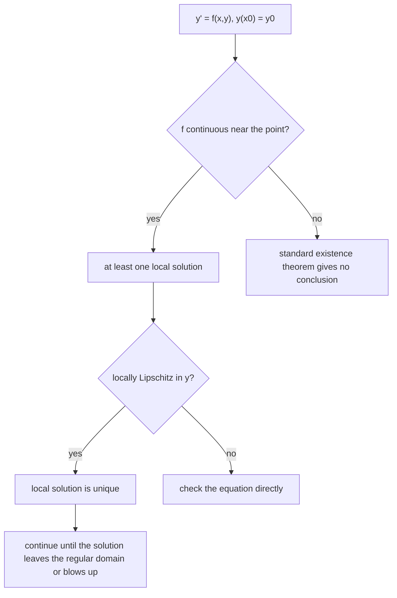

# Direction Fields and Existence

For a first-order equation $y'=f(x,y)$, the function $f$ assigns a slope to each point where it is defined. A solution is a curve tangent to this field of slopes. Direction fields reveal qualitative behavior before a formula is available, while existence and uniqueness theorems say when an initial point actually selects a solution and when it selects only one.

## Reading the equation as geometry

At a grid point $(x,y)$, draw a short segment with slope $f(x,y)$. A solution through $(x_0,y_0)$ must follow the local segments without jumping between them. The segments carry no preferred length; only their slopes matter.

Curves on which $f(x,y)=c$ are isoclines. Every field segment along such a curve has slope $c$. For

$$
y'=x-y,
$$

the isoclines are $x-y=c$, or $y=x-c$. Drawing several parallel lines for $c=-2,-1,0,1,2$ organizes a hand sketch much faster than evaluating an arbitrary grid.

A nullcline is the isocline $f(x,y)=0$. Solution curves have horizontal tangents where they cross it. In a nonautonomous equation, the nullcline need not be a solution. For $y'=x-y$, the nullcline $y=x$ has slope $1$ as a geometric line, while the field assigns slope $0$ on it; a solution cannot follow that line.

Very steep segments can indicate rapid growth, approach to a vertical asymptote, or merely a coordinate scale that compresses large slopes. A direction field does not prove finite-time blow-up, but it tells where a symbolic or numerical result needs scrutiny.

Differentiating the ODE can reveal concavity when $f$ is differentiable:

$$
y''=f_x(x,y)+f_y(x,y)y'
=f_x(x,y)+f_y(x,y)f(x,y).
$$

This avoids solving for $y$ before deciding where a solution bends upward or downward.

## What existence and uniqueness actually guarantee

Consider the initial value problem

$$
y'=f(x,y),
\qquad
y(x_0)=y_0.
$$

If $f$ is continuous on a rectangle containing $(x_0,y_0)$, an existence theorem guarantees at least one solution on some interval around $x_0$. If $f$ is also locally Lipschitz in $y$, the solution is unique on a possibly smaller interval. A common, easy-to-check sufficient condition for local Lipschitz behavior is continuity of $f_y$ on the rectangle.

The word *local* matters. The theorem promises an interval near the initial point, not continuation for every $x$. For

$$
y'=y^2,
\qquad y(0)=1,
$$

the right side is smooth everywhere. Separation gives

$$
-\frac1y=x+C.
$$

The initial condition yields $C=-1$, hence

$$
y(x)=\frac{1}{1-x}.
$$

The solution becomes unbounded at $x=1$. Its maximal interval containing the initial point is $(-\infty,1)$, even though $f(x,y)=y^2$ has no singularity. The trajectory escapes every bounded vertical range in finite time.

The hypotheses are sufficient, not necessary. If $f_y$ is discontinuous, uniqueness may still hold; the standard test merely stops answering. Conversely, continuity of $f$ alone ensures existence under the usual theorem but does not ensure uniqueness.



## Why a Lipschitz condition produces uniqueness

The differential equation can be rewritten as an integral equation:

$$
y(x)=y_0+\int_{x_0}^{x}f(t,y(t))\,dt.
$$

Successive approximation starts with a simple guess, often $y_0(x)=y_0$, and iterates

$$
y_{n+1}(x)=y_0+\int_{x_0}^{x}f(t,y_n(t))\,dt.
$$

On a sufficiently short interval, a Lipschitz bound

$$
|f(x,y_1)-f(x,y_2)|\le L|y_1-y_2|
$$

makes this iteration a contraction. The approximations converge to a fixed point, which is a solution.

The same estimate rules out two solutions. If $y_1$ and $y_2$ share the initial value, then

$$
|y_1(x)-y_2(x)|
\le L\int_{x_0}^{x}|y_1(t)-y_2(t)|\,dt.
$$

A Grönwall-type argument forces their difference to remain zero. The proof explains why control in the dependent variable is central: two nearby solution values must not be assigned slopes that separate too violently.

Within a uniqueness region, distinct solution curves cannot cross. If they met, the intersection point would provide one initial condition with two continuations. Ordered scalar solutions therefore remain ordered as long as both stay in the region where uniqueness applies.

## What failed hypotheses do and do not say

When a theorem's assumptions fail, its conclusion becomes undecided; the opposite conclusion does not follow automatically. Two examples keep the logic straight.

First consider

$$
y'=\frac{1}{x},
\qquad y(0)=0.
$$

The right side is undefined at the initial point. More than a theorem is missing: no differentiable function can satisfy the displayed equation at $x=0$, because the requested derivative value does not exist. On either side of zero, solutions have the form $y=\ln\vert x\vert +C$, but none extends continuously to the prescribed finite value at zero. Here existence genuinely fails.

Now consider

$$
y'=1+|y|,
\qquad y(0)=0.
$$

The partial derivative $f_y$ does not exist at $y=0$, so the convenient continuous-$f_y$ test is unavailable. Yet $f(y)=1+\vert y\vert $ is globally Lipschitz in $y$ because

$$
\bigl||y_1|-|y_2|\bigr|\le|y_1-y_2|.
$$

The actual Lipschitz condition holds with constant $1$, and uniqueness follows. Since $y'(0)=1$, the solution initially enters $y\gt 0$, where it solves $y'=1+y$. Applying $y(0)=0$ gives

$$
y=e^x-1
$$

for $x\ge0$. For negative $x$, the resulting value is negative and the equation becomes $y'=1-y$, yielding $y=1-e^{-x}$. These pieces meet with derivative $1$ at zero and form the unique solution.

Discontinuity in $f$ can also coexist with a specially chosen solution, and non-Lipschitz equations can be unique for particular initial data. The hypotheses are designed for reliable neighborhood-level guarantees, not a complete classification of every exceptional initial point.

## Comparison barriers from uniqueness

Equilibria and known solutions can act as barriers. Suppose $f$ is locally Lipschitz in $y$, $y_*(x)$ is a solution, and another solution starts above it. If the two ever changed order, continuity would force a first meeting point. Uniqueness at that point would make their later and earlier local continuations coincide, contradicting their distinct initial values. Thus they cannot cross while the hypotheses remain valid.

For the logistic equation, $y=0$ and $y=10$ are constant barriers. Initial data in $(0,10)$ stay in that interval without needing the explicit logistic formula. This kind of invariant-region argument is often more useful than solving: it gives positivity, boundedness, and qualitative long-time behavior directly from the field.

## Worked example: nonuniqueness by waiting

Consider, for $x\ge0$,

$$
y'=\sqrt{|y|},
\qquad y(0)=0.
$$

The zero function is a solution. For a positive solution, separation gives

$$
\frac{dy}{\sqrt y}=dx.
$$

Integrating,

$$
2\sqrt y=x-C,
$$

so a branch that begins to rise at $x=a$ has

$$
y=\frac{(x-a)^2}{4}.
$$

For any $a\ge0$, define

$$
y_a(x)=
\begin{cases}
0, & 0\le x\le a,\\
\dfrac{(x-a)^2}{4}, & x>a.
\end{cases}
$$

On the waiting interval, both sides of the ODE are zero. For $x\gt a$,

$$
y_a'(x)=\frac{x-a}{2}
$$

and

$$
\sqrt{|y_a(x)|}=\sqrt{\frac{(x-a)^2}{4}}=\frac{x-a}{2}.
$$

At $x=a$, both one-sided derivatives equal zero, so the piecewise function is continuously differentiable and satisfies the ODE there as well. Every choice of waiting time gives a different solution through $(0,0)$.

The right side is continuous, so existence is expected. Its derivative with respect to $y$ behaves like $1/(2\sqrt{\vert y\vert })$ near zero and is unbounded. The local Lipschitz condition fails exactly where branching occurs.

## Autonomous equations and phase lines

When the equation is autonomous,

$$
y'=f(y),
$$

horizontal translation does not change the field. Zeros $f(y_*)=0$ give equilibrium solutions $y=y_*$. A phase line records only these levels and the sign of $f$ between them:

- $f(y)\gt 0$ means solutions move toward larger $y$ as $x$ increases;
- $f(y)\lt 0$ means they move toward smaller $y$;
- arrows pointing toward an equilibrium from both sides indicate asymptotic stability;
- arrows pointing away indicate instability;
- attraction from one side and repulsion from the other is semistability.

If $f$ is differentiable and $f'(y_*)\lt 0$, nearby arrows typically point toward $y_*$. If $f'(y_*)\gt 0$, they point away. The derivative test is inconclusive when $f'(y_*)=0$, so the sign chart remains the dependable method.

### Worked example: logistic growth without solving it first

For

$$
y'=0.4y\left(1-\frac{y}{10}\right),
$$

equilibria occur when either factor vanishes:

$$
y=0,
\qquad y=10.
$$

Test the three intervals. If $y\lt 0$, the first factor is negative and the parenthesis is positive, so $y'\lt 0$. If $0\lt y\lt 10$, both factors are positive, so $y'\gt 0$. If $y\gt 10$, the parenthesis is negative, so $y'\lt 0$. The phase line is therefore

$$
\leftarrow\quad 0\quad\rightarrow\quad10\quad\leftarrow.
$$

The level $0$ repels nearby data and $10$ attracts from both sides. A solution starting at $y(0)=2$ increases but cannot cross the equilibrium $10$ while uniqueness holds. It must remain below $10$ and approaches that level.

Concavity adds another detail. Here

$$
f'(y)=0.4-0.08y,
$$

and $y''=f'(y)f(y)$. Between $0$ and $10$, $f(y)\gt 0$, so the solution is concave up below $y=5$ and concave down above $y=5$. The steepest growth occurs at half the carrying capacity.

## Euler's method as a numerical direction-field trace

Euler's method takes the tangent line at the start of each step:

$$
\begin{aligned}
x_{n+1}&=x_n+h,\\
y_{n+1}&=y_n+h f(x_n,y_n).
\end{aligned}
$$

For $y'=x-y$, $y(0)=1$, and $h=0.25$, the first steps are

$$
y_1=1+0.25(0-1)=0.75,
$$

$$
y_2=0.75+0.25(0.25-0.75)=0.625,
$$

$$
y_3=0.625+0.25(0.5-0.625)=0.59375.
$$

At each step, the algorithm uses the field slope at the left endpoint, not the average slope across the interval. Under standard smoothness conditions, the one-step truncation error is $O(h^2)$ and the accumulated error over a fixed interval is $O(h)$. Halving the step should roughly halve the global error once the asymptotic regime is reached.

```python
def euler(f, x0, y0, h, steps):
    points = [(x0, y0)]
    x, y = x0, y0
    for _ in range(steps):
        y = y + h * f(x, y)
        x = x + h
        points.append((x, y))
    return points

f = lambda x, y: x - y
for x, y in euler(f, 0.0, 1.0, 0.25, 3):
    print(f"{x:.2f}  {y:.5f}")
```

The assignment to `y` must use the old `x`; the code updates `x` afterward for that reason. For coupled systems, all new components should likewise be computed from the same old state.

Large steps can cross equilibria that the true solution cannot cross, or turn stable decay into numerical oscillation. Repeating the calculation with $h$, $h/2$, and $h/4$ is a basic convergence check. Stiff equations may require an implicit or stability-oriented method even when Euler's arithmetic appears well behaved for a few steps.

## Boundaries, singular lines, and maximal intervals

Before applying a theorem, locate where $f$ is undefined or loses regularity. For

$$
y'=\frac{x+y}{x-1},
$$

no standard solution interval can cross $x=1$ because the equation itself is undefined there. For

$$
y'=\frac{1}{y},
$$

the singular set is $y=0$; whether a solution reaches it depends on its initial data.

A maximal solution interval ends for one of the usual reasons: its independent variable reaches the boundary of the domain, the solution approaches a singular set, or its magnitude becomes unbounded. A closed-form formula should always be reported with the interval containing the initial point, rather than with only the algebraic expression.

Direction-field sketches and numerical plots need the same checks:

- mark undefined curves before drawing slope segments;
- distinguish a moving nullcline from a constant equilibrium;
- reject crossing solution curves only inside a region where uniqueness is established;
- infer stability from arrows on both sides, not from the equilibrium value alone;
- compare numerical results at several step sizes;
- avoid extrapolating a local theorem past blow-up or a domain boundary.

## What a direction field can establish without a formula

A well-read field can answer boundedness and monotonicity questions that a closed form would answer only after substantial algebra. If slopes are positive throughout a horizontal strip, every solution remaining in that strip increases. If the strip is bounded by equilibrium solutions and uniqueness holds, solutions starting inside cannot leave by crossing either boundary. Together these facts may force convergence to an equilibrium.

The field can also compare two models. If one right-hand side is larger than another throughout a relevant region and the solutions share initial data, the first trajectory tends to lie above the second under appropriate comparison hypotheses. The conclusion must account for dependence on the current solution value; comparing slopes at unrelated points is not enough.

Symmetry and repeated patterns are useful clues. An autonomous field is invariant under horizontal translation. A periodic dependence on the independent variable repeats after each period. If a plotted field lacks a symmetry evident in the equation, the plotting scale, sampling, or implementation is suspect.

Direction fields become less informative where slopes are extremely large because short segments visually approach vertical. The differential equation still describes functions of the independent variable, so a truly vertical segment cannot belong to a differentiable solution graph. Near such regions, swapping dependent and independent variables or using an implicit formulation may describe the geometry better.

Finally, a field is local data sampled at finite resolution. It can miss a narrow singular line or a small unstable region between grid points. Analytic inspection of the right-hand side should precede plotting, and theorem hypotheses should be checked from the formula rather than inferred from a smooth-looking image.

Parameter changes can alter the entire portrait. Moving an equilibrium through another may exchange stability or create new equilibria, a phenomenon studied as bifurcation. Even before formal bifurcation theory, drawing phase lines for parameter values on either side of a critical value shows which qualitative conclusions are robust. A model prediction that disappears under a tiny plausible parameter change should be reported as sensitive rather than treated as a fixed feature of the equation.

<div className="see-also">

See also: [First-order ODEs](/math/engineering-math/first-order-odes) · [Numerical methods overview](/math/engineering-math/numerical-methods-overview) · [Systems of ODEs and phase planes](/math/engineering-math/systems-of-odes-and-phase-plane) · [Second-order linear ODEs](/math/engineering-math/second-order-linear-odes)

</div>
