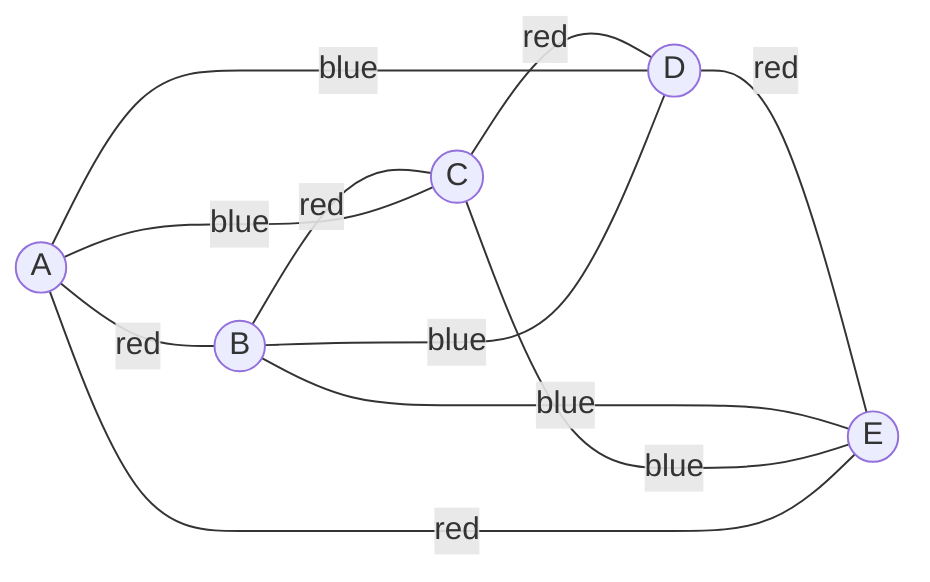

# Ramsey Theory Basics

Ramsey theory says that complete disorder is impossible in a sufficiently large structure. If every edge of a large complete graph is coloured red or blue, then some large one-colour pattern must appear. The simplest famous result is $R(3,3)=6$: every red-blue colouring of the edges of $K_6$ contains a monochromatic triangle.

Instead of asking how to avoid conflicts with few colours, Ramsey theory asks how large a graph must be before a specified one-colour configuration becomes unavoidable. It sits between graph colouring, extremal graph theory, and combinatorics.

## What a Ramsey number measures

For positive integers $s$ and $t$, the **Ramsey number** $R(s,t)$ is the smallest integer $n$ such that every red-blue colouring of the edges of $K_n$ contains either a red $K_s$ or a blue $K_t$. The diagonal number $R(k,k)$ asks for a monochromatic $K_k$.

A **monochromatic triangle** is a set of three vertices whose three connecting edges all have the same colour. More generally, multicolour Ramsey numbers and graph Ramsey numbers allow more than two colours or targets other than complete graphs, but the underlying question is unchanged: when does a monochromatic subgraph become unavoidable?

A two-colouring can also be represented by a single graph $G$. Take its edges to be red and the edges of its complement $\overline{G}$ to be blue. A red clique of order $s$ is a clique in $G$, while a blue clique of order $t$ is an independent set of order $t$ in $G$. Thus $n\ge R(s,t)$ exactly when every graph on $n$ vertices contains either a clique of order $s$ or an independent set of order $t$.

## Recursion from one chosen vertex

For $s,t\ge 2$,

$$
R(s,t)\le R(s-1,t)+R(s,t-1).
$$

Choose a vertex $v$ and partition the other vertices into its red-neighbours and blue-neighbours. If the red-neighbour set has size at least $R(s-1,t)$, it contains either a red $K_{s-1}$, which joins $v$ to form a red $K_s$, or a blue $K_t$. The blue-neighbour case is symmetric.

The recursion starts from

$$
R(1,t)=1,\qquad R(2,t)=t.
$$

A red $K_2$ is a single red edge, so avoiding one forces every edge to be blue. Repeated pigeonhole arguments prove that every $R(s,t)$ is finite, although the resulting upper bounds are usually far from exact.

## Pinning down $R(3,3)$

The classical calculation has two logically different halves: every colouring of $K_6$ must contain a monochromatic triangle, while one colouring of $K_5$ avoids them. The first is a universal upper-bound proof; the second is a constructive lower-bound certificate.


*Figure: A visual proof of the small Ramsey theorem. Image: [Wikimedia Commons](https://commons.wikimedia.org/wiki/File:Ramsey_theorem_visual_proof.svg), Cmglee, CC BY-SA 4.0.*

### The upper bound $R(3,3)\le 6$

Pick any vertex $v$ of a red-blue $K_6$. It is incident with five edges, so at least three have the same colour. Suppose $va$, $vb$, and $vc$ are red; the blue case is symmetric.

If any of $ab$, $bc$, or $ca$ is red, that edge and $v$ form a red triangle. If none is red, then all three are blue and $a,b,c$ form a blue triangle. Every two-colouring of $K_6$ therefore contains a monochromatic triangle.

Notice that the forced triangle need not contain the initially chosen vertex. When the three neighbours do not complete a red triangle with $v$, they form a blue triangle among themselves.

### The five-vertex colouring that meets the bound

Label five vertices cyclically. Colour the cycle edges

$$
12,\ 23,\ 34,\ 45,\ 51
$$

red, and colour the remaining edges

$$
13,\ 14,\ 24,\ 25,\ 35
$$

blue.



The red graph is a $5$-cycle and has no triangle. Its complement, the blue graph, is the other $5$-cycle,

$$
13,\ 35,\ 52,\ 24,\ 41,
$$

so it has no triangle either. Hence $R(3,3)\gt 5$. Together with the upper bound, this gives $R(3,3)=6$.

Some small values show how quickly the easy cases give way to difficult ones:

| Quantity | Value or bound | Meaning |
|---|---:|---|
| $R(2,t)$ | $t$ | force a red edge or a blue $K_t$ |
| $R(3,3)$ | $6$ | force a monochromatic triangle |
| $R(3,4)$ | $9$ | force a red triangle or a blue $K_4$ |
| $R(4,4)$ | $18$ | the first harder diagonal case |
| $R(s,t)$ | finite | Ramsey's theorem |

## Checking proposed colourings by search

For small lower-bound constructions, a direct program can check whether either colour contains a triangle.

```python
from itertools import combinations

def has_mono_triangle(vertices, colour):
    for a, b, c in combinations(vertices, 3):
        edges = [tuple(sorted(e)) for e in [(a, b), (a, c), (b, c)]]
        colours = {colour[e] for e in edges}
        if len(colours) == 1:
            return True, (a, b, c), colours.pop()
    return False, None, None

V = [1, 2, 3, 4, 5]
red = {(1, 2), (2, 3), (3, 4), (4, 5), (1, 5)}
colouring = {}
for e in combinations(V, 2):
    edge = tuple(sorted(e))
    colouring[edge] = "red" if edge in red else "blue"

print(has_mono_triangle(V, colouring))
```

This check certifies the displayed $K_5$ colouring, but it is not an upper-bound proof unless every colouring is examined. There are $2^{\binom n2}$ red-blue colourings of $K_n$, so exhaustive search becomes expensive even for modest $n$.

## Quantifiers and colour classes

Ramsey calculations are especially sensitive to quantifiers. To prove $R(s,t)\le n$, every colouring of $K_n$ must be covered. To prove $R(s,t)\gt n-1$, one counterexample on $K_{n-1}$ is enough. Verifying a single colouring cannot establish an upper bound, and an upper-bound argument alone cannot establish an exact value.

Both colour classes also need checking in a lower-bound construction. Looking only at the red graph can miss a forbidden clique in its blue complement. Switching freely between colouring language and graph-complement language often shortens the check: a blue clique is an independent set in the red graph.

The colours in $R(s,t)$ belong to edges, not vertices. Here “monochromatic” means that every edge of the target clique has the same colour. Swapping red with blue exchanges $R(s,t)$ with $R(t,s)$, and using that symmetry can remove duplicate cases from a proof.

The recursion supplies upper bounds, not usually exact values. Exact Ramsey numbers require matching lower constructions, and many small-looking cases remain open because the numbers grow rapidly and the two bounds are hard to close.

<div className="see-also">

See also: [Vertex and map colouring](/math/graph-theory/vertex-and-map-colouring) · [Edge colouring and chromatic polynomials](/math/graph-theory/edge-colouring-and-chromatic-polynomials) · [Random graphs basics](/math/graph-theory/random-graphs-basics) · [Definitions and examples](/math/graph-theory/definitions-and-examples)

</div>
