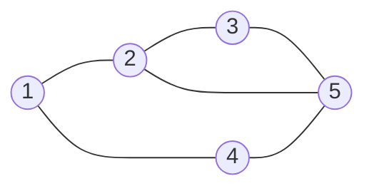

# Random Graphs Basics

Random graphs replace one fixed graph with a probability distribution over many graphs. The change of viewpoint supports existence proofs, threshold estimates, and models of large networks whose exact edge sets are unknown.

The basic Erdős–Rényi model is $G(n,p)$: start with $n$ labelled vertices and include each possible edge independently with probability $p$. As $p$ rises from $0$ to $1$, the sampled graph moves from isolated vertices to a dense graph. Triangles, a giant component, and connectivity appear at different scales.

## Sampling from $G(n,p)$

The random graph **$G(n,p)$** has vertex set $[n]=\{1,\dots,n\}$. Each of the $\binom n2$ possible edges is included independently with probability $p$. The related model **$G(n,m)$** instead chooses uniformly from all labelled graphs with exactly $m$ edges.



The diagram is one possible outcome of $G(5,p)$. The model is the distribution that could produce this graph, not the individual outcome.

A graph property is **monotone increasing** if adding edges cannot destroy it. Connectivity, containing a triangle, and having a perfect matching are all increasing properties. A function $p(n)$ is a **threshold** for a property $\mathcal{P}$ when the probability that $G(n,p)$ has $\mathcal{P}$ changes from near $0$ to near $1$ around that scale.

## Counting with indicator variables

If $X=\sum_i I_i$ is a sum of indicator variables, then

$$
\mathbb{E}[X]=\sum_i \mathbb{E}[I_i].
$$

Linearity of expectation does not require the indicators to be independent. This is useful for counts of overlapping subgraphs, whose occurrence events are usually dependent.

For $G(n,p)$,

$$
\mathbb{E}[|E|]=p\binom n2.
$$

Each possible edge contributes $1$ with probability $p$. For a fixed vertex $v$,

$$
\deg(v)\sim \operatorname{Bin}(n-1,p),
\qquad
\mathbb{E}[\deg(v)]=(n-1)p.
$$

There are $\binom n3$ vertex triples, and a fixed triple is a triangle when all three of its edges occur. Therefore

$$
\mathbb{E}[\text{number of triangles}]=\binom n3p^3.
$$

### Edge and triangle counts in $G(20,0.1)$

There are

$$
\binom{20}{2}=190
$$

possible edges, so

$$
\mathbb{E}[|E|]=190(0.1)=19.
$$

There are

$$
\binom{20}{3}=1140
$$

vertex triples. Each forms a triangle with probability $(0.1)^3=0.001$, giving

$$
\mathbb{E}[\text{number of triangles}]=1140(0.001)=1.14.
$$

An expectation of $1.14$ does not assert that a sample contains a triangle. It is the long-run average triangle count: some samples contain none, some one, and some several overlapping triangles.

## From sparse components to connectivity

Two changes occur at different values of $p$:

- Around $p=1/n$, a component containing a positive fraction of the vertices begins to emerge.
- Around $p=(\log n)/n$, isolated vertices disappear and the graph becomes connected with high probability.

| Scale of $p$ | Typical behavior in $G(n,p)$ |
|---|---|
| $p\ll 1/n$ | mostly small tree components |
| $p\approx 1/n$ | a giant component begins to appear |
| $p\approx (\log n)/n$ | isolated vertices disappear; connectivity emerges |
| constant $p$ | dense graph with many small subgraphs |
| $p=1$ | complete graph $K_n$ |

Thresholds are asymptotic, not exact finite-$n$ cutoffs. A property holds **asymptotically almost surely** when its probability tends to $1$ as $n\to\infty$; a finite sample can still behave differently.

### Isolation as the obstruction near connectivity

Vertex $1$ has $n-1$ possible incident edges. Their absence events are independent, so

$$
\Pr(\deg(1)=0)=(1-p)^{n-1}.
$$

For $n=50$ and $p=0.05$,

$$
\Pr(\deg(1)=0)=0.95^{49}\approx 0.081.
$$

Thus vertex $1$ has about an $8.1\%$ chance of being isolated. Its expected degree is $49(0.05)=2.45$, which is consistent with isolation being possible but not dominant.

## The first moment and existence proofs

If $X$ counts unwanted objects, Markov's inequality gives

$$
\Pr(X\ge 1)\le \mathbb{E}[X].
$$

Consequently, $\mathbb{E}[X]\to 0$ implies that no such object exists with probability tending to $1$. This **first moment method** often shows that a sparse random graph contains no copy of a fixed subgraph.

For a fixed graph $H$, the expected number of labelled copies in $G(n,p)$ is, up to a constant depending on automorphisms,

$$
n^{|V(H)|}p^{|E(H)|}.
$$

Setting this expression near $1$ gives the first-moment scale. For triangles it yields $p\approx 1/n$, which is the correct appearance threshold. For a general $H$, the densest subgraph of $H$ determines the threshold, so the expectation of the total number of copies is only a starting heuristic.

The **probabilistic method** uses the distribution without claiming that a random output is the final object. If a random graph has positive probability of satisfying a property, at least one deterministic graph with that property exists. Ramsey lower bounds and graphs with both high girth and high chromatic number can be obtained this way, even when the proof does not display an example.

## Simulating component sizes

The following sampler generates an adjacency map and then finds connected-component sizes by breadth-first search.

```python
import random
from collections import deque

def random_graph(n, p, seed=None):
    rng = random.Random(seed)
    adj = {i: set() for i in range(n)}
    for i in range(n):
        for j in range(i + 1, n):
            if rng.random() < p:
                adj[i].add(j)
                adj[j].add(i)
    return adj

def component_sizes(adj):
    unseen = set(adj)
    sizes = []
    while unseen:
        start = unseen.pop()
        q = deque([start])
        size = 1
        while q:
            u = q.popleft()
            for v in adj[u]:
                if v in unseen:
                    unseen.remove(v)
                    q.append(v)
                    size += 1
        sizes.append(size)
    return sorted(sizes, reverse=True)

G = random_graph(20, 0.1, seed=7)
print(sum(len(nbrs) for nbrs in G.values()) // 2)
print(component_sizes(G))
```

Changing the seed changes the sample but not the model. Repeated trials can estimate edge count, largest-component size, isolated-vertex count, or triangle count. For instance, the average edge count over many samples of $G(20,0.1)$ should be close to $19$. A substantial discrepancy often means that unordered pairs were tested twice or that the wrong inclusion probability was used.

## Reading probabilistic claims carefully

Expected value alone does not show that most samples lie near it. Concentration needs a separate argument, commonly through variance or a Chernoff bound. The number of edges is binomial with parameters $\binom n2$ and $p$, so it is sharply concentrated around $p\binom n2$ when that expectation is large; not every random variable has such behavior.

Calculations should identify the random variable before taking an expectation or probability. The expected number of triangles is a sum over vertex triples, whereas the probability of at least one triangle concerns a single event. Confusing the two leads to faulty threshold arguments.

Probability claims also need their strength stated. Positive probability proves existence. Probability tending to $1$ describes typical behavior as $n$ grows. An exact statement about a fixed finite graph is stronger than either simulation evidence or asymptotic intuition.

Finally, edge events are independent in $G(n,p)$, but graph properties built from them generally are not. Overlapping triangle events, connectivity events, and component sizes cannot be multiplied as though they were independent. The model $G(n,m)$ adds another distinction: it fixes the edge count exactly rather than including each edge independently.

<div className="see-also">

See also: [Definitions and examples](/math/graph-theory/definitions-and-examples) · [Walks paths and connectedness](/math/graph-theory/walks-paths-and-connectedness) · [Ramsey theory basics](/math/graph-theory/ramsey-theory-basics) · [Algebraic graph theory basics](/math/graph-theory/algebraic-graph-theory-basics)

</div>
