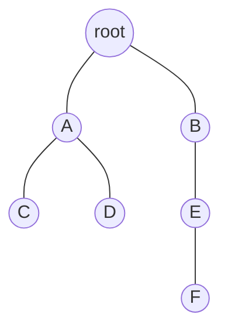

# Trees and Spanning Trees

Trees are connected graphs with no redundant route: any two vertices are joined by one path. They occur in search algorithms, hierarchical data, electrical networks, and phylogenies, and their leaf structure makes induction unusually effective.

A connected graph may have many cycles. Deleting one edge from each cycle, without losing connectedness, leaves a spanning tree: a minimal connected backbone containing every vertex.

## Six ways to recognize a tree

A **tree** is a connected graph with no cycles. A **forest** is acyclic but may be disconnected; each component of a forest is a tree. A **leaf** is a vertex of degree $1$.

For a finite graph $T$ with $n$ vertices, the following conditions are equivalent:

1. $T$ is a tree.
2. $T$ is connected and has $n-1$ edges.
3. $T$ is acyclic and has $n-1$ edges.
4. Every pair of vertices is joined by a unique path.
5. $T$ is minimally connected: deleting any edge disconnects it.
6. $T$ is maximally acyclic: adding any missing edge creates exactly one cycle.

One route through the equivalences starts with a connected graph and deletes an edge from each cycle. Every deletion preserves connectedness. Once no cycles remain, induction on $n$—removing one leaf at a time—shows that the resulting graph has $n-1$ edges.

### Checking a seven-vertex graph

Let $G$ have vertices $\{a,b,c,d,e,f,g\}$ and edges

$$
ab,\ ac,\ bd,\ be,\ cf,\ fg.
$$

Here $n=7$ and $m=6=n-1$. From $a$ one can reach $b$ and $c$, then $d,e$ through $b$, and $f,g$ through $c$. Thus $G$ is connected, so condition 2 proves that it is a tree.

The unique-path condition gives another check. For example, the path from $d$ to $g$ is

$$
d-b-a-c-f-g.
$$

An alternative route would create a cycle, but no listed edge joins the two branches.

## Leaves, roots, and induction

Every tree with at least two vertices has at least two leaves. Take a longest path: if either endpoint had another neighbour outside the path, the path could be extended; if it had another neighbour on the path, the tree would contain a cycle.

Removing a leaf $v$ and its incident edge leaves a tree on $n-1$ vertices. Many proofs proceed by applying an induction hypothesis to this smaller tree and then checking the effect of restoring $v$. Formulas involving $n-1$ arise naturally because each step removes one vertex and one edge.

A **rooted tree** has one distinguished vertex, the root. Every non-root vertex then has a parent, and vertices farther from the root may be described as children or descendants. A **branch**, or pendant subtree, is a connected piece attached to the rest of the tree through one vertex or edge.



Rooting adds orientation and vocabulary but does not alter the underlying edges. Parent–child relations therefore depend on the chosen root.

| View | Meaning | Typical use |
|---|---|---|
| Unrooted tree | only adjacency matters | chemical trees, spanning trees |
| Rooted tree | one vertex is distinguished | search, parsing, recursion |
| Ordered rooted tree | children have a left-to-right order | syntax trees, heaps |
| Spanning tree | includes all vertices of another graph | network backbone |

Repeatedly deleting all current leaves ends with either one vertex or two adjacent vertices. This is the **center** of the tree. A path with an odd number of vertices has one central vertex; a path with an even number has a central edge. Centers help describe tree symmetry and select balanced roots.

## Forests keep track of components

If a forest has $n$ vertices, $m$ edges, and $c$ connected components, then

$$
m=n-c,
$$

or equivalently $c=n-m$. If the components have orders $n_1,\dots,n_c$, their edge counts add to

$$
(n_1-1)+\cdots+(n_c-1)=n-c.
$$

The tree identity $m=n-1$ is the case $c=1$. An isolated vertex counts as a tree component and contributes one vertex but no edge.

## Deleting cycles to obtain a spanning tree

A **spanning tree** of a connected graph $G$ is a subgraph $T$ with $V(T)=V(G)$ such that $T$ is a tree. Every connected graph has one: while a cycle remains, delete an edge of that cycle. The graph stays connected, and the finite process ends with a connected acyclic subgraph on all the original vertices.

Consider the graph with vertices $\{1,2,3,4,5,6\}$ and edges

$$
12,\ 23,\ 31,\ 34,\ 45,\ 56,\ 64,\ 25.
$$

Delete $31$ from the cycle $1-2-3-1$, then delete $64$ from $4-5-6-4$. Six edges remain, including the cycle

$$
2-3-4-5-2.
$$

Deleting $25$ leaves

$$
\{12,23,34,45,56\},
$$

the path $1-2-3-4-5-6$. It contains all six vertices, is connected, and has five edges, so it is a spanning tree.

The choices are not unique. Deleting $12$ instead of $31$ in the first cycle could lead to a different spanning tree. Each valid cycle-edge deletion preserves reachability until the redundant routes are gone.

The required property determines which spanning tree is useful. A breadth-first tree preserves unweighted distances from its root, a depth-first tree records nesting and backtracking, and a minimum spanning tree minimizes total edge weight. These trees may select quite different edges from the same graph.

## Fundamental cycles and cuts

Fix a spanning tree $T$ of $G$. Adding an edge $e\in E(G)-E(T)$ creates one **fundamental cycle**: the new edge closes the unique path in $T$ between its endpoints.

Conversely, deleting a tree edge splits $T$ into two components. The edges of $G$ crossing between those vertex sets form the corresponding **fundamental cut**. Fundamental cycles and cuts connect spanning trees to network design, matroids, and graph duality.

Tree distances are similarly controlled by unique paths. In rooted trees, depths and lowest common ancestors can be used to calculate distances; the three pairwise paths among three vertices also meet in a unique median vertex. Algorithms often simplify on trees because no competing cycle route needs consideration.

## Building a DFS spanning tree

A depth-first search returns a spanning tree of the component containing its start vertex.

```python
def dfs_spanning_tree(adj, start):
    seen = {start}
    tree_edges = []
    stack = [start]
    while stack:
        u = stack.pop()
        for v in sorted(adj[u], reverse=True):
            if v not in seen:
                seen.add(v)
                tree_edges.append((u, v))
                stack.append(v)
    return seen, tree_edges

adj = {
    1: {2, 3},
    2: {1, 3, 5},
    3: {1, 2, 4},
    4: {3, 5, 6},
    5: {2, 4, 6},
    6: {4, 5},
}

seen, tree = dfs_spanning_tree(adj, 1)
print(seen)
print(tree)
print(len(tree) == len(adj) - 1)
```

The DFS tree depends on neighbour order. A different order may select different edges while still producing a spanning tree. Breadth-first search instead produces root-to-vertex paths that are shortest in the original unweighted graph; depth-first search offers no such guarantee.

## Conditions that should not be conflated

An acyclic graph need not be a tree: it may be a disconnected forest. Likewise, having $n-1$ edges alone is insufficient; connectedness or acyclicity must also be established. A spanning tree must include every original vertex, not merely a large connected subset.

The six characterizations are interchangeable once their hypotheses are met, but a proof is clearer when it states which one is being used. Root-dependent parent–child relations should also be kept separate from properties of the underlying unrooted tree.

<div className="see-also">

See also: [Walks, paths, and connectedness](/math/graph-theory/walks-paths-and-connectedness) · [Algorithms on weighted graphs](/math/graph-theory/algorithms-on-weighted-graphs) · [Counting trees and Pruefer sequences](/math/graph-theory/counting-trees-and-prufer-sequences) · [Matroids and graph duality](/math/graph-theory/matroids-and-graph-duality)

</div>
