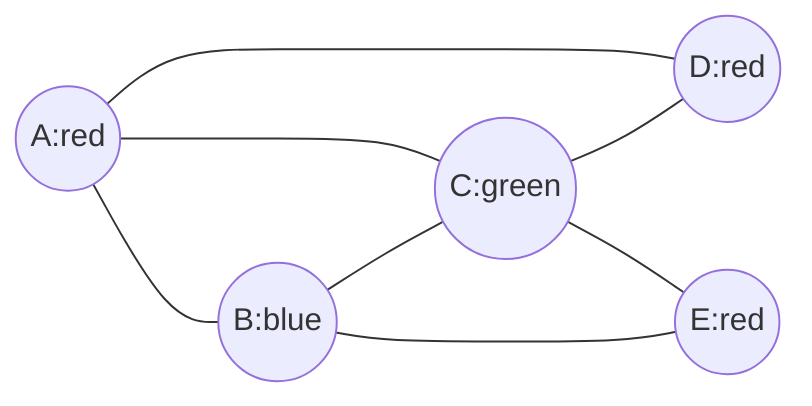

# Vertex and Map Colouring

Vertex colouring turns adjacency into a separation rule: conflicting exams need different time slots, adjacent regions need different colours, and incompatible tasks need different resources. The main question is how few colours can satisfy every constraint.

## Colour classes and the chromatic number

A **proper vertex colouring** of a graph $G$ is a function

$$
c:V(G)\to \{1,2,\dots,k\}
$$

such that $c(u)\ne c(v)$ whenever $uv\in E(G)$. If such a colouring exists, $G$ is **$k$-colourable**. The **chromatic number** $\chi(G)$ is the least possible $k$.

Each colour class is an independent set. Thus a proper $k$-colouring is equivalent to a partition of $V(G)$ into $k$ independent sets. This formulation separates two parts of most chromatic-number proofs:

- a lower bound showing that too few independent sets cannot cover the vertices;
- an upper bound given by an explicit colouring or a general theorem.

A **clique** is a set of pairwise adjacent vertices. All its vertices need distinct colours, so

$$
\omega(G)\le \chi(G).
$$

If $G$ has $n$ vertices and independence number $\alpha(G)$, each colour class contains at most $\alpha(G)$ vertices, which gives another lower bound:

$$
\chi(G)\ge \left\lceil\frac{n}{\alpha(G)}\right\rceil.
$$

The small families below are useful reference cases.

| Graph family | Chromatic number | Reason |
|---|---:|---|
| Null graph $N_n$ | $1$ | no adjacencies |
| Path $P_n$ with $n\ge 2$ | $2$ | bipartite and has an edge |
| Even cycle $C_{2r}$ | $2$ | bipartite |
| Odd cycle $C_{2r+1}$ | $3$ | not bipartite but 3-colourable |
| Complete graph $K_n$ | $n$ | all vertices pairwise adjacent |
| Wheel | $3$ or $4$ | depends on the parity of the rim cycle |

## Odd cycles are the obstruction to two colours

A graph is **bipartite** when its vertices split into two independent sets. Apart from an edgeless graph, this is equivalent to being $2$-colourable. A graph is bipartite if and only if it contains no odd cycle.

In a bipartite graph, every cycle alternates between the two parts and hence has even length. Conversely, in a connected graph with no odd cycle, choose a root and colour vertices by the parity of their distance from it. An edge joining equal parities would combine with shortest paths to the root to produce an odd cycle.

### Determining $\chi(C_5)$

Attempt to alternate two colours around $C_5$. Starting with $v_1$ red forces $v_2$ blue, $v_3$ red, $v_4$ blue, and $v_5$ red. The closing edge $v_5v_1$ then has equal colours at both ends. Hence $\chi(C_5)\ge 3$.

The assignment

$$
c(v_1)=1,\quad c(v_2)=2,\quad c(v_3)=1,\quad c(v_4)=2,\quad c(v_5)=3
$$

is proper, so $\chi(C_5)\le 3$. The bounds meet at

$$
\chi(C_5)=3.
$$

## Greedy colourings and their limits

Colouring vertices one at a time gives the universal bound

$$
\chi(G)\le \Delta(G)+1,
$$

because at most $\Delta(G)$ colours can be forbidden by already coloured neighbours. Brooks' theorem improves this for a connected graph that is neither complete nor an odd cycle:

$$
\chi(G)\le \Delta(G).
$$

The order matters. A poor ordering can make greedy colouring use many more colours than $\chi(G)$; even a bipartite graph can be forced to use arbitrarily many. Common heuristics place high-degree vertices first or choose a vertex with many already-coloured neighbours, but a heuristic colouring remains an upper bound rather than proof of optimality.

A graph is **$k$-critical** if $\chi(G)=k$ but deleting any vertex lowers the chromatic number. Odd cycles are $3$-critical, and $K_k$ is $k$-critical. Critical subgraphs often expose the minimum obstruction inside a failed colouring argument.

## Adding a universal hub to a cycle

Let $W_6$ consist of a $5$-cycle and a central hub adjacent to all five rim vertices. The rim needs three colours because it is $C_5$. Every proper $3$-colouring of the rim uses all three, so the hub needs a fourth colour. Conversely, colouring the rim $1,2,1,2,3$ and the hub $4$ is proper. Therefore

$$
\chi(W_6)=4.
$$

With an even rim, two alternating colours suffice on the cycle and a third colour handles the hub. Adding a universal vertex increases the chromatic number by one because it is adjacent to every existing colour class.

The following example shows an explicit colouring rather than merely a chromatic-number count.



## From maps to planar duals

A plane map becomes a graph by assigning one vertex to each region and joining two vertices when their regions share a boundary segment. Regions that meet only at a point are not adjacent. Colouring the map is equivalent to properly colouring this region-adjacency graph.


*Figure: A four-colour map. Image: [Wikimedia Commons](https://commons.wikimedia.org/wiki/File:Fourcolorsmap.svg), Germo, public domain.*

The **four-colour theorem** states that every planar graph is $4$-colourable, or equivalently that every plane map needs at most four colours. It is a deep theorem and is usually taken as a landmark result in an introductory treatment.

Many planar classes need fewer colours. Every outerplanar graph is $3$-colourable, every bipartite planar graph is $2$-colourable, and every planar graph is $5$-colourable by a shorter classical argument using Euler's formula and induction. Four colours are sufficient in general, not necessary for every planar graph.

Care is needed when forming a dual from a map. Bridges, dangling boundary features, or poorly behaved regions can produce loops or repeated adjacencies. Standard map-colouring problems assume well-behaved regions and count adjacency only along a nontrivial boundary arc.

## Exact search on small graphs

This backtracking routine tests $k$-colourability and then finds the least working $k$.

```python
def can_colour(adj, k):
    vertices = sorted(adj, key=lambda v: -len(adj[v]))
    colour = {}

    def search(i):
        if i == len(vertices):
            return True
        v = vertices[i]
        forbidden = {colour[u] for u in adj[v] if u in colour}
        for c in range(k):
            if c not in forbidden:
                colour[v] = c
                if search(i + 1):
                    return True
                del colour[v]
        return False

    return search(0)

def chromatic_number(adj):
    for k in range(1, len(adj) + 1):
        if can_colour(adj, k):
            return k

C5 = {i: {((i - 2) % 5) + 1, (i % 5) + 1} for i in range(1, 6)}
print(chromatic_number(C5))
```

Exact backtracking is exponential, so it is suitable for small examples rather than large general instances. Larger solvers combine branching, propagation, lower bounds, greedy upper bounds, and structure specific to the input.

## Details that change the answer

Colour names are interchangeable; their numerical labels have no order or magnitude. What matters is equality at adjacent vertices. A loop therefore makes a proper vertex colouring impossible, since its endpoint would have to differ from itself.

An explicit colouring proves only an upper bound unless it is matched by a clique, odd cycle, independence-number argument, or another lower bound. A graph with one edge already needs two colours, while a planar graph may need anywhere from one to four. Drawings and greedy outputs can suggest a value, but matching bounds establish it.

<div className="see-also">

See also: [Planarity and Euler formula](/math/graph-theory/planarity-and-euler-formula) · [Edge colouring and chromatic polynomials](/math/graph-theory/edge-colouring-and-chromatic-polynomials) · [Ramsey theory basics](/math/graph-theory/ramsey-theory-basics) · [Random graphs basics](/math/graph-theory/random-graphs-basics)

</div>
