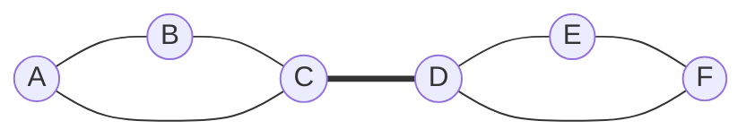

# Walks Paths and Connectedness

Walks and paths turn a static graph into a navigable object. They describe whether one vertex can be reached from another, how many edges a shortest route uses, and what fails when an edge or vertex is removed. Degree counts alone cannot answer these questions: two disjoint cycles have no low-degree vertices but are still disconnected.


*Figure: The bridges of Königsberg as a graph-traversal problem. Image: [Wikimedia Commons](https://commons.wikimedia.org/wiki/File:Konigsberg_Bridge.png), Merian-Erben, public domain.*

## Walk, trail, path, or cycle?

A **walk** from $v_0$ to $v_k$ is an alternating sequence

$$
v_0,e_1,v_1,e_2,\dots,e_k,v_k
$$

in which $e_i$ joins $v_{i-1}$ to $v_i$. In a simple graph it is often abbreviated $v_0v_1\dots v_k$. Its **length** is $k$, the number of edges traversed, including repetitions.

The restrictions become progressively stronger:

- A **trail** is a walk with no repeated edge.
- A **path** is a walk with no repeated vertex.
- A **closed walk** begins and ends at the same vertex.
- A **cycle** is a positive-length closed walk with no repeated vertex except the first and last. In a simple graph, a cycle has length at least $3$.

If any walk joins $u$ to $v$, then some path joins them. Whenever a walk repeats a vertex, delete the closed portion between two occurrences. Repeating this shortening step removes all repeated vertices. In particular, a shortest walk never repeats a vertex.

## Reachability partitions the vertices

Vertices $u$ and $v$ are **connected** when a path joins them. A graph is **connected** when every pair of vertices is connected, and a **component** is a maximal connected subgraph.

The relation “is connected to” is reflexive, symmetric, and transitive, so it is an equivalence relation on the vertex set. Its equivalence classes are exactly the components. This gives a precise version of the informal instruction to group vertices by mutual reachability.

A connected graph on $n$ vertices has at least $n-1$ edges, with equality exactly for trees. Extra edges create alternative routes and hence cycles; paths and trees attain the minimum connected edge count.

## Distances from breadth-first layers

For connected vertices $u$ and $v$, the **distance** $d(u,v)$ is the length of a shortest $u$–$v$ path. The **diameter** of a connected graph is the largest distance between any pair of vertices.

Consider the graph with edges

$$
AB,\ AC,\ BC,\ CD,\ DE,\ DF,\ EF.
$$

Starting from $A$, breadth-first layers are

| Layer | Vertices first reached |
|---:|---|
| $0$ | $A$ |
| $1$ | $B,C$ |
| $2$ | $D$ |
| $3$ | $E,F$ |

The first appearance of $F$ is at layer $3$, so

$$
d(A,F)=3,
$$

with $A-C-D-F$ as one shortest path. The largest distances cross from the left triangle to the right triangle, for example $d(A,E)=d(B,F)=3$. No pair is farther apart because each left vertex reaches $C$ in at most one step, crosses $CD$, and reaches a right vertex in at most one more step. The diameter is therefore $3$.

Distances between different components are commonly left undefined or assigned $\infty$; the convention should be stated when disconnected graphs are allowed.

## Bridges, cut vertices, and blocks

A **bridge** is an edge whose deletion increases the number of components. An edge is a bridge exactly when it lies on no cycle. If $e=uv$ lies on a cycle, the rest of that cycle still connects $u$ to $v$ after $e$ is deleted. Conversely, if a $u$–$v$ path remains after deleting $e$, that path together with $e$ forms a cycle.

A **cut vertex** is a vertex whose deletion, together with all incident edges, increases the number of components. Edge deletion can increase the component count by at most one; vertex deletion may increase it by more than one because several incident routes disappear together.

In the graph below, $CD$ is the only route between two cyclic regions.



| Object | Example in diagram | Effect of deletion |
|---|---|---|
| Bridge | $CD$ | graph splits into two components |
| Non-bridge edge | $AB$ | $A-C-B$ keeps the left side connected |
| Cut vertex | $C$ or $D$ | the connection between the two sides disappears |
| Non-cut vertex | $A,B,E,F$ | graph remains connected |

A graph may have no bridges yet still have a cut vertex: two cycles sharing one vertex are a standard example. An endpoint of a bridge need not be a cut vertex; deleting the leaf endpoint of a pendant edge does not increase the component count.

A **block** is a maximal connected subgraph with no cut vertex. Cycles provide local redundancy, while bridges join blocks in a fragile way. Identifying the cyclic pieces first often reveals what will happen after a deletion.

### Tracking components after deleting a vertex

Let $G$ have vertices $\{1,2,3,4,5,6,7\}$ and edges

$$
12,\ 23,\ 31,\ 34,\ 45,\ 56,\ 64,\ 67.
$$

The edges $12,23,31$ form one triangle and $45,56,64$ another, so none of those six edges is a bridge. Edge $34$ joins the two cyclic blocks and lies on no cycle. Edge $67$ is the sole connection to vertex $7$. Hence the bridges are

$$
34,\qquad 67.
$$

Deleting vertex $4$ also deletes $34$, $45$, and $64$. The remaining edges are

$$
12,\ 23,\ 31,\ 56,\ 67,
$$

and the two components have vertex sets $\{1,2,3\}$ and $\{5,6,7\}$. By comparison, deleting $34$ alone separates the left triangle from the rest, while deleting $67$ alone isolates vertex $7$.

## Computing components and unweighted distances

Breadth-first search records shortest distances from a start vertex. Repeating it from an unseen vertex enumerates all components.

```python
from collections import deque

def bfs_distances(adj, start):
    dist = {start: 0}
    q = deque([start])
    while q:
        u = q.popleft()
        for v in adj[u]:
            if v not in dist:
                dist[v] = dist[u] + 1
                q.append(v)
    return dist

def components(adj):
    unseen = set(adj)
    parts = []
    while unseen:
        start = next(iter(unseen))
        reached = set(bfs_distances(adj, start))
        parts.append(reached)
        unseen -= reached
    return parts

adj = {
    "A": {"B", "C"},
    "B": {"A", "C"},
    "C": {"A", "B", "D"},
    "D": {"C", "E", "F"},
    "E": {"D", "F"},
    "F": {"D", "E"},
}

print(bfs_distances(adj, "A")["F"])
print(components(adj))
```

On a drawing, breadth-first layers justify distance claims, while component markings show which vertices remain mutually reachable after a deletion. These are separate checks: a vertex can remain reachable while its distance increases.

## Keeping the terminology straight

A route with a repeated vertex is not a path, even if no edge repeats. Bridges are edges and cut vertices are vertices; removing a vertex always removes every incident edge. High minimum degree does not guarantee connectedness, and a shortest route needs no repetitions because any closed detour can be deleted.

For vulnerability questions, the decisive issue is the existence of an alternative path. An edge on a cycle has one; a bridge does not.

<div className="see-also">

See also: [Definitions and examples](/math/graph-theory/definitions-and-examples) · [Trees and spanning trees](/math/graph-theory/trees-and-spanning-trees) · [Eulerian and Hamiltonian graphs](/math/graph-theory/eulerian-and-hamiltonian-graphs) · [Menger theorem and network flows](/math/graph-theory/menger-theorem-and-network-flows)

</div>
