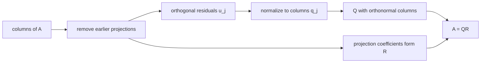

# Orthogonality, Gram-Schmidt, and QR

An orthonormal basis turns coordinate extraction into dot products and makes squared lengths add without cross terms. Gram–Schmidt constructs such a basis while preserving the span of the original vectors. Applied to matrix columns, the same calculation produces $A=QR$, a factorization used for least squares, eigenvalue algorithms, and numerically stable changes of coordinates.

## Removing directions already represented

Suppose $\mathbf v_1,\ldots,\mathbf v_k$ are linearly independent. Start with

$$
\mathbf u_1=\mathbf v_1.
$$

For each later vector, remove its components along all earlier orthogonal directions:

$$
\mathbf u_j
=\mathbf v_j-
\sum_{i=1}^{j-1}
\operatorname{proj}_{\mathbf u_i}\mathbf v_j,
$$

where

$$
\operatorname{proj}_{\mathbf u_i}\mathbf v_j
=\frac{\mathbf v_j\cdot\mathbf u_i}
{\mathbf u_i\cdot\mathbf u_i}\mathbf u_i.
$$

Normalize at the end of each step:

$$
\mathbf q_j=\frac{\mathbf u_j}{\lVert\mathbf u_j\rVert}.
$$

If earlier vectors have already been normalized, the update is shorter:

$$
\mathbf u_j
=\mathbf v_j-
\sum_{i=1}^{j-1}
(\mathbf q_i^T\mathbf v_j)\mathbf q_i.
$$

To check orthogonality, dot this expression with an earlier $\mathbf q_\ell$. Every term disappears except the original component and the matching subtraction:

$$
\mathbf q_\ell^T\mathbf u_j
=\mathbf q_\ell^T\mathbf v_j
-(\mathbf q_\ell^T\mathbf v_j)=0.
$$

The span is preserved at every stage:

$$
\operatorname{span}\{\mathbf v_1,\ldots,\mathbf v_j\}
=\operatorname{span}\{\mathbf u_1,\ldots,\mathbf u_j\}.
$$

One inclusion follows because $\mathbf u_j$ is $\mathbf v_j$ minus a combination of earlier vectors. Rearranging that equation expresses $\mathbf v_j$ using $\mathbf u_j$ and earlier directions, giving the reverse inclusion. If some $\mathbf u_j$ is exactly zero, then $\mathbf v_j$ contributed no new direction and the original list was dependent.

Column order affects the intermediate vectors and the resulting basis. Different orders can produce different orthonormal bases for the same final subspace. That is expected; the subspace has many orthonormal bases.

## Worked example: orthonormalizing three vectors

Take

$$
\mathbf v_1=
\begin{bmatrix}1\\1\\0\end{bmatrix},
\qquad
\mathbf v_2=
\begin{bmatrix}1\\0\\1\end{bmatrix},
\qquad
\mathbf v_3=
\begin{bmatrix}0\\1\\1\end{bmatrix}.
$$

The first orthogonal vector is $\mathbf u_1=\mathbf v_1$, with norm $\sqrt2$, so

$$
\mathbf q_1=\frac1{\sqrt2}
\begin{bmatrix}1\\1\\0\end{bmatrix}.
$$

For the second vector,

$$
\mathbf q_1^T\mathbf v_2=\frac1{\sqrt2}.
$$

Subtract that component:

$$
\begin{aligned}
\mathbf u_2
&=\mathbf v_2-(\mathbf q_1^T\mathbf v_2)\mathbf q_1\\
&=\begin{bmatrix}1\\0\\1\end{bmatrix}
-\frac12\begin{bmatrix}1\\1\\0\end{bmatrix}\\
&=\begin{bmatrix}1/2\\-1/2\\1\end{bmatrix}.
\end{aligned}
$$

Its norm is

$$
\lVert\mathbf u_2\rVert
=\sqrt{\frac14+\frac14+1}
=\sqrt{\frac32},
$$

so a convenient normalized form is

$$
\mathbf q_2=\frac1{\sqrt6}
\begin{bmatrix}1\\-1\\2\end{bmatrix}.
$$

Now compute the two components of $\mathbf v_3$:

$$
\mathbf q_1^T\mathbf v_3=\frac1{\sqrt2},
$$

$$
\mathbf q_2^T\mathbf v_3
=\frac{-1+2}{\sqrt6}
=\frac1{\sqrt6}.
$$

Therefore

$$
\begin{aligned}
\mathbf u_3
&=\begin{bmatrix}0\\1\\1\end{bmatrix}
-\frac12\begin{bmatrix}1\\1\\0\end{bmatrix}
-\frac16\begin{bmatrix}1\\-1\\2\end{bmatrix}\\
&=\begin{bmatrix}-2/3\\2/3\\2/3\end{bmatrix}.
\end{aligned}
$$

Its norm is $2/\sqrt3$, giving

$$
\mathbf q_3=\frac1{\sqrt3}
\begin{bmatrix}-1\\1\\1\end{bmatrix}.
$$

The checks are direct: each $\mathbf q_j$ has norm $1$, and all three pairwise dot products vanish. Since three independent vectors have been produced in $\mathbb R^3$, they form an orthonormal basis of the whole space.

## How Gram–Schmidt becomes $A=QR$

Let $A$ be an $m\times n$ matrix with independent columns $\mathbf a_1,\ldots,\mathbf a_n$, where $m\ge n$. Apply Gram–Schmidt to those columns and assemble the normalized results:

$$
Q=\begin{bmatrix}\mathbf q_1&\cdots&\mathbf q_n\end{bmatrix},
\qquad Q^TQ=I_n.
$$

Each original column has an expansion using only the orthonormal directions available by that stage:

$$
\mathbf a_j
=r_{1j}\mathbf q_1+\cdots+r_{jj}\mathbf q_j,
$$

where

$$
r_{ij}=\mathbf q_i^T\mathbf a_j
\quad(i<j),
\qquad
r_{jj}=\lVert\mathbf u_j\rVert.
$$

Place these coefficients in an upper-triangular matrix $R$. The column expansions combine into

$$
A=QR.
$$

The zeros below the diagonal record the fact that $\mathbf a_j$ lies in the span of only the first $j$ constructed directions. With the convention $r_{jj}\gt 0$, reduced QR is unique for a full-column-rank matrix.

For the three vectors in the worked example, take $A=[\mathbf v_1\ \mathbf v_2\ \mathbf v_3]$. The coefficients already calculated give

$$
R=
\begin{bmatrix}
\sqrt2&1/\sqrt2&1/\sqrt2\\
0&\sqrt{3/2}&1/\sqrt6\\
0&0&2/\sqrt3
\end{bmatrix}.
$$

Multiplying $QR$ reconstructs the original columns. The product of the positive diagonal entries also gives $\vert \det A\vert $ because the square $Q$ in this example has determinant $\pm1$.



## Reduced and full QR

When $m\ge n$ and $A$ has independent columns, reduced QR uses

$$
Q\in\mathbb R^{m\times n},
\qquad
R\in\mathbb R^{n\times n}.
$$

The columns of $Q$ form an orthonormal basis for $\operatorname{Col}(A)$. Full QR extends them to an orthonormal basis of $\mathbb R^m$:

$$
Q_{\mathrm{full}}\in\mathbb R^{m\times m},
$$

while $R_{\mathrm{full}}$ is $m\times n$ with zero rows below its triangular part. Least-squares work usually needs only the reduced form.

If $A$ is square and nonsingular,

$$
|\det A|=|\det Q|\,|\det R|
=\prod_{j=1}^n|r_{jj}|,
$$

because $\vert \det Q\vert =1$. With the positive-diagonal convention, the product of the diagonal entries of $R$ is the absolute determinant.

A very small $r_{jj}$ says that column $j$ adds little direction beyond the earlier columns. An exact zero signals dependence in exact arithmetic. In floating-point arithmetic, “small” must be interpreted relative to the scale of the matrix.

## Least squares without the normal equations

For an inconsistent system $A\mathbf x\approx\mathbf b$ with independent columns, the least-squares solution minimizes

$$
\lVert\mathbf b-A\mathbf x\rVert.
$$

Using reduced QR,

$$
A\mathbf x=QR\mathbf x.
$$

Decompose $\mathbf b$ into its projection $QQ^T\mathbf b$ and perpendicular residual $(I-QQ^T)\mathbf b$. Then

$$
\begin{aligned}
\lVert\mathbf b-QR\mathbf x\rVert^2
&=\lVert QQ^T\mathbf b-QR\mathbf x\rVert^2
+\lVert(I-QQ^T)\mathbf b\rVert^2\\
&=\lVert Q^T\mathbf b-R\mathbf x\rVert^2
+\lVert(I-QQ^T)\mathbf b\rVert^2.
\end{aligned}
$$

The second term does not depend on $\mathbf x$. The first is minimized to zero by solving the triangular system

$$
R\widehat{\mathbf x}=Q^T\mathbf b.
$$

This route avoids forming $A^TA$, which squares the 2-norm condition number and can lose significant accuracy.

### Worked example: fitting a line to three points

Fit $y=\beta_0+\beta_1x$ in least squares to

$$
(0,1),\qquad(1,2),\qquad(2,2).
$$

The design matrix and data vector are

$$
A=
\begin{bmatrix}
1&0\\
1&1\\
1&2
\end{bmatrix},
\qquad
\mathbf b=
\begin{bmatrix}1\\2\\2\end{bmatrix}.
$$

Normalize the first column:

$$
\mathbf q_1=\frac1{\sqrt3}
\begin{bmatrix}1\\1\\1\end{bmatrix},
\qquad r_{11}=\sqrt3.
$$

The next coefficient is

$$
r_{12}=\mathbf q_1^T
\begin{bmatrix}0\\1\\2\end{bmatrix}
=\sqrt3.
$$

Subtract the projection:

$$
\mathbf u_2=
\begin{bmatrix}0\\1\\2\end{bmatrix}
-\begin{bmatrix}1\\1\\1\end{bmatrix}
=\begin{bmatrix}-1\\0\\1\end{bmatrix}.
$$

Thus

$$
\mathbf q_2=\frac1{\sqrt2}
\begin{bmatrix}-1\\0\\1\end{bmatrix},
\qquad r_{22}=\sqrt2,
$$

and

$$
R=
\begin{bmatrix}
\sqrt3&\sqrt3\\
0&\sqrt2
\end{bmatrix}.
$$

Compute the transformed right side:

$$
Q^T\mathbf b
=\begin{bmatrix}
5/\sqrt3\\
1/\sqrt2
\end{bmatrix}.
$$

Back-substitution starts with

$$
\sqrt2\,\beta_1=\frac1{\sqrt2}
\quad\Longrightarrow\quad
\beta_1=\frac12.
$$

Then

$$
\sqrt3\,\beta_0+\sqrt3\left(\frac12\right)
=\frac5{\sqrt3}.
$$

Dividing by $\sqrt3$ gives

$$
\beta_0+\frac12=\frac53,
\qquad
\beta_0=\frac76.
$$

The fitted line is

$$
y=\frac76+\frac12x.
$$

Its predicted values are $7/6$, $5/3$, and $13/6$, so the residual is

$$
\mathbf r=
\begin{bmatrix}-1/6\\1/3\\-1/6\end{bmatrix}.
$$

Both $\sum r_i=0$ and $\sum x_ir_i=0$, confirming $A^T\mathbf r=0$.

## Classical, modified, and Householder QR

The formulas above describe classical Gram–Schmidt. In exact arithmetic they are correct. With nearly dependent columns, computed projection errors can leave the resulting vectors noticeably nonorthogonal.

Modified Gram–Schmidt performs the same mathematical subtractions but updates the working column after each projection. It generally retains orthogonality better and is easy to adapt for incremental work. Reorthogonalization can repeat the projection pass when higher accuracy is needed.

Householder QR uses reflections. Given a column segment $\mathbf x$, choose a reflector

$$
H=I-2\frac{\mathbf v\mathbf v^T}{\mathbf v^T\mathbf v}
$$

that maps $\mathbf x$ to a multiple of the first coordinate vector. Applying successive reflectors zeros entire subcolumns. Each $H$ is orthogonal and symmetric, so products of them preserve norms well. Householder QR is the standard dense-matrix choice when the explicit incremental basis construction of Gram–Schmidt is not required.

Givens rotations zero one entry at a time. They are useful for sparse matrices and for updating a factorization after localized changes. The algorithms produce equivalent factorization goals but have different data movement, sparsity, and stability properties.

| Method | Main operation | Typical use |
|---|---|---|
| classical Gram–Schmidt | projections against a fixed original column | teaching and well-conditioned hand work |
| modified Gram–Schmidt | sequential residual updates | incremental orthogonalization |
| Householder reflections | zero a column tail at once | stable dense QR |
| Givens rotations | zero selected entries | sparse or updated problems |

## Rank deficiency and column pivoting

If columns are dependent, a thin QR with nonsingular square $R$ does not exist. QR with column pivoting factors

$$
A\Pi=QR,
$$

where the permutation matrix $\Pi$ reorders columns so that new directions are chosen more effectively. The decreasing scale of diagonal entries in $R$ helps estimate numerical rank.

Rank decisions require a tolerance. A column may be independent in exact arithmetic yet indistinguishable from earlier columns at the precision and noise level of the application. Pivoted QR is useful for rank-revealing work, though the singular value decomposition gives the clearest spectral measure of near rank deficiency.

For rank-deficient least squares, multiple coefficient vectors may produce the same closest fitted vector. A basic pivoted QR can identify a solution after choosing free variables; an SVD is often preferred when the minimum-norm solution is required.

## Computing and checking a factorization

```python
import numpy as np

A = np.array([[1.0, 0.0],
              [1.0, 1.0],
              [1.0, 2.0]])
b = np.array([1.0, 2.0, 2.0])

Q, R = np.linalg.qr(A, mode="reduced")
x = np.linalg.solve(R, Q.T @ b)
residual = b - A @ x

print("reconstruction error:", np.linalg.norm(A - Q @ R))
print("orthogonality error:", np.linalg.norm(Q.T @ Q - np.eye(2)))
print("coefficients:", x)
print("normal residual:", A.T @ residual)
```

The two factorization checks test different properties: $A\approx QR$ checks reconstruction, while $Q^TQ\approx I$ checks orthogonality. A small least-squares normal residual confirms that the remaining error is perpendicular to the column space. These are backward checks; for ill-conditioned problems, coefficient sensitivity still deserves separate attention.

Sign differences between software output and a hand calculation are harmless. Multiplying one column of $Q$ and the matching row of $R$ by $-1$ leaves $QR$ unchanged. Enforcing positive diagonal entries in $R$ removes that ambiguity for a full-rank factorization.

## Reading the entries of the factors

The columns of $Q$ describe directions, while the entries of $R$ describe how the original columns use those directions. An off-diagonal entry measures the component of a later original column along an earlier constructed direction. A diagonal entry measures the norm of the genuinely new component introduced at that stage.

Large off-diagonal entries are not errors; they say that columns share direction. A small diagonal entry is more revealing because it signals near dependence after earlier components have been removed. Its meaning depends on column order, which motivates pivoting when rank discovery matters.

The condition of the triangular factor reflects the condition of a full-column-rank matrix in the Euclidean norm because multiplication by an orthonormal-column matrix preserves vector lengths. Solving with the original matrix or with the triangular factor therefore has the same intrinsic sensitivity, while the triangular form makes the solve cheaper and avoids the extra damage caused by normal equations.

The factorization also exposes column-space coordinates. The vector formed by applying the transpose of $Q$ contains coefficients along the orthonormal basis. Components in the remaining orthogonal directions, present in a full factorization, measure what lies outside the column space. This is the geometric split used in least squares.

## Why classical Gram–Schmidt can lose orthogonality

In exact arithmetic, subtracting all earlier projections removes them exactly. In floating-point arithmetic, a vector nearly contained in the earlier span is obtained as the small difference of larger vectors. Relative error in that residual can be large. Later dot products then see leftover components that should have vanished.

Classical Gram–Schmidt computes projection coefficients against the original column and combines their subtraction. Modified Gram–Schmidt updates the residual after each removal, so later coefficients are measured against what remains. Both perform similar arithmetic counts, but the second arrangement limits some error propagation.

Reorthogonalization runs another pass against the existing basis. If the first pass leaves small unwanted components, the second often removes them to working precision. The extra cost can be worthwhile when an explicit basis is required and columns are difficult but not numerically rank deficient.

Householder reflections avoid building each new direction by a chain of nearly cancelling projection subtractions. They transform whole column tails using norm-preserving operations. A robust implementation also chooses the reflector sign to avoid cancellation when forming its defining vector. Such details explain why a short literal translation of a textbook formula may be less reliable than a library routine.

## QR in linear solves and eigenvalue algorithms

For a square nonsingular system, factoring the matrix once permits a solve in two stages. First apply the transpose of the orthogonal factor to the right-hand side; then solve the upper-triangular system by back-substitution. Multiple right-hand sides can reuse the factors.

For eigenvalues, the QR iteration repeatedly factors a shifted matrix and reverses the factors. The reversed product is similar to the original matrix, so eigenvalues are preserved while the matrix tends toward triangular form under suitable conditions. Shifts accelerate convergence, and structured variants avoid forming dense factors unnecessarily.

This algorithmic role differs from using QR to solve least squares, yet both rely on the same strength: orthogonal transformations preserve the Euclidean norm and do not amplify errors merely through a coordinate change. The triangular result concentrates the remaining algebra into a simpler form.

Updating problems can also exploit QR. Adding a row, removing an observation, or changing a few entries need not always trigger a factorization from scratch. Givens rotations are well suited to restoring triangular form after localized changes. The choice depends on matrix size, sparsity, and how many updates are expected.

## Rank and model interpretation

Exact dependence means one column adds no direction. In a regression model, that can arise from redundant predictors or from including every category indicator together with an intercept. Coefficients are then not uniquely determined even though fitted values may be.

Near dependence produces unstable coefficients: small changes in data can cause large changes in individual parameter estimates. A fit may still predict well inside the observed range because compensating coefficient changes leave the combined column-space vector nearly fixed. Reporting only a small residual can conceal that instability.

Pivoted QR helps identify a subset of informative columns, but the numerical rank threshold is a modeling decision as well as a floating-point one. Measurement noise may make distinctions below a certain scale meaningless even when arithmetic could resolve them. Rescaling columns can also change pivot order, so units and normalization should be chosen deliberately.

The singular value decomposition gives a basis-independent account of near rank deficiency and directly supplies minimum-norm solutions. QR remains faster and sufficient for many full-rank least-squares problems. Choosing between them depends on whether the main task is a stable solve, rank diagnosis, or detailed sensitivity analysis.

## Verification beyond one identity

A valid-looking product can hide a poor orthogonal factor. Check reconstruction and orthogonality separately, using norms scaled to the input size. For least squares, also check that the residual is perpendicular to the column space. Each test targets a different promise.

Diagonal signs and column conventions should not be used as numerical correctness tests unless the convention was explicitly enforced. Two packages can return different but equally valid factors. Rank-deficient factorizations may differ more substantially because bases for the same subspace are nonunique.

When the matrix is badly scaled, relative residuals are more meaningful than raw norms. A reconstruction error should be compared with the matrix norm, and an orthogonality error with the dimension and machine precision. Passing these backward checks says the factors accurately represent a nearby matrix; it does not remove inherent sensitivity in the original problem.

<div className="see-also">

See also: [Orthogonality in Rn](/math/linear-algebra/orthogonality-in-rn) · [Inner product spaces](/math/linear-algebra/inner-product-spaces) · [Least squares](/math/linear-algebra/least-squares) · [Numerical linear algebra](/math/linear-algebra/numerical-linear-algebra) · [Singular value decomposition](/math/linear-algebra/singular-value-decomposition)

</div>
