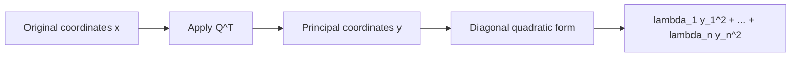

# Quadratic Forms and Spectral Theorems

A quadratic form turns a symmetric matrix into scalar-valued geometry. Quadratic forms describe conics, surfaces, energy functions, constrained extrema, and second-order behavior in optimization. The spectral theorem supplies the simplifying coordinates: an orthogonal change of basis removes all cross terms.

## Encoding cross terms in a symmetric matrix

A quadratic form on $\mathbb{R}^n$ is

$$
Q(\mathbf{x})=\mathbf{x}^TA\mathbf{x},
$$

where $A$ may be taken symmetric. In two variables,

$$
Q(x,y)=ax^2+2bxy+cy^2
$$

corresponds to

$$
A=
\begin{bmatrix}
a&b\\
b&c
\end{bmatrix}.
$$

The factor $2$ in the mixed term comes from the two off-diagonal products. If a nonsymmetric matrix appears, only its symmetric part contributes:

$$
\mathbf{x}^TA\mathbf{x}
=
\mathbf{x}^T\left(\frac{A+A^T}{2}\right)\mathbf{x}.
$$

The skew-symmetric part contributes zero.

There is a useful reverse operation. A symmetric bilinear form

$$
B(\mathbf{x},\mathbf{y})=\mathbf{x}^TA\mathbf{y}
$$

determines the quadratic form by $Q(\mathbf{x})=B(\mathbf{x},\mathbf{x})$, and the quadratic form recovers the bilinear form through the polarization identity

$$
B(\mathbf{x},\mathbf{y})
=\frac14\left(Q(\mathbf{x}+\mathbf{y})-Q(\mathbf{x}-\mathbf{y})\right).
$$

Expanding the two terms proves the identity: the pure $Q(\mathbf{x})$ and $Q(\mathbf{y})$ terms cancel, while the mixed terms add to $4\mathbf{x}^TA\mathbf{y}$. Thus the cross terms record how pairs of directions interact under the associated bilinear form.

For a polynomial written with an $xy$ coefficient rather than a $2xy$ coefficient, the bookkeeping changes accordingly. For example,

$$
3x^2-8xy+5y^2
$$

is represented by

$$
\begin{bmatrix}3&-4\\-4&5\end{bmatrix},
$$

because the two off-diagonal products together contribute $-8xy$.

## Rotating to principal axes

The real spectral theorem states that a real symmetric matrix has an orthonormal eigenbasis. Equivalently, there is an orthogonal $Q$ and a real diagonal $D$ such that

$$
A=QDQ^T,
\qquad
Q^TQ=I.
$$

The columns of $Q$ are orthonormal eigenvectors, and the diagonal entries of $D$ are their eigenvalues.



With $\mathbf{x}=Q\mathbf{y}$,

$$
\mathbf{x}^TA\mathbf{x}
=\mathbf{y}^TQ^TAQ\mathbf{y}
=\mathbf{y}^TD\mathbf{y}
=\lambda_1y_1^2+\cdots+\lambda_ny_n^2.
$$

The eigenvectors point along the principal axes, and the eigenvalues give the curvature or scale along those axes. Orthogonality matters because $\|\mathbf{x}\|=\|\mathbf{y}\|$: the coordinate change rotates or reflects without stretching.

### Why symmetry produces perpendicular eigendirections

The core orthogonality calculation is short. Suppose $A=A^T$ and

$$
A\mathbf{u}=\lambda\mathbf{u},
\qquad
A\mathbf{v}=\mu\mathbf{v}.
$$

Then

$$
\lambda\mathbf{u}^T\mathbf{v}
=(A\mathbf{u})^T\mathbf{v}
=\mathbf{u}^TA\mathbf{v}
=\mu\mathbf{u}^T\mathbf{v}.
$$

If $\lambda\ne\mu$, it follows that $\mathbf{u}^T\mathbf{v}=0$. Repeated eigenvalues need a little more care: their eigenspace may have dimension greater than one, but Gram--Schmidt can choose an orthonormal basis inside it. Applying this to every eigenspace yields an orthonormal eigenbasis.

A complete proof of the spectral theorem can be organized by induction on dimension. A real symmetric matrix attains a maximum of its Rayleigh quotient on the unit sphere; a Lagrange-multiplier calculation shows that a maximizing vector is an eigenvector. Its orthogonal complement is invariant under $A$, since for $\mathbf{x}\perp\mathbf{q}$,

$$
\mathbf{q}^TA\mathbf{x}=(A\mathbf{q})^T\mathbf{x}
=\lambda\mathbf{q}^T\mathbf{x}=0.
$$

Restrict $A$ to that $(n-1)$-dimensional complement and repeat. The argument explains both parts of the theorem: real eigenvalues appear through a real optimization problem, and the successive directions remain orthogonal.

```text
xy-coordinate axes             principal axes

      y                              y2
      |      tilted ellipse           |    ellipse aligned
      |    /-----/                    |   -----
------+---/-----/---- x        ------+---------- y1
      |  /-----/                      |   -----
      |
```

The mixed term measures the failure of the original coordinate axes to align with these principal directions.

## Reading definiteness from eigenvalues

A quadratic form is positive definite when $Q(\mathbf{x})\gt 0$ for every nonzero $\mathbf{x}$, negative definite when it is always negative, and indefinite when it takes both signs.

| Eigenvalues of symmetric $A$ | Type of quadratic form |
|---|---|
| all positive | positive definite |
| all nonnegative with at least one zero | positive semidefinite |
| all negative | negative definite |
| all nonpositive with at least one zero | negative semidefinite |
| both positive and negative | indefinite |

For a symmetric $2\times2$ matrix

$$
\begin{bmatrix}a&b\\b&c\end{bmatrix},
$$

positive definiteness is equivalent to

$$
a>0
\quad\text{and}\quad
ac-b^2>0.
$$

These are the leading-principal-minor conditions in dimension two. The diagonal entries alone do not classify a general form.

In higher dimensions, **Sylvester's criterion** says that a real symmetric matrix is positive definite exactly when all leading principal minors are positive:

$$
\det A_{1:k,1:k}>0,
\qquad k=1,\ldots,n.
$$

The statement follows naturally from an $LDL^T$ factorization. When elimination proceeds without row exchanges,

$$
A=LDL^T,
$$

with $L$ unit lower triangular and $D$ diagonal. Setting $\mathbf{z}=L^T\mathbf{x}$ gives

$$
\mathbf{x}^TA\mathbf{x}=\mathbf{z}^TD\mathbf{z}.
$$

Positive pivots in $D$ therefore give positive definiteness, and those pivots are ratios of consecutive leading principal minors. Cholesky factorization is the special form $A=R^TR$ available precisely when $A$ is positive definite. It gives the identity

$$
\mathbf{x}^TA\mathbf{x}=\|R\mathbf{x}\|_2^2.
$$

Positive semidefiniteness is subtler: nonnegative leading principal minors alone are not the usual criterion. One may instead check that every eigenvalue is nonnegative, or that all principal minors are nonnegative.

Positive definite matrices often encode energy, variance-weighted distance, or local curvature. Positive semidefinite forms allow flat directions: they never become negative, but may vanish on nonzero vectors. Covariance matrices are positive semidefinite because variances cannot be negative, while exact linear dependence can produce zero variance in some direction. Indefinite forms have both increasing and decreasing directions and produce saddle geometry.

Definiteness is preserved by any invertible change of variables, not only an orthogonal one. If $A$ changes by congruence to $S^TAS$ and $S$ is invertible, then $S\mathbf{y}$ runs through every vector as $\mathbf{y}$ does. Sylvester's law of inertia strengthens this observation: the numbers of positive, negative, and zero squares in a diagonal form are invariant under congruence. Eigenvalues themselves change under a general congruence, but their sign counts do not.

This distinguishes similarity from congruence. Similarity, $S^{-1}AS$, represents the same linear operator in another basis and preserves eigenvalues. Congruence, $S^TAS$, represents the same quadratic form after a coordinate change and preserves inertia. Orthogonal matrices make the two transformations coincide because $Q^{-1}=Q^T$.

## Diagonalizing $5x^2+4xy+2y^2$

The symmetric matrix is

$$
A=\begin{bmatrix}5&2\\2&2\end{bmatrix}.
$$

Its characteristic polynomial is

$$
\det(A-\lambda I)
=(5-\lambda)(2-\lambda)-4
=\lambda^2-7\lambda+6
=(\lambda-6)(\lambda-1).
$$

For $\lambda=6$, an eigenvector is $\begin{bmatrix}2&1\end{bmatrix}^T$. For $\lambda=1$, an eigenvector is $\begin{bmatrix}1&-2\end{bmatrix}^T$. After normalization,

$$
\mathbf{q}_1=\frac{1}{\sqrt5}\begin{bmatrix}2\\1\end{bmatrix},
\qquad
\mathbf{q}_2=\frac{1}{\sqrt5}\begin{bmatrix}1\\-2\end{bmatrix}.
$$

These eigenvectors are orthonormal, and in principal coordinates the form is

$$
Q=6y_1^2+y_2^2.
$$

Both eigenvalues are positive, so the form is positive definite. Level sets $Q=c\gt 0$ are ellipses aligned with the eigenvectors.

The semiaxis lengths can also be read off. For $c\gt 0$,

$$
6y_1^2+y_2^2=c
\quad\Longleftrightarrow\quad
\frac{y_1^2}{c/6}+\frac{y_2^2}{c}=1.
$$

The ellipse has semiaxis $\sqrt{c/6}$ in the $\mathbf{q}_1$ direction and $\sqrt c$ in the $\mathbf{q}_2$ direction. Larger eigenvalue means greater curvature and a shorter level-set axis. If the eigenvalues had opposite signs, the same calculation would give a hyperbola; if one were zero, the level set could become a pair of parallel lines or an empty set depending on $c$.

The coordinate equation $\mathbf{x}=Q\mathbf{y}$ is worth tracking carefully. Columns of $Q$ are the new axes expressed in old coordinates, while $\mathbf{y}=Q^T\mathbf{x}$ contains the coordinates along those axes.

## Using a Hessian at a critical point

Consider

$$
f(x,y)=x^2+4xy+y^2.
$$

Its gradient is

$$
f_x=2x+4y,
\qquad
f_y=4x+2y,
$$

so $(0,0)$ is a critical point. The Hessian is

$$
H=
\begin{bmatrix}
2&4\\
4&2
\end{bmatrix}.
$$

Its characteristic equation is

$$
(2-\lambda)^2-16=0,
$$

which gives eigenvalues $-2$ and $6$. The Hessian is indefinite, so $(0,0)$ is a saddle point.

For a sufficiently smooth real-valued function, the Hessian is symmetric. A positive definite Hessian curves upward in every direction near a critical point, a negative definite Hessian curves downward, and an indefinite Hessian supplies both kinds of directions.

## Extremes on the unit sphere

For symmetric $A$, the Rayleigh quotient is

$$
R(\mathbf{x})=
\frac{\mathbf{x}^TA\mathbf{x}}{\mathbf{x}^T\mathbf{x}}.
$$

On the unit sphere it reduces to $\mathbf{x}^TA\mathbf{x}$. Its minimum and maximum are the smallest and largest eigenvalues of $A$, attained at corresponding unit eigenvectors. In particular, for a unit eigenvector $\mathbf{q}_i$,

$$
\mathbf{q}_i^TA\mathbf{q}_i=\lambda_i.
$$

Eigenvalues are therefore the values of the form along its principal unit directions. This interpretation connects quadratic forms to constrained optimization, mechanics, statistics, and eigenvalue algorithms.

The Lagrange-multiplier derivation is worth keeping at hand. To extremize $\mathbf{x}^TA\mathbf{x}$ subject to $\mathbf{x}^T\mathbf{x}=1$, form

$$
L(\mathbf{x},\lambda)
=\mathbf{x}^TA\mathbf{x}-\lambda(\mathbf{x}^T\mathbf{x}-1).
$$

For symmetric $A$,

$$
\nabla_{\mathbf{x}}L=2A\mathbf{x}-2\lambda\mathbf{x}.
$$

Stationarity is exactly the eigenvalue equation $A\mathbf{x}=\lambda\mathbf{x}$. Multiplying on the left by $\mathbf{x}^T$ and using $\|\mathbf{x}\|=1$ gives $\lambda=\mathbf{x}^TA\mathbf{x}$. Expanding a general unit vector in the orthonormal eigenbasis,

$$
\mathbf{x}=\sum_i c_i\mathbf{q}_i,
\qquad
\sum_i c_i^2=1,
$$

then gives

$$
R(\mathbf{x})=\sum_i\lambda_i c_i^2.
$$

It is a weighted average of the eigenvalues, so it lies between the smallest and largest. Equality at an endpoint requires all weight to lie in the corresponding eigenspace.

### A constrained maximum with a non-unit constraint

Maximize $xy$ subject to $x^2+4y^2=1$. Write the objective and constraint as quadratic forms:

$$
xy=
\begin{bmatrix}x&y\end{bmatrix}
\begin{bmatrix}0&1/2\\1/2&0\end{bmatrix}
\begin{bmatrix}x\\y\end{bmatrix},
$$

$$
x^2+4y^2=
\begin{bmatrix}x&y\end{bmatrix}
\begin{bmatrix}1&0\\0&4\end{bmatrix}
\begin{bmatrix}x\\y\end{bmatrix}.
$$

The multiplier equations are

$$
y=2\lambda x,
\qquad
x=8\lambda y.
$$

For a nonzero feasible point, substitution gives $1=16\lambda^2$, so $\lambda=\pm1/4$. For the maximum take $\lambda=1/4$, hence $y=x/2$. The constraint becomes

$$
x^2+4(x/2)^2=2x^2=1,
$$

so $x=\pm1/\sqrt2$ and $y=\pm1/(2\sqrt2)$ with matching signs. At either point,

$$
xy=\frac14.
$$

Opposite signs give the minimum $-1/4$. This is a generalized eigenvalue problem $A\mathbf{x}=\lambda B\mathbf{x}$ with a positive definite constraint matrix $B$.

## Completing squares versus finding eigenvectors

Orthogonal diagonalization is the cleanest geometric method, but completing squares is often faster for symbolic classification. Starting from a variable with a nonzero square coefficient, collect every term involving that variable and complete one square. What remains is a quadratic form in fewer variables. Repeating the process produces a diagonal expression after an invertible, generally nonorthogonal, change of variables.

For example, the expression $x^2+4xy+3y^2$ can be written as $(x+2y)^2-y^2$. Its one positive square and one negative square show that it is indefinite. The transformation does not preserve lengths or angles, so the new axes are not the principal axes of the original Euclidean coordinates. It does preserve the numbers of positive and negative squares, in agreement with the law of inertia.

The two methods answer slightly different questions. Completing squares or an $LDL^T$ factorization classifies signs with relatively little algebra. The spectral decomposition supplies orthonormal directions, actual eigenvalues, extremal values on spheres, and semiaxis lengths. When only definiteness is needed, computing every eigenvector can be unnecessary work. When geometry or sensitivity matters, inertia alone omits important scale information.

Coordinate scaling can make that difference sharp. The forms $x^2+y^2$ and $1000x^2+0.001y^2$ are both positive definite and have the same inertia. Their level curves are very different: the second is extremely elongated. Its eigenvalue ratio also signals poor conditioning in optimization, because progress along the steep direction and the shallow direction occurs at very different rates.

## Where quadratic forms enter models

In mechanics, a small displacement vector often has potential energy $\frac12\mathbf{x}^TK\mathbf{x}$, where the stiffness matrix $K$ is symmetric. Positive definiteness means every nonzero displacement costs energy and the equilibrium is stable. A zero eigenvalue describes a mechanism or rigid motion that costs no quadratic energy. A negative eigenvalue gives a direction in which the stated equilibrium lowers its energy, so the equilibrium is unstable.

In statistics, a covariance matrix $\Sigma$ is positive semidefinite because $\mathbf{a}^T\Sigma\mathbf{a}$ is the variance of the scalar combination $\mathbf{a}^T\mathbf{X}$. Its eigenvectors give uncorrelated principal directions, and its eigenvalues are the variances along them. A zero eigenvalue records an exact linear relation among the measured variables. When $\Sigma$ is positive definite, the form

$$
(\mathbf{x}-\boldsymbol{\mu})^T\Sigma^{-1}
(\mathbf{x}-\boldsymbol{\mu})
$$

defines squared Mahalanobis distance. Directions with large variance are penalized less because the inverse covariance has small eigenvalues there.

For a twice differentiable objective, the Hessian supplies the local quadratic model

$$
f(\mathbf{x}+\mathbf{h})
\approx f(\mathbf{x})
+\nabla f(\mathbf{x})^T\mathbf{h}
+\frac12\mathbf{h}^TH(\mathbf{x})\mathbf{h}.
$$

At a critical point the linear term vanishes, leaving the Hessian form as the leading local information. Away from a critical point, definiteness of the Hessian still describes curvature, but it does not by itself locate or classify the current point because the gradient term remains.

Quadratic constraints also lead to generalized eigenvalues. Optimizing $\mathbf{x}^TA\mathbf{x}$ subject to $\mathbf{x}^TB\mathbf{x}=1$ gives $A\mathbf{x}=\lambda B\mathbf{x}$. When $B$ is positive definite, one can transform the constraint to a sphere using a Cholesky factor of $B$. If $B$ is singular or indefinite, the feasible set may be unbounded or disconnected, and the ordinary minimum--maximum conclusions need not hold.

## Checking the decomposition numerically

```python
import numpy as np

A = np.array([[5, 2],
              [2, 2]], dtype=float)

values, Q = np.linalg.eigh(A)
D = np.diag(values)

print(values)
print(Q.T @ A @ Q)
print(np.allclose(A, Q @ D @ Q.T))
print(np.all(values > 0))
```

`np.linalg.eigh` is specialized for real symmetric or complex Hermitian matrices. It returns real eigenvalues and orthonormal eigenvectors, matching the spectral theorem.

## Where classifications go wrong

- In $ax^2+2bxy+cy^2$, the off-diagonal matrix entries are $b$, not $2b$.
- The real spectral theorem requires symmetry. A general diagonalizable matrix need not be orthogonally diagonalizable.
- Zero eigenvalues distinguish semidefinite forms from definite ones and represent flat directions.
- The old and new coordinates must not be interchanged: $\mathbf{x}=Q\mathbf{y}$ and $\mathbf{y}=Q^T\mathbf{x}$.
- Level-set shape follows eigenvalue signs: equal signs give ellipse-like behavior, opposite signs give hyperbola-like behavior, and a zero eigenvalue leaves a flat direction.

When the starting matrix is not symmetric, replace it by $(A+A^T)/2$ before applying the definiteness test. That symmetric matrix represents exactly the same quadratic form.

One further caution concerns the Hessian test. A positive definite Hessian at a critical point gives a strict local minimum, and a negative definite one gives a strict local maximum. An indefinite Hessian gives a saddle. A semidefinite Hessian gives no classification by itself: $x^4+y^4$ and $x^4-y^4$ both have the zero Hessian at the origin, but the first has a minimum and the second a saddle. Higher-order terms decide the case.

Numerical classification should allow for uncertainty near zero. If the smallest computed eigenvalue is comparable to rounding error or uncertainty in the matrix entries, labeling the form definite or indefinite from its sign alone overstates the evidence. Scaling the matrix, examining a backward error, and reporting a near-null direction are more informative. Exact symbolic criteria remain decisive only when the entries themselves are exact.

Symmetry should also be checked at the scale of the data. A measured or assembled matrix may differ slightly from its transpose. Replacing it by its symmetric part is appropriate only when the intended model is a quadratic form or self-adjoint operator and the asymmetry is numerical noise. If the asymmetry carries modeled effects, such as directed transport, symmetrizing changes the problem rather than cleaning it.

<div className="see-also">

See also: [Eigenvalues and Eigenvectors](/math/linear-algebra/eigenvalues-and-eigenvectors) · [Diagonalization and Similarity](/math/linear-algebra/diagonalization-and-similarity) · [Orthogonality in Rn](/math/linear-algebra/orthogonality-in-rn) · [Singular Value Decomposition](/math/linear-algebra/singular-value-decomposition)

</div>
