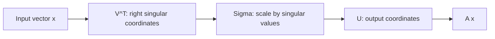

# Singular Value Decomposition

The singular value decomposition applies to every real matrix, square or rectangular. It separates a linear map into orthogonal input directions, nonnegative stretch factors, and orthogonal output directions. Rank, conditioning, least squares, compression, and low-dimensional structure can all be read from the same factorization.

## Rotate, stretch, rotate

For $A\in\mathbb{R}^{m\times n}$, a full SVD is

$$
A=U\Sigma V^T,
$$

where $U\in\mathbb{R}^{m\times m}$ and $V\in\mathbb{R}^{n\times n}$ are orthogonal. The diagonal-shaped $\Sigma\in\mathbb{R}^{m\times n}$ contains

$$
\sigma_1\geq\sigma_2\geq\cdots\geq0.
$$

These numbers are the singular values of $A$.



```text
A        =        U        Sigma        V^T

m x n           m x m       m x n       n x n
                         [s1  0  0]
                         [0  s2  0]
                         [0   0  0]
```

The columns $\mathbf{v}_i$ of $V$ are right singular vectors, and the columns $\mathbf{u}_i$ of $U$ are left singular vectors. They satisfy

$$
A\mathbf{v}_i=\sigma_i\mathbf{u}_i.
$$

Each orthonormal input direction is therefore sent to a corresponding orthonormal output direction and scaled by $\sigma_i$. A zero singular value marks a direction collapsed to zero; a small one marks a direction that is nearly lost.

The unit sphere gives the cleanest geometric reading. Write a unit input as

$$
\mathbf{x}=\sum_{i=1}^n c_i\mathbf{v}_i,
\qquad
\sum_i c_i^2=1.
$$

Then

$$
A\mathbf{x}=\sum_{i=1}^r \sigma_i c_i\mathbf{u}_i.
$$

The image is an ellipsoid in the column space of $A$, with principal semiaxes $\sigma_i\mathbf{u}_i$. When $r\lt n$, some input directions disappear and the sphere collapses to a lower-dimensional ellipsoid. Translation is absent: the origin stays fixed because the map is linear.

Three matrix shapes occur often:

| Form | Factor sizes | What is retained |
|---|---|---|
| Full SVD | $U:m\times m$, $\Sigma:m\times n$, $V:n\times n$ | complete orthonormal bases |
| Thin SVD, $m\ge n$ | $U:n$ columns, $\Sigma:n\times n$, $V:n\times n$ | all $n$ singular triplets, including possible zeros |
| Compact SVD | $U_r:m\times r$, $\Sigma_r:r\times r$, $V_r:n\times r$ | only the $r$ positive singular values |

Terminology varies between libraries, so dimensions are safer than names. In the compact factorization,

$$
U_r^TU_r=I_r,
\qquad
V_r^TV_r=I_r,
$$

but $U_rU_r^T$ and $V_rV_r^T$ are projections rather than identity matrices unless the corresponding factor is square.

| Factorization | Applies to | Central diagonal values | Orthogonal factors? |
|---|---|---|---|
| Eigendecomposition | some square matrices | eigenvalues | not always |
| Orthogonal diagonalization | real symmetric matrices | eigenvalues | yes |
| SVD | every real matrix | singular values | yes |

## Why every matrix has an SVD

The matrix $A^TA$ is symmetric and positive semidefinite. The spectral theorem gives it an orthonormal eigenbasis:

$$
A^TA\mathbf{v}_i=\sigma_i^2\mathbf{v}_i.
$$

For each positive singular value, define

$$
\mathbf{u}_i=\frac{A\mathbf{v}_i}{\sigma_i}.
$$

These vectors are orthonormal and can be completed to a basis of $\mathbb{R}^m$. This construction yields $A=U\Sigma V^T$ even when $A$ is rectangular or lacks an eigenbasis of its own.

The orthogonality of the constructed left singular vectors follows directly. For distinct eigenvectors $\mathbf{v}_i,\mathbf{v}_j$ with positive singular values,

$$
\mathbf{u}_i^T\mathbf{u}_j
=\frac{\mathbf{v}_i^TA^TA\mathbf{v}_j}{\sigma_i\sigma_j}
=\frac{\sigma_j^2\mathbf{v}_i^T\mathbf{v}_j}{\sigma_i\sigma_j}
=0.
$$

Their norms are one by the same calculation with $i=j$. Vectors associated with zero singular values cannot be defined by division; they are supplied by completing an orthonormal basis in the appropriate null space.

If $A$ has rank $r$, the reduced SVD keeps only positive singular values:

$$
A=U_r\Sigma_rV_r^T.
$$

It also yields the rank-one expansion

$$
A=
\sigma_1\mathbf{u}_1\mathbf{v}_1^T
+\cdots+
\sigma_r\mathbf{u}_r\mathbf{v}_r^T.
$$

## The four fundamental subspaces

The SVD supplies orthonormal bases for all four fundamental subspaces:

- right singular vectors with $\sigma_i\gt 0$ span the row space;
- right singular vectors with $\sigma_i=0$ span the null space;
- left singular vectors with $\sigma_i\gt 0$ span the column space;
- the remaining left singular vectors span the left null space.

The rank is the number of positive singular values. The identities

$$
A^TA=V\Sigma^T\Sigma V^T
$$

and

$$
AA^T=U\Sigma\Sigma^TU^T
$$

show that $A^TA$ and $AA^T$ have the same positive eigenvalues, namely $\sigma_i^2$. Their dimensions differ when $A$ is rectangular, and the larger matrix may have additional zero eigenvalues.

The corresponding orthogonal projectors can also be read from the compact SVD. The matrix $U_rU_r^T$ projects onto $\operatorname{Col}(A)$, while $V_rV_r^T$ projects onto $\operatorname{Row}(A)$. The complementary projectors $I-V_rV_r^T$ and $I-U_rU_r^T$ project onto $\operatorname{Null}(A)$ and $\operatorname{Null}(A^T)$, respectively. These formulas turn subspace questions into stable matrix operations when orthonormal bases are already available.

## Norms and sensitivity

The induced Euclidean matrix norm is

$$
\|A\|_2=\sigma_1.
$$

For an invertible square matrix,

$$
\kappa_2(A)=\frac{\sigma_1}{\sigma_n}.
$$

Inverting $A$ divides components by the singular values. Noise along a direction with small $\sigma_i$ is amplified by $1/\sigma_i$, so a small final singular value signals an ill-conditioned inverse problem.

QR is normally cheaper for ordinary full-rank least squares, and LU is normally cheaper for nonsingular square solves. SVD becomes especially valuable when rank, near-dependence, conditioning, compression, or minimum-norm solutions are central.

The norm formula follows from orthogonal invariance:

$$
\|A\mathbf{x}\|_2
=\|\Sigma V^T\mathbf{x}\|_2
\le \sigma_1\|V^T\mathbf{x}\|_2
=\sigma_1\|\mathbf{x}\|_2.
$$

Equality occurs for $\mathbf{x}=\mathbf{v}_1$. For an invertible square matrix, the smallest possible stretch is $\sigma_n$, so perturbations obey

$$
\sigma_n\|\delta\mathbf{x}\|_2
\le \|A\delta\mathbf{x}\|_2
\le \sigma_1\|\delta\mathbf{x}\|_2.
$$

The ratio $\sigma_1/\sigma_n$ measures the anisotropy of the map. A condition number near one means the map stretches all directions by nearly the same factor; a large ratio means some input directions are much harder to recover than others.

## A rectangular diagonal example

Let

$$
A=
\begin{bmatrix}
3&0\\
0&2\\
0&0
\end{bmatrix}.
$$

Then

$$
A^TA=
\begin{bmatrix}9&0\\0&4\end{bmatrix},
$$

so $\sigma_1=3$ and $\sigma_2=2$. The right singular vectors may be the standard basis vectors in $\mathbb{R}^2$. Using $\mathbf{u}_i=A\mathbf{v}_i/\sigma_i$ gives

$$
\mathbf{u}_1=\begin{bmatrix}1\\0\\0\end{bmatrix},
\qquad
\mathbf{u}_2=\begin{bmatrix}0\\1\\0\end{bmatrix}.
$$

Complete $U$ with $\mathbf{u}_3=\begin{bmatrix}0&0&1\end{bmatrix}^T$. Here $U=I_3$, $V=I_2$, and $\Sigma=A$.

## A non-diagonal $2\times2$ decomposition

Consider

$$
A=\begin{bmatrix}1&1\\0&0\end{bmatrix}.
$$

First compute

$$
A^TA=
\begin{bmatrix}1&1\\1&1\end{bmatrix}.
$$

Its characteristic polynomial is

$$
\det(A^TA-\lambda I)
=(1-\lambda)^2-1
=\lambda(\lambda-2).
$$

The eigenvalues are $2$ and $0$, so the singular values are $\sigma_1=\sqrt2$ and $\sigma_2=0$. Normalized eigenvectors may be chosen as

$$
\mathbf{v}_1=\frac1{\sqrt2}\begin{bmatrix}1\\1\end{bmatrix},
\qquad
\mathbf{v}_2=\frac1{\sqrt2}\begin{bmatrix}1\\-1\end{bmatrix}.
$$

For the positive singular value,

$$
\mathbf{u}_1
=\frac{A\mathbf{v}_1}{\sqrt2}
=\frac1{\sqrt2}
\begin{bmatrix}\sqrt2\\0\end{bmatrix}
=\begin{bmatrix}1\\0\end{bmatrix}.
$$

Complete the basis with $\mathbf{u}_2=(0,1)^T$. Thus

$$
U=\begin{bmatrix}1&0\\0&1\end{bmatrix},
\quad
\Sigma=\begin{bmatrix}\sqrt2&0\\0&0\end{bmatrix},
\quad
V^T=\frac1{\sqrt2}
\begin{bmatrix}1&1\\1&-1\end{bmatrix}.
$$

Multiplication checks the result:

$$
U\Sigma V^T
=
\begin{bmatrix}\sqrt2&0\\0&0\end{bmatrix}
\frac1{\sqrt2}\begin{bmatrix}1&1\\1&-1\end{bmatrix}
=\begin{bmatrix}1&1\\0&0\end{bmatrix}.
$$

The direction $(1,-1)^T$ lies in the null space, while $(1,1)^T$ is stretched by $\sqrt2$ and sent along the first coordinate axis.

## Truncating to low rank

For

$$
A_k=
\sigma_1\mathbf{u}_1\mathbf{v}_1^T
+\cdots+
\sigma_k\mathbf{u}_k\mathbf{v}_k^T,
$$

the Eckart--Young--Mirsky theorem says that $A_k$ is the closest rank-$k$ matrix to $A$ in both spectral and Frobenius norms. The errors are

$$
\|A-A_k\|_2=\sigma_{k+1}
$$

and

$$
\|A-A_k\|_F
=\sqrt{\sigma_{k+1}^2+\cdots+\sigma_r^2}.
$$

Suppose a rank-two matrix has singular values $10$ and $1$. Its best rank-one approximation is

$$
A_1=10\mathbf{u}_1\mathbf{v}_1^T,
$$

with spectral-norm error

$$
\|A-A_1\|_2=1.
$$

For a data matrix, the retained terms capture the strongest modes. In image compression, a grayscale image can be treated as a matrix and approximated by storing a limited number of singular values and singular-vector pairs.

A proof sketch for the spectral-norm statement explains why no alternative rank-$k$ matrix can do better. Any rank-$k$ matrix $B$ has a null space that must meet the $(k+1)$-dimensional span of $\mathbf{v}_1,\ldots,\mathbf{v}_{k+1}$ in a nonzero vector. Choose a unit vector $\mathbf{x}$ in that intersection. Then $B\mathbf{x}=0$, while

$$
\|A\mathbf{x}\|_2\ge \sigma_{k+1}.
$$

Consequently $\|(A-B)\mathbf{x}\|_2\ge\sigma_{k+1}$, so $\|A-B\|_2$ cannot fall below $\sigma_{k+1}$. The truncated SVD reaches that bound.

## Pseudoinverses and regularization

The Moore–Penrose pseudoinverse is

$$
A^+=V\Sigma^+U^T,
$$

where $\Sigma^+$ transposes the diagonal shape and reciprocates positive singular values. It gives least-squares solutions and, among multiple solutions, selects the one with minimum Euclidean norm.

Tiny singular values create unstable parameter directions: changing a parameter along such a direction barely changes the prediction, while inversion greatly magnifies noise. Truncated SVD suppresses selected small-singular-value components instead of dividing by them. The truncation threshold must reflect matrix scale, measurement noise, units, and the intended use.

### Least squares and the minimum-norm choice

Using the compact SVD, minimizing $\|A\mathbf{x}-\mathbf{b}\|_2$ requires matching every component of $\mathbf{b}$ in $\operatorname{Col}(A)$:

$$
\sigma_i\mathbf{v}_i^T\mathbf{x}
=\mathbf{u}_i^T\mathbf{b},
\qquad i=1,\ldots,r.
$$

One solution is

$$
\mathbf{x}^+
=\sum_{i=1}^r
\frac{\mathbf{u}_i^T\mathbf{b}}{\sigma_i}\mathbf{v}_i
=A^+\mathbf{b}.
$$

Any other least-squares solution differs from $\mathbf{x}^+$ by a null-space vector. Since $\mathbf{x}^+$ lies in the row space and the null space is orthogonal to it, the Pythagorean theorem gives

$$
\|\mathbf{x}^++\mathbf{z}\|_2^2
=\|\mathbf{x}^+\|_2^2+\|\mathbf{z}\|_2^2,
\qquad \mathbf{z}\in\operatorname{Null}(A).
$$

Hence the pseudoinverse selects the unique least-squares solution with minimum norm.

For the rank-one matrix from the preceding example and

$$
\mathbf{b}=\begin{bmatrix}3\\2\end{bmatrix},
$$

only the first component of $\mathbf{b}$ lies in the column space. The pseudoinverse solution is

$$
\mathbf{x}^+
=\frac{\mathbf{u}_1^T\mathbf{b}}{\sigma_1}\mathbf{v}_1
=\frac3{\sqrt2}\frac1{\sqrt2}
\begin{bmatrix}1\\1\end{bmatrix}
=\begin{bmatrix}3/2\\3/2\end{bmatrix}.
$$

It produces

$$
A\mathbf{x}^+=\begin{bmatrix}3\\0\end{bmatrix},
$$

leaving the unavoidable residual $(0,-2)^T$. Every vector satisfying $x_1+x_2=3$ has the same residual, but $(3/2,3/2)^T$ has the smallest Euclidean norm.

## Data matrices and principal components

Suppose the rows of a matrix are observations and the columns are measured variables. Before using the SVD for principal component analysis, subtract each column mean. If the centered data matrix is $X$, then the sample covariance matrix, up to the conventional divisor, is $X^TX$. The right singular vectors of $X$ are therefore covariance eigenvectors, and the squared singular values give the variance captured along those directions.

Centering is essential because PCA is meant to describe variation around the mean. Without centering, a large offset from the origin can dominate the first singular vector. Standardizing columns to unit variance is a separate choice. It prevents a variable measured on a large numerical scale from dominating, but it changes the question from covariance PCA to correlation PCA. Neither choice is universally correct; units and the scientific meaning of scale decide.

If $X=U\Sigma V^T$, the principal-component scores are

$$
XV=U\Sigma.
$$

The first score column gives each observation's coordinate along the first principal direction. Keeping the first $k$ columns of $V$ projects observations onto a $k$-dimensional subspace. Reconstructing with $X_k=U_k\Sigma_kV_k^T$ gives the best rank-$k$ approximation of the centered data matrix.

Explained-variance fractions use squared singular values:

$$
\frac{\sigma_i^2}{\sum_j\sigma_j^2}.
$$

Using $\sigma_i$ rather than $\sigma_i^2$ would confuse axis length with variance. A sharp drop in the spectrum may suggest a useful reduced dimension, but no universal cutoff distinguishes signal from noise. Sampling error, measurement noise, and the downstream task all affect the choice.

## Sensitivity and what singular vectors mean

Singular values vary continuously under small perturbations. In fact, each singular value changes by no more than the spectral norm of the perturbation. Singular vectors can be much less stable. If two singular values are equal, any orthonormal rotation within their shared singular subspace is valid. If they are merely close, a small perturbation may rotate the individual vectors considerably even though the subspace they span remains stable.

This matters when singular vectors are interpreted as physical modes or latent factors. A sign flip has no meaning, because flipping both members of a singular pair leaves the rank-one term unchanged. Rotations inside a repeated or nearly repeated block also carry little individual meaning. Comparisons across data sets should use subspace angles or projections when the relevant singular values are clustered.

Low-rank approximation preserves directions with the largest output energy, not necessarily the most important directions for a later prediction problem. A weak singular direction may contain a small but scientifically important signal. Conversely, a dominant singular direction may reflect nuisance variation. The SVD gives an optimal answer to a precise norm-based problem; deciding whether that problem matches the application remains separate.

## How numerical software obtains the factors

The proof through $A^TA$ is conceptually economical but numerically unattractive. Squaring the condition number loses relative information about small singular values. Standard dense algorithms instead use Householder transformations to reduce $A$ to bidiagonal form, preserving norms through orthogonal operations. A specialized iteration then diagonalizes the bidiagonal matrix and accumulates singular vectors when requested.

When only a few leading components of a large sparse matrix are needed, forming every entry of $U$ and $V$ wastes storage and work. Krylov or randomized methods use matrix-vector products with $A$ and $A^T$ to approximate the dominant singular subspaces. Their output should include residual checks such as $\|A\mathbf{v}_i-\sigma_i\mathbf{u}_i\|$, since an iteration count alone says little about accuracy.

Computing singular vectors can cost much more memory than computing singular values. Library options such as reduced matrices or values-only mode should match the later use. For a rank estimate, condition number, or spectral norm, full square factors are unnecessary.

## Computing an SVD with NumPy

```python
import numpy as np

A = np.array([[3, 0],
              [0, 2],
              [0, 0]], dtype=float)

U, s, Vt = np.linalg.svd(A, full_matrices=True)
Sigma = np.zeros_like(A, dtype=float)
Sigma[:len(s), :len(s)] = np.diag(s)

print(s)
print(np.allclose(A, U @ Sigma @ Vt))

A1 = s[0] * np.outer(U[:, 0], Vt[0, :])
print(A1)
print(np.linalg.norm(A - A1, 2))
```

The final norm equals the second singular value, as predicted by the best rank-one approximation theorem. A reduced SVD is usually preferable when the unused basis vectors in full $U$ and $V$ are not needed.

## Numerical rank and nonuniqueness

Exact rank counts nonzero singular values. Floating-point rank uses a tolerance because a computed value near $10^{-14}$ may represent rounding error relative to the scale of the matrix. A small singular value should not be discarded without considering that scale and the problem’s noise level.

An SVD is also not unique. Multiplying both $\mathbf{u}_i$ and $\mathbf{v}_i$ by $-1$ leaves $\mathbf{u}_i\mathbf{v}_i^T$ unchanged. Repeated singular values allow arbitrary orthogonal rotations within the repeated singular subspaces. Software output may therefore differ from a hand calculation while representing the same factorization.

Dimension checks prevent another common error: $U$ and $V$ generally have different sizes, and $A^TA$ and $AA^T$ do as well. Only their positive spectra match.

Forming $A^TA$ explicitly is also a poor numerical route to the SVD. Its condition number is the square of that of $A$, and rounding can erase small singular directions. Reliable implementations first reduce the matrix to bidiagonal form with orthogonal transformations and then diagonalize the bidiagonal matrix.

Scaling a matrix multiplies every singular value by the magnitude of the scale factor but leaves its condition number unchanged. Scaling individual rows or columns is different: it changes the geometry and may change the condition number substantially. Such equilibration can improve a numerical solve, but singular vectors from the scaled matrix describe scaled variables. Any interpretation must map them back to the original units.

For complex matrices, transposes become conjugate transposes and the orthogonal factors become unitary. Singular values remain real and nonnegative. The central ideas—orthonormal input directions, nonnegative stretches, and orthonormal output directions—survive without change.

The determinant gives one final square-matrix check. For an invertible matrix, the absolute determinant equals the product of the singular values. Geometrically, the determinant measures signed volume scaling, while singular values give the individual axis scalings; the sign or complex phase is carried by the orthogonal or unitary factors. A tiny determinant alone does not identify which direction is nearly collapsed, but the smallest singular vector does.

<div className="see-also">

See also: [Eigenvalues and Eigenvectors](/math/linear-algebra/eigenvalues-and-eigenvectors) · [Quadratic Forms and Spectral Theorems](/math/linear-algebra/quadratic-forms-and-spectral-theorems) · [Least Squares](/math/linear-algebra/least-squares) · [Numerical Linear Algebra](/math/linear-algebra/numerical-linear-algebra)

</div>
